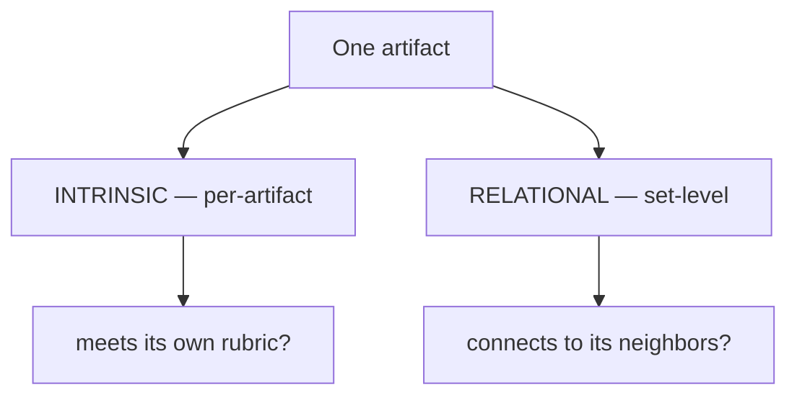
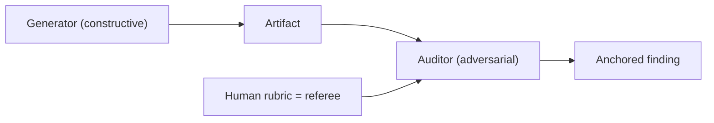

# The Eval Model

Cross-cutting reference for how the toolkit evaluates its own artifacts. Plans 1 and 2 implement it.
Written from the PM seat: the goal is an eval you can *trust and defend to a client*, not an LLM
issuing vibes about another LLM's output.

> **When evals run (read first):** evals are **manual** — skills (including the `specifier`
> pipeline) never grade their own output (`_shared/system-prompt.md` → *Evals are manual — never
> run automatically*). This file describes the *model* an eval applies **when a human invokes it**:
> standalone via the `eval-runner`, as a batch via `compliance-audit`, or as part of the `auto-spec`
> workflow (the only caller that grades as it runs). Read "runs the moment produced" and the
> "Gated (specifier)" column below in that light.

## The core problem it solves
The auditor is the same class of model that wrote the artifact, with no oracle. "Passed eval" would
mean nothing unless we constrain *what* it checks and *how* it must justify a finding. So the model
rests on one idea: **the human-authored rubric is the ground truth.** The LLM doesn't judge quality
freely; it checks an artifact against a fixed, versioned checklist and must cite evidence for every
call. That turns LLM-as-judge from open-ended opinion into a constrained, reproducible test.

## Five principles

### 1. Rubric is the oracle
Every artifact type has a **rubric** (Plan 1): a checklist of concrete items, each with *what good
looks like*, a *severity*, and *how to test it*. The rubric is authored by a human, version-
controlled, and improved over time. Eval quality = rubric quality, which we can inspect and defend.

### 2. Two planes, evaluated separately
- **Intrinsic (per-artifact):** does THIS artifact meet its own rubric? Runs progressively, the
  moment the artifact is produced (AD-1).
- **Relational (set-level):** does it connect correctly to its neighbors — traceability, coverage,
  no orphans/duplicates? Runs as a distinct gate (Plan 2), because these defects are invisible one-
  artifact-at-a-time.

Keeping them apart is deliberate: progressive eval alone gives false confidence about completeness.

The same artifact is checked on two planes — on its own, and against its neighbors:

*Intrinsic* catches bad shape, weak content, invented facts. *Relational* catches missing
links, duplicates, and uncovered requirements — defects invisible one-artifact-at-a-time.

### 3. Severity is defined by rule class, not by feeling
An auditor may not invent severity. Each rubric item is pre-labelled:

| Severity | Meaning | Example (objective test) |
|----------|---------|--------------------------|
| **Blocker** | Structural / traceability / invented-fact violation with a definite test | An FR with no BR link; a Must feature in no feature; a number with no citation and no `AI-RECOMMENDED` tag |
| **Major** | Required content missing or not fit-for-purpose | No in/out scope; AC that isn't testable; happy-path missing |
| **Minor** | Style / format drift | Heading order, naming, tone |

Because severity rides on the *check*, two runs grade the same defect the same way.

### 4. Every finding must be anchored
A finding is only valid if it cites **location + the rubric item it violates + a verbatim quote**.
Un-anchored findings are dropped. This is the throttle on hallucinated critique (false positives):
if the auditor can't point to it, it doesn't count.

### 5. Anti-circularity measures
- The auditor runs an **adversarial persona** ("find why this fails; default to fail if unsure"),
  distinct from the generator's constructive persona.
- **High-stakes layers (BRD, PRD, coverage gate)** use a small **panel of 2–3** with majority vote
  (reuse `compliance-audit`'s parallel design), so one bad draw doesn't decide.
- The rubric, being human-authored, is the escape from LLM-grading-LLM.

Why "passed eval" means something: a human-authored rubric is the referee, and a separate
adversarial auditor must anchor every finding.

An *anchored* finding cites location + the rubric item + a verbatim quote; un-anchored findings
are dropped. High-stakes layers (BRD, PRD, coverage) use a panel of 2–3 with majority vote.

## The gate decision
Each artifact eval yields a score and one of three outcomes:

| Outcome | Meaning | Autonomous (auto-spec) action | Manual grade action (eval-runner / compliance-audit) |
|---------|---------|----------------------------|--------------------------|
| **PASS** | No Blockers, ≤ threshold Majors | Continue | Continue |
| **PASS-WITH-FINDINGS** | No Blockers, findings recorded | Continue; findings → eval doc + decision log | Show findings at the gate |
| **FAIL** | ≥1 Blocker | Try to fix (≤3 loops). Still failing → **stop advancing anything that depends on it and hand to a human**; independent branches may finish, then the run ends with a *human fix needed* report | Stop at the gate for human fix |

> **Autonomous failure mode:** bounded remediation (≤3 loops), then **stop and require a human** — the
> run doesn't loop forever and doesn't silently ship a broken artifact. Independent branches still
> complete so the human gets as much usable output as possible alongside the blocking list.

## Remediation policy (bounded — user rule)
- **Generated artifact FAILs:** try to fix it up to **3 loops** (regenerate → re-eval). Still failing
  after the 3rd? **Stop and hand it to a human** — never loop forever, never silently ship it.
- **Provided (user) artifact:** **never rewritten.** See Plan 3 — an approved doc passes through;
  eval may only normalize format and raise findings/open-questions, never override the source.
- **Quality bar (KPI):** across a run, **≥95% of artifacts must PASS eval** within the loop budget.
  Below that, the pack is stamped *not ready — human fixes needed*.

## Where the outputs go
- Findings → `Output/_eval/<stage>-eval.md` (structured: severity · location · rubric-item · quote · fix).
- The decision to pass/quarantine, and why → the run **decision log** (`Output/00-run-log/`).
- These records are designed to be machine-diffable so `blast-radius` can consume them later.
