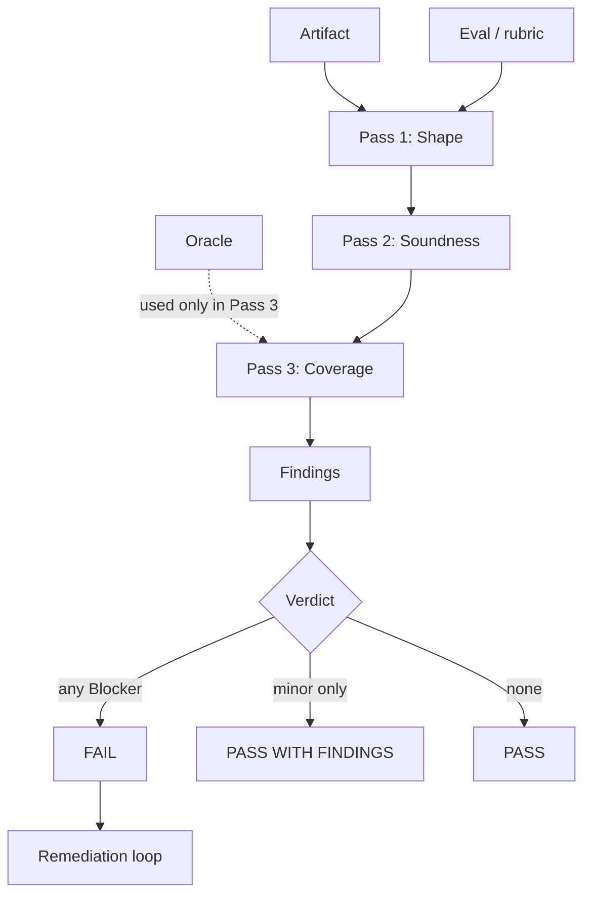
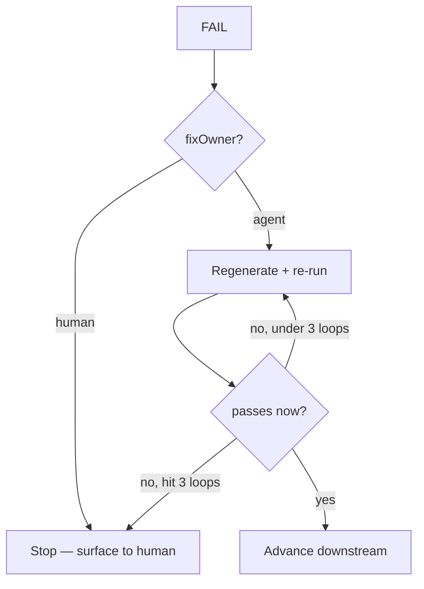

# Eval Runner — how any eval is executed (shared)

The single, generic executor **every** eval is run through — standalone, from a skill, or
from a workflow. Callers never re-implement grading: they load **this file + one eval
(rubric)** and follow it. That is what keeps evals callable without hardcoding — the eval is
*data*, the runner is *shared behaviour*. Authored by `artifact-eval`; consumed by
`compliance-audit` (fan-out), by the `auto-spec` workflow (which grades as it runs), and by
anyone running an eval by hand. Skills never invoke this runner automatically
(`_shared/system-prompt.md` → *Evals are manual — never run automatically*).

## The runner at a glance

Inputs on the left, the three passes in the middle, the verdict on the right:

## 1. Input contract

You are handed:

| Field | Meaning |
|-------|---------|
| `artifact` | the file/text to grade (path or content) |
| `eval` / `type` | which eval to load: `_shared/rubrics/<eval>.md` |
| `oracle` *(optional)* | the upstream slice the **coverage** checks compare against (named in the eval's `input.oracle`). It may live in the **same file** as the artifact (e.g. a story's body rules). |

### What the "oracle" is, and how it's used

The **oracle** is the upstream document the artifact was *derived from* — the answer key the
grader checks the artifact against. Every artifact in this pipeline is built from something
before it, and that something is its oracle:

| Artifact being graded | Its oracle (the answer key) |
|-----------------------|-----------------------------|
| An EPIC | the PRD slice it was built from |
| A story's acceptance criteria | that story's groomed body |
| A feature list | the PRD's functional requirements |

The oracle is used in **one place only: Pass 3 (Coverage)**. The other two passes judge the
artifact on its own; coverage is the only pass that needs something to compare against. It runs
two checks in opposite directions:

The oracle (say, a PRD) and the artifact (say, an EPIC) checked in both directions:

**Worked example.** The oracle (a PRD) lists `FR-01 ... FR-09`. The EPIC being graded covers
`FR-01 ... FR-08` and also adds a "dark mode" feature.
- *Missing* → `FR-09` has no counterpart in the EPIC. Coverage finding, anchored to `FR-09`.
- *Extra* → "dark mode" traces to no FR. Containment finding, anchored to the dark-mode text.

The oracle does **not** have to be a separate file — it can live **inside** the artifact (e.g.
a story whose own body states the rules its acceptance criteria must cover). If no oracle is
supplied, coverage checks are marked `not-evaluable`, **not** failed (see section 5).

Load `_shared/system-prompt.md` (global rules G.1–G.6), the eval file, and the artifact. If
the eval or artifact is missing, **stop and name what's missing** — do not improvise a rubric.

If the eval declares `panel: N` in its frontmatter (high-stakes types), grade it with **N
independent auditors and take the majority verdict per finding** — otherwise a single pass.
The `compliance-audit` workflow fans the panel out; a standalone/skill caller may run it inline.

## 2. Stance

Adversarial: *find why it fails.* On **soundness** and **coverage** checks, if unsure, **fail**.
**Shape** checks are binary — present or not — there is no "unsure" and the fail-if-unsure
heuristic does not apply to them.

## 3. Method — grade in the eval's three passes, cheapest first

1. **Shape** — is it well-formed? (intrinsic, binary)
2. **Soundness** — is each part individually a real, unambiguous unit? (intrinsic, judgment)
3. **Coverage** — does the *set* match its oracle: nothing missing, nothing extra? (needs the oracle)

Run **every** check. For each failure, emit one anchored finding.

## 4. Finding schema (every finding, no exceptions)

`{ severity, item, location, quote, fix, fixOwner }`

- **severity** `B|M|m` — copied from the eval item. The runner never invents severity.
- **item** — the eval check id (e.g. `A5`).
- **location** — section / line in the artifact.
- **quote** — **verbatim** anchor text. For most checks: the offending text. For a **coverage
  *absence*** (a required item with no counterpart — nothing to quote in the artifact): quote the
  **uncovered oracle item** instead, and set `location` to "no counterpart in <artifact section>".
  For a **containment** failure: quote the out-of-scope text in the artifact. **A finding with no
  quote of either kind → drop it.** (This is the throttle on hallucinated critique — an absence
  still has to point at the specific oracle item it's missing, never a vague "seems incomplete".)
- **fix** — a *concrete edit*, traced to the oracle. "Replace X with Y (per BR-07)", not "make it testable".
- **fixOwner** — `agent` if the fix is an edit the generator can apply **from existing sources**; `human` if closing it would require **inventing a fact no source provides** (G.1). A `human` finding **never enters the auto-remediation loop** — otherwise the loop fabricates to clear its own eval.

## 5. Graceful degradation (fan-out safe)

If a check's `oracle` was not supplied, mark those items **`not-evaluable`**, raise an open
question ("re-run with <oracle> to verify coverage"), and **do not fail-by-default**. Never
guess coverage. This keeps one missing input from blocking a parallel batch. The runner is
**sibling-blind**: it grades one artifact and may not depend on seeing the others — cross-item
checks belong to a set-level gate, not here.

## 6. Verdict (deterministic — compute from severities, don't eyeball)

- any `B` → **FAIL**
- else any finding → **PASS_WITH_FINDINGS**
- else → **PASS**

`not-evaluable` items do **not** count toward the gate.

## 7. Output

Write findings + verdict to `Output/_eval/<artifact-id>-eval.md` (columns: severity · item ·
location · quote · fix · owner), and return `{ id, type, status, findings }`.

## 8. On FAIL

`agent`-owned findings → hand back for a bounded remediation pass (**≤3 loops**: regenerate →
re-run this eval). Still failing after the 3rd, **or any `human`-owned finding present** → stop
advancing anything downstream and surface the human-owned list. Never ship a FAIL silently;
never fabricate to clear a finding.

> The owner split is the safety valve: a `human` finding never enters the loop, so the agent
> can't fabricate a fact just to clear its own eval.
