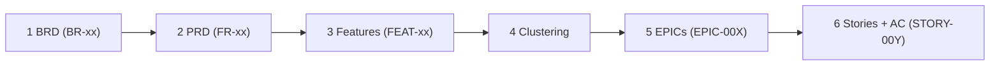
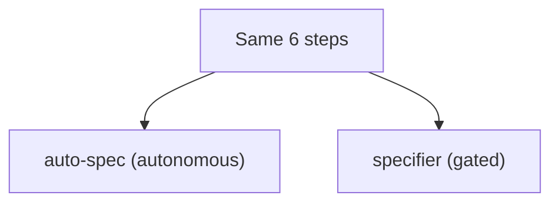

# Pipeline Contract

The single, human-readable source of truth for the spec pipeline's **shape**. Both drivers follow
these steps in order:
- **`auto-spec`** (autonomous) and **`specifier`** (gated) run the *same* steps — they differ only in
  gating, decision resolution, and fan-out, **never in what a step is**.

The atomic **skills** own each step's internal method (how to write a good BRD, etc.). This contract
owns the **wiring**: order, inputs, output location + naming, the IDs carried forward, the manifest
write, and any decision-point. (Manifest shape, provenance labels, and the ID scheme
`BR→FR→Feature→EPIC→Story-id→AC` live in `_shared/system-prompt.md`.)

> **Evals are not part of a step.** Skills never auto-grade (`_shared/system-prompt.md` → *Evals are
> manual — never run automatically*). The `rubric` column below just names *which* eval applies to a
> step's output **if a human chooses to grade it** — standalone via the `eval-runner`, or as a batch
> via `compliance-audit`. The `auto-spec` workflow is the sole caller that grades as it runs.

## Steps

| # | id | skill | input | output → path | defines / forward | rubric |
|---|----|-------|-------|---------------|-------------------|--------|
| 1 | brd | `write-brd` | idea / sources | `01-brd/<feature>-brd.md` | `BR-xx` | R-BRD |
| 2 | prd | `write-prd` | BRD | `02-prd/<feature>-prd.md` | `FR-xx` → BR | R-PRD |
| 3 | features | `define-features` | PRD | `03-features/<feature>-features.md` | `FEAT-xx` → FR | R-FEAT |
| 4 | clustering | `cluster-features` | features | `04-clustering/<feature>-clustering.md` | groups | R-CLUS |
| 5 | epics | `generate-epics` | clustering, PRD | `05-epics/EPIC-REGISTER.md` (**primary** — copied from the clustering; the gate) + `EPIC-<NNN>-<name-slug>.md` detail files **on demand** (+ sequencing, mapping); schemas per `standard-formats.md` → *EPIC Register / EPIC detail file / EPIC naming* | `EPIC-<NNN>` → FEAT | R-EPIC |
| 6 | stories | `draft-stories` → `groom-stories` → `write-acceptance-criteria` | EPIC Register rows (the story fan-out anchor; + detail file if present), PRD | `06-stories/<epic-stem>/` — an index `<epic-stem>-stories-draft.md` + one `<title-slug>.md` per story, each one evolving file (shell → grooming → AC, no 07/08), plus a batch nav index `06-stories/epics-list-draft.md`; schema per `standard-formats.md` → *Story folder, index & file* | story identity = **title**; traces via inline `Feature ID` + `Req ID` → EPIC/FEAT/FR | R-STORY-SHELL / -BODY / R-AC |

**After every step:** the step writes its file **and** updates that artifact's row in
`Output/manifest.json` (per the RUN MANIFEST convention).

The six steps in order — each defines the IDs the next one builds on (skills are in the table above):

## Decision-points (resolved differently by each driver)
- **Step 4 · clustering — CHOICE.** The pipeline must pick one clustering.
  - `auto-spec`: auto-selects the strongest option (records the choice + rationale).
  - `specifier`: presents 2–3 options; the human picks.

## Entry / no-skip / provided docs
Per AD-5 (tier1-plan-3): a run may **start at any stage**, but **no step is skipped**. A provided
doc is dropped to `Output/artifacts/`, evaluated, then **placed normalized** (approved docs pass
through unchanged) or, if an upstream artifact is missing, represented as a **`reconstructed-stub`**
(citation-tagged, never fabricated). Every placed artifact records its `provenance`.

## What the two drivers differ on (and ONLY this)
1. **Gating** — `specifier` stops for approval after each step; `auto-spec` does not.
2. **Decision resolution** — human-picks vs auto-select at decision-points.
3. **Fan-out + resume** — `auto-spec` parallelizes per-EPIC; both use the manifest to resume.

Everything else (what each step produces, where, named how, traced to what) is fixed here and in the
skills — so the two drivers cannot drift.

Both drivers run the same six steps — they differ only in gating and how choices are resolved:

