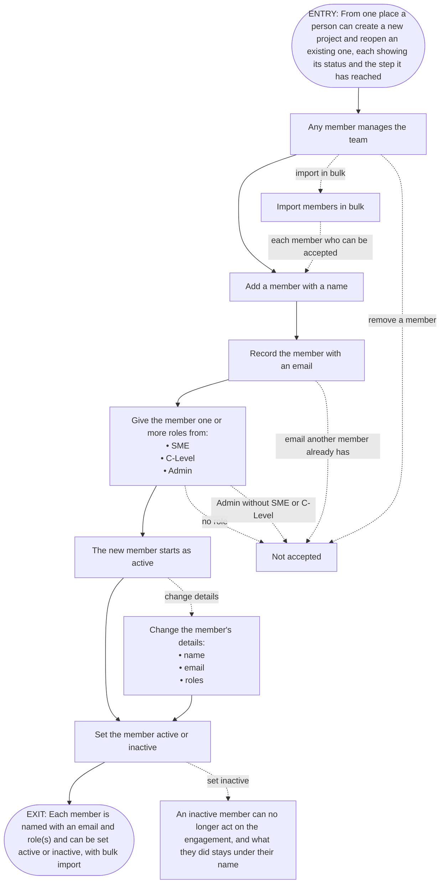

# FRD-3a Team & roles

> **Lineage**
> - **Previous step:** Feature catalog
> - **Primary source:** [modernization-control-plane-features-v3.md](../Output/03-features/modernization-control-plane-features-v3.md)
> - **Supporting sources:** [mcp-requirements-v4.md](../Output/mcp-requirements-v4.md)
> - **Next step:** These rules are proved by acceptance criteria written on the user stories -> [06-stories/](../Output/06-stories/)

- **Depends on:**
  - F-02 Project workspace
- **Last changed:** 2026-10-14, Decision 13
- **Excludes:**
  - F-16 Source attachment & health
  - F-17 Reversible connect/disconnect
  - F-18 Inspect & scope a source
  - F-19 Engagement-wide context
  - F-20 Start the read

**Requirements**
- **REQ-3.1 Name the team and their roles** — The people who work the engagement are named with an email and given one or more roles (SME, C-Level, Admin - Admin being the setup / access role, held alongside SME or C-Level), each active or inactive. Members can be imported in bulk.

## Features covered

| Feature ID | Feature | Description | Req. ID | Priority |
|---|---|---|---|---|
| F-15 | Team & roles | The people governing the engagement are named with an email and one or more roles | REQ-3.1 | Must |

## Gates

| | Condition | Tied to |
|---|---|---|
| **In** (true before start) | From one place a person can create a new project and reopen an existing one, each showing its status and the step it has reached | F-02 Project workspace (1. Onboarding) |
| **Out** (this unlocks) | Each member is named with an email and role(s) and can be set active or inactive, with bulk import | None. |
| **Undone if** | None. | None. |

## Actors

| Actor | What they do here |
|---|---|
| Any active member *Updated from the requirement on the basis of Decision 7: any member manages the team's members.* *Updated from the requirement on the basis of Decision 10: any member here means any member still on the team.* | • add a member with a name and an email • give a member one or more roles • change a member's details *Updated from the requirement on the basis of Decision 3: a member's details can be changed after they are added.* • set a member active or inactive • import members in bulk |

## Rules

Each rule is a **The system shall…** statement. The **Source** column says where it comes from:
- `F-nn.dwN` — a Done-when clause
- `req` — the requirement, beyond the Done-when
- `proposed` — a rule I'm suggesting, because the sources name the options but not which applies; waiting for your decision
- `decided` — added or kept because of your decision

Wherever this document differs from the requirements doc, a note says so: *Updated from the requirement on the basis of Decision n: what changed.*

### F-15 Team & roles

| Rule | The system shall… | Source |
|---|---|---|
| F-15.1 | record each member with a name | F-15.dw1 — Each member is named with an email and role(s) |
| F-15.2 | record each member with an email | F-15.dw1 — Each member is named with an email and role(s) |
| F-15.3 | let a member hold one or more roles | F-15.dw1 — Each member is named with an email and role(s) |
| F-15.4 | **not** let a member hold no role | F-15.dw1 — Each member is named with an email and role(s) *Updated from the requirement on the basis of Decision 3: the limit also holds when a member's roles are changed.* |
| F-15.5 | let a member be set active or inactive | F-15.dw2 — can be set active or inactive |
| F-15.6 | **only** let a member's status be active or inactive | F-15.dw2 — can be set active or inactive |
| F-15.7 | let members be imported in bulk | F-15.dw3 — with bulk import |
| F-15.8 | **only** let a member hold these roles: • SME • C-Level • Admin | req — from the requirement |
| F-15.9 | **not** let a member hold Admin without also holding SME or C-Level | req — from the requirement *Updated from the requirement on the basis of Decision 3: the limit also holds when a member's roles are changed.* |
| F-15.10 | start each new member as active | decided — see Decision 8 *Updated from the requirement on the basis of Decision 8: a new member starts as active.* |
| F-15.11 | let a member's name be changed after they are added | decided — see Decision 3 *Updated from the requirement on the basis of Decision 3: a member's details can be changed after they are added.* |
| F-15.12 | let a member's email be changed after they are added | decided — see Decision 3 *Updated from the requirement on the basis of Decision 3: a member's details can be changed after they are added.* |
| F-15.13 | let a member's roles be changed after they are added | decided — see Decision 3 *Updated from the requirement on the basis of Decision 3: a member's details can be changed after they are added.* |
| F-15.14 | **not** let a member be removed from the team | decided — see Decision 4 *Updated from the requirement on the basis of Decision 4: a member cannot be removed, and setting them inactive is the way off the team.* |
| F-15.15 | **not** let a member have an email that another member already has | decided — see Decision 5 *Updated from the requirement on the basis of Decision 5: no two members may share an email.* |
| F-15.16 | add every member of a bulk import who can be accepted, even when others in it are turned away | decided — see Decision 6 *Updated from the requirement on the basis of Decision 6: a bulk import adds the members who pass and turns away only the ones who do not.* |
| F-15.17 | let any member manage the team's members | decided — see Decision 7 *Updated from the requirement on the basis of Decision 7: any member manages the team's members.* |
| F-15.18 | **not** let an inactive member act on the engagement | decided — see Decision 9 *Updated from the requirement on the basis of Decision 9: an inactive member can no longer act on the engagement.* |
| F-15.19 | keep showing what an inactive member did under their name | decided — see Decision 9 *Updated from the requirement on the basis of Decision 9: what an inactive member did stays on the record under their name.* |

## Coverage — every Done-when clause has a rule

| Done-when | Clause | Proved by |
|---|---|---|
| F-15.dw1 | Each member is named with an email and role(s) | • F-15.1 • F-15.2 • F-15.3 • F-15.4 |
| F-15.dw2 | can be set active or inactive | F-15.5 and F-15.6 |
| F-15.dw3 | with bulk import | F-15.7 |

**From the requirement (not a Done-when):**
- F-15.8
- F-15.9

**From your decisions (not in the documents):**
- F-15.10
- F-15.11
- F-15.12
- F-15.13
- F-15.14
- F-15.15
- F-15.16
- F-15.17
- F-15.18
- F-15.19

## Flow

**Entry:** From one place a person can create a new project and reopen an existing one, each showing its status and the step it has reached *(Gate in)*.

1. Any member manages the team's members *(F-15.17)*
2. A member is added with a name *(F-15.1)*
3. The member is recorded with an email *(F-15.2)*
4. The member is given one or more roles *(F-15.3)*
5. Each role given is one of these: *(F-15.8)*
   - SME
   - C-Level
   - Admin
6. The new member starts as active *(F-15.10)*
7. The member is set active or inactive *(F-15.5)*
8. The member's status is always either active or inactive *(F-15.6)*
9. An inactive member can no longer act on the engagement *(F-15.18)*
10. What an inactive member did stays shown under their name *(F-15.19)*
- *Alternate:* members are imported in bulk instead of added one at a time *(F-15.7)*
  - every member of the import who can be accepted is added, even when others in it are turned away *(F-15.16)*
- *Alternate:* a member's name is changed after they are added *(F-15.11)*
- *Alternate:* a member's email is changed after they are added *(F-15.12)*
- *Alternate:* a member's roles are changed after they are added *(F-15.13)*
- *Alternate:* a member would have an email that another member already has, and this is not accepted *(F-15.15)*
- *Alternate:* a member would hold no role, and this is not accepted *(F-15.4)*
- *Alternate:* a member would hold Admin without SME or C-Level, and this is not accepted *(F-15.9)*
- *Alternate:* someone tries to remove a member, and this is not accepted *(F-15.14)*

**Exit:** Each member is named with an email and role(s) and can be set active or inactive, with bulk import *(Gate out)*.

## Data

| Thing | Holds |
|---|---|
| Member | • name • email, not shared with another member *Updated from the requirement on the basis of Decision 5: no two members may share an email.* • one or more roles, from: • SME • C-Level • Admin • status: active or inactive, starting as active *Updated from the requirement on the basis of Decision 8: a new member starts as active.* |

## Standard questions

| Thing | Question | Answered by |
|---|---|---|
| Member | Can it be changed after it is added? Which parts? | Decision 3 →  • F-15.11 • F-15.12 • F-15.13 |
| Member | Can it be removed? | Decision 4 → F-15.14 |
| Member | Can two be the same, and on what? | Decision 5 → F-15.15 |
| Member | When several are added at once, what happens if some fail? | Decision 6 → F-15.16 |
| Member | Who can do each of these? | Decision 7 → F-15.17 |
| Member | What is its starting status? | Decision 8 → F-15.10 |
| Member | What changes in each status? | Decision 9 → F-15.18 and F-15.19 |

## Open questions

1. **Changing a member's details** — Once a member is added, can their details be changed, and which ones? The documents say only that a member can be set active or inactive. TBD. *(F-15.5)* Decided — see Decision 3.
2. **Removing a member** — Can a member be removed from the team, or only set inactive? The documents never mention removing a member. TBD. *(F-15.5)* Decided — see Decision 4.
3. **Duplicate emails** — Can two members have the same email? The documents never mention it. TBD. *(F-15.2)* Decided — see Decision 5.
4. **Bulk import with failures** — When members are imported in bulk and some of them cannot be accepted, what happens to the rest? The documents never say. TBD. *(F-15.7)* Decided — see Decision 6.
5. **Who manages the team** — Who can do what this part allows to the team's members? The requirement names no one who does it. It describes Admin as the setup and access role, while the requirements doc also says there is no access control. TBD. *(F-15.3)* Decided — see Decision 7.
6. **Keep or drop F-15.10?** — The documents say each member is active or inactive, but not which a new member starts as. *(F-15.10)* Decided — see Decision 8.
7. **What being inactive changes** — What does setting a member inactive change for that member? The documents never say. TBD. *(F-15.5)* Decided — see Decision 9.

## Decision record

### Decision 1 — Should this part cover Team & roles on its own?
- **Asked at:** Step 1
- **Options offered:**
  - **Team & roles on its own** — Why: it is the only feature in "3. Setup" about people, and nothing else in the catalog depends on it. What happens next: this part keeps the catalog's name, Team & roles, and I ask you next how its "done" line is split into conditions.
  - **Add other features from "3. Setup"** — Why: if you want the people and the sources specified together as one part. What happens next: you tell me which features to add, I set this part up again, and you decide its name.
- **Recommended:** Team & roles on its own
- **Chosen:** Team & roles on its own
- **Decided by:** Product owner, 2026-10-13

### Decision 2 — Is this the right way to split "done" into conditions?
- **Asked at:** Step 1
- **Options offered:**
  - **Three conditions, as shown** — Why: each is one thing you could test on its own. What happens next: I draft the rules against these three.
  - **Join the last two** — Why: it avoids the short fragment "with bulk import". What happens next: one condition covers two different behaviours, so it is harder to see whether each one is covered.
- **Recommended:** Three conditions, as shown
- **Chosen:** Three conditions, as shown
- **Decided by:** Product owner, 2026-10-13

### Decision 3 — Once a member is added, can their details be changed?
- **Asked at:** Step 2
- **Options offered:**
  - **All of a member's details can be changed** — Why: a wrong email or a role that changes partway through the engagement can be fixed in place. What happens next: when I apply your decisions, I add one rule for each detail that can be changed.
  - **Only roles can be changed** — Why: a member's name and email identify them on the record, so they stay fixed, while what they do on the engagement can change. What happens next: I add a rule that a member's roles can be changed, and a rule that their name and email cannot.
  - **Nothing except active or inactive can be changed** — Why: the team is recorded exactly as it was entered; a mistake is fixed by setting the member inactive and adding them again. What happens next: I add a rule that a member's details cannot be changed after they are added.
- **Recommended:** All of a member's details can be changed
- **Chosen:** All of a member's details can be changed
- **Decided by:** Product owner, 2026-10-13

### Decision 4 — Can a member be removed from the team?
- **Asked at:** Step 2
- **Options offered:**
  - **A member cannot be removed; setting them inactive is the way off the team** — Why: everyone who worked the engagement stays on the record, which is the reason your requirement gives. What happens next: when I apply your decisions, I add a rule that a member cannot be removed from the team.
  - **A member can be removed** — Why: someone added by mistake can be taken off completely, not just set inactive. What happens next: I add a rule that a member can be removed from the team.
- **Recommended:** A member cannot be removed; setting them inactive is the way off the team
- **Chosen:** A member cannot be removed; setting them inactive is the way off the team
- **Decided by:** Product owner, 2026-10-13

### Decision 5 — Can two members have the same email?
- **Asked at:** Step 2
- **Options offered:**
  - **No two members may share an email** — Why: each email stands for one person, so who reviewed and decided can never be confused between two members. What happens next: when I apply your decisions, I add a rule that a member is not accepted if another member already has their email. That covers both adding a member and changing an email.
  - **Two members may share an email** — Why: a shared mailbox could stand for more than one person on the team. What happens next: I add a rule that two members may have the same email.
- **Recommended:** No two members may share an email
- **Chosen:** No two members may share an email
- **Decided by:** Product owner, 2026-10-13

### Decision 6 — When some members in a bulk import are turned away, what happens to the rest?
- **Asked at:** Step 2
- **Options offered:**
  - **Add the members who pass, and turn away only the ones who don't** — Why: one mistake in a long list does not hold back everyone else. What happens next: when I apply your decisions, I add a rule that an import adds every member who can be accepted, even when others in it are turned away.
  - **Add no one unless every member passes** — Why: the team is never left half-imported, so what is on the record always matches a whole import. What happens next: I add a rule that if any member in an import is turned away, no member from that import is added.
- **Recommended:** Add the members who pass, and turn away only the ones who don't
- **Chosen:** Add the members who pass, and turn away only the ones who don't
- **Decided by:** Product owner, 2026-10-13

### Decision 7 — Who can manage the team's members?
- **Asked at:** Step 2
- **Options offered:**
  - **Any member** — Why: it matches your requirements doc's statement that there is no access control, and no one waits on an Admin to change the team. What happens next: when I apply your decisions, I add a rule that any member can manage the team's members, and the Actors stay as "Any member".
  - **Only members who hold Admin** — Why: it matches the requirement calling Admin the setup and access role, so changes to who is on the team stay with the people set up to make them. What happens next: I add a rule that only a member who holds Admin can manage the team's members, and the Actors change to Admin. Who becomes the first Admin, before anyone holds the role, is not covered by your documents.
- **Recommended:** Only members who hold Admin
- **Chosen:** Any member
- **Decided by:** Product owner, 2026-10-13

### Decision 8 — Keep or drop the suggested rule "start each new member as active"?
- **Asked at:** Step 2
- **Options offered:**
  - **Keep it** — Why: a member is added in order to work the engagement, so being active from the start is what anyone adding them expects. What happens next: when I apply your decisions, the rule stays and is marked as coming from your decision.
  - **Drop it** — Why: if new members should not be treated as active until someone sets them so. What happens next: I delete the rule, and the documents stay silent on which status a new member starts as.
- **Recommended:** Keep it
- **Chosen:** Keep it
- **Decided by:** Product owner, 2026-10-13

### Decision 9 — What does setting a member inactive change for that member?
- **Asked at:** Step 2
- **Options offered:**
  - **An inactive member can no longer act on the engagement, but stays on the record** — Why: leaving the team means no longer taking part, while what they did stays shown under their name. What happens next: when I apply your decisions, I add a rule that an inactive member cannot act on the engagement, and a rule that what they did stays shown under their name.
  - **Inactive is a label only** — Why: it shows who is no longer on the team without blocking anything, in line with your documents' statement that there is no access control. What happens next: I add a rule that setting a member inactive only shows them as inactive and changes nothing they can do.
- **Recommended:** An inactive member can no longer act on the engagement, but stays on the record
- **Chosen:** An inactive member can no longer act on the engagement, but stays on the record
- **Decided by:** Product owner, 2026-10-13

### Decision 10 — "Any member can manage the team" and "an inactive member can no longer act" — keep both?
- **Asked at:** Step 3
- **Options offered:**
  - **Keep both** — Why: they fit if "any member" means any member still on the team, so someone who has left cannot change it. What happens next: both rules stay as written, and this tension is recorded with your decision.
  - **Revisit one of them** — Why: if an inactive member should still be able to manage the team, or if managing the team should be limited in some other way. What happens next: you tell me which decision to revisit, I ask it again, and your new answer is recorded as a new decision that replaces the old one.
- **Recommended:** Keep both
- **Chosen:** Keep both
- **Decided by:** Product owner, 2026-10-14

### Decision 11 — "A member's email can be changed" and "no two members may share an email" — keep both?
- **Asked at:** Step 3
- **Options offered:**
  - **Keep both** — Why: at any one moment no two members share an email, and what each member did is shown under their name, not their email. What happens next: both rules stay as written, and this tension is recorded with your decision.
  - **Revisit one of them** — Why: if an email, once used, should never pass to someone else, or if emails should not be changeable at all. What happens next: you tell me which decision to revisit, I ask it again, and your new answer is recorded as a new decision that replaces the old one.
- **Recommended:** Keep both
- **Chosen:** Keep both
- **Decided by:** Product owner, 2026-10-14

### Decision 12 — Accept these changes into the document?
- **Asked at:** Step 3
- **Options offered:**
  - **Accept** — Why: everything your decisions touch now matches them. What happens next: the rule numbers are fixed from now on; a new rule takes the next number.
  - **Change something first** — Why: if anything shown is wrong. What happens next: you tell me what, and I show you the review again.
- **Recommended:** Accept
- **Chosen:** Change something first
- **Decided by:** Product owner, 2026-10-14

### Decision 13 — Accept these changes into the document?
- **Asked at:** Step 3
- **Options offered:**
  - **Accept** — Why: everything your decisions touch now matches them. What happens next: the rule numbers are fixed from now on; a new rule takes the next number.
  - **Change something first** — Why: if anything shown is wrong. What happens next: you tell me what, and I show you the review again.
- **Recommended:** Accept
- **Chosen:** Accept
- **Decided by:** Product owner, 2026-10-14

## Check record

The most recent check of this document, written by the checking program and pasted as it is.

- **Program:** check-frd.cjs, full mode
- **Ran at:** 2026-10-14 13:41
- **Checked this file against:**
  - the feature catalog: modernization-control-plane-features-v3.md
  - the requirements doc: mcp-requirements-v4.md
- **Copied from your documents, and found to match them exactly:**
  - the requirement "Name the team and their roles", title and text — requirements doc, entry 3.1
  - the feature name "Team & roles" — feature catalog, row "Team & roles", column "Feature"
  - the description of "Team & roles" — feature catalog, row "Team & roles", column "Description"
  - the priority "Must" of "Team & roles" — feature catalog, row "Team & roles", column "Priority"
  - the 3 "done" conditions of "Team & roles", which read back as the catalog's sentence word for word — feature catalog, row "Team & roles", column "Done when"
  - Depends on: Project workspace — feature catalog, row "Team & roles", column "Depends on"
  - Excludes: the 5 other features of the catalog section "3. Setup"
  - Gates, In: the "Done when" of "Project workspace" — feature catalog, row "Project workspace", column "Done when"
  - Gates, Out: the "Done when" of "Team & roles" — feature catalog, row "Team & roles", column "Done when"
- **Result:** 37 of 37 structure checks passed:
  - Title and file name follow the numbering rule
  - Sections match the template, in order
  - Lineage comes first and names the given sources
  - Last changed names the latest decision
  - Every covered feature sits in the FRD's module
  - Features covered match the catalog
  - Requirements listed are exactly those of the features covered
  - Requirement titles and text are word for word
  - Depends on lists the outside features the catalog names
  - Excludes lists every sibling feature, then only requirement-linked neighbours
  - One Rules subsection per covered feature, named as in the catalog
  - Rule IDs are numbered from 1 with no gaps
  - Rules are numbered in source order until the changes are first accepted
  - Every rule cites exactly one allowed source
  - Every decided rule carries a note naming its own decision
  - Every clause in the split belongs to a covered feature, numbered from 1 with no gaps
  - The clause split reads back as the catalog sentence (nothing dropped or reworded)
  - Rules quote each clause exactly as the decided split lists it
  - Proved by matches the Rules table, and every clause has a rule
  - "From the requirement" lists exactly the req rules
  - "From your decisions" lists exactly the suggested and decided rules
  - Each pending suggested rule has an open Keep-or-drop question; answered ones point to their decision
  - Once the changes are accepted, nothing is left undecided
  - No banned "how" words in rules
  - Gates are tied to the features the catalog's Depends on gives
  - Gate conditions copied from the catalog match it word for word
  - Entry and Exit repeat the Gates conditions word for word
  - Each flow step cites exactly one existing rule
  - Every rule appears in the flow at least once
  - Every thing in Data has every standard question, each answered in an allowed way
  - Each decision records its question, every option offered, the choice, who and when
  - Every reference to a decision points to an entry that exists
  - The Check record section holds the checker's record, or None yet.
  - No status line — the document is a living one
  - No template markers or writer notes are left in the document
  - Only the allowed ID prefixes appear
  - No middle dots anywhere and no slash-joined items
- **Not checked by the program — read by the person:**
  - lists of three or more items joined with commas
  - the written Gates sentences are plain, and written for no one role in particular
  - each rule states one behaviour, and states behaviour, not mechanism
  - each rule is a faithful reading of the source it cites
  - each suggested rule picks between options the sources name; any other gap is an open question
  - the Actors and the flow agree with the final rules
  - every "Does not apply" in Standard questions is backed by a document that rules the topic out
  - tensions between decisions were raised before the changes were accepted
