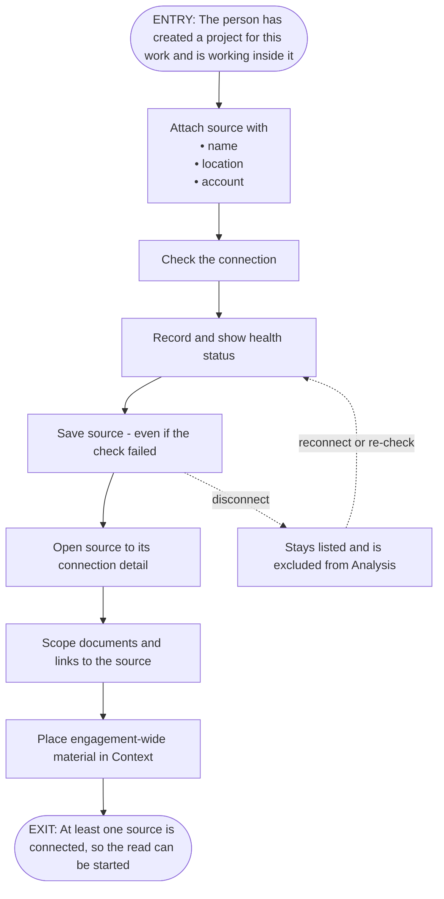

# FRD-3b Source management

> **Lineage**
> - **Previous step:** Feature catalog
> - **Primary source:** [modernization-control-plane-features-v3.md](../Output/03-features/modernization-control-plane-features-v3.md)
> - **Supporting sources:** [mcp-requirements-v4.md](../Output/mcp-requirements-v4.md)
> - **Next step:** These rules are proved by acceptance criteria written on the user stories -> [06-stories/](../Output/06-stories/)

- **Depends on:**
  - F-02 Project workspace
- **Status:** Draft
- **Excludes:**
  - F-15 Team & roles
  - F-20 Start the read
  - Analysis module, linked by REQ-3.3

**Requirements**
- **REQ-3.2 Attach the sources** — The source code is attached as one or more repositories, each with a name, its location, and the account it is reached through; adding one checks the connection but can be saved without a successful check. Each carries a health status (reachable, unreachable, auth needed, not tested).
- **REQ-3.3 Connect and disconnect, reversibly** — A source can be disconnected and reconnected; a disconnected source remains listed and is excluded from Analysis until reconnected. Connections can be re-checked.
- **REQ-3.4 Inspect and scope a source** — A source can be opened to its connection detail and its scoped documents - documents and reference links (for example Confluence, Figma) attached to that one source.
- **REQ-3.5 Engagement-wide context** — Reference material that applies to the whole engagement is placed in Context, grouped by type (documents, and reference links such as Confluence or Figma), each with an optional note. A document scoped to one source is placed with that source instead.

## Features covered

| Feature ID | Feature | Description | Req. ID | Priority |
|---|---|---|---|---|
| F-16 | Source attachment & health | The source code is attached as repositories, each carrying a health status | REQ-3.2 | Must |
| F-17 | Reversible connect/disconnect | A source can be disconnected and reconnected without leaving the effort | REQ-3.3 | Should |
| F-18 | Inspect & scope a source | A single source opens to its connection detail and the documents scoped to it | REQ-3.4 | Should |
| F-19 | Engagement-wide context | Reference material for the whole engagement is placed in Context, grouped by type | REQ-3.5 | Must |

## Gates

| | Condition | Tied to |
|---|---|---|
| **In** (true before start) | The person has created a project for this work and is working inside it | F-02 Project workspace (Onboarding) |
| **Out** (this unlocks) | At least one source is connected, so the read can be started | F-20 Start the read |
| **Undone if** | Every source has been disconnected | F-17 Reversible connect/disconnect |

## Actors

| Actor | What they do here |
|---|---|
| Admin (setup role) | • attach sources • scope documents • disconnect and reconnect • place context |
| SME | inspect a source and its scoped material |

## Rules

Each rule is a **The system shall…** statement, with the **Done when** clause it satisfies:
- `F-nn.dwN` — a Done-when clause
- `req` — the requirement, beyond the Done-when
- `proposed` — not in any source; kept or dropped at the review

### F-16 Source attachment & health

| Rule | The system shall… | Done when |
|---|---|---|
| F-16.1 | let a source be added with: • its name • its location • the account it is reached through | F-16.dw1 — Sources add with a name, location, and account |
| F-16.2 | record and show a health status for each source | F-16.dw2 — each showing a health status |
| F-16.3 | save the source even when its connection check has not passed | F-16.dw3 — save even if the check has not passed |
| F-16.4 | check the connection when a source is added | req — from the requirement |
| F-16.5 | accept only these health values: • reachable • unreachable • auth needed • not tested | req — from the requirement |

### F-17 Reversible connect/disconnect

| Rule | The system shall… | Done when |
|---|---|---|
| F-17.1 | keep a disconnected source listed | F-17.dw1 — A disconnected source stays listed |
| F-17.2 | **not** include a disconnected source in Analysis until it is reconnected | F-17.dw2 — excluded from Analysis until reconnected |
| F-17.3 | let a source's connection be re-checked | F-17.dw3 — connections can be re-checked |
| F-17.4 | let a source be disconnected and reconnected | req — from the requirement |

### F-18 Inspect & scope a source

| Rule | The system shall… | Done when |
|---|---|---|
| F-18.1 | let a source be opened to its connection detail | F-18.dw1 — A source opens to its connection detail |
| F-18.2 | let documents and reference links be scoped to a single source | F-18.dw2 — its scoped documents and links |

### F-19 Engagement-wide context

| Rule | The system shall… | Done when |
|---|---|---|
| F-19.1 | place engagement-wide reference material in Context, grouped by type | F-19.dw1 — Engagement-wide sources sit in Context grouped by type |
| F-19.2 | place a document scoped to one source with that source, not in Context | F-19.dw2 — source-specific documents scope to their source |
| F-19.3 | allow an optional note on each context item | req — from the requirement |

## Coverage — every Done-when clause has a rule

| Done-when | Clause | Proved by |
|---|---|---|
| F-16.dw1 | Sources add with a name, location, and account | F-16.1 |
| F-16.dw2 | each showing a health status | F-16.2 |
| F-16.dw3 | save even if the check has not passed | F-16.3 |
| F-17.dw1 | A disconnected source stays listed | F-17.1 |
| F-17.dw2 | excluded from Analysis until reconnected | F-17.2 |
| F-17.dw3 | connections can be re-checked | F-17.3 |
| F-18.dw1 | A source opens to its connection detail | F-18.1 |
| F-18.dw2 | its scoped documents and links | F-18.2 |
| F-19.dw1 | Engagement-wide sources sit in Context grouped by type | F-19.1 |
| F-19.dw2 | source-specific documents scope to their source | F-19.2 |

**From the requirement (not a Done-when):**
- F-16.4
- F-16.5
- F-17.4
- F-19.3

**Proposed (not from any source):** None.

## Flow

**Entry:** The person has created a project for this work and is working inside it *(Gate in)*.

1. The person attaches a source with: *(F-16.1)*
   - its name
   - its location
   - its account
2. The system checks the connection. *(F-16.4)*
3. The system records and shows the source's health status. *(F-16.2)*
4. The system saves the source even if the check did not pass. *(F-16.3)*
5. The person opens the source to its connection detail. *(F-18.1)*
6. The person scopes documents and reference links to that source. *(F-18.2)*
7. The person places engagement-wide material in Context, grouped by type. *(F-19.1)*
- *Alternate:* the person disconnects a source. *(F-17.4)*
  - The source stays listed. *(F-17.1)*
  - The source is excluded from Analysis until it is reconnected. *(F-17.2)*
- *Alternate:* the person re-checks a connection. *(F-17.3)*

**Exit:** At least one source is connected, so the read can be started *(Gate out)*.

## Data

| Thing | Holds |
|---|---|
| Source | • name • location • account • health status (values in F-16.5) • connection state: connected or disconnected |
| Context item | • type: document or reference link • optional note • scope (engagement-wide *or* one source) |

## Open questions

1. **Health-status set** — REQ-3.2 names four values; the Done-when does not. Confirm the set is complete. *(F-16.5)*
2. **F-18 vs F-19** — both handle "documents and links"; F-18 scopes to *one source*, F-19 places *engagement-wide*. Confirm nothing falls between them.
3. **Mixed priority** — F-16 and F-19 are Must; F-17 and F-18 are Should. Confirm the capability can ship Musts first.

## Decision record

None yet.
