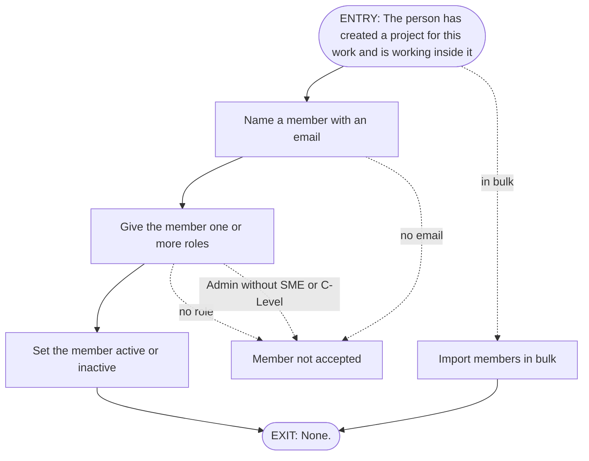

# FRD-3a Team & roles

> **Lineage**
> - **Previous step:** Feature catalog
> - **Primary source:** [modernization-control-plane-features-v3.md](../Output/03-features/modernization-control-plane-features-v3.md)
> - **Supporting sources:** [mcp-requirements-v4.md](../Output/mcp-requirements-v4.md)
> - **Next step:** These rules are proved by acceptance criteria written on the user stories -> [06-stories/](../Output/06-stories/)

- **Depends on:**
  - F-02 Project workspace
- **Status:** Approved
- **Excludes:**
  - F-16 Source attachment & health
  - F-17 Reversible connect/disconnect
  - F-18 Inspect & scope a source
  - F-19 Engagement-wide context
  - F-20 Start the read

**Requirements**
- **REQ-3.1 Name the team and their roles** — The people who work the engagement are named with an email and given one or more roles (SME, C-Level, Admin - Admin being the setup / access role, held alongside SME or C-Level), each active or inactive. Members can be imported in bulk.

## Features covered

| Feature ID | Feature | Description | Req. ID | Priority |
|---|---|---|---|---|
| F-15 | Team & roles | The people governing the engagement are named with an email and one or more roles | REQ-3.1 | Must |

## Gates

| | Condition | Tied to |
|---|---|---|
| **In** (true before start) | The person has created a project for this work and is working inside it | F-02 Project workspace (Onboarding) |
| **Out** (this unlocks) | None. | None. |
| **Undone if** | None. | None. |

## Actors

| Actor | What they do here |
|---|---|
| Admin (setup role) | • name each member with an email and one or more roles • set members active or inactive • import members in bulk |

## Rules

Each rule is a **The system shall…** statement, with the **Done when** clause it satisfies:
- `F-nn.dwN` — a Done-when clause
- `req` — the requirement, beyond the Done-when
- `proposed` — not in any source; kept or dropped at the review

### F-15 Team & roles

| Rule | The system shall… | Done when |
|---|---|---|
| F-15.1 | let a member be added with a name and an email | F-15.dw1 — Each member is named with an email and role(s) |
| F-15.2 | **not** accept a member without an email | F-15.dw1 — Each member is named with an email and role(s) |
| F-15.3 | let a member hold one or more roles | F-15.dw1 — Each member is named with an email and role(s) |
| F-15.4 | **not** accept a member who holds no role | F-15.dw1 — Each member is named with an email and role(s) |
| F-15.5 | let a member be set active or inactive | F-15.dw2 — can be set active or inactive |
| F-15.6 | accept **only** active or inactive as a member's status | F-15.dw2 — can be set active or inactive |
| F-15.7 | let members be imported in bulk | F-15.dw3 — with bulk import |
| F-15.8 | accept **only** these roles: • SME • C-Level • Admin | req — from the requirement |
| F-15.9 | **not** accept a member who holds Admin without also holding SME or C-Level | req — from the requirement |
| F-15.10 | start each new member as active | proposed, kept — Why: the sources say a member is active or inactive, but not which one a new member starts in; active, because members are named as the people who work the engagement; see Decision 8 |
| F-15.11 | **not** accept a member whose email another member already has | proposed, kept — Why: the sources never mention two members with the same email; each email then belongs to exactly one person, so the record of who reviewed and decided can't mix two people up; see Decision 4 |
| F-15.12 | keep an inactive member listed, with their past actions under their name | proposed, kept — Why: the sources do not say what being inactive changes; someone who has left the engagement keeps their past reviews and decisions under their name; see Decision 5 |
| F-15.13 | **not** let an inactive member act in this project until they are set active again | proposed, kept — Why: the sources do not say what being inactive changes; someone who has left the engagement stops adding to the record; see Decision 5 |
| F-15.14 | take in every member of a bulk import who meets these rules, even when others in it are not accepted | proposed, kept — Why: the sources do not say what happens to the rest of a bulk import when one member is not accepted; one mistake doesn't hold up the whole team; see Decision 6 |
| F-15.15 | show which members of a bulk import were not accepted | proposed, kept — Why: the sources do not say what happens to the rest of a bulk import when one member is not accepted; the person sees exactly which entries to fix; see Decision 6 |
| F-15.16 | **not** let holding Admin change what a member can see here | proposed, kept — Why: the sources do not say whether anything is only for an Admin; the requirements doc says there is no access control; see Decision 7 |
| F-15.17 | **not** let holding Admin change what a member can do here | proposed, kept — Why: the sources do not say whether anything is only for an Admin; the requirements doc says there is no access control; see Decision 7 |

## Coverage — every Done-when clause has a rule

| Done-when | Clause | Proved by |
|---|---|---|
| F-15.dw1 | Each member is named with an email and role(s) | • F-15.1 • F-15.2 • F-15.3 • F-15.4 |
| F-15.dw2 | can be set active or inactive | F-15.5 and F-15.6 |
| F-15.dw3 | with bulk import | F-15.7 |

**From the requirement (not a Done-when):**
- F-15.8
- F-15.9

**Proposed (not from any source):**
- F-15.10
- F-15.11
- F-15.12
- F-15.13
- F-15.14
- F-15.15
- F-15.16
- F-15.17

## Flow

**Entry:** The person has created a project for this work and is working inside it *(Gate in)*.

1. The person names a member with an email. *(F-15.1)*
2. The person gives the member one or more roles. *(F-15.3)*
3. The person sets the member active or inactive. *(F-15.5)*
- *Alternate:* the person imports members in bulk. *(F-15.7)*
- *Alternate:* the system does not accept a member without an email. *(F-15.2)*
- *Alternate:* the system does not accept a member who holds no role. *(F-15.4)*
- *Alternate:* the system does not accept a member who holds Admin without SME or C-Level. *(F-15.9)*

**Exit:** None. *(Gate out)*.

## Data

| Thing | Holds |
|---|---|
| Member | • name • email • one or more roles (values in F-15.8) • status: active or inactive |

## Open questions

1. **Name and email** — the catalog says each member is "named with an email". That may mean the email is how the member is named, or that the member has a name and an email. Which is it? TBD. *(F-15.1)* Decided — see Decision 3.
2. **Duplicate emails** — the sources never mention two members with the same email. Is that allowed? TBD. *(F-15.1)* Decided — see Decision 4.
3. **What inactive means** — the sources say a member can be set inactive, but not what changes for a member once they are inactive. TBD. *(F-15.5)* Decided — see Decision 5.
4. **Bulk import with a member not accepted** — the sources say members can be imported in bulk, but not what happens to the rest of an import when one member in it is not accepted. TBD. *(F-15.7)* Decided — see Decision 6.
5. **What Admin allows** — the requirement calls Admin the role for setup and access, while the requirements doc's Personas section says there is no access control. Is there anything only an Admin can do? TBD. *(F-15.9)* Decided — see Decision 7.
6. **Keep or drop F-15.10?** — the sources say a member is active or inactive, but not which one a new member starts in. *(F-15.10)* Decided — see Decision 8.
7. **Keep or drop F-15.11?** — the sources never mention two members with the same email; this rule comes from the answer to Duplicate emails. *(F-15.11)* Decided — see Decision 4.
8. **Keep or drop F-15.12?** — the sources do not say what being inactive changes; this rule comes from the answer to What inactive means. *(F-15.12)* Decided — see Decision 5.
9. **Keep or drop F-15.13?** — the sources do not say what being inactive changes; this rule comes from the answer to What inactive means. *(F-15.13)* Decided — see Decision 5.
10. **Keep or drop F-15.14?** — the sources do not say what happens to the rest of a bulk import when one member is not accepted; this rule comes from the answer to Bulk import with a member not accepted. *(F-15.14)* Decided — see Decision 6.
11. **Keep or drop F-15.15?** — the sources do not say what happens to the rest of a bulk import when one member is not accepted; this rule comes from the answer to Bulk import with a member not accepted. *(F-15.15)* Decided — see Decision 6.
12. **Keep or drop F-15.16?** — the sources do not say whether anything is only for an Admin; this rule comes from the answer to What Admin allows. *(F-15.16)* Decided — see Decision 7.
13. **Keep or drop F-15.17?** — the sources do not say whether anything is only for an Admin; this rule comes from the answer to What Admin allows. *(F-15.17)* Decided — see Decision 7.

## Decision record

### Decision 1 — Should this document cover Team & roles on its own?
- **Asked at:** Step 1
- **Options offered:**
  - **Team & roles on its own** — Why: it is the only feature in the section about the people, so the document covers one thing and keeps the catalog's name, "Team & roles". What happens next: I ask you how its "done" line is split into conditions.
  - **Add other features from "3. Setup"** — Why: you see the team and the sources as one piece of work. What happens next: you tell me which features to add, I propose a new name for you to approve, and their "done" conditions are added for your review.
- **Recommended:** Team & roles on its own
- **Chosen:** Team & roles on its own
- **Decided by:** Product owner, 2026-10-13

### Decision 2 — Is this the right way to split "done" into conditions?
- **Asked at:** Step 1
- **Options offered:**
  - **Three conditions, as shown** — Why: each is one thing you could test on its own, and each reads as a whole condition. What happens next: I draft the rules against these three.
  - **Split the first one in two** — Why: having an email and having role(s) could then be checked separately. What happens next: four conditions, but one of them reads only "role(s)", which is hard to understand on its own.
  - **Join the last two** — Why: it avoids the short fragment "with bulk import". What happens next: one condition covers two different behaviours, so it's harder to see whether each is covered.
- **Recommended:** Three conditions, as shown
- **Chosen:** Three conditions, as shown
- **Decided by:** Product owner, 2026-10-13

### Decision 3 — Does each member have a name as well as an email?
- **Asked at:** Step 2
- **Options offered:**
  - **A name and an email** — Why: the requirement's own reason is that who reviewed and decided is part of the record, and a name makes that record easy to read. What happens next: the first rule changes to say each member has a name and an email, and a name is added to what is kept for each member.
  - **The email is the name** — Why: it is the closest reading of the words, and nothing in your documents mentions a separate name. What happens next: the rule stays as written, and each member is known by their email.
- **Recommended:** A name and an email
- **Chosen:** A name and an email
- **Decided by:** Product owner, 2026-10-13

### Decision 4 — Can two members have the same email?
- **Asked at:** Step 2
- **Options offered:**
  - **Not allowed** — Why: each email then belongs to exactly one person, so the record of who reviewed and decided can't mix two people up. What happens next: a rule is added that the system does not accept a member whose email another member already has.
  - **Allowed** — Why: some teams use one shared mailbox for several people. What happens next: no rule is added, and two members can share an email, told apart by their names.
- **Recommended:** Not allowed
- **Chosen:** Not allowed
- **Decided by:** Product owner, 2026-10-13

### Decision 5 — What changes for a member once they are set inactive?
- **Asked at:** Step 2
- **Options offered:**
  - **Stays listed, but can no longer act here** — Why: someone who has left the engagement stops adding to the record, while their past reviews and decisions stay under their name. What happens next: two rules are added. An inactive member stays listed with their past actions. An inactive member cannot act in this project until set active again.
  - **A label only** — Why: your documents say there is no access control, and this keeps it that way; the label just shows who is working the engagement now. What happens next: a rule is added that being inactive changes nothing a member can see or do.
- **Recommended:** Stays listed, but can no longer act here
- **Chosen:** Stays listed, but can no longer act here
- **Decided by:** Product owner, 2026-10-13

### Decision 6 — When members are imported in bulk and one of them is not accepted, what happens to the rest?
- **Asked at:** Step 2
- **Options offered:**
  - **Import the rest, and show the ones not accepted** — Why: one mistake doesn't hold up the whole team, and you see exactly which entries to fix. What happens next: a rule is added that a bulk import takes in every member who meets the rules, and shows which members were not accepted.
  - **Import no one until every entry is fixed** — Why: the team is never half-imported, so there is no doubt about who made it in. What happens next: a rule is added that a bulk import with any member not accepted adds no one, and shows which members were not accepted.
- **Recommended:** Import the rest, and show the ones not accepted
- **Chosen:** Import the rest, and show the ones not accepted
- **Decided by:** Product owner, 2026-10-13

### Decision 7 — Is there anything only an Admin can do in Team & roles?
- **Asked at:** Step 2
- **Options offered:**
  - **Only an Admin manages the team** — Why: the requirement names Admin as the setup role, and naming the team is part of setup, so the record of who governs the work stays in a few hands. What happens next: a rule is added that only an Admin can manage team members. Everyone still sees everything.
  - **Nothing is Admin-only** — Why: it matches your documents' statement that there is no access control, and Admin just marks who sets the project up. What happens next: a rule is added that holding Admin changes nothing a member can see or do here.
- **Recommended:** Only an Admin manages the team
- **Chosen:** Nothing is Admin-only
- **Decided by:** Product owner, 2026-10-13

### Decision 8 — Keep or drop the rule I'm suggesting: "start each new member as active"?
- **Asked at:** Step 2
- **Options offered:**
  - **Keep it** — Why: members are named as the people who work the engagement, so a new member is working it from the start. What happens next: the rule stays, marked as your decision rather than something your documents say.
  - **Drop it** — Why: you don't want the document to fix a starting status your documents don't state. What happens next: the rule is removed, and the document says nothing about how a new member starts.
- **Recommended:** Keep it
- **Chosen:** Keep it
- **Decided by:** Product owner, 2026-10-13
