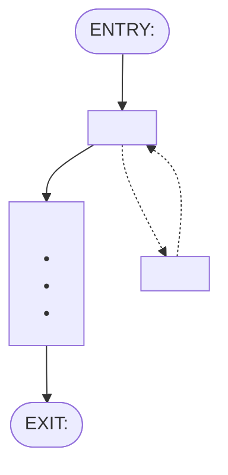

<!-- Step 1 -->
# FRD-<module><capability letter> <Capability name>

> **Lineage**
> - **Previous step:** Feature catalog
> - **Primary source:** [<feature-catalog>.md](<relative/path>)
> - **Supporting sources:** [<requirements>.md](<relative/path>)
> - **Next step:** These rules are proved by acceptance criteria written on the user stories -> [06-stories/](<relative/path>)

- **Depends on:**
  - <F-xx feature this capability needs, named>
- **Last changed:** <YYYY-MM-DD of the latest decision>, Decision <its number>
- **Excludes:**
  - F-xx <catalog name> <every other feature in this module, in ID order>
  - F-xx <catalog name>, linked by REQ-x.y <a feature this FRD's own requirement text names>
  - <Module name> module, linked by REQ-x.y <a module this FRD's own requirement text names>

**Requirements**
- **REQ-x.y <title>** — <the requirement's full text, verbatim from the requirements doc>
- **REQ-x.z <title>** — <verbatim>

## Features covered

| Feature ID | Feature | Description | Req. ID | Priority |
|---|---|---|---|---|
| F-xx | <feature name> | <catalog description, verbatim> | REQ-x.y | <priority, from the catalog> |

<!-- Step 2 -->
## Gates

| | Condition | Tied to |
|---|---|---|
| **In** (true before start) | <the "Done when" line of the Depends-on feature, word for word> | <F-xx catalog name (its module)> |
| **Out** (this unlocks) | <a plain sentence; this capability's own "Done when" line, word for word, when Tied to is None.> | <F-xx catalog name of each feature whose Depends on names a covered feature, or None.> |
| **Undone if** | <a plain sentence, or None.> | <F-xx catalog name of the covered feature that undoes Out, or None.> |

## Actors

| Actor | What they do here |
|---|---|
| <a role this FRD's own requirement text names; Any member when it names none> | • <what they do, no mechanism> • <what they do> |

## Rules

Each rule is a **The system shall…** statement. The **Source** column says where it comes from:
- `F-nn.dwN` — a Done-when clause
- `req` — the requirement, beyond the Done-when
- `proposed` — a rule I'm suggesting, because the sources name the options but not which applies; waiting for your decision
- `decided` — added or kept because of your decision

Wherever this document differs from the requirements doc, a note says so: *Updated from the requirement on the basis of Decision n: what changed.*

### F-xx <feature name>

| Rule | The system shall… | Source |
|---|---|---|
| F-xx.1 | <single behaviour> | F-xx.dw1 — <clause, verbatim from the catalog Done-when> |
| F-xx.2 | <single behaviour, with three or more items as:> • <item> • <item> • <item> | req — from the requirement |
| F-xx.3 | **not** <constraint or validation> | F-xx.dw2 — <clause> |
| F-xx.4 | <one of the options the sources name> | proposed — Why: <the options the sources name, and why this one> |
| F-xx.5 | <behaviour from your decision> | decided — see Decision <n> *Updated from the requirement on the basis of Decision <n>: <what changed, in a few words>.* |

<one subsection per feature in this capability>

<!-- Step 1: the Done-when and Clause columns, with — under Proved by. Step 2: Proved by, and the two lists. -->
## Coverage — every Done-when clause has a rule

| Done-when | Clause | Proved by |
|---|---|---|
| F-xx.dw1 | <clause, verbatim from the catalog Done-when> | F-xx.1 |
| F-xx.dw2 | <clause> | F-xx.3 |

**From the requirement (not a Done-when):**
- <rule ID whose source is `req`>

**From your decisions (not in the documents):**
- <rule ID whose source is `proposed` or `decided`>

<!-- Step 2 -->
## Flow

**Entry:** <the Gate In condition, word for word> *(Gate in)*.

1. <one action — no bundling> *(F-xx.1)*
2. <one action, with three or more items as:> *(F-xx.2)*
   - <item>
   - <item>
   - <item>
- *Alternate:* <branch action> *(F-xx.n)*
  - <its consequence> *(F-xx.m)*

**Exit:** <the Gate Out condition, word for word> *(Gate out)*.

## Data

| Thing | Holds |
|---|---|
| <entity> | • <attribute> • <attribute: value or value> |

## Standard questions

| Thing | Question | Answered by |
|---|---|---|
| <each thing in Data> | <each standard question in the conventions, word for word> | <one of the answer forms in the conventions> |

## Open questions

1. **<topic>** — <the question only the person can answer>. TBD. *(F-xx.n)*
2. **Two readings: <topic>** — <the two ways the source can be read>. TBD. *(F-xx.n)*
3. **Keep or drop F-xx.4?** — <the gap it fills, and why the sources do not cover it>. *(F-xx.4)*

<!-- Step 1, Step 2 and Step 3: add one entry for each decision, at the review stop where it is made -->
## Decision record

### Decision 1 — <the question, as it was asked>
- **Asked at:** Step <n>
- **Options offered:**
  - **<option label>** — Why: <why you'd pick it>. What happens next: <what follows>
  - **<option label>** — Why: <why you'd pick it>. What happens next: <what follows>
- **Recommended:** <option label>
- **Chosen:** <option label>
- **Decided by:** <name or role>, <YYYY-MM-DD>

<!-- Step 1, Step 2 and Step 3: after each passing check at a review stop, replace everything under the heading with the checker's "For the file" block, pasted as it is -->
## Check record

None yet.
