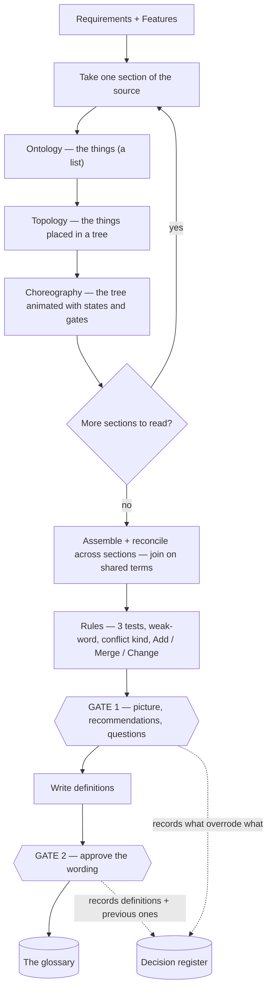

# Methodology — how the three OTC lenses tie together

> **What this is** — the binder that ties the three OTC lenses together: the order they run in, how each feeds the next, how they assemble into one picture, and where that picture goes.
> **What it is not** — not the OTC lenses themselves, not the law that judges terms, not the output shapes. It only connects them.
> **Related docs**
>
> - OTC lenses:
>   - `lens1-ontology.md`
>   - `lens2-topology.md`
>   - `lens3-choreography.md`
> - law: `otc-run-rules.md`
> - shapes: `output-formats.md`
> - overview: `../glossary-design.md`
>
> **Next step** — read `lens1-ontology.md`, the first OTC lens. The harvest and check skills apply this methodology; the disposition skill consumes its outputs.

## What the methodology is

A way to read *any* document for meaning, in three OTC lenses — **O**ntology, **T**opology, **C**horeography — that together produce **one picture** of the product's things and how they connect. It reads the phrases in sentences, not tables or identifiers, so it works on a tidy spec or a loose brief alike. It is **methodology, not a skill**: it describes *how to read* and produces nothing until a skill runs it; the skill adds the gates, the state, and the output files.

## Words this methodology uses

We hold ourselves to the same discipline we ask of a specification — one word per thing.

| Word | Means |
|---|---|
| **section** | one coherent part of the source, read at a time — a module or step in a requirements document, an area such as "Checkout" in the store example. *(This is what we earlier called "per module".)* |
| **OTC lens** | one of the three readings: Ontology, Topology, Choreography |
| **candidate term** | a word or phrase an OTC lens found, not yet judged |
| **term** | a candidate that passed the gates and the three tests in `otc-run-rules.md`, and so has a glossary entry. The tests: • special meaning • consequence • reach |
| **kind** | which of the four sorts a term is, as `lens1-ontology.md` ("KEEP") defines them. Every term is exactly one kind; "object" is one kind of term, not another word for it. The kinds: • object • role • step • state or value |
| **family** | a part of the product that groups terms in the glossary, taken from the source's own top-level structure. A family says where a term comes from in the sources; it is not a relationship between terms. The families are chosen at Gate 1 and recorded in the decision register, so every glossary file can show how they were chosen |
| **relationship** | a stated connection between two terms, of one of two sorts: • structure - what is part of, or a kind of, what • flow - what happens before, or controls, what The words for each are listed in `glossary-assembly-principles.md`, G5 rule 2 |
| **picture** | the assembled model of one section |
| **gate** | a checkpoint where a person decides |
| **decision register** | the permanent record of what overrode what |

## Sections — how the source is divided

Each OTC lens reads one **section** at a time. Take the sections from the source's **own structure** — its headings, modules, or numbered groups, in document order. That is repeatable because the divisions are the source's, not ours. If the source has no structure of its own, treat the whole source as one section, or ask the person to mark the sections at the gate — never invent a grouping of loose prose. Name and fix the sections before reading.

**Naming a section.** A section's name is its own name in the source, without the number or id the source puts in front of its section names to number them - for example E01, EP-01, or 3.2. A number that is part of the name itself stays: "Phase 2 features" keeps its 2. The section's folder name is that name in kebab-case - "E01 Checkout" becomes `checkout`, "Phase 2 features" becomes `phase-2-features` - and its files take the folder's name (`output-formats.md`, "The run root"). If two sections would get the same name, each takes the name of the document it comes from in front (`requirements-checkout`, `prototype-checkout`).

## The one principle: meaning first

The OTC lenses run in a fixed order, each building on the one before. **Ontology** finds *what* the things are — a flat list. **Topology** takes that list and arranges it into a *tree* — where each thing sits. **Choreography** takes the tree and *animates* it — the states each thing can be in, and the gates between them. Each OTC lens hands its output to the next: things → tree → animated tree, and that animated tree is the picture.

## When the rules apply — inline, then whole-picture

Rules run at **two moments**, not one. Most run **inline, as each OTC lens runs** — they judge a single item and need nothing else, so there is no "draft now, get scolded later". A few can only run **after the whole read**, because they need every section in view.

| Rule | Runs | Why |
|---|---|---|
| four-kinds keep drop-list evidence quote no "how" words | **inline, in Ontology** | judges one item, needs nothing else |
| no phrase → no link / no gate | **inline, in Topology / Choreography** | judges one sentence |
| the three tests (especially reach) | **whole-picture, after the read** | reach needs every section |
| the five conflict kinds | **whole-picture** | needs all candidates on the table |
| weak-word recommendation | **whole-picture** | names the axis across all uses |
| Add / Merge / Change | **whole-picture** | needs the full set against the existing glossary |

The inline rules live in the Ontology, Topology, and Choreography docs, in each OTC lens's **"Rules this OTC lens enforces"** list. The whole-picture rules live in `otc-run-rules.md`. Note the second tier is **not error-hunting** — it is decision-making that needs everything visible (which word wins, is this reach-2, is this a merge); those calls simply cannot be made during a single OTC lens. So: read each section with its local rules applied as you go, then apply the whole-picture rules once, over the assembled picture.

## The end-to-end flow

Everything inside the OTC loop is **read and assemble** — the methodology's whole job. Everything from `Rules` downward is judgment, gates, and shapes, owned by `otc-run-rules.md`, the person, and `output-formats.md`. The two gates are the only points a person decides; every decision they take is written to the **decision register**, which is what makes overrides auditable.

## The same-thing test — why it lives here, not in a single OTC lens

Deciding whether two words name one thing needs all three OTC lenses at once, so it sits in the binder rather than in any single OTC lens. Two words are the same **only if they agree on all three**: O — described as the same thing; T — sit in the same place, same parent and same kind; C — same states and same actions. If all three agree, it is one thing, and the method **proposes the merge**: in the assembly draft the words become one box under the recommended word, with the others listed as "also written as", and a Gate 1 row asks the person to confirm it. If any disagree, they stay separate boxes and become a conflict for the gate; `otc-run-rules.md` says which kind it is. Either way the person decides at Gate 1 - the method recommends the winning word, it never settles it.

## Assembly — one picture per section, then joined across sections

Because the OTC lenses build on each other, the picture is complete when Choreography finishes a section: **Ontology** put the boxes in (the things), **Topology** nested them (`contains`, `kind of`, `reveals`), and **Choreography** added the `also can be` states and the `locks / produces / comes-before` arrows. The same-thing test proposes merging synonyms into one box with an `Also written as` line, for the person to confirm at Gate 1. The exact layout lives in `output-formats.md`; a worked picture is in the design document.

**Joining across sections.** The glossary is one shared set across every section, not per-section. So a term used in two sections is the **same node**. When section A's text links a local term to a term owned by section B (recognised as already `KNOWN` in the shared glossary), that **cross-section link** is recorded where the phrase appears. When the per-section pictures are then assembled, those shared terms are the **join points** that stitch the section trees into one whole. Nothing is invented — a cross-section link exists only where a sentence states it, and the shared glossary is what lets an OTC lens recognise a term first seen in another section.

## Re-scan — the methodology never starts from zero

On a re-scan, Ontology marks each thing `NEW` or `KNOWN` against the existing glossary, and the same-thing test may find a `KNOWN` thing appearing under a new word. The methodology *surfaces* these; `otc-run-rules.md` classifies each as one of:

- **Add**
- **Merge**
- **Change**
- **No change**

The person confirms at the gate, and the decision register records what overrode what. This is what stops the glossary going stale: every run is a delta against the current glossary, never a fresh pile of words.

## Where the methodology stops

| Concern | Owner |
|---|---|
| read the document, find things and connections, assemble the picture | **the methodology** — this file plus Ontology / Topology / Choreography |
| judge which terms qualify, classify conflicts, decide Add / Merge / Change | `otc-run-rules.md` |
| the shape of the picture, the glossary entry, the decision register, the deltas | `output-formats.md` |
| run the OTC lenses, hold the gates, write the files, keep state | the **skills** — harvest / check / change |
| decide every conflict, keep or drop each proposed term, answer each question | the **person**, at a gate |
