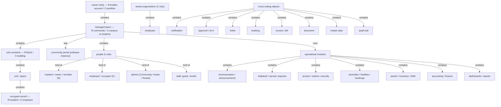
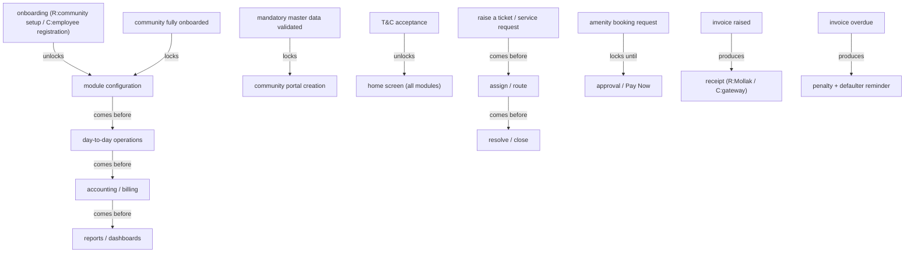

# Assembled draft — ANACITY platform glossary (Residential + Commercial)

> Source: `BRD-Residential.pdf` (ANACITY Community Management, DIEZ Dubai) + `BRD-Commercial.pdf` (ANACITY Business "Embassy SYNC", Embassy REIT). Mode: **new build**.
> Sections joined on shared terms: platform-and-onboarding, people-roles-and-directory, communication-and-engagement, helpdesk-requests-and-incidents, access-visitors-and-security, amenities-facilities-and-bookings, assets-inventory-and-maintenance, accounting-and-finance, dashboards-reports-and-integrations.
> **Central finding:** the two BRDs are the *same platform, two deployments*, so the dominant reconciliation is **Residential ↔ Commercial drift** — the same concept named differently in each. This is settled at Gate 1 (see Whole-picture rule 2).

Candidate counts across the nine section drafts (pre-reconciliation, heavy overlap): Objects ~652 · Roles ~205 · Steps ~182 · States/values ~147. These collapse sharply once synonyms merge and the three tests (esp. reach) narrow — the numbers below are candidates, not the final glossary.

## Join points (terms owned in one section, referenced across others)

`community` / `campus`, `builder account` / `portfolio`, `block` / `building`, `unit`, `community portal`, `resident` / `owner` / `member` / `employee` / `occupant`, `tenant` (person) / `tenant organization`, `admin` / `Community Administrator` / `Asset Administrator` / `Tenant Admin`, `maintenance staff`, `vendor` / `supplier`, `guard` / `Security Guard`, `visitor` / `guest`, `notification`, `approval` / `ALH`, `ticket` / `complaint` / `service request`, `booking`, `amenity` / `facility`, `invoice` / `bill`, `report`, `notice` / `announcement`, `document`, `master data`, `Emirates ID`, `Excel template`, `audit trail`, `QR code` / `pass`.

## Joined tree (the product's object model — dialects marked R:/C:)

## Joined flow (the forward thread + the main gates)

---

## Whole-picture rule 1 — the three tests (qualifying)

Reach ≥ 2 sections carries the core shared vocabulary; a term used in only one feature with an obvious sentence meaning is not promoted. Proposed keep (illustrative core, by kind — the full set is in the section drafts):

- **Objects (core):** platform, owner entity (builder-account/portfolio), community/campus, block/building, unit, community portal, resident record/occupant, tenant organization, master data, notice/announcement, document, gallery album, marketplace listing, event, ticket (complaint/service request), request, incident, visitor, visitor pass, access point, gate pass, amenity/facility, slot, booking, holiday home, asset, inventory/stock item, AMC, work order, invoice/bill, credit note, debit note, receipt, PO, RFQ, PR, penalty, accrual, BRS, report, dashboard, notification, approval/ALH, audit trail, Emirates ID, QR code, wallet/credit balance.
- **Roles (core):** resident, owner, tenant (person), member, employee/occupant, Owners Committee member (R only), Community Administrator, Asset Administrator, Tenant Admin, maintenance staff, facility team, security guard, security supervisor, gatekeeper, vendor/supplier, visitor, host, HHO (R only).
- **Steps (core):** onboarding (community), employee onboarding, communication, raise-request, escalation, resolution, move-in/move-out (R only), check-in/check-out, patrol, amenity booking, procurement (PR→RFQ→PO), invoicing, penalty run, bank reconciliation, defaulter reminder, reporting.
- **States/values (core):** onboarding reversibility, account status (active/deactivated), relationship type, ticket lifecycle (open→assigned→in-progress→on-hold→resolved→closed→reopened→cancelled), escalation level, booking status (pending-approval/confirmed/rejected/cancelled), slot status (available/fully-booked/blocked), AMC status (active/expiring/expired), invoice status (draft/posted/paid/overdue/reconciled), Fit/Gap.

**Borderline reach (raised at Gate 1):** widget, KPI, download-manager, PPM, "case", equipment, "job" — each appears in one place, or in a heading only, or was expected but not attested.

## Whole-picture rule 2 — the five conflict kinds (feeds Gate 1)

### (1) several words, one thing — synonyms to collapse
- **ticket / complaint / service request / request / job card / work order** — the raise-route-resolve object, named differently across Res (Complaint Box) and Com (Service Requests/Service Desk) and across lifecycle stages.
- **notice / announcement / circular / newsletter / feed** — the broadcast message (Res "notice/Noticeboard" vs Com "announcement/Announcements").
- **amenity / facility**; **slot / time-slot / booking slot**; **booking / reservation / booking request**.
- **visitor / guest / walk-in**; **visitor pass / QR pass / gate pass / digital access pass / e-pass**.
- **guard / Security Guard / security personnel**; **access point / controlled entry point / access touch point**.
- **bill / invoice / expense**; **vendor / supplier**; **defaulter / overdue / outstanding**.
- **approval hierarchy / ALH / Approver List / Approval List**; **SOA / unit statement / Unit-Wise Transaction Statement**.
- **asset / asset record / asset detail record**; **inventory / stock / stock item**; **AMC / Annual Maintenance Contract / maintenance contract**.
- **admin console / Admin Portal / ANACITY web-based administration portal** (Res); **Asset Owner Portal / Building Admin Portal** (Com, explicit "also referred to as").
- **Interest-Based Group / interest group / forum group / Club**; **Snip Snack Dine / F&B Integration Card / In-Campus Food Ordering**.

### (2) one word, two+ meanings — to split or narrow
- **tenant** — a *person* who rents (R relationship-type value) vs a tenant *organization* (C company). The single most confusing clash.
- **onboarding** — community setup (R) vs employee registration (C) vs the PII/non-PII *data model* (C).
- **member** — resident/owner (R) vs a group/club joiner (C); also OC "member".
- **booking** — amenity slot reservation vs event registration (C merges both) vs holiday-home short stay vs the admin Booking Calendar tool.
- **maintenance** — preventive asset maintenance vs the AMC contract vs the **Maintenance Staff role**.
- **notice** — a communication vs a document-category value {Agreement, Notice, Invoice, Policy}.
- **role** — job role vs permission role vs committee membership vs access role.
- **admin** — Community Administrator (R) vs Tenant Admin vs Administrator super-user (C).
- **report** — the generated document vs (accounting) "statement"; a reach-heavy term with ~25+ typed variants.
- **status** — spans account, ticket, booking, AMC, invoice, portal — six different state-sets.

### (3) part vs whole
- **community** vs **community portal** (place vs software instance); **interface** (the six) vs each portal/app.
- **owner entity** (builder-account/portfolio) vs **community/campus** vs **block/building** vs **unit** (the containment chain).
- **ticket** (whole) vs **complaint/service request** as both whole-objects and "nature" values.
- **facility** vs **slot** vs **slot capacity**; **Bookings section** contains amenity bookings + event registrations.
- **invoice/bill** vs **line item**; **Approval Hierarchy** vs **Approval Level (L1/L2/L3)**.
- **maintenance schedule/calendar** vs **action item**; **stock statement** vs **balances**.

### (4) collides with our own working (method/OTC) words
- source **"Step" / "Actor"** (process-table headers) vs the method's *step* kind.
- source **"Role"** (45+ role taxonomy) vs the method's *role* kind.
- source **"status" / "state"** vs the method's *state* notion.
- source **"module" / "section"** vs the method's *section* (reading unit).
- source **"gate"** (entry gate / gate pass) vs the method's decision *gate*.

### (5) drift between the two documents (the dominant axis)
| Concept | Residential word | Commercial word |
|---|---|---|
| top managed place | community | commercial campus / property |
| owner entity | builder / builder account | portfolio |
| sub-container | block ("Tower A") | building / tower / floor / zone |
| web admin portal | Admin Portal / admin console | Asset Owner Portal / Building Admin Portal |
| end-user app | ANACITY app | Mobile App / Employee Mobile App |
| end-user person | resident / owner / member | employee / occupant |
| top admin | Community Administrator | Asset Administrator / Administrator |
| security app | Gatekeeper App | Guard App |
| ticketing area | Complaint Box | Service Requests / Service Desk |
| broadcast | notice | announcement |
| landing | Multi Property Dashboard | home screen |
| onboarding email | welcome email | activation email |
| collection rails | Mollak / Noqodi escrow | Payment Gateway (Pine Labs / RazorPay) |
| refund | credit note | gateway cancellation refund |

### Deployment-scope asymmetries (concept exists in one BRD only — not a conflict, a scope note)
- **Residential-only:** Owners Committee / OC, Holiday Homes (HHO, DTCM Permit, NOC, Trade License), Move-In/Move-Out, Marketplace, Gallery, Document Repository, Mollak, Service Maid (flagged out-of-scope in source).
- **Commercial-only:** tenant organization model, Newsletters/Feed, Interest-Based Groups/Clubs, In-Campus Food Ordering, Popular Offers, home aggregators (What's New / Pending Approvals / Your Activity / Quick Actions), Kiosk/Smart-Access/Spintly, Payment Gateway, Parking (Phase 2).

## Whole-picture rule 3 — weak-word recommendations (proposed to Gate 1)

Only labels are open to improvement; the meaning is always the source's. Each is a proposal, not a swap:
- vague/branded → tiered: **Snip Snack Dine / F&B card → in-campus food ordering**.
- relative/loose → precise: **"quick actions" → shortcut menu** (only if it qualifies; borderline).
- generic → specific: none forced — most ANACITY terms are already concrete.
- The real weak-word work here is the *drift table* above: choosing one platform-wide word per concept (or deciding to keep two dialects) is the main naming decision — see Gate 1.

---

*This is interim working output, reviewed at Gate 1 — not the deliverable. The finished glossary is written to `Output/glossary/` only after Gate 1 (recommendations/conflicts) and Gate 2 (definitions) are approved.*
