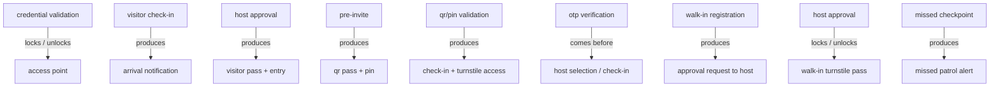

# Section glossary — Access, visitors, gatekeeper & security (Commercial)

**Source read:** Com Asset Owner 1.4 Smart Access (967–1143), 1.5 Visitors (1144–1353); Com Tenant 1.3 Visitor Invite (1984–2099); Com VMS 5 Kiosk App & Guard App (2231–2469); Com Employee 1.8 Smart Access & 1.9 Visitor Invitation (2803–2987); Com Employee 1.17 Guest & Delivery / Gate Pass (3219–3231); Com 7.1 Access Control Integration Spintly (3418–3569); Com 7.5 Parking Integration (3794–3833). Integration mechanism (Spintly hardware/reader, Park+) dropped per brief; product terms kept.

---

## Ontology

### Objects

| # | Term | Meaning (≤12 words, from the source) | Evidence (exact quote — where) | Re-scan |
|---|---|---|---|---|
| 1 | Smart Access module | centralized access-control management for the asset | "The Smart Access module enables centralized management" (Com 1.4) | NEW |
| 2 | access point | door/turnstile/gate where an entry event occurs | "all entry and exit events across all access points" (Com 1.4) | NEW = "controlled entry point" / "access control touch point" |
| 3 | turnstile | a controlled entry barrier | "turnstiles, access-controlled doors, entry gates" (Com 1.4) | NEW |
| 4 | access-controlled door | a controlled door | "turnstiles, access-controlled doors, entry gates" (Com 1.4) | NEW |
| 5 | entry gate (vehicle gate) | a controlled vehicle gate | "entry and exit points such as turnstiles, doors, and vehicle gates" (Com 1.4) | NEW |
| 6 | occupant access log | real-time employee entry/exit record | "Occupant Access Logs -- real-time employee entry/exit monitoring" (Com 1.4) | NEW |
| 7 | visitor access log | visitor movement record with QR validation | "Visitor Access Logs -- visitor movement tracking with QR pass validation" (Com 1.4) | NEW |
| 8 | access credential | token presented at a reader for entry | "Presents access credentials such as mobile credential" (Com 1.4) | NEW |
| 9 | mobile credential | phone-based credential (QR/Bluetooth/NFC) | "mobile credential (QR/Bluetooth/NFC)" (Com 1.4) | NEW |
| 10 | QR pass | visitor's scannable entry pass | "Validates the visitor's QR pass or PIN" (Com 1.4) | NEW |
| 11 | occupants directory | directory of occupants for the asset | "add or remove occupants from the occupants directory" (Com 1.4) | NEW |
| 12 | Asset Owner Portal | asset admin's web portal | "Navigates to Smart Access > Occupant Logs in the Asset Owner Portal" (Com 1.4) | NEW |
| 13 | visitor pass | pass created granting a visitor entry | "the system creates the visitor pass" (Com 1.5) | NEW |
| 14 | Maintenance Staff Directory | directory of maintenance staff | "Directory > Maintenance Staff Directory" (Com 1.5) | NEW |
| 15 | digital access pass | digital pass for staff entry | "issued ID card or digital access pass" (Com 1.5) | NEW |
| 16 | attendance device | physical device recording entry/exit | "physical attendance recording devices installed at the building's entry and exit points" (Com 1.5) | NEW |
| 17 | Kiosk App (Smart Lobby) | lobby self-service check-in app | "the Kiosk App (Smart Lobby) for lobby-side self-service" (Com VMS 5) | NEW = "Smart Lobby" |
| 18 | Guard App | security team's operational app | "the Guard App for security team operations" (Com VMS 5) | NEW = "Gatekeeper App" (Res) |
| 19 | Visitor Management System (VMS) | on-ground layer for physical visitor access | "The Visitor Management System (VMS) is the on-ground operational layer" (Com VMS 5) | NEW |
| 20 | OTP | one-time code for phone verification | "OTP-based phone verification" (Com VMS 5) | NEW |
| 21 | building directory | directory of host orgs and employees | "selects the host organization and the specific host employee name from the building directory" (Com VMS 5) | NEW |
| 22 | government-issued ID | identity document validated at entry | "validates visitor identity against a government-issued ID document" (Com VMS 5) | NEW |
| 23 | PIN | code entered for visitor check-in | "Manually enters the visitor PIN that was sent with the invitation" (Com VMS 5) | NEW |
| 24 | Pending Approvals | section listing approvals awaiting a host | "Pending Approvals section" (Com VMS 5) | NEW |
| 25 | Tenant Portal | tenant admin's web portal | "Opens the Visitor Invite section in the Tenant Portal" (Com 1.3) | NEW |
| 26 | Mobile App (Employee App) | employee's mobile app | "in the Tenant Portal or Mobile App" (Com 1.3) | NEW |
| 27 | visitor pass link | URL to the visitor pass sent by SMS | "Sends the visitor pass link to the visitor via SMS" (Com 1.9) | NEW |
| 28 | rotating QR code | dynamic, time-limited access QR | "a dynamic, time-limited rotating QR code is displayed" (Com 1.8) | NEW |
| 29 | Smart Access Points | map/list of configured access points | "Smart Access Points: map or list of all configured access points and turnstiles" (Com 1.8) | NEW |
| 30 | zone | access-permission area (floor/tower) | "Access permissions are configured at the zone level" (Com 7.1) | NEW |
| 31 | temporary QR pass | single-use walk-in pass after approval | "the visitor receives a temporary QR pass for turnstile access" (Com 7.1) | NEW |
| 32 | gate pass (digital gate pass) | digital pass generated from the mobile app | "digital gate pass generation from the mobile app" (Com 1.17) | NEW |
| 33 | delivery | a delivered item managed in the app | "Guest and Delivery Management and Gate Pass" (Com 1.17) | NEW |
| 34 | parcel | a tracked package | "Parcel tracking" (Com 1.17) | NEW |
| 35 | parking slot | a monitored parking space | "Real-time parking slot availability and utilization" (Com 7.5) | NEW = "parking lot" (Res) |
| 36 | vehicle registration | vehicle registration data for access | "Vehicle-level entry/exit logs with timestamps, vehicle registration details" (Com 7.5) | NEW |
| 37 | notification | real-time message to host/guard/resident | "sends an arrival notification to the host employee" (Com 1.4) | NEW |
| 38 | approval workflow | configurable routing per visitor type | "Configurable approval workflows for different visitor types" (Com 1.17) | NEW |

### Roles

| # | Term | Meaning (≤12 words, from the source) | Evidence (exact quote — where) | Re-scan |
|---|---|---|---|---|
| 1 | Asset Admin (Asset Administrator) | asset-owner-portal admin | "Asset Admins can modify smart access permissions" (Com 1.4) | NEW |
| 2 | Tenant Admin (Tenant Administrator) | tenant-organisation admin | "occupants once they are added to the system by Tenant Admins" (Com 1.4) | NEW |
| 3 | occupant | registered employee in the asset | "captures entry and exit data for all registered occupants (employees)" (Com 1.4) | NEW = "employee" |
| 4 | Employee | occupant using the mobile app for access | "Uses a Spintly-enabled access point ... to enter or exit" (Com 1.4) | NEW |
| 5 | host employee | employee the visitor is visiting | "sends an arrival notification to the host employee" (Com 1.4) | NEW = "host" |
| 6 | walk-in visitor | visitor arriving without an invitation | "Arrives at the building without any prior invitation" (Com 1.5) | NEW |
| 7 | pre-invited visitor | visitor invited before arrival | "Pre-Invited Visitor" (Com VMS 5) | NEW = "pre-approved visitor" |
| 8 | pre-approved visitor | invited visitor cleared for entry | "Selects 'Pre-Approved Visitor' on the kiosk screen" (Com VMS 5) | NEW |
| 9 | guest | pre-invited non-employee | "Employees can pre-invite various types of guests" (Com 1.17) | NEW = "visitor" |
| 10 | Maintenance Staff | building operations personnel | "register, manage, and monitor operational staff" (Com 1.5) | NEW |
| 11 | Security / Reception Staff | staff registering walk-ins at reception | "Registers the visitor using the Guard App or Kiosk App" (Com 1.5) | NEW |
| 12 | security personnel | security team notified of expected visitors | "notifies security personnel (Guard App)" (Com 1.3) | NEW = "Security Guard" |
| 13 | Authorized Employee | employee allowed to invite visitors | "Tenant Admin or Authorized Employee" (Com 1.3) | NEW |
| 14 | Facility Management (FM) team | stakeholder coordinating access setup | "the Facility Management (FM) team" (Com 1.4) | NEW — borderline (stakeholder) |

### Steps

| # | Term | Meaning (≤12 words, from the source) | Evidence (exact quote — where) | Re-scan |
|---|---|---|---|---|
| 1 | check-in | recording a visitor's arrival | "records the check-in timestamp" (Com 1.5) | NEW |
| 2 | check-out | recording a visitor's departure | "checks out through the kiosk, guard app, or turnstile" (Com 1.5) | NEW |
| 3 | pre-invite | inviting a visitor in advance | "Pre-Invite Visitor (Individual)" (Com 1.3) | NEW |
| 4 | bulk visitor invite | inviting many visitors via Excel upload | "Bulk Visitor Invite (Excel Upload)" (Com 1.3) | NEW |
| 5 | walk-in registration | registering a visitor on arrival | "register walk-ins" (Com VMS 5) | NEW |
| 6 | visitor verification | guard verifies visitor before entry | "Sub-Module A: Visitor Verification" (Com VMS 5) | NEW |
| 7 | self check-in | visitor checks in at the kiosk unaided | "Walk-In Visitor Self Check-In" (Com VMS 5) | NEW |
| 8 | Tap Access | entry by tapping device to hardware | "Tap Access (NFC or Bluetooth)" (Com 1.8) | NEW = "Mobile Tap Access" |
| 9 | Smart QR Access | entry via a rotating QR code | "Smart QR Access Process" (Com 1.8) | NEW = "Smart QR" |
| 10 | send invite | employee sends a visitor invite | "Taps 'Send Invite'" (Com 1.9) | NEW |

### States & values

| # | Term | States / values (from the source) | Evidence (exact quote — where) | Re-scan |
|---|---|---|---|---|
| 1 | Direction | • Entry • Exit (device orientation) | "it refers to device orientation, not the actual movement direction of the occupant" (Com 1.4) | NEW |
| 2 | event type | • Entry • Exit | "Event Type ... Entry or Exit" (Com 1.4) | NEW |
| 3 | access method | • QR Code • NFC • Bluetooth • Tap Access | "Access Method ... QR Code / NFC / Bluetooth / Tap Access" (Com 1.4) | NEW = "Access Type" |
| 4 | maintenance staff access status | • All • Expired • Expiring Soon • Inactive | "status tabs such as All, Expired, or Expiring Soon" (Com 1.5) | NEW |
| 5 | attendance device status | • online • offline • error | "real-time device status: online, offline, or in an error state" (Com 1.5) | NEW |
| 6 | visitor visit status | • checked-in • completed / checked-out | "marks the visitor visit record as completed/checked out" (Com 1.4) | NEW |
| 7 | auto-approval mode | walk-ins approved without host confirmation | "automatically approved without host confirmation" (Com VMS 5) | NEW |
| 8 | access-enabled state | • enabled • Access Not Enabled (Permission Required) | "Access Not Enabled State ... 'Permission Required to Access!'" (Com 1.8) | NEW |
| 9 | unlock result | • Device Unlocked • Failed to Unlock | "Displays 'Device Unlocked' ... 'Failed to Unlock -- Retry'" (Com 1.8) | NEW |
| 10 | visitor type | • personal guest • interview candidate • contractor | "personal guests, interview candidates, and contractors" (Com 1.17) | NEW |
| 11 | invite duration | • single-day • multi-day | "Single-day and multi-day invite support" (Com 1.17) | NEW |
| 12 | visitor pass validity | • single-use • time-bound • expired (invalidated) | "single-use and time-bound; expired passes are automatically invalidated" (Com 7.1) | NEW |
| 13 | host approval status | • approved • rejected • pending | "approves or rejects the request"; "Pending approval passes do not grant turnstile entry" (Com 1.5 / 7.1) | NEW |
| 14 | maintenance staff role | • housekeeping • electrician • plumber • technician • security | "role (e.g., housekeeping, electrician, plumber, technician)" (Com 1.5) | NEW |
| 15 | patrol progress | • scanned • pending | "which checkpoints have been scanned and which are pending" (Com 1.5) | NEW |
| 16 | overstay | visitor exceeding threshold time | "Overstaying visitor threshold times" (Com VMS 5) | NEW |

---

## Topology — the tree

### Verbatim

| Parent (A) | relationship | Child (B) | Evidence (exact quote — where) |
|---|---|---|---|
| Smart Access module | contains | • occupant access log • visitor access log | "Sub-Module A: Occupant Access Logs ... Sub-Module B: Visitor Access Logs" (Com 1.4) |
| access point | kind of | • turnstile • access-controlled door • entry gate | "entry and exit points such as turnstiles, doors, and vehicle gates" (Com 1.4) |
| access credential | kind of | • mobile credential • card/fob | "access credentials such as mobile credential (QR/Bluetooth/NFC) or card/fob" (Com 1.4) |
| mobile credential | kind of | • QR • Bluetooth • NFC | "mobile credential (QR/Bluetooth/NFC)" (Com 1.4) |
| Visitors Module | contains | • My Visitors • Maintenance Staff • Attendance Devices • Guard Patrol | "Sub-Module A: My Visitors ... B: Maintenance Staff ... C: Attendance Devices ... D: Guard Patrol" (Com 1.5) |
| Maintenance Staff Directory | reveals | • All • Expired • Expiring Soon | "under relevant status tabs such as All, Expired, or Expiring Soon" (Com 1.5) |
| Visitor Management System (VMS) | contains | • Kiosk App • Guard App | "It consists of two dedicated applications: the Kiosk App ... and the Guard App" (Com VMS 5) |
| Guard App | contains | • Visitor Verification • Entry and Exit Logging • Guard Patrol • Real-Time Alerts | "Sub-Module A: Visitor Verification ... B: Entry and Exit Logging ... C: Guard Patrol ... D: Real-Time Alerts" (Com VMS 5) |
| Real-Time Alerts | kind of | • unauthorized access • overstay • missed patrol | "Real-Time Alerts -- unauthorized access, overstay, and missed patrol alerts" (Com VMS 5) |
| Visitor Invite module | contains | • pre-invite • bulk visitor invite • walk-in tracking | "Feature A: Pre-Invite Visitor ... Feature B: Bulk Visitor Invite ... Feature C: Walk-In Visitor Tracking" (Com 1.3) |
| Guest and Delivery Management | contains | • guest • delivery / parcel • gate pass | "Guest and Delivery Management and Gate Pass ... Parcel tracking, and digital gate pass generation" (Com 1.17) |
| guest | kind of | • personal guest • interview candidate • contractor | "various types of guests: personal guests, interview candidates, and contractors" (Com 1.17) |
| parking | contains | parking slot | "Real-time parking slot availability and utilization" (Com 7.5) |

### Mermaid

```mermaid
flowchart TD
    smartaccess["smart access module"] -->|contains| occlog["occupant access log"]
    smartaccess -->|contains| vislog["visitor access log"]
    accesspoint["access point"] -->|kind of| turnstile["turnstile"]
    accesspoint -->|kind of| door["access-controlled door"]
    accesspoint -->|kind of| gate["entry gate"]
    credential["access credential"] -->|kind of| mobilecred["mobile credential"]
    credential -->|kind of| cardfob["card / fob"]
    mobilecred -->|kind of| credtypes["qr / bluetooth / nfc"]
    vismodule["visitors module"] -->|contains| myvisitors["my visitors"]
    vismodule -->|contains| maintstaff["maintenance staff"]
    vismodule -->|contains| attdevices["attendance devices"]
    vismodule -->|contains| guardpatrol["guard patrol"]
    maintdir["maintenance staff directory"] -->|reveals| stafftabs["all / expired / expiring soon"]
    vms["visitor management system"] -->|contains| kiosk["kiosk app"]
    vms -->|contains| guardapp["guard app"]
    guardapp -->|contains| gasub["verification / logging / patrol / alerts"]
    alerts["real-time alerts"] -->|kind of| alerttypes["unauthorized / overstay / missed patrol"]
    invitemod["visitor invite module"] -->|contains| preinvite["pre-invite"]
    invitemod -->|contains| bulkinvite["bulk visitor invite"]
    invitemod -->|contains| walkin["walk-in tracking"]
    gdm["guest and delivery management"] -->|contains| guest["guest"]
    gdm -->|contains| parcel["delivery / parcel"]
    gdm -->|contains| gatepass["gate pass"]
    guest -->|kind of| guesttypes["personal / interview / contractor"]
    parking["parking"] -->|contains| parkingslot["parking slot"]
```

---

## Choreography — states + gates

### States

| Thing | States (each on its own line) | Evidence (exact quote — where) |
|---|---|---|
| attendance device | • online • offline • error | "real-time device status: online, offline, or in an error state" (Com 1.5) |
| maintenance staff pass | • active (All) • Expiring Soon • Expired • Inactive | "status tabs such as All, Expired, or Expiring Soon" (Com 1.5) |
| visitor visit | • checked-in • completed / checked-out | "marks the visitor visit record as completed/checked out" (Com 1.4) |
| visitor pass | • single-use, time-bound • expired (invalidated) | "single-use and time-bound; expired passes are automatically invalidated" (Com 7.1) |
| walk-in visitor request | • pending • approved • rejected | "approves or rejects the request" (Com 1.5) |
| Smart Access (employee) | • enabled • not enabled (Permission Required) | "Access Not Enabled State ... 'Permission Required to Access!'" (Com 1.8) |
| access attempt | • Device Unlocked • Failed to Unlock | "'Device Unlocked' ... 'Failed to Unlock -- Retry'" (Com 1.8) |

### Gates (verbatim)

| A | relationship | B | Evidence (exact quote — where) |
|---|---|---|---|
| credential validation | locks / unlocks | access point (turnstile/door) | "Grants or denies physical entry/exit based on validation result" (Com 1.4) |
| visitor check-in | produces | arrival notification to host | "sends an arrival notification to the host employee" (Com 1.4) |
| host approval | produces | visitor pass + entry | "Upon approval, the system creates the visitor pass, records the check-in timestamp, and grants entry" (Com 1.5) |
| pre-invite | produces | QR pass + PIN | "Generates a unique QR pass and PIN for the visitor" (Com 1.3) |
| QR/PIN validation | produces | check-in + turnstile access | "Records check-in timestamp and triggers turnstile access" (Com 1.3) |
| OTP verification | comes before | host selection / check-in | "Sends an OTP to the provided phone number for identity verification" (Com VMS 5) |
| walk-in registration | produces | approval request to host | "Sends an approval notification to the identified host employee" (Com 1.5) |
| host approval | locks / unlocks | walk-in turnstile pass | "Pending approval passes do not grant turnstile entry" (Com 7.1) |
| missed checkpoint (not scanned in window) | produces | missed patrol alert | "Generates and sends automated alerts ... if a checkpoint is not scanned within the configured time window" (Com 1.5) |

### Gates (mermaid)

---

## Conflict flags (for Gate 1)

**Several words, one thing (synonym clusters)**
- **visitor / guest / walk-in visitor / pre-invited visitor / pre-approved visitor** — all name a non-employee entrant. "guest" (Com 1.17 Gate Pass) vs "visitor" (used everywhere else).
- **pass cluster: visitor pass / QR pass / gate pass / digital gate pass / digital access pass / temporary QR pass / visitor pass link** — all "an entry credential/document". (Brief's expected "e-pass" term not found in source; nearest is "visitor pass link".)
- **guard / Security Guard / security personnel / Security & Reception Staff** — same field security role; "security personnel (Guard App)" (Com 1.3) vs "Security Guard" (Com VMS 5).
- **access point / controlled entry point / access control touch point** — one thing across Com 1.4 and 7.1.
- **Smart QR / Smart QR Access / Smart QR Code / rotating QR code / dynamic time-limited QR** — one access method (Com 1.8 / 7.1).
- **Tap Access / Mobile Tap Access** — one access method (Com 1.8).
- **Access Method / Access Type** — same log field/value set (Com 1.4).
- **directory cluster: occupants directory / building directory / Maintenance Staff Directory** — three "directory" objects, distinct scopes (Com 1.4 / VMS 5 / 1.5).

**One word, two meanings**
- **Tenant** — Commercial = a *tenant organisation* leasing space, with its own Tenant Admin (Com 1.4); Residential = a *resident who rents a unit*. Different referents.
- **Guard Patrol** — used as a *step/process* and as a named *sub-module/object* (Com 1.5 Sub-Module D; Com VMS 5 Sub-Module C).
- **check-in** — the *act/step* vs the recorded *check-in timestamp* (Com 1.3/1.5).
- **Direction (Entry/Exit)** — flagged in the source itself as "device orientation, not the actual movement direction" (Com 1.4) — a value whose plain meaning misleads.

**Part vs whole**
- Kiosk App and Guard App are parts of the VMS (Com VMS 5).
- occupant access log / visitor access log are parts of the Smart Access module (Com 1.4).

**Collides with method words**
- **gate** — source "entry gate" / "gate pass" (Com 1.4 / 1.17) vs Choreography's "gate" (flow control). Same word, different concept.
- **state** — source "Access Not Enabled State" (Com 1.8) vs the method's "state/value" kind.
- **step** — source "Process Steps" tables vs the method's "step" kind.

**Commercial vs Residential drift (same platform, two deployments) — from the Commercial side**
- **Guard App (Com) vs Gatekeeper App (Res)** — same guard-facing mobile app; Commercial names it "Guard App".
- **Approver of a visitor: host employee (Com) vs Resident (Res)** — Commercial routes visitor approval to the host employee.
- **Maintenance Staff (Com 1.5) vs service staff (Res 4.14)** — Commercial = building operations staff; Residential = helpers serving a unit.
- **Admin roles: Asset Admin / Tenant Admin (Com) vs Community Administrator / Security Supervisor (Res)** — governance model drift.
- **Credential scheme: QR pass + PIN / rotating QR / Tap Access (Com, Spintly smart-access / turnstile self-service)** — Residential is manual guard-mediated (6-digit verification code for service staff).
- **parking slot (Com, Park+ Phase 2, slot availability, Com 7.5) vs parking lot (Res, Gatekeeper-managed, mapped to unit)** — parking object drift.
- **No Move-In/Move-Out form in Commercial (this section)** — Residential has resident onboarding Move-In/Out forms; Commercial occupant onboarding is via Tenant Admin.

**Mechanism dropped (not terms, per brief)**
- Spintly (hardware/reader/integration), Park+ platform, Excel template upload, SMS/URL/WebView/deep link delivery — integration/how, excluded; the *product* terms they carry (access point, turnstile, gate pass, parking, QR pass, PIN) are kept.
