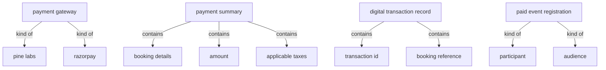
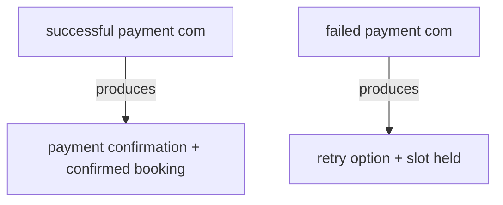

# Section glossary — Accounting, Finance & Procurement (Commercial)

**Source read:** Commercial BRD 7.2 Payment Gateway Integration — Pine Labs / RazorPay (lines 3570–3642). Locator: `Com 7.2`. Re-scan = **NEW BUILD** (every row NEW).

> Scope note: the accounting/finance/procurement domain is almost entirely Residential-sourced (Mollak escrow, invoices, penalties, vendor bills, PR/PO, bank reconciliation, defaulter reminders). The Commercial deployment contributes only the Payment Gateway Integration (Com 7.2) — in-app digital payments for paid amenity bookings and event registrations. The Commercial-only glossary is therefore thin by design.

---

## 1. Ontology — the things, by kind

### Objects

| # | Term | Meaning (≤12 words, from source) | Evidence (exact quote — where) | Re-scan |
|---|---|---|---|---|
| 1 | Payment Gateway | integrated online payment provider | "Payment Gateway Integration (Pine labs or RazorPay)" (Com 7.2) | NEW |
| 2 | payment provider | online provider processing transactions | "integrates with an online payment provider to enable secure in-app digital transactions" (Com 7.2) | NEW |
| 3 | Pine Labs | a payment gateway option | "(Pine labs or RazorPay)" (Com 7.2) | NEW |
| 4 | RazorPay | a payment gateway option | "(Pine labs or RazorPay)" (Com 7.2) | NEW |
| 5 | paid amenity booking | amenity booking requiring payment | "secure in-app digital transactions for paid amenity bookings" (Com 7.2) | NEW |
| 6 | paid event registration | event registration requiring payment | "paid event registrations with in-app payment completion" (Com 7.2) | NEW |
| 7 | payment summary | booking details, amount, applicable taxes | "Displays the payment summary: booking details, amount, and applicable taxes" (Com 7.2) | NEW |
| 8 | payment confirmation notification | notice sent on successful payment | "Automated payment confirmation notification sent to the user immediately upon successful payment" (Com 7.2) | NEW |
| 9 | digital transaction record | record accessible for reconciliation/reporting | "Complete digital transaction records accessible to Asset Administrators for reconciliation" (Com 7.2) | NEW |
| 10 | transaction ID | id logged per payment transaction | "logged with transaction ID, amount, booking reference, and timestamp" (Com 7.2) | NEW |
| 11 | booking reference | reference logged per transaction | "transaction ID, amount, booking reference, and timestamp" (Com 7.2) | NEW |
| 12 | booking slot | slot held temporarily during payment | "booking slot held temporarily during payment processing" (Com 7.2) | NEW |
| 13 | cancellation refund | refund per booking cancellation policy | "Cancellation refund handling managed as per the configured booking cancellation policy" (Com 7.2) | NEW = "refund (Credit Note, Res)" |
| 14 | booking cancellation policy | policy governing refunds | "as per the configured booking cancellation policy" (Com 7.2) | NEW |
| 15 | rate card | agreed gateway pricing | "for direct settlement and rate card" (Com 7.2) | NEW |
| 16 | direct settlement | direct settlement to developer | "shared by ANACITY with the developers for direct settlement" (Com 7.2) | NEW |

### Roles

| # | Term | Meaning (≤12 words, from source) | Evidence (exact quote — where) | Re-scan |
|---|---|---|---|---|
| 1 | Employee | user booking/paying in the app | "employees to complete the full booking and payment workflow within the app" (Com 7.2) | NEW |
| 2 | Asset Administrator | views payment transactions for reconciliation | "digital transaction records accessible to Asset Administrators for reconciliation" (Com 7.2) | NEW = "Asset Admin" |
| 3 | Participant | paid event category | "for both Participant and Audience categories" (Com 7.2) | NEW |
| 4 | Audience | paid event category | "for both Participant and Audience categories" (Com 7.2) | NEW |
| 5 | facility management team | recipient of clean transaction records | "for both the user and the facility management team" (Com 7.2) | NEW |

### Steps

| # | Term | Meaning (≤12 words, from source) | Evidence (exact quote — where) | Re-scan |
|---|---|---|---|---|
| 1 | Payment Gateway Integration | integrate in-app payments | "7.2 Payment Gateway Integration" (Com 7.2) | NEW |
| 2 | Paid Booking Payment Process | book, pay, confirm, record | "Paid Booking Payment Process" (Com 7.2) | NEW |

### States & values

| # | Term | States / values (from source) | Evidence (exact quote — where) | Re-scan |
|---|---|---|---|---|
| 1 | payment outcome | • successful payment • Failed payment (retry) | "immediately upon successful payment"; "Failed payment handling: user notified with retry option" (Com 7.2) | NEW |

---

## 2. Topology — where each thing sits

### Verbatim (parent → child)

| Parent (A) | relationship | Child (B) | Evidence (exact quote — where) |
|---|---|---|---|
| Payment Gateway | kind of | • Pine Labs • RazorPay | "Payment Gateway Integration (Pine labs or RazorPay)" (Com 7.2) |
| payment summary | contains | • booking details • amount • applicable taxes | "Displays the payment summary: booking details, amount, and applicable taxes" (Com 7.2) |
| digital transaction record | contains | • transaction ID • amount • booking reference • timestamp | "logged with transaction ID, amount, booking reference, and timestamp" (Com 7.2) |
| paid event registration | kind of | • Participant • Audience | "for both Participant and Audience categories" (Com 7.2) |

### Mermaid

---

## 3. Choreography — states + gates

### States

| Thing | States (each on its own line) | Evidence (exact quote — where) |
|---|---|---|
| payment (Com) | • successful • failed (retry) | "upon successful payment"; "Failed payment handling: user notified with retry option" (Com 7.2) |
| booking slot (Com) | • held temporarily (during payment) | "booking slot held temporarily during payment processing" (Com 7.2) |

### Gates (verbatim, A → relationship → B)

| A | relationship | B | Evidence (exact quote — where) |
|---|---|---|---|
| successful payment (Com) | produces | payment confirmation notification + confirmed booking | "Confirms the booking and sends a payment confirmation notification to the employee" (Com 7.2) |
| failed payment (Com) | produces | retry option + slot held | "user notified with retry option; booking slot held temporarily during payment processing" (Com 7.2) |

### Gates (mermaid)

---

## 4. Conflict flags (for Gate 1)

**Several words, one thing (synonyms):**
- **None** within Commercial 7.2 — the payment-gateway tie-in introduces no within-BRD synonym cluster. (The rich Residential synonym clusters — bill/invoice/expense bill, ALH/Approval List, tax structure/tax slab, etc. — are Residential-internal and out of Commercial scope.)

**One word, two meanings:**
- **None** material within Commercial 7.2.

**Part vs whole:**
- **payment summary ⊃ {booking details, amount, applicable taxes}** (Com 7.2).
- **digital transaction record ⊃ {transaction ID, amount, booking reference, timestamp}** (Com 7.2).
- **paid event registration ⊃ {Participant, Audience}** (Com 7.2).

**Collides with method words:**
- **step** — the Commercial "Paid Booking Payment Process" is described as numbered steps — collides with the method's "step" kind.
- **status / state** — Commercial uses "payment outcome" (successful / failed) as a product state — echoes the method's "state / value" kind.
- **module / integration** — Commercial calls 7.2 a "Payment Gateway Integration" — overlaps the method's section/module reading unit.

**Commercial vs Residential drift (from the Commercial side):**
- **Billed party:** Commercial = **Employee**, plus **Participant / Audience** for events (Com 7.2); Residential = Owner / Member / unit owner / resident.
- **Collection mechanism:** Commercial collects amenity/event payments via **Payment Gateway (Pine Labs / RazorPay)** (Com 7.2); Residential collects service charges via **Mollak / Noqodi** escrow.
- **Refund:** Commercial refund = **cancellation refund** through the gateway per booking cancellation policy (Com 7.2); Residential refund = **Credit Note**.
- **Admin / reconciliation owner:** Commercial = **Asset Administrator** in the **Asset Owner Portal** (Com 7.2); Residential = Accounting Administrator / Community Administrator / Accounts team.
- **Transaction record:** Commercial = **digital transaction record** (transaction ID, booking reference, timestamp) (Com 7.2); Residential = receipt / ledger / SOA.
- **VAT / tax framing:** Commercial = generic **"applicable taxes"** on the payment summary (Com 7.2); Residential = explicit UAE VAT structures (Input/Output VAT, TRN, FTA).
