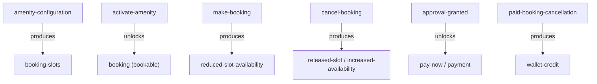

# Section glossary — Amenities, facilities & bookings (Commercial)

**Source read:** Com Asset Owner 1.1 Home Dashboard (313–407); Com Asset Owner 1.6 Amenities Module (1354–1498); Com Tenant 1.5 Amenities (2158–2197); Com Employee 1.11 Amenity Booking (3033–3094); Com Employee 1.13 Bookings (3132–3144).

---

## Ontology

### Objects

| # | Term | Meaning (≤12 words, from source) | Evidence (exact quote — where) | Re-scan |
|---|---|---|---|---|
| 1 | amenity | a bookable community/campus facility residents or users reserve | "The Amenity module allows Asset Administrators to configure and manage all facilities" (Com 1.6) | NEW = "facility" |
| 2 | booking | a user's reservation of a facility slot | "Confirm booking" (Res 4.15) / "make bookings" (Com 1.6) | NEW = "reservation" |
| 3 | booking request | a submitted booking awaiting validation/approval | "Submit booking request for a facility" (Res 4.15) / "Creates the booking request" (Com 1.11) | NEW |
| 4 | booking ID | unique identifier issued for a confirmed booking | "provides a unique booking ID with all slot details" (Com T1.5) | NEW |
| 5 | Booking Calendar | admin visual calendar of all bookings | "Booking Calendar -- visual calendar showing all bookings across all amenities" (Com 1.6) | NEW |
| 6 | Booking History | record of a user's past/upcoming bookings | "the employee can view the request in Booking History" (Com 1.11) | NEW = "booking history" |
| 7 | Bookings section | consolidated list of a user's bookings | "Views all upcoming and past bookings in the Bookings section" (Com 1.11) | NEW |
| 8 | Amenity Bookings panel | dashboard widget of pending bookings | "Amenity Bookings panel indicating the number of bookings pending for approval" (Com 1.1) | NEW |
| 9 | amenity directory | navigable list of amenities | "direct navigation to the amenity directory" (Com 1.1) | NEW = "amenity list" |
| 10 | pending approval list | list of bookings awaiting admin approval | "the amenity directory and pending approval list" (Com 1.1) | NEW |
| 11 | booking rules | configured constraints enforced on bookings | "Configure booking rules: maximum booking duration, booking frequency limits, advance booking window" (Com 1.6) | NEW |
| 12 | booking frequency limit | cap on how often a user books | "booking frequency limits" (Com 1.6) | NEW = "Booking Quota Limit" |
| 13 | operational hours | days/times bookings are accepted | "Configure operational hours: days of the week and specific time windows" (Com 1.6) | NEW |
| 14 | payment settings | amount + gateway config for paid amenity | "Configure payment settings if the amenity requires payment: set amount and payment gateway configuration" (Com 1.6) | NEW |
| 15 | wallet / profile credit balance | where paid-cancellation refunds are credited | "credited to the employee's wallet/profile credit balance" (Com 1.11) | NEW |
| 16 | refund policy | rule governing paid-booking refunds | "as per the configured refund policy" (Com 1.11) | NEW |
| 17 | cancellation policy window | time window within which a booking may be cancelled | "within the configured cancellation policy window" (Com T1.5) | NEW = "cancellation window" |
| 18 | reminder notification | pre-booking reminder sent to the user | "Sends reminder notifications before the scheduled booking time" (Com 1.11) | NEW |
| 19 | confirmation notification | alert that a booking was confirmed | "sends a confirmation notification to the user" (Com 1.6) | NEW |
| 20 | amenity images / supporting media | media displayed for a facility | "Upload amenity images and supporting media for display to users" (Com 1.6) | NEW |
| 21 | Home Dashboard | operational overview screen, first after login | "The Home Dashboard provides the building management team with a consolidated view" (Com 1.1) | NEW |
| 22 | event registration | an event booking shown alongside amenities | "all upcoming event registrations with event name, date, and registration type" (Com E1.13) | NEW |

### Roles

| # | Term | Meaning (≤12 words, from source) | Evidence (exact quote — where) | Re-scan |
|---|---|---|---|---|
| 1 | Asset Administrator / Asset Admin | commercial facility configurer/manager | "The Amenity module allows Asset Administrators to configure and manage all facilities" (Com 1.6) | NEW |
| 2 | Building Admin | commercial ops admin using dashboard | "Building Admin Click on the profile icon" (Com 1.1) / "the building management team" (Com 1.1) | NEW |
| 3 | Tenant Admin | tenant-org admin who views and books | "Employees and Tenant Admins can then view and book these amenities" (Com 1.6) | NEW |
| 4 | Employee | campus user booking via mobile app | "Employee Opens Amenities from Quick Actions" (Com 1.11) | NEW |
| 5 | User | generic booker (employee or tenant) | "User Selects an available time slot and proceeds to confirm the booking" (Com 1.6) | NEW |

### Steps

| # | Term | Meaning (≤12 words, from source) | Evidence (exact quote — where) | Re-scan |
|---|---|---|---|---|
| 1 | Amenity Configuration | create and configure a facility | "Amenity Configuration" (Res 4.15) / "Amenity Setup and Configuration" (Com 1.6) | NEW = "Amenity Setup and Configuration" |
| 2 | Slot Management | slot generation and availability management | "Sub-Module B: Slot Management -- slot generation and real-time availability management" (Com 1.6) | NEW = "Slot Generation" |
| 3 | Resident Booking Flow | resident browses, selects slot, confirms booking | "Resident Booking Flow" (Res 4.15) / "Amenity Booking Flow (Mobile App)" (Com 1.11) | NEW = "Amenity Booking Flow" |
| 4 | Cancel Booking | cancel a booking with reason, release slot | "Cancel  Provide reason  Confirm" (Res 4.15) / "Cancels a booking from the app" (Com 1.11) | NEW |

### States & values

| # | Term | Meaning (≤12 words, from source) | Evidence (exact quote — where) | Re-scan |
|---|---|---|---|---|
| 1 | slot state | • Available • Fully Booked • Blocked • soft-held • released | "Shows the status of each slot clearly as Available, Fully Booked, or Blocked" (Com 1.6) / "slot is soft-held" / "release slot" (Res 4.15) | NEW |
| 2 | amenity/facility state | • active (activated / bookable) • deactivated • blocked out (date range) | "Activate the amenity -- it becomes visible and bookable" (Com 1.6) / "block out a facility for a date range" (Res 4.15) | NEW |
| 3 | amenity payment type | • free amenities • paid amenities | "For free amenities... For paid amenities, the cancelled booking amount is credited" (Com 1.11) | NEW |

---

## Topology

### Verbatim

| Parent (A) | relationship | Child (B) | Evidence (exact quote — where) |
|---|---|---|---|
| Amenity module | contains | • Amenity Setup and Configuration • Slot Management • Booking Calendar | "Sub-Module A: Amenity Setup and Configuration … Sub-Module B: Slot Management … Sub-Module C: Booking Calendar" (Com 1.6) |
| facility | contains | slot | "Saves the amenity configuration and automatically generates all available booking slots" (Com 1.6) |
| facility | contains | • booking rules • access permissions • operational hours • rate | "Configure booking rules … Configure access permissions … Configure operational hours … Open Facility Pricing Settings" (Res 4.15 / Com 1.6) |
| amenity | kind of | • conference rooms • cafeteria • gym • parking areas • recreational facilities | "Examples of Configurable Amenities: Conference rooms … Cafeteria … Gym … Parking areas … Recreational facilities" (Com 1.6) |
| booking rules | contains | • Booking Quota Limit • Maximum Booking Duration • Advance Booking Window • Maximum Bookings per Slot | "Configure booking rules: maximum booking duration, booking frequency limits, advance booking window" (Com 1.6) |
| Home Dashboard | contains | Amenity Bookings panel | "The Home Dashboard … includes … Amenity Bookings panel" (Com 1.1) |
| Amenity Bookings panel | reveals | • amenity directory • pending approval list | "direct navigation to the amenity directory and pending approval list" (Com 1.1) |
| Bookings section | contains | • amenity booking • event registration | "all their active and upcoming bookings across both Amenities and Events" (Com E1.13) |
| Booking Calendar | reveals | all bookings | "visual calendar showing all bookings across all amenities" (Com 1.6) |
| slot state | kind of | • Available • Fully Booked • Blocked | "Shows the status of each slot clearly as Available, Fully Booked, or Blocked" (Com 1.6) |

### Mermaid

```mermaid
flowchart TD
    amenitymodule["amenity module"] -->|contains| setup["amenity-setup-and-configuration"]
    amenitymodule -->|contains| slotmgmt["slot-management"]
    amenitymodule -->|contains| calendar["booking-calendar"]
    facility["facility / amenity"] -->|contains| slot["slot"]
    facility -->|contains| bookingrules["booking-rules"]
    facility -->|contains| accessperm["access-permissions"]
    facility -->|contains| ophours["operational-hours"]
    facility -->|contains| rate["rate"]
    amenity2["amenity"] -->|kind of| examples["conference-room / cafeteria / gym / parking / recreational"]
    bookingrules -->|contains| quota["booking-quota-limit"]
    bookingrules -->|contains| maxdur["maximum-booking-duration"]
    bookingrules -->|contains| advwin["advance-booking-window"]
    bookingrules -->|contains| slotmax["maximum-bookings-per-slot"]
    dashboard["home-dashboard"] -->|contains| panel["amenity-bookings-panel"]
    panel -->|reveals| dir["amenity-directory"]
    panel -->|reveals| pendlist["pending-approval-list"]
    bookingssection["bookings-section"] -->|contains| abk["amenity-booking"]
    bookingssection -->|contains| ereg["event-registration"]
    calendar2["booking-calendar"] -->|reveals| allbk["all-bookings"]
    slotstate["slot-state"] -->|kind of| ssvals["available / fully-booked / blocked"]
```

---

## Choreography

### States

| Thing | States (each on its own line) | Evidence (exact quote — where) |
|---|---|---|
| slot | Available Fully Booked Blocked soft-held released | "as Available, Fully Booked, or Blocked" (Com 1.6) / "slot is soft-held" / "release slot" (Res 4.15) |
| amenity/facility | active (activated / bookable) deactivated blocked out (date range) | "Activate the amenity -- it becomes visible and bookable" (Com 1.6) / "block out a facility for a date range" (Res 4.15) |

### Gates — Verbatim

| A | relationship | B | Evidence (exact quote — where) |
|---|---|---|---|
| Amenity Configuration | produces | booking slots | "Saves the amenity configuration and automatically generates all available booking slots" (Com 1.6) |
| Activate amenity | unlocks | booking (bookable) | "Activate the amenity -- it becomes visible and bookable" (Com 1.6) |
| make booking | produces | reduced slot availability | "Automatically reduces available capacity when users make bookings" (Com 1.6) |
| cancel booking | produces | released slot / increased availability | "increases availability if bookings are cancelled" (Com 1.6) |
| approval granted | unlocks | Pay Now / payment | "the Pay Now option becomes available … completes payment … once approval is granted" (Com 1.11) |
| paid booking cancellation | produces | wallet credit | "the cancelled booking amount is credited to the employee's wallet/profile credit balance" (Com 1.11) |

### Gates — Mermaid

---

## Conflict flags (for Gate 1)

- **Several words, one thing (synonyms) — from the Commercial side:**
  - **amenity = facility** — used interchangeably: "The Amenity module allows … configure and manage all facilities" (Com 1.6); Residential titles the module "Amenities / Facilities".
  - **slot = time slot = booking slot** — "automatically generates time slots" / "generates all available booking slots" (Com 1.6) vs Residential "Define fixed booking slot duration".
  - **booking = reservation** — "make bookings" (Com 1.6) vs Residential "per reservation".
  - **booking = booking request** — "Creates the booking request" (Com 1.11) vs Residential "Confirm booking".
  - **booking frequency limit ≈ Booking Quota Limit** — "booking frequency limits" (Com 1.6) vs Residential "Booking Quota Limit (max open bookings per unit)".
  - **amenity directory ≈ amenity list ≈ Amenities section/module** — "amenity directory" (Com 1.1) vs Residential "Facility appears in amenity list".
  - **cancellation window = cancellation policy window** — "within the configured cancellation policy window" (Com T1.5).
  - **Admin acting role — many names for one function:** "Asset Administrator" / "Asset Admin (Facility Booking Admin)" (Com 1.6); Residential uses "Facility Booking Administrator" / "Facility Admin" / "Admin".

- **One word, two meanings:**
  - **booking** — an amenity slot **reservation** (Com 1.6) **collides** with (a) **event registration** — the "Bookings section" merges both: "all their active and upcoming bookings across both Amenities and Events" (Com E1.13); and (b) **Booking Calendar / Bookings panel** name an admin tool/widget, not a reservation (Com 1.1/1.6). (Residential adds a third sense: a holiday-home short-stay rental.) → "booking" needs disambiguation.
  - **Blocked** — a **slot** state (unavailable): "Available, Fully Booked, or Blocked" (Com 1.6); Residential also uses **blocked weekdays** config and admin **block out a facility for a date range**. Multiple "block" meanings.

- **Part vs whole:**
  - **facility/amenity (whole) → slot (part)** (Com 1.6).
  - **Amenity module (whole)** vs **Amenity Bookings panel** (a Home Dashboard widget onto it) (Com 1.1).
  - **Bookings section (whole)** contains amenity bookings **and** event registrations (Com E1.13).
  - **booking rules (whole)** vs its parts (quota, duration, window, slot capacity) (Com 1.6).

- **Collides with method words:** minimal — "step" (process steps) and "state" (slot/booking states) echo OTC lens vocabulary but are used as product terms here; note only.

- **Commercial vs Residential drift (from the Commercial side):**
  - **Booker role:** Commercial = **Employee / Tenant Admin / User**; Residential = **Resident** (owner/tenant/guest). Same act (book a slot), different persona.
  - **Slot states named:** Commercial explicitly names **Available / Fully Booked / Blocked** (Com 1.6); Residential never names "Fully Booked" (expresses it as "slot has reached its capacity"). Drift in slot-state vocabulary.
  - **Money model:** Commercial = **payment gateway / Pay Now**, and paid cancellations **credit the employee's wallet/profile credit** per refund policy (Com 1.11); Residential = invoice → resident account ledger + UAE VAT (5%) + deposit. Different charging & refund concepts.
  - **Quota term:** Commercial "**booking frequency limits**" (Com 1.6) vs Residential "**Booking Quota Limit**" (per unit).
  - **Approval lifecycle depth:** Commercial pairs approval with **Pay Now** unlock (Com 1.11); Residential adds **approval SLA + auto-cancellation** and soft-hold.
  - **No Holiday Homes in Commercial:** HHO, DTCM Permit, NOC, Trade License, Move-In/Out Short Stay, representative/Primary Contact appear only in Residential (Res 4.10); Commercial has no short-stay-rental equivalent.
  - **Calendar-make-booking:** Commercial allows admin to create/cancel bookings on behalf of users — "Creates bookings manually on behalf of users directly from the calendar" (Com 1.6) — as does Residential ("Actions  Make Booking"). Same feature, differently phrased.
