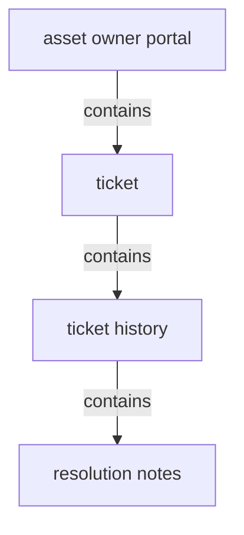
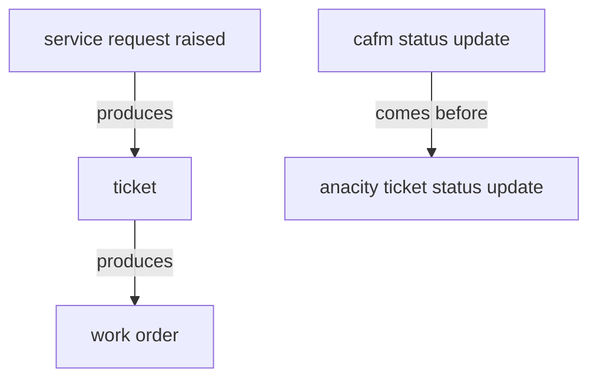

# Assets, inventory & maintenance (AMC) — section glossary draft (Commercial)

**Source read:** Commercial 7.4 CAFM Integration — Facility Management System (3718–3793). NEW BUILD (Re-scan = NEW).

> Scope note: this section is almost entirely Residential-sourced (native Assets / Inventory / AMC modules). The Commercial deployment contributes only the CAFM Integration tie-in (Com 7.4) — where ANACITY service requests are mirrored as work orders in the facility team's external CAFM/FM platform. The Commercial-only glossary is therefore thin by design.

---

## 1. Ontology

### Objects

| # | Term | Meaning (≤12 words, from source) | Evidence (exact quote — where) | Re-scan |
|---|---|---|---|---|
| 1 | service request | a request raised by a tenant or employee | "service requests raised by tenants and employees" (Com 7.4 CAFM) | NEW = "ticket" |
| 2 | ticket | the ANACITY record of a service request | "Creates the ticket in the CAFM platform and assigns a Ticket ID" (Com 7.4 CAFM) | NEW |
| 3 | Ticket ID | identifier assigned to a ticket | "assigns a Ticket ID; sets status to Open" (Com 7.4 CAFM) | NEW |
| 4 | work order | the CAFM/FM-side record corresponding to a ticket | "Creates a corresponding work order in the facility team's existing FM platform" (Com 7.4 CAFM) | NEW = "ticket" (cross-platform) |
| 5 | ticket history | history, notes, and status changes on a ticket | "Ticket history, resolution notes, and status changes remain visible" (Com 7.4 CAFM) | NEW |
| 6 | resolution notes | notes recorded on ticket resolution | "Ticket history, resolution notes, and status changes" (Com 7.4 CAFM) | NEW |
| 7 | Asset Owner Portal | portal where admins monitor all tickets | "monitor all tickets in the Asset Owner Portal" (Com 7.4 CAFM) | NEW (join — owned by portals section) |

*Dropped as mechanism / "how":* CAFM system, FM platform, integration/API.

### Roles

| # | Term | Meaning (≤12 words, from source) | Evidence (exact quote — where) | Re-scan |
|---|---|---|---|---|
| 1 | employee | commercial app user raising service requests | "Service requests raised by employees on the Mobile App" (Com 7.4 CAFM) | NEW (join) |
| 2 | Tenant Admin | commercial portal user raising service requests | "Tenant Admins on the Tenant Portal" (Com 7.4 CAFM) | NEW (join) |
| 3 | facility team | FM team operating the existing CAFM tools | "The facility team continues to use their existing CAFM tools" (Com 7.4 CAFM) | NEW = "Facility Management Team" (drift) |
| 4 | Asset Administrator | commercial admin monitoring all tickets | "Asset Administrators can monitor all tickets in the Asset Owner Portal" (Com 7.4 CAFM) | NEW = "Assets Administrator" (drift) |
| 5 | requestor | the person a status update is reflected back to | "real-time status updates reflected back to the requestor" (Com 7.4 CAFM) | NEW |

### Steps

| # | Term | Meaning (≤12 words, from source) | Evidence (exact quote — where) | Re-scan |
|---|---|---|---|---|
| 1 | raise service request | employee/tenant raises a request in app/portal | "Raises a service request via the ANACITY Mobile App or Tenant Portal" (Com 7.4 CAFM) | NEW |
| 2 | ticket tracking | requestor tracks ticket progress and notifications | "Tracks ticket progress and receives notifications for each status change" (Com 7.4 CAFM) | NEW |

*Dropped as pure integration mechanism (per brief):* "CAFM Service Request Sync Process" (the routing/sync flow) — the product terms it carries (service request, ticket, work order, ticket status) are kept above.

### States & values

| # | Term | States / values (each on its own line) | Evidence (exact quote — where) | Re-scan |
|---|---|---|---|---|
| 1 | ticket status | • Open • Assigned • In Progress • Resolved | "sets status to Open" / "status updates (Assigned, In Progress, Resolved)" (Com 7.4 CAFM) | NEW (same set on work order) |

---

## 2. Topology

### Verbatim (parent → child)

| Parent (A) | relationship | Child (B) | Evidence (exact quote — where) |
|---|---|---|---|
| ticket | contains | ticket history | "Ticket history, resolution notes, and status changes remain visible" (Com 7.4 CAFM) |
| ticket history | contains | resolution notes | "Ticket history, resolution notes, and status changes" (Com 7.4 CAFM) |
| Asset Owner Portal | contains | ticket | "monitor all tickets in the Asset Owner Portal" (Com 7.4 CAFM) |

### Mermaid

---

## 3. Choreography

### States

| Thing | States (each on its own line) | Evidence (exact quote — where) |
|---|---|---|
| ticket / work order | • Open • Assigned • In Progress • Resolved | "sets status to Open" / "status updates (Assigned, In Progress, Resolved)" (Com 7.4 CAFM) |

### Gates (verbatim)

| A | relationship | B | Evidence (exact quote — where) |
|---|---|---|---|
| service request raised | produces | ticket | "Creates the ticket in the CAFM platform and assigns a Ticket ID; sets status to Open" (Com 7.4 CAFM) |
| ticket | produces | work order | "Creates a corresponding work order in the facility team's existing FM platform" (Com 7.4 CAFM) |
| CAFM status update | comes before | ANACITY ticket status update | "Pushes real-time status updates ... back to the ANACITY platform" then "Updates the ticket status" (Com 7.4 CAFM) |

### Gates (mermaid)

---

## 4. Conflict flags (for Gate 1)

**Several words, one thing (synonyms):**
- **service request / ticket / work order** — one request as it flows and crosses platforms: raised as a *service request*, recorded as a *ticket* in ANACITY, mirrored as a *work order* in the CAFM/FM system ("service requests raised" → "Creates the ticket" → "Creates a corresponding work order", Com 7.4).

**One word, two meanings:**
- **job / work order** — brief asked to flag `work order / job` as synonyms; **"job" is NOT a synonym for work order** in Commercial. "work order" (Com 7.4) is the FM work item; in the Residential ranges "job" appears only as "scheduled job / daily system job" (a system cron) — a different sense. Flag as one-word-two-meanings, not a synonym pair.
- **status** — Commercial "ticket status" (Open → Resolved) (Com 7.4); "status" also carries Residential asset / action-item / AMC state sets across the wider section.

**Part vs whole:**
- **ticket ⊃ ticket history ⊃ resolution notes** (Com 7.4).

**Collides with method words:** none material.

**Commercial vs Residential drift (from the Commercial side):**
- **Asset Administrator (Com 7.4) vs Assets Administrator (Res 4.17)** — same admin role, "Asset"/"Assets" (singular/plural) drift.
- **Maintenance handling model differs** — Commercial *routes out* to an external CAFM as a **work order** worked by the **facility team** (Com 7.4); Residential handles maintenance *natively* as a **maintenance action item** worked by Maintenance Staff. The same "do the maintenance work" concept surfaces as *work order* (Com) vs *action item* (Res).
- **facility team / Facility Management team (Com 7.4, the CAFM operators)** vs **Facility Management Team (Res 4.17, a requirements source)** — same label, different actor role per deployment.
- **ticket** — a first-class object in Commercial (Com 7.4) but **absent** from the Residential Assets/Inventory/AMC ranges (Residential uses "maintenance action item" / native lifecycle). Likely a join term owned by a helpdesk/community-request section.

**Join terms (shared vocabulary likely used by other sections):** community, vendor, notification, ticket, service request, work order, employee, Tenant Admin, Asset Administrator, Asset Owner Portal, asset.
