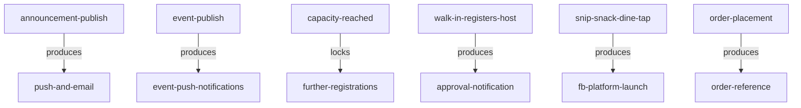

# Communication, community & engagement — section glossary (Commercial) (NEW BUILD)

**Source read:** Commercial — Asset Owner 1.2 Announcements Module (408-686), Asset Owner 1.8 Event Management (1548-1650), Tenant 1.6 Announcements (2198-2212), Employee home 8.2-8.6 (2578-2757), Employee 1.12-1.15 (3095-3177), Employee 1.18 In-Campus Food Ordering (3232-3264).

---

## 1. Ontology

### Objects

| # | Term | Meaning (<=12 words, from source) | Evidence (exact quote — where) | Re-scan |
|---|---|---|---|---|
| 1 | booking | resident's confirmed event reservation | "Records the booking once the payment … is successful" (Res 4.16 / Com 1.8) | NEW |
| 2 | Announcements module | broadcast + engagement tools for workplace | "The Announcements module enables authorized administrators to broadcast" (Com 1.2) | NEW = "Communication" (Res) |
| 3 | announcement | structured broadcast communication | "create and broadcast structured communications" (Com 1.2) | NEW = "notice" (Res) |
| 4 | communication type template | announcement format/category selection | "communication type template: General Notification, Campus Event Update, or Emergency Alert" (Com 1.2) | NEW; collides with "Noticeboard template" (Res) |
| 5 | Interest-Based Group / interest group / Club | engagement group members join and discuss | "Interest-Based Groups -- engagement"; "Clubs -- Interest-Based Groups" (Com 1.2) | NEW |
| 6 | Discussion Forum | module holding topics and forum groups | "Accesses the Discussion Forum module to view discussion topics" (Com 1.2) | NEW |
| 7 | post | text/attachment member creates in a group | "creating posts (text plus optional attachments … images, PDFs, Word docs)" (Com 1.2) | NEW; collides with "Post" (publish action, Res) |
| 8 | group timeline | where a group's posts are shown | "Displays posts in the group timeline" (Com 1.2) | NEW |
| 9 | Event Management module | create/publish/manage campus events | "The Event Management module enables Asset Administrators … to create, publish" (Com 1.8) | NEW = "Events module" (Res) |
| 10 | rate card | pricing for paid event bookings | "seating categorization and rate card for paid bookings" (Com 1.8) | NEW ≈ "pricing model" (Res) |
| 11 | seating category | ticket area with price/seats | "the ticket category (e.g., Platinum Area, Gold Area, Silver Area)" (Com 1.8) | NEW = "ticket category" (Res) |
| 12 | registration field | customizable field on a registration form | "Configure registration fields: add customizable fields" (Com 1.8) | NEW = "participation form field" (Res) |
| 13 | bill summary | ticket type, quantity, pricing page | "Displays a bill summary page with ticket type, quantity, and pricing" (Com 1.8) | NEW |
| 14 | announcement history | past communications, searchable list | "View complete announcement history: all past communications" (Com 1.6) | NEW |
| 15 | What's New section | home screen: latest events + announcements | "The 'What's New' section on the home screen displays the latest campus events and announcements" (Com 8.2) | NEW |
| 16 | event card | scrollable card for an upcoming event | "each upcoming event shown as a scrollable card" (Com 8.2) | NEW |
| 17 | announcement card | card opening full announcement content | "Tapping an announcement card navigates to the full announcement content view" (Com 8.2) | NEW |
| 18 | Pending Approvals section | home section for awaiting visitor approvals | "A dedicated 'Pending Approvals' section displayed on the home screen" (Com 8.3) | NEW [cross-section: visitor mgmt] |
| 19 | approval card | card for one pending approval request | "showing each pending request as a card" (Com 8.3) | NEW |
| 20 | Your Activity section | today's visitors, bookings, events for user | "shows all pre-invited, walk-ins, amenities booked, events booked for the day" (Com 8.4) | NEW |
| 21 | Quick Actions section | home shortcuts to common actions | "8.5 Quick Actions Section" (Com 8.5) | NEW |
| 22 | Snip Snack Dine card / F&B Integration Card | home card linking to food ordering | "A prominent 'Snip Snack Dine' card displayed on the home screen" (Com 8.6) | NEW |
| 23 | F&B platform | integrated food-ordering system in-app | "the integrated F&B platform (HungerBox or Smart Q)" (Com 8.6) | NEW |
| 24 | credits | refunded amount held to user's account | "refunds the remaining amount as credits to the user's account" (Com 8.2) | NEW |
| 25 | Bookings section | single view of amenity + event bookings | "single centralized view of all their active and upcoming bookings" (Com 1.13) | NEW |
| 26 | booking history | past bookings kept for reference | "View complete booking history for all past bookings" (Com 1.13) | NEW |
| 27 | Feed / activity feed | campus activity stream in one section | "View campus communications, activity feed, and newsletters" (Com 1.14) | NEW; collides with "Marketplace feed" (Res) |
| 28 | Newsletter | scheduled informational publication | "The Newsletter feature allows the Asset Owner … to publish informational newsletters" (Com 1.14) | NEW |
| 29 | Popular Offers / Offers | curated promotions and partner offers | "curated promotions, partner offers, and employee benefit programmes" (Com 1.15) | NEW |
| 30 | partner offer | third-party promotion for employees | "partner offers, and employee benefit programmes" (Com 1.15) | NEW ≈ "offer" (Res Events) |
| 31 | In-Campus Food Ordering / F&B section | integrated in-app food ordering | "In-Campus Food Ordering (F&B Integration)" (Com 1.18) | NEW |
| 32 | cart | items selected before checkout | "Adds selected items to the cart" (Com 1.18) | NEW |
| 33 | order | placed and confirmed food order | "Processes the order and confirms it to the employee" (Com 1.18) | NEW |
| 34 | menu | food choices per outlet | "Browses menus from campus restaurants, food courts" (Com 1.18) | NEW |
| 35 | order reference | identifier confirming an order | "confirms it to the employee with an order reference" (Com 1.18) | NEW |

### Roles

| # | Term | Meaning (<=12 words, from source) | Evidence (exact quote — where) | Re-scan |
|---|---|---|---|---|
| 1 | Noticeboard Admin | creates and publishes announcements | "Noticeboard Admin Navigate to Announcements > Notices" (Com 1.2) | NEW |
| 2 | Poll Administrator | creates and manages polls | "Poll Administrator … click 'Add New Poll'" (Com 1.2) | NEW |
| 3 | Forum Administrator | creates groups, moderates discussions | "Forum Administrator Accesses the Discussion Forum module" (Com 1.2) | NEW |
| 4 | Employee | campus user; receives, votes, registers, orders | "Deliver in-app push notifications to all targeted employees" (Com 1.2) | NEW = "Resident" (Res) |
| 5 | tenant / tenant organization | organisation occupying office space | "specific tenant offices, or targeted user groups" (Com 1.2) | NEW |
| 6 | Asset Admin / Asset Administrator | creates and publishes campus events | "Asset Administrators and managers to create, publish" (Com 1.8) | NEW |
| 7 | Employee (Audience) | registrant attending as spectator | "Employee (Audience) … chooses the ticket category" (Com 1.8) | NEW |
| 8 | Employee (Participant) | registrant filling a participation form | "If Participant is selected, the system displays a registration form" (Com 1.8) | NEW |
| 9 | Asset Owner | publishes announcements/newsletters | "all communications published by the Asset Owner" (Com 1.6) | NEW |
| 10 | Building Management team / Building Admin | sends notices, updates, alerts | "communications from the Building Management team" (Com 1.6) | NEW |
| 11 | Tenant Admin | configures employee quick-action permissions | "permissions configured by the Tenant Admin" (Com 8.5) | NEW |
| 12 | walk-in visitor / visitor | on-site visitor naming an employee host | "A walk-in visitor registers the employee as their host" (Com 8.3) | NEW [cross-section: visitor mgmt] |
| 13 | host | employee a visitor is visiting | "registers the employee as their host" (Com 8.3) | NEW [cross-section] |
| 14 | security team | notified of visitor approval decisions | "notifies the visitor and security team" (Com 8.3) | NEW [cross-section] |

### Steps

| # | Term | Meaning (<=12 words, from source) | Evidence (exact quote — where) | Re-scan |
|---|---|---|---|---|
| 1 | Announcement Creation and Publishing | create and broadcast an announcement | "Announcement Creation and Publishing Process" (Com 1.2) | NEW |
| 2 | Poll Creation and Distribution | create and publish a poll | "Poll Creation and Distribution Process" (Com 1.2) | NEW |
| 3 | Survey Creation and Response Collection | create survey and gather responses | "Survey Creation and Response Collection Process" (Com 1.2) | NEW |
| 4 | Interest Group Creation and Management | create group, moderate discussions | "Interest Group Creation and Management Process" (Com 1.2) | NEW |
| 5 | Event Registration Management | employee registers; admin tracks attendance | "Event Registration Management Process" (Com 1.8) | NEW |
| 6 | registration | employee signs up for an event | "Clicks Register Now and selects the registration type" (Com 1.8) | NEW |
| 7 | Walk-In Visitor Approval | employee approves/rejects a walk-in | "Walk-In Visitor Approval Process (from Home Screen)" (Com 8.3) | NEW [cross-section] |
| 8 | In-Campus Food Ordering Process | browse, order, pay, track food | "In-Campus Food Ordering Process" (Com 1.18) | NEW |

### States & values

| # | Term | States / values (each on its own line) | Evidence (exact quote — where) | Re-scan |
|---|---|---|---|---|
| 1 | survey response type (Com) | • single select • multi-select • open text • star rating | "single select, multi-select, open text, or star rating" (Com 1.2) | NEW |
| 2 | voting rights | • one per user / One per employee • one per unit | "voting rights (one per user / one per unit)" (Res 4.6); "One per employee' or 'One per unit'" (Com 1.2) | NEW; user-vs-employee drift |
| 3 | booking type | • Paid • Free | "Booking Type as Paid or Free" (Res 4.16); "Set event type: Free … or Paid" (Com 1.8) | NEW |
| 4 | registration type | • Audience • Participant | "selects the registration type: Audience or Participant" (Com 1.8) | NEW; "Audience" collides with target audience |
| 5 | ticket area (Com) | • Platinum Area • Gold Area • Silver Area | "ticket category (e.g., Platinum Area, Gold Area, Silver Area)" (Com 1.8) | NEW; drifts from VIP/Standard/Early Bird (Res) |
| 6 | booking state (Com) | • Active • Past • Cancelled | "view Active, Past, and Cancelled bookings" (Com 8.2) | NEW |
| 7 | announcement state | • active • past/expired | "Past and expired announcements are not shown … Only active announcements are visible" (Com 1.2) | NEW |
| 8 | communication type template value | • General Notification • Campus Event Update • Emergency Alert | "General Notification, Campus Event Update, or Emergency Alert" (Com 1.2) | NEW |
| 9 | announcement target audience (Com) | • entire organisation • specific tenant offices • selected user groups | "entire organisation across all buildings, specific tenant offices, or selected user groups" (Com 1.2) | NEW |
| 10 | group listing / join state | • All Groups • Suggested Groups • Owned Groups • Pending Approval • member | "'All Groups' / 'Suggested Groups'"; "puts the request into Pending Approval" (Com 1.2) | NEW |
| 11 | quick action | • Invite Visitor • Raise a Request • Book Amenity • Explore All | "Invite Visitor … Raise a Request … Book Amenity … Explore All" (Com 8.5) | NEW [cross-section shortcuts] |
| 12 | activity type (Your Activity) | • Today's Visitors • Amenity Bookings • Events | "Activity Type … Today's Visitors … Amenity Bookings … Events" (Com 8.4) | NEW |
| 13 | visitor tag | • Pre-Invited • Walk-In | "tagged 'Pre-Invited' or 'Walk-In'" (Com 8.4) | NEW [cross-section] |
| 14 | order status | • Order Received • Preparing • Ready for Pickup/Delivery | "Order Received → Preparing → Ready for Pickup/Delivery" (Com 1.18) | NEW |
| 15 | newsletter frequency | • weekly • monthly • Quarterly | "weekly, monthly, Quarterly" (Com 1.14) | NEW |

---

## 2. Topology

### Verbatim (Parent → Child)

| Parent (A) | relationship | Child (B) | Evidence (exact quote — where) |
|---|---|---|---|
| Announcements module | contains | • announcement • Poll • Survey • Interest-Based Group | "Sub-Module A: Announcements … B: Polls … C: Surveys … D: Interest-Based Groups" (Com 1.2) |
| announcement | kind of | • communication type template (General/Campus Event/Emergency) | "communication type template: General Notification, Campus Event Update, or Emergency Alert" (Com 1.2) |
| Discussion Forum | contains | • Interest-Based Group | "Create New Group from the Discussion Forum(s) screen" (Com 1.2) |
| Interest-Based Group | contains | • post | "Participates in discussions by creating posts" (Com 1.2) |
| group timeline | reveals | • post | "Displays posts in the group timeline" (Com 1.2) |
| Event Management module | contains | • event | "The Event Management module enables … to create, publish, and manage campus-wide events" (Com 1.8) |
| event (Com) | contains | • seating category • registration field • rate card | "seating categorization and rate card"; "Configure registration fields" (Com 1.8) |
| event (Com) | kind of | • event type (Free/Paid) | "Set event type: Free … or Paid" (Com 1.8) |
| What's New section | contains | • event card • announcement card • polls/surveys | "displays the latest campus events and announcements" (Com 8.2) |
| Pending Approvals section | contains | • approval card | "showing each pending request as a card" (Com 8.3) |
| Your Activity section | contains | • Today's Visitors • Amenity Bookings • Events | "Today's Visitors … Amenity Bookings … Events" (Com 8.4) |
| Quick Actions section | contains | • Invite Visitor • Raise a Request • Book Amenity • Explore All | "Invite Visitor … Raise a Request … Book Amenity … Explore All" (Com 8.5) |
| Snip Snack Dine card | reveals | • F&B platform | "Tapping the card redirects the user to the integrated F&B platform" (Com 8.6) |
| Bookings section | contains | • amenity booking • event registration | "all their active and upcoming bookings across both Amenities and Events" (Com 1.13) |
| Announcements/Feed/Newsletters | contains | • announcement • Feed • Newsletter | "View campus communications, activity feed, and newsletters -- all in one section" (Com 1.14) |
| Popular Offers | contains | • partner offer • promotion • employee benefit programme | "curated promotions, partner offers, and employee benefit programmes" (Com 1.15) |
| F&B platform | contains | • menu • cart • order | "handles all menu browsing, cart management, order placement, and payment" (Com 8.6 / 1.18) |

### Mermaid

```mermaid
flowchart TD
    annmod["announcements-module"] -->|contains| announcement["announcement"]
    annmod -->|contains| poll["poll"]
    annmod -->|contains| survey["survey"]
    annmod -->|contains| igroup["interest-based-group"]
    announcement -->|kind of| commtpl["communication-type-template"]
    forum["discussion-forum"] -->|contains| igroup
    igroup -->|contains| post["post"]
    timeline["group-timeline"] -->|reveals| post

    eventmgmt["event-management-module"] -->|contains| eventc["event-com"]
    eventc -->|contains| seatcat["seating-category"]
    eventc -->|contains| regfield["registration-field"]
    eventc -->|contains| ratecard["rate-card"]
    eventc -->|kind of| eventtype["event-type-free-paid"]

    whatsnew["whats-new-section"] -->|contains| eventcard["event-card"]
    whatsnew -->|contains| anncard["announcement-card"]
    pendingappr["pending-approvals-section"] -->|contains| apprcard["approval-card"]
    youractivity["your-activity-section"] -->|contains| todayvisitors["todays-visitors"]
    youractivity -->|contains| amenitybk["amenity-bookings"]
    youractivity -->|contains| activityevents["events"]
    quickactions["quick-actions-section"] -->|contains| invitevisitor["invite-visitor"]
    quickactions -->|contains| raiserequest["raise-a-request"]
    quickactions -->|contains| bookamenity["book-amenity"]
    quickactions -->|contains| exploreall["explore-all"]

    snipcard["snip-snack-dine-card"] -->|reveals| fbplatform["fb-platform"]
    bookings["bookings-section"] -->|contains| amenitybooking["amenity-booking"]
    bookings -->|contains| eventreg["event-registration"]
    annfeednews["announcements-feed-newsletters"] -->|contains| announcement
    annfeednews -->|contains| feed["activity-feed"]
    annfeednews -->|contains| newsletter["newsletter"]
    offers["popular-offers"] -->|contains| partneroffer["partner-offer"]
    offers -->|contains| promotion["promotion"]
    offers -->|contains| benefit["employee-benefit-programme"]
    fbplatform -->|contains| menu["menu"]
    fbplatform -->|contains| cart["cart"]
    fbplatform -->|contains| order["order"]
```

---

## 3. Choreography

### States

| Thing | States (each on its own line) | Evidence (exact quote — where) |
|---|---|---|
| notice / announcement | • draft/scheduled • published (active) • expired | "publish the notice now or schedule it for later" (Res 4.6); "Only active announcements are visible … Past and expired announcements are not shown" (Com 1.2) |
| poll | • published (active) • closed (at expiry, voting locked) | "poll becomes active from 00:00 hrs on start date and closes shortly after 24:00 hrs" (Com 1.2); "close polls … lock further voting" (Res 4.6) |
| survey | • published (live) • closed (at end date) | "Automatically close survey when the configured end date is reached" (Com 1.2) |
| booking | • Active • Past • Cancelled | "view Active, Past, and Cancelled bookings" (Com 8.2) |
| order | • Order Received • Preparing • Ready for Pickup/Delivery | "Order Received → Preparing → Ready for Pickup/Delivery" (Com 1.18) |
| approval request (card) | • pending • actioned (approved/rejected) | "Removes the card from Pending Approvals once the request is actioned" (Com 8.3) |
| group join request | • Pending Approval • member (joined) | "Adds the employee as a member … or puts the request into Pending Approval" (Com 1.2) |

### Gates — Verbatim (A → relationship → B)

| A | relationship | B | Evidence (exact quote — where) |
|---|---|---|---|
| announcement publish | produces | in-app push + email | "Deliver in-app push notifications … Sends email notifications" (Com 1.2) |
| event publish | produces | announcement push notifications | "Upon publishing, send event announcement push notifications to all employees" (Com 1.8) |
| capacity limit reached | locks | further registrations | "Prevents additional registrations once the configured participant or audience limit is reached" (Com 8.2) |
| walk-in registers host | produces | approval notification | "An approval notification is immediately sent to the employee as a push notification" (Com 8.3) |
| Snip Snack Dine tap | produces | F&B platform launch | "Launches the integrated F&B platform (Smart Q or HungerBox) within the app" (Com 1.18) |
| order placement | produces | order reference, ready notification | "confirms it … with an order reference"; "Receives a notification when the order is ready" (Com 1.18) |

### Gates — Mermaid

---

## 4. Conflict flags (for Gate 1)

**Several words, one thing (synonym clusters) — from the Commercial side:**
- **announcement / notice / admin notice** — Commercial leads with "announcement" and "Announcements module" (Com 1.2); Residential uses "notice" / "Noticeboard" for the same object.
- **Announcements module (Com) / Noticeboard (Res)** — same container tool named differently.
- **seating category (Com: Platinum, Gold, Silver Area) / ticket category (Res: VIP, Standard, Early Bird)** — same concept, both also called "ticket category"; Commercial adds "rate card" for the same pricing role Residential calls "pricing model".
- **registration form + registration fields (Com) / participation form (Res)** — same custom event form.
- **Event Management module (Com) / Events module (Res)** — same module.
- **Popular Offers / partner offer / promotion (Com 1.15) / offer/discount (Res Events)** — overlapping "offer" vocabulary for different scopes (curated campus offers vs event-level promo).
- **Snip Snack Dine card / F&B Integration Card / In-Campus Food Ordering / F&B section** — four Commercial labels, one feature (Com 8.6, 1.18).
- **Interest-Based Group / interest group / forum group / Club / group** — five Commercial words; "Clubs -- Interest-Based Groups" confirms Club = Interest-Based Group (Com 1.2).

**One word, two meanings:**
- **"Audience"** — in Commercial, an **event registration type** (spectator, opposite of Participant) (Com 1.8, 8.2), distinct from **Target Audience** (a recipient set). Same word, distinct meanings.
- **"template"** — Commercial **communication type template** = a format/category label only, "underlying publishing workflow remains the same" (Com 1.2), distinct from the Residential **Noticeboard template** (reusable notice content).
- **"post"** — Commercial noun: a forum **post** object ("creating posts", Com 1.2); also used elsewhere as the publish verb.
- **"event"** — consistently the **campus event**, BUT "Campus Event **Update**" is an announcement template value using "event" as a label (Com 1.2). Flag against the classic collision with system/audit "event" for cross-section reconciliation.
- **"feed"** — Commercial **Feed / activity feed** = campus activity stream (Com 1.14), distinct from the Residential **Marketplace feed**.
- **"category"** — Commercial: seating category / forum category — one word, multiple scopes.
- **"group"** — Interest-Based Group vs "selected **user groups**" (announcement audience target) vs the poll voter scope (Com 1.2).

**Part vs whole:**
- Commercial **Announcements module** ⊃ {Announcements, Polls, Surveys, Interest-Based Groups} (Com 1.2) — Interest-Based Groups appears Commercial-side only; Residential groups the tools under **Communication**.
- Commercial **event** ⊃ seating category + registration field/form + rate card (Com 1.8).
- **What's New / Your Activity / Quick Actions / Bookings** are home-screen aggregators that *reveal* items owned by other modules (events, announcements, visitors, amenities) — the same object appears as a card here and as an entity there.

**Collides with method / neutral words:**
- **"event"** collides with the method/audit sense of "event" (see one-word-two-meanings) — reconcile at whole-picture.
- **"post", "feed", "activity"** are borderline product-vs-mechanism; kept as product objects here because the source treats them as things users see/act on.

**Commercial vs Residential drift (same platform, two deployments) — from the Commercial side:**
- Consumer role: **Employee** (Com) — Residential uses **Resident**; same actor.
- Admin roles fragment: **Noticeboard Admin / Poll Administrator / Forum Administrator / Asset Admin / Tenant Admin / Building Admin** (Com) — Residential uses **Community Administrator / Admin / Manager / Event Admin**.
- Location/targeting hierarchy: **entire organisation / building / tenant office / user group** (Com) — Residential uses **Community / Block / Unit**.
- Audience target values: **{entire organisation, specific tenant offices, selected user groups}** (Com) — Residential uses **{All, Residing Only, Owners Only, Tenants Only, Committee Members}**.
- Voting rights: **"One per employee"** (Com) — Residential uses **"one per user"**.
- Survey response types: **{single select, multi-select, open text, star rating}** (Com) — Commercial adds star rating vs Residential **{Single choice, Multiple choice, Text}**.
- Event ticket tiers & pricing: **Platinum/Gold/Silver Area + rate card** (Com) — Residential uses **VIP/Standard/Early Bird + pricing model**.
- Event lifecycle vocab: Com surfaces the **booking status {Active, Past, Cancelled}** — Residential tracks the **event status {Draft, Published, Cancelled, Completed}**.
- Feature presence gaps in these ranges: Commercial-only — **Newsletters, Feed, Interest-Based Groups/Clubs, In-Campus Food Ordering (Snip Snack Dine), Popular Offers, home aggregator sections (What's New / Your Activity / Quick Actions / Bookings)**; Residential-only — **Marketplace, Gallery, Document Repository**. Flag as deployment-scope drift, not renamed terms.
- **Popular Offers (Com: curated partner/employee offers) ≠ Marketplace (Res: resident-to-resident selling)** — both are "listings/offers" but different concepts; do not merge.
