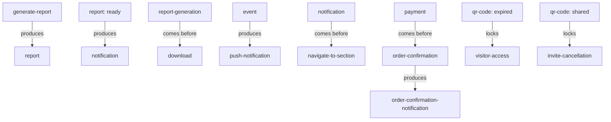

# Section glossary — Dashboards, reports, notifications & cross-cutting integrations (Commercial)

**Source read:** Com Asset Owner 1.9 Reports & Download Manager (1650–1725); Com Tenant 1.7 Reports (2213–2230); Com Employee 1.21 Notifications (3345–3398); Com 7.3 Food & Beverage Integration (3643–3717); Com 8 Important Assumptions & Clarifications (3834–3891).
Locators: `Com AO 1.9`, `Com Ten 1.7`, `Com Emp 1.21`, `Com 7.3`, `Com 8`. NEW BUILD → every Re-scan = NEW.

---

## 1. Ontology

### Objects

| # | Term | Meaning (≤12 words, from source) | Evidence (exact quote — where) | Re-scan |
|---|---|---|---|---|
| 1 | Asset Owner Portal | portal where building admin runs reports | "Navigate to Reports from the left navigation menu in the Asset Owner Portal" (Com AO 1.9) | NEW = join term |
| 2 | Occupant Access Logs | employee entry/exit log report | "Occupant Access Logs Employee entry and exit logs with precise timestamps" (Com AO 1.9) | NEW |
| 3 | Service Request Reports | ticket volume by status report | "Service Request Reports … Ticket volume by current status" (Com AO 1.9) | NEW; same name in Com Ten 1.7 |
| 4 | Guard Patrol Reports | patrol checkpoint logs and compliance | "Guard Patrol Reports Patrol checkpoint logs with timestamps" (Com AO 1.9) | NEW; drift → gatekeeper patrol report (Res) |
| 5 | Visitor Reports | tenant visitor counts and history | "Visitor Reports Daily visitor counts, pre-invited vs walk-in breakdown" (Com Ten 1.7) | NEW |
| 6 | Amenity Booking Reports | tenant booking volumes and usage | "Booking volumes, facility usage data, cancellation rates, and payment records" (Com Ten 1.7) | NEW |
| 7 | building-level report | full building report set, tenant reports subset of | "a filtered and isolated subset of the building-level reports" (Com Ten 1.7) | NEW |
| 8 | tenant organization | org scope filtering the tenant's reports | "Operational reports scoped exclusively to the tenant organization" (Com Ten 1.7) | NEW = join term |
| 9 | notification | app alert delivered for an event | "delivers push notifications for all relevant events" (Com Emp 1.21) | NEW = join term |
| 10 | push notification | device notification for a triggered event | "Receives push notifications on their device for each triggered event" (Com Emp 1.21) | NEW |
| 11 | notifications inbox | centralized list of all app alerts | "the centralized notifications inbox" (Com Emp 1.21) | NEW |
| 12 | alert | app notification shown in the inbox | "all app alerts organized in one inbox" (Com Emp 1.21) | NEW = "notification" (synonym) |
| 13 | announcement | published communication targeting employees | "New announcements published by Asset Owner or Tenant Admin" (Com Emp 1.21) | NEW = join term; drift → notice (Res) |
| 14 | event reminder | pre-event reminder notification | "Pre-event reminder notifications at configured intervals before registered events" (Com Emp 1.21) | NEW = "notification" (synonym) |
| 15 | F&B module | in-app food ordering module | "a full F&B ordering module" (Com 7.3) | NEW |
| 16 | Smart Q | existing in-campus food ordering integration | "Smart Q is the existing Phase 1 integration" (Com 7.3) | NEW |
| 17 | HungerBox | planned future F&B ordering integration | "HungerBox is planned for a future phase" (Com 7.3) | NEW |
| 18 | menu | restaurant/food-court menu browsed in app | "Browse menus from all campus restaurants and food courts" (Com 7.3) | NEW |
| 19 | cart | items added before payment | "Add items to cart and complete payment" (Com 7.3) | NEW |
| 20 | order | food order tracked placement to fulfillment | "Track order status in real time from placement to fulfillment" (Com 7.3) | NEW = join term |
| 21 | order history | past orders and transactions | "View order history and past transactions" (Com 7.3) | NEW |
| 22 | Snip Snack Dine card | home-screen card opening the F&B module | "taps the Snip Snack Dine card on the home screen" (Com 7.3) | NEW |
| 23 | home screen | Mobile App landing surface hosting F&B card | "a dedicated section in the Mobile App home screen" (Com 7.3) | NEW; drift → dashboard (Res) |
| 24 | Mobile App | ANACITY employee mobile application | "the ANACITY Mobile App" (Com 7.3) | NEW = join term |
| 25 | food outlet | campus restaurant/food court fulfilling orders | "Confirms the order to the relevant food outlet" (Com 7.3) | NEW |
| 26 | order confirmation notification | notification with pickup/delivery time | "Sends an order confirmation notification to the employee" (Com 7.3) | NEW |
| 27 | visitor pass | pass generating a validity-bound QR code | "Once a visitor pass is generated, a QR code … is created" (Com 8) | NEW = join term |
| 28 | QR code | time-limited code for visitor access | "a QR code with a defined validity period" (Com 8) | NEW |
| 29 | amenity | facility available to tenanted employees | "Amenities are assumed available to all tenanted employees" (Com 8) | NEW = join term |
| 30 | Offers section | offers/programme populated in a later phase | "The Offers section content and programme scope will be defined" (Com 8) | NEW |
| 31 | Employee ID | employee identifier managed by Tenant Admin | "Organisation name and Employee ID fields cannot be edited by the employee" (Com 8) | NEW |
| 32 | campaign | Moengage campaign for user data (future CR) | "a CR for campaign wise user data" (Com 8) | NEW |

> **Not captured — no body quote in range:** *Download Manager* (module named only in the section heading "Reports and Download Manager"; the visible body says "Downloads the report" — captured as the step **download**). *widget* / *KPI* — **None** in these ranges (the reports surface shows "status indicators", "consolidated list", not widgets/KPIs).

### Roles

| # | Term | Meaning (≤12 words, from source) | Evidence (exact quote — where) | Re-scan |
|---|---|---|---|---|
| 1 | Building Admin | runs reports in the Asset Owner Portal | "Building Admin Navigate to Reports" (Com AO 1.9) | NEW; "Admin" overloaded |
| 2 | Asset Owner | publishes announcements; portal owner | "published by Asset Owner or Tenant Admin" (Com Emp 1.21) | NEW = join term |
| 3 | Tenant Admin | accesses tenant-scoped reports; manages Employee ID | "Tenant Admins access operational reports scoped strictly to their own organization" (Com Ten 1.7) | NEW = join term |
| 4 | Employee | mobile-app user; receives notifications, orders food | "Receives push notifications on their device" (Com Emp 1.21) | NEW = join term |
| 5 | Payment Gateway | processes food-order transactions | "Payment Gateway Processes the transaction securely" (Com 7.3) | NEW = join term |
| 6 | Smart Q System | confirms the order to the food outlet | "Smart Q System Confirms the order" (Com 7.3) | NEW |
| 7 | vendor | food-service provider integrated into the app | "vendor management and food ordering system" (Com 7.3) | NEW = join term |

### Steps

| # | Term | Meaning (≤12 words, from source) | Evidence (exact quote — where) | Re-scan |
|---|---|---|---|---|
| 1 | report generation | generating a report on demand or schedule | "report is generated in the background" (Com AO 1.9) | NEW |
| 2 | download | downloading the generated report | "Downloads the report in the configured format" (Com AO 1.9) | NEW = join term |
| 3 | Notification Management | viewing and managing notifications and preferences | "Notification Management Process" (Com Emp 1.21) | NEW |
| 4 | In-Campus Food Ordering | browse, order, pay and track food | "In-Campus Food Ordering Process" (Com 7.3) | NEW |
| 5 | ticket escalation | escalating a service ticket (flagged enhancement) | "Ticket escalation requirements are flagged as a key enhancement" (Com 8) | NEW |

### States & values

| # | Term | Meaning (≤12 words, from source) | Evidence (exact quote — where) | Re-scan |
|---|---|---|---|---|
| 1 | download format (Com) | CSV / Excel | "the configured format (typically CSV or Excel)" (Com AO 1.9) | NEW; drift → CSV/PDF (Res) |
| 2 | ticket status (Com AO) | Open / In Progress / Resolved / Closed | "current status (Open, In Progress, Resolved, Closed)" (Com AO 1.9) | NEW |
| 3 | ticket status (Com Emp) | Assigned / In Progress / On Hold / Resolved | "Assigned, In Progress, On Hold, Resolved" (Com Emp 1.21) | NEW; drift vs Com AO set |
| 4 | notification read state | read / cleared | "Marks individual notifications as read or clears all notifications at once" (Com Emp 1.21) | NEW |
| 5 | notification toggle | on / off | "Toggles individual notification types on or off" (Com Emp 1.21) | NEW |
| 6 | notification category | Visitor Approvals / Service Ticket Updates / Announcement Alerts / Event Reminders / Booking Confirmations / Access Alerts | "1.21.1 Notification Categories" (Com Emp 1.21) | NEW |
| 7 | order status | placement → fulfillment | "order status in real time from placement to fulfillment" (Com 7.3) | NEW |
| 8 | integration rollout phase | Phase 1 / Phase 2 / future phase | "HungerBox integration is planned for a future phase" (Com 8) | NEW |
| 9 | announcement visibility | active shown / expired hidden | "only active announcements are visible" (Com 8) | NEW |

> **Dropped as pure integration/API mechanism (per brief):** Mollak API, Spintly, Puntualiti, Park+, Moengage, sendgrid, gupshup, WATI (WhatsApp), Smart Q WebView, email integrator, background queue. (*Smart Q* / *HungerBox* kept — they are the branded ordering experience the employee sees, not just the API.)

---

## 2. Topology

### Verbatim (parent → child)

| Parent (A) | relationship | Child (B) | Evidence (exact quote — where) |
|---|---|---|---|
| Asset Owner Portal | contains | Reports | "Navigate to Reports from the left navigation menu in the Asset Owner Portal" (Com AO 1.9) |
| Reports (Com AO) | contains | • Occupant Access Logs • Service Request Reports • Guard Patrol Reports | "access to all operational reports across every module" (Com AO 1.9) |
| building-level report | contains | tenant report | "a filtered and isolated subset of the building-level reports" (Com Ten 1.7) |
| tenant report | kind of | • Visitor Reports • Service Request Reports • Amenity Booking Reports | "Report Type / Scope and Description" table (Com Ten 1.7) |
| notifications inbox | contains | notification | "all app alerts organized in one inbox" (Com Emp 1.21) |
| notification | kind of | • Visitor Approvals • Service Ticket Updates • Announcement Alerts • Event Reminders • Booking Confirmations • Access Alerts | "1.21.1 Notification Categories" (Com Emp 1.21) |
| Mobile App | contains | • home screen • F&B module | "surfaced as a dedicated section in the Mobile App home screen and a full F&B ordering module" (Com 7.3) |
| F&B integration | kind of | • Smart Q • HungerBox | "Smart Q is the existing Phase 1 integration … HungerBox is planned for a future phase" (Com 7.3) |
| F&B module | contains | • menu • cart • order | "Browse menus … Add items to cart … Track order status" (Com 7.3) |
| cart | contains | item | "Add items to cart" (Com 7.3) |
| home screen | reveals | Snip Snack Dine card | "taps the Snip Snack Dine card on the home screen" (Com 7.3) |
| visitor pass | contains | QR code | "Once a visitor pass is generated, a QR code … is created" (Com 8) |

### Mermaid

```mermaid
flowchart TD
    aop["asset-owner-portal"] -->|contains| reportsao["reports-module"]
    reportsao -->|contains| oal["occupant-access-logs"]
    reportsao -->|contains| srr["service-request-reports"]
    reportsao -->|contains| gpr["guard-patrol-reports"]
    blr["building-level-report"] -->|contains| tr["tenant-report"]
    tr -->|kind of| vr["visitor-reports"]
    tr -->|kind of| srr2["service-request-reports"]
    tr -->|kind of| abr["amenity-booking-reports"]
    inbox["notifications-inbox"] -->|contains| notif["notification"]
    notif -->|kind of| va["visitor-approvals"]
    notif -->|kind of| stu["service-ticket-updates"]
    notif -->|kind of| aa["announcement-alerts"]
    notif -->|kind of| er["event-reminders"]
    notif -->|kind of| bc["booking-confirmations"]
    notif -->|kind of| acc["access-alerts"]
    app["mobile-app"] -->|contains| hs["home-screen"]
    app -->|contains| fbm["f-and-b-module"]
    fbi["f-and-b-integration"] -->|kind of| sq["smart-q"]
    fbi -->|kind of| hb["hungerbox"]
    fbm -->|contains| menu["menu"]
    fbm -->|contains| cart["cart"]
    fbm -->|contains| order["order"]
    cart -->|contains| item["item"]
    hs -->|reveals| ssd["snip-snack-dine-card"]
    vp["visitor-pass"] -->|contains| qr["qr-code"]
```

---

## 3. Choreography

### States

| Thing | States (each on its own line) | Evidence (exact quote — where) |
|---|---|---|
| report (Com) | • queued (background) • ready for download • downloaded | "Queues the report generation request … Notifies the admin when the report is ready for download" (Com AO 1.9) |
| ticket (Com AO) | • Open • In Progress • Resolved • Closed | "current status (Open, In Progress, Resolved, Closed)" (Com AO 1.9) |
| ticket (Com Emp) | • Assigned • In Progress • On Hold • Resolved | "Assigned, In Progress, On Hold, Resolved" (Com Emp 1.21) |
| notification | • unread • read • cleared | "Marks individual notifications as read or clears all notifications at once" (Com Emp 1.21) |
| notification type | • on • off (toggled) | "Toggles individual notification types on or off" (Com Emp 1.21) |
| order | • placement • fulfillment | "order status in real time from placement to fulfillment" (Com 7.3) |
| QR code | • valid (within validity period) • expired | "The visitor can use the QR code only within this duration, after which it automatically expires" (Com 8) |
| announcement | • active (visible) • expired (hidden) | "Past and expired announcements are not shown to users in the app; only active announcements are visible" (Com 8) |

### Gates (verbatim)

| A | relationship | B | Evidence (exact quote — where) |
|---|---|---|---|
| Generate Report | produces | report | "Click 'Generate Report' … report is generated in the background" (Com AO 1.9) |
| report (ready) | produces | notification | "Notifies the admin when the report is ready for download" (Com AO 1.9) |
| report generation | comes before | download | "Notifies the admin when the report is ready for download … Downloads the report" (Com AO 1.9) |
| event | produces | push notification | "Generates and delivers push notifications for all relevant events" (Com Emp 1.21) |
| notification | comes before | navigate to section | "Taps on a notification to navigate directly to the relevant section of the app" (Com Emp 1.21) |
| payment | comes before | order confirmation | "proceeds to payment … Smart Q System Confirms the order" (Com 7.3) |
| Smart Q order confirmation | produces | order confirmation notification | "Confirms the order … Sends an order confirmation notification" (Com 7.3) |
| QR code (expired) | locks | visitor access | "The visitor can use the QR code only within this duration, after which it automatically expires" (Com 8) |
| QR code (generated & shared) | locks | invite cancellation | "If the QR code has already been generated and shared, the invite cannot be cancelled" (Com 8) |

### Gates (mermaid)

---

## 4. Conflict flags (for Gate 1)

- **Several words, one thing (synonyms) — notification / alert / reminder:** Commercial (Com Emp 1.21) uses "push notifications", "all app alerts", and "Event Reminders" for the same object; also "failure alerts", "missed patrol alerts" (Com AO 1.9), "Access Alerts" (Com Emp 1.21). One winner needed.
- **Several words, one thing — report / statement:** flag as likely cross-section synonym. NOTE: "statement" does **not** appear in the Commercial ranges (which use "report" everywhere, incl. "settlement report"); the accounting workstream is the probable home of "statement" — raise for the accounting section.
- **Several words, one thing — dashboard / home screen:** Commercial "home screen" (employee mobile landing, Com 7.3/8) — Residential uses "Multi Property Dashboard" / "MPD dashboard" (admin web console). Both are the aggregating landing surface; different word per deployment.
- **Several words, one thing — notice / announcement:** Commercial "announcement" / "Announcement Alerts" (Com Emp 1.21 / Com 8) — Residential uses "Notice Board" / "notice". Same concept (a broadcast communication) — **Commercial vs Residential drift**.
- **Several words, one thing — download / Download Manager / export:** Commercial names a **Download Manager** module and "Downloads the report" (Com AO 1.9); Residential treats it as an action ("Export Formats CSV/PDF"). Part-vs-whole + naming drift.
- **One word, two meanings — report:** reach-heavy. Spans Occupant Access / Service Request / Guard Patrol reports (Com AO 1.9), Visitor / Service Request / Amenity Booking reports (Com Ten 1.7), plus ~23 named Residential report types. Nearly every module contributes a "report" — decide whether "report" is one glossary object with typed children, or each report type is its own entry.
- **One word, two meanings — Admin:** "Admin" spans Building Admin (Com AO 1.9), Tenant Admin (Com Ten 1.7), Asset Owner (Com Emp 1.21); also Residential MPD Admin / Community Administrator. Roles section owns; flag the overload.
- **One word, two meanings — category:** "report categories" (Com AO 1.9) vs "Notification Categories" (Com Emp 1.21) — same word, distinct referents (also a complaint "category" filter on the Residential side).
- **Part vs whole — notification vs channel:** notification (the thing) vs its delivery via push notification, SMS, WhatsApp (Com 8). Channels are the *how*; the product term is the notification.
- **Part vs whole — tenant report vs building-level report:** "a filtered and isolated subset of the building-level reports" (Com Ten 1.7) — tenant reports are a scoped subset, not a distinct object family.
- **Commercial vs Residential drift — guard vs gatekeeper:** Commercial "Guard Patrol Reports" (Com AO 1.9) — Residential uses "Gatekeeper Patrol Reports" for the same patrol-compliance report (ties to the roles section's gatekeeper/guard split).
- **Commercial vs Residential drift — home dashboard vs multi-property dashboard:** Commercial has no cross-community "home dashboard"; the landing role is split between the **Asset Owner Portal** (admin) and the **home screen** (employee) — Residential has a single cross-community **Multi Property Dashboard**. Confirm whether these map to one concept.
- **Commercial vs Residential drift — export format value set:** Commercial "CSV or Excel" (Com AO 1.9) — Residential "CSV / PDF". Same value slot, divergent members.
- **Commercial-internal drift — ticket status set:** Com AO 1.9 "Open, In Progress, Resolved, Closed" vs Com Emp 1.21 "Assigned, In Progress, On Hold, Resolved" — divergent status enums for the same ticket object within Commercial (also touches the helpdesk section).
- **Same name, different scope — Service Request Reports:** appears building-wide (Com AO 1.9) and tenant-scoped (Com Ten 1.7). Confirm one term, scoped by role.
- **Collides with method words — module / section / step / category:** Commercial source says "across every module", "dedicated section", process "Step" — clashes with the methodology's own `module`/`section`/`step` vocabulary. Keep product uses quoted.
- **Absent but expected — widget / KPI:** neither appears in the Commercial ranges; the reports surfaces use "status indicators", "consolidated list" instead. Honest **None** — do not invent.
