# Section glossary — Helpdesk, service requests & incidents (Commercial)

**Source read:** Commercial BRD Asset Owner 1.3 Helpdesk Module incl. Sub-Module A Service Requests + Sub-Module B QR-Based Feedback (687–966), Tenant 1.4 Service Requests (2100–2157), Employee 1.10 Service Requests (2988–3032), Employee 1.16 Contact Us and SOS Emergency Directory (3178–3218). NEW BUILD — every Re-scan cell is `NEW`.

Locators: `Com AO 1.3` = Commercial Asset Owner Helpdesk · `Com Ten 1.4` = Commercial Tenant Service Requests · `Com Emp 1.10` = Commercial Employee Service Requests · `Com Emp 1.16` = Commercial Contact Us / SOS.

## Ontology

### Objects

| # | Term | Meaning (≤12 words, from the source) | Evidence (exact quote — where) | Re-scan |
|---|---|---|---|---|
| 1 | escalation path | Commercial name for the configured escalation matrix | "Open Define Escalation Paths and configure the escalation matrix" (Com AO 1.3) | NEW = "escalation matrix" |
| 2 | interim path | pre-escalation notification rule when SLAs are at risk | "Open Define Interim Paths and configure interim notification rules and timelines" (Com AO 1.3) | NEW |
| 3 | ETA | expected time displayed per ticket | "display category, ETA, escalation level, interim TAT, and status" (Com AO 1.3) | NEW |
| 4 | interim TAT | interim turnaround time shown per ticket | "interim TAT, and status for each ticket" (Com AO 1.3) | NEW |
| 5 | service request ID | unique identifier generated per service request | "Generates a unique Service Request ID, sets the ticket status to Open" (Com AO 1.3) | NEW = "complaint ID" / "ticket ID" |
| 6 | ticket ID | unique identifier generated per ticket | "Generates a unique Ticket ID and sets status to Submitted" (Com Ten 1.4) | NEW = "complaint ID" / "service request ID" |
| 7 | helpdesk module | end-to-end service request management system | "The Helpdesk Module provides a complete end-to-end service request management system" (Com AO 1.3) | NEW = "helpdesk" |
| 8 | service requests | sub-module: full ticket lifecycle creation to closure | "Sub-Module A: Service Requests -- full ticket lifecycle from creation to closure" (Com AO 1.3) | NEW |
| 9 | service request | facility ticket an employee/tenant raises | "Employees raise and track service requests" (Com AO 1.3) | NEW = "ticket" / "complaint" |
| 10 | service desk | the configured ticketing system for tenants/employees | "The Service Desk is configured by the Asset Administrator and Helpdesk Administrator" (Com AO 1.3) | NEW = "service requests" |
| 11 | service category | main category classifying service requests | "create main service categories (for example: Electrical, Plumbing, Housekeeping...)" (Com AO 1.3) | NEW = "complaint category" |
| 12 | job card | work order generated from a service request | "Configure Job Card Settings to define how work orders/job cards are generated from service requests" (Com AO 1.3) | NEW = "work order" |
| 13 | work order | work item generated from a service request | "how work orders/job cards are generated from service requests" (Com AO 1.3) | NEW = "job card" |
| 14 | resolution details | recorded outcome when work is completed | "records the resolution details, optionally uploads completion images" (Com AO 1.3) | NEW |
| 15 | completion image | image uploaded at ticket resolution | "optionally uploads completion images, and updates the ticket status to Resolved" (Com AO 1.3) | NEW |
| 16 | ticket thread | in-app comment thread on a ticket | "Communicates with the admin via in-app comments within the ticket thread" (Com Ten 1.4) | NEW = "chat channel" |
| 17 | comment | in-app update message on a ticket | "whenever a new comment is added" (Com Ten 1.4) | NEW = "note" |
| 18 | ticket history | full record of tickets for a scope | "Views complete ticket history for the entire tenant organization" (Com Ten 1.4) | NEW |
| 19 | tenant admin portal | portal where tenant admins raise/track tickets | "Navigate to Service Requests in the Tenant Admin Portal" (Com Ten 1.4) | NEW = "tenant portal" |
| 20 | asset owner portal | portal holding the ticket management system | "All tickets ... flow into the Asset Owner Portal's ticket management system" (Com Ten 1.4) | NEW |
| 21 | ticket management system | where tenant tickets flow for handling | "flow into the Asset Owner Portal's ticket management system" (Com Ten 1.4) | NEW |
| 22 | QR-based feedback | sub-module: anonymous scan-and-rate feedback | "Sub-Module B: QR-Based Feedback (E-Feedback)" (Com AO 1.3) | NEW *(sibling sub-module, not ticketing)* |
| 23 | QR code | open code scanned to open a feedback form | "The QR code is open and can be scanned using any smart phone" (Com AO 1.3) | NEW |
| 24 | feedback | rating/comments submitted against a QR location | "fills in rating/comments as configured, and submits feedback" (Com AO 1.3) | NEW |
| 25 | contact us | in-app way to reach building management / tenant admin | "Employees can contact the building management or their Tenant Admin directly" (Com Emp 1.16) | NEW |
| 26 | SOS emergency directory | always-accessible list of critical emergency contacts | "Opens the SOS / Emergency Directory from anywhere in the app" (Com Emp 1.16) | NEW |
| 27 | SOS contact list | configured list of emergency contacts | "Configures and maintains the SOS Contact List" (Com Emp 1.16) | NEW = "SOS directory" |
| 28 | emergency contact | a critical emergency number with name and role | "Views all configured emergency contact numbers with contact names and roles" (Com Emp 1.16) | NEW |
| 29 | quick dial | one-tap direct call to an emergency contact | "Uses Quick Dial functionality: taps once on any contact to initiate an immediate direct call" (Com Emp 1.16) | NEW |

### Roles

| # | Term | Meaning (≤12 words, from the source) | Evidence (exact quote — where) | Re-scan |
|---|---|---|---|---|
| 1 | asset administrator | admin who configures the service desk | "The Service Desk is configured by the Asset Administrator" (Com AO 1.3) | NEW |
| 2 | helpdesk administrator | admin who configures helpdesk alongside asset admin | "Asset Administrator and Helpdesk Administrator before it is made available" (Com AO 1.3) | NEW |
| 3 | employee | user who raises and tracks service requests | "Employees raise and track service requests" (Com AO 1.3) | NEW |
| 4 | tenant admin | tenant role raising tickets scoped to their org | "Tenant Admins can raise service requests directly to the Asset Owner" (Com Ten 1.4) | NEW |
| 5 | asset owner | entity/role to whom service requests are raised | "raise service requests directly to the Asset Owner" (Com Ten 1.4) | NEW |
| 6 | building operations team | team that reviews, assigns and updates tickets | "Reviews, assigns, and updates the ticket through the standard ticket lifecycle" (Com Ten 1.4) | NEW = "operations team" / "facility team" |
| 7 | facility staff | staff who resolve tickets on the ground | "assigns the request to the appropriate facility staff member" (Com AO 1.3) | NEW = "maintenance staff" / "field staff" |
| 8 | service vendor | external vendor handling a service request | "the appropriate facility staff member or service vendor" (Com AO 1.3) | NEW = "vendor" |
| 9 | end user | employee or visitor submitting QR feedback | "End User (Employee/Visitor)" (Com AO 1.3) | NEW |
| 10 | visitor | non-logged-in user who submits QR feedback | "Visitor / Non-Logged-in User (Web Flow)" (Com AO 1.3) | NEW |
| 11 | FM SPOC | facility-management single point of contact | "building security hotline, FM SPOC" (Com Emp 1.16) | NEW = "SPOC" |

### Steps

| # | Term | Meaning (≤12 words, from the source) | Evidence (exact quote — where) | Re-scan |
|---|---|---|---|---|
| 1 | closure | user confirms resolution to close ticket | "confirms closure of the ticket" (Com AO 1.3) | NEW |
| 2 | helpdesk configuration | admin setup of the ticketing system | "Helpdesk Configuration Process (Admin Setup)" (Com AO 1.3) | NEW |
| 3 | ticket lifecycle | end-to-end flow from creation to closure | "Ticket Lifecycle -- Step-by-Step Flow" (Com AO 1.3) | NEW |
| 4 | service request creation and tracking | raise and track a facility ticket | "Service Request Creation and Tracking Process (Tenant View)" (Com Ten 1.4) | NEW |
| 5 | assignment | assigning a ticket to staff or vendor | "assigns the request to the appropriate facility staff member or service vendor" (Com AO 1.3) | NEW |
| 6 | QR feedback setup | admin generates and places a feedback QR | "QR Feedback Setup Process (Admin)" (Com AO 1.3) | NEW |
| 7 | QR feedback submission | user scans QR and submits feedback | "QR Feedback Submission Process" (Com AO 1.3) | NEW |

### States & values

| # | Term | Meaning (≤12 words, from the source) | Evidence (exact quote — where) | Re-scan |
|---|---|---|---|---|
| 1 | ticket status | • Open / Submitted • Assigned • In Progress • On Hold • Resolved • Closed • Reopened • Cancelled | "Ticket Status Lifecycle" table — Open/Submitted, Assigned, In Progress, On Hold, Resolved, Closed, Reopened, Cancelled (Com AO 1.3) | NEW |
| 2 | ticket resolution value | • Resolved • Completed | "updates the ticket status to Resolved or Completed" (Com AO 1.3) | NEW |
| 3 | escalation level | • Level 1 • Level 2 • Level 3 | "escalation matrix with up to three levels (Level 1, Level 2, Level 3)" (Com AO 1.3) | NEW |
| 4 | QR status | • Active • Inactive | "Toggles QR status between Active and Inactive" (Com AO 1.3) | NEW |
| 5 | star rating | • 1–5 | "Selects a star rating (1–5) to indicate their experience" (Com AO 1.3) | NEW |

## Topology

### Verbatim (parent → child)

| Parent (A) | relationship | Child (B) | Evidence (exact quote — where) |
|---|---|---|---|
| helpdesk module | contains | • service requests • QR-based feedback | "Sub-Module A: Service Requests ... Sub-Module B: QR-Based Feedback" (Com AO 1.3) |
| service requests | contains | service category | "create main service categories ... to classify service requests" (Com AO 1.3) |
| service category | contains | subcategory | "Within each main category, create subcategories as needed" (Com AO 1.3) |
| escalation path | contains | • Level 1 • Level 2 • Level 3 | "configure the escalation matrix with up to three levels (Level 1, Level 2, Level 3)" (Com AO 1.3) |
| ticket | contains | • category • description • image/document | "selecting the relevant category, entering a description ..., optionally attaching images or documents" (Com AO 1.3) |
| ticket | reveals | • category • ETA • escalation level • interim TAT • status | "display category, ETA, escalation level, interim TAT, and status for each ticket" (Com AO 1.3) |
| ticket | contains | ticket thread | "in-app comments within the ticket thread" (Com Ten 1.4) |
| asset owner portal | contains | ticket management system | "flow into the Asset Owner Portal's ticket management system" (Com Ten 1.4) |
| tenant admin portal | contains | service requests | "Navigate to Service Requests in the Tenant Admin Portal" (Com Ten 1.4) |
| QR-based feedback | contains | QR code | "Click Generate QR Code to create a new feedback QR entry" (Com AO 1.3) |
| QR feedback record | contains | • QR Id • name • created date • status | "Creates a new QR Feedback record with a unique QR Id, name, created date, and initial Active status" (Com AO 1.3) |
| QR code | reveals | feedback form | "Scans the QR code ... opens the feedback form on their device" (Com AO 1.3) |
| SOS emergency directory | contains | SOS contact list | "Configures and maintains the SOS Contact List" (Com Emp 1.16) |
| SOS contact list | contains | emergency contact | "enters all critical emergency contacts" (Com Emp 1.16) |
| emergency contact | kind of | • fire emergency • ambulance • police • building security hotline • FM SPOC | "fire emergency, ambulance, police, building security hotline, FM SPOC" (Com Emp 1.16) |
| contact us | kind of | • in-app messaging • email • direct call | "Contact options include in-app messaging, email, or direct call" (Com Emp 1.16) |

### Mermaid

```mermaid
flowchart TD
    helpdeskmodule["helpdesk-module"] -->|contains| servicerequests["service-requests"]
    helpdeskmodule -->|contains| qrfeedback["qr-based-feedback"]
    servicerequests -->|contains| servicecategory["service-category"]
    servicecategory -->|contains| subcategory2["subcategory"]
    escpath["escalation-path"] -->|contains| lvl1b["level-1"]
    escpath -->|contains| lvl2b["level-2"]
    escpath -->|contains| lvl3b["level-3"]
    ticket["ticket"] -->|contains| tcategory["category"]
    ticket -->|contains| tdesc["description"]
    ticket -->|contains| tickthread["ticket-thread"]
    ticket -->|reveals| teta["eta"]
    ticket -->|reveals| tesclevel["escalation-level"]
    ticket -->|reveals| tinterimtat["interim-tat"]
    ticket -->|reveals| tstatus["status"]
    assetownerportal["asset-owner-portal"] -->|contains| ticketmgmt["ticket-management-system"]
    tenantportal["tenant-admin-portal"] -->|contains| servicerequests
    qrfeedback -->|contains| qrcode["qr-code"]
    qrfbrecord["qr-feedback-record"] -->|contains| qrid["qr-id"]
    qrfbrecord -->|contains| qrstatus["status"]
    qrcode -->|reveals| feedbackform["feedback-form"]
    sosdirectory["sos-emergency-directory"] -->|contains| soscontactlist["sos-contact-list"]
    soscontactlist -->|contains| emergencycontact["emergency-contact"]
    emergencycontact -->|kind of| fire["fire-emergency"]
    emergencycontact -->|kind of| ambulance["ambulance"]
    emergencycontact -->|kind of| police["police"]
    emergencycontact -->|kind of| securityhotline["building-security-hotline"]
    emergencycontact -->|kind of| fmspoc["fm-spoc"]
    contactus["contact-us"] -->|kind of| inappmsg["in-app-messaging"]
    contactus -->|kind of| email["email"]
    contactus -->|kind of| directcall["direct-call"]
```

## Choreography

### States

| Thing | States (each on its own line) | Evidence (exact quote — where) |
|---|---|---|
| ticket / service request | Open / Submitted Assigned In Progress On Hold Resolved Closed Reopened Cancelled | "Ticket Status Lifecycle" table (Com AO 1.3) |
| QR feedback / QR code | Active Inactive | "Toggles QR status between Active and Inactive" (Com AO 1.3) |

### Gates (verbatim)

| A | relationship | B | Evidence (exact quote — where) |
|---|---|---|---|
| submit service request | produces | service request ID (status Open) + notify ops team | "Generates a unique Service Request ID, sets the ticket status to Open, and notifies the relevant operations or facility team" (Com AO 1.3) |
| ticket logged | produces | SLA timers start | "SLA timers start when a ticket is logged" (Com AO 1.3) |
| assign ticket | produces | status Assigned/In Progress + notify staff | "Updates the ticket status to Assigned or In Progress and sends a notification to the assigned staff member" (Com AO 1.3) |
| service request | produces | job card / work order | "how work orders/job cards are generated from service requests" (Com AO 1.3) |
| resolve ticket | produces | status Resolved + notify user (awaits confirmation) | "updates the ticket status to Resolved or Completed ... Notifies the user ... awaits confirmation or closure" (Com AO 1.3) |
| user confirms | comes before | ticket Closed + archived | "confirms closure of the ticket ... the ticket is archived in the Closed Service Requests list" (Com AO 1.3) |
| user rejects resolution | produces | Reopened | "User rejected the resolution; ticket re-enters the active workflow" (Com AO 1.3) |
| unresolved past SLA/interim limit | produces | escalation notifications (raise level) | "If the ticket remains unresolved beyond configured SLA or interim time limits, the system automatically sends escalation notifications and raises the escalation level" (Com AO 1.3) |
| save configuration | locks / unlocks | service request module active | "Save all configuration changes, effectively activating the Helpdesk service request rules" (Com AO 1.3) |
| configure SOS contact list | produces | SOS directory synced to apps | "Syncs the configured SOS Directory to all employees' Mobile Apps automatically" (Com Emp 1.16) |

### Gates (mermaid)

```mermaid
flowchart TD
    submitsr["submit-service-request"] -->|produces| srid["service-request-id-open-notify-ops"]
    ticketlogged["ticket-logged"] -->|produces| slatimers["sla-timers-start"]
    assignticket["assign-ticket"] -->|produces| assignedstatus["status-assigned-notify-staff"]
    servicereq["service-request"] -->|produces| jobcard["job-card-work-order"]
    resolveticket["resolve-ticket"] -->|produces| resolvedstatus["status-resolved-notify-user"]
    userconfirm["user-confirms"] -->|comes before| ticketclosed["ticket-closed-archived"]
    userreject["user-rejects-resolution"] -->|produces| reopened["reopened"]
    unresolvedsla["unresolved-past-sla"] -->|produces| escnotif["escalation-notifications-raise-level"]
    saveconfig["save-configuration"] -->|locks/unlocks| srmodule["service-request-module-active"]
    configsos["configure-sos-contact-list"] -->|produces| sossync["sos-directory-synced-to-apps"]
```

## Conflict flags (for Gate 1)

- **Several words, one thing — the core cluster: complaint / ticket / service request / request.** Commercial uses "service request" and "ticket" interchangeably: "Employees raise and track service requests, while administrators manage the full ticket lifecycle" (Com AO 1.3). Residential logs a "complaint" (titled "Ticket Lifecycle and Audit Trail"). So **service request (Com) = ticket (both) = complaint (Res)** for the raise/route/resolve object. *Note:* "case" (named in the sweep prompt) does **not** appear in any source range.
- **One word, two meanings — "request" / "service request".** In Commercial, "service request" (Com AO 1.3 / Ten 1.4 / Emp 1.10) IS the facility ticket; the bare word "request" also appears inside the Commercial ticket flow ("assigns the request", Com AO 1.3), meaning the ticket. In Residential, "request" (Request Box) is an approval-workflow item (NOC, Pet Registration…), not a facility ticket.
- **One word, two meanings — "Service Request" as object vs nature value.** "Service Request" is the Commercial ticket object (Com AO 1.3) but is also a Residential "Complaint Nature" value {Complaint, Service Request, Inquiry} — same words, different referents.
- **Several words, one thing — the ticket ID.** Commercial uses both "Service Request ID" (Com AO 1.3) and "Ticket ID" (Com Ten 1.4) in the same sub-module; = Residential "complaint ID".
- **Commercial vs Residential drift — escalation config.** Commercial "Define Escalation Paths" configuring "the escalation matrix" (Com AO 1.3) — Residential uses "Escalation Matrix". Commercial adds "Interim Paths" and "interim TAT" with **no Residential equivalent**.
- **Commercial vs Residential drift — the ticket area / module name.** Module is "Helpdesk" in both, but the ticket area is "Service Requests" / "Service Desk" (Com) vs "Complaint Box" (Res). Within Commercial, "Service Desk" and "Service Requests" name the same configured system.
- **Several words, one thing — note template & note/comment.** Commercial "Service Request Note Templates" (Com AO 1.3); ticket "comment" / "in-app comments" (Com Ten 1.4 / Emp 1.10) and "ticket thread" (Com Ten 1.4) — Residential uses complaint "note", "note templates", and a per-request "chat channel" / "in-app chat".
- **Several words, one thing — job card / work order.** One Commercial sentence names both: "work orders/job cards are generated from service requests" (Com AO 1.3).
- **Commercial vs Residential drift — the raiser role.** Employee / Tenant Admin raise the item (Com); ticket "user" awaits the resolution notice (Com AO 1.3) — Residential uses Resident / Member and incident "reporter".
- **Several words, one thing — the on-ground resolver.** Commercial: Facility Staff + service vendor (Com AO 1.3) — Residential uses Maintenance Staff / Incident Field Staff.
- **Several words, one thing — the config admin.** Commercial: Asset Administrator / Helpdesk Administrator (Com AO 1.3) — Residential uses Community Administrator / Incident/Category Administrator / Complaint Box Admin / Complaint Category Admin.
- **State-set drift across the same lifecycle.** Commercial ticket {Open/Submitted, Assigned, In Progress, On Hold, Resolved, Closed, Reopened, Cancelled} (Com AO 1.3) — Residential complaint {Open, In Progress, Resolved, Closed}, incident {Open, In Progress, Escalated, Resolved}, request {In Review, Closed, Rejected}. Note "Open / Submitted" (Com) vs "Open" (Res); "Resolved or Completed" (Com).
- **Part vs whole.** Commercial: service requests + QR-based feedback ⊂ helpdesk module; SOS contact list ⊂ SOS emergency directory; escalation levels ⊂ escalation path/matrix (Com AO 1.3 / Emp 1.16).
- **Asymmetry (feature exists on one side only).** Interim Paths / interim TAT and QR-Based Feedback (Com AO 1.3), and SOS / Emergency Directory and Contact Us (Com Emp 1.16), are Commercial-only; RCA template (Res 4.12) has no Commercial counterpart.
- **Collision with method words — none material.** The Commercial source uses "status"/"state", "category", "note", "escalation" as product terms; none clashes with the OTC method vocabulary. "gate" is not used. "FM SPOC" / "SPOC" appears only in Com Emp 1.16.
- **Scope note.** QR-Based Feedback (Sub-Module B, Com AO 1.3) sits inside the Helpdesk Module range but is a feedback flow, not the raise/route/resolve ticket family; captured lightly here and likely owned by a feedback/ratings section.
