# Section glossary — People, roles, directory & access management (Commercial)

**Source read:** Commercial 2. User Roles and Permissions (229–302), Asset Owner 1.7 Directory Management (1499–1547), 1.10 Tenants Module (1726–1802), Employee 1.7 Clubs (2758–2802), 1.19 Profile Management / 1.20 Admin Section (3265–3344). Re-scan = **NEW** (new build).

---

## 1. Ontology

### Roles

| # | Term | Meaning (≤12 words, from source) | Evidence (exact quote — where) | Re-scan |
|---|---|---|---|---|
| 1 | Administrator | full-access commercial-level administrator | "Full access across all modules." (Com 2.1) | NEW |
| 2 | Noticeboard Administrator | manages announcements, circulars, notices | "Creates and manages announcements, circulars, and important notices across the property." (Com 2.1) | NEW |
| 3 | Forum Administrator | moderates forums; reviews group join requests | "Moderates discussion forums and conversations within interest-based groups." (Com 2.1) | NEW |
| 4 | Poll Administrator | creates and manages polls and surveys | "Creates and manages polls and surveys distributed to the employees/staff." (Com 2.1) | NEW |
| 5 | Complaint Box Administrator | oversees complaint submissions, assignment, resolution | "Oversees complaint submissions and ensures proper assignment and resolution." (Com 2.2) | NEW |
| 6 | Complaint Category Administrator | manages complaint categories and workflows | "Creates and manages complaint categories and workflows." (Com 2.2) | NEW |
| 7 | Complaint Field Staff | resolves complaints on the ground, updates ticket | "Assigned to resolve complaints on the ground and update ticket status." (Com 2.2) | NEW |
| 8 | Request Box Administrator | manages request box submissions and routing | "Manages request box submissions and routing." (Com 2.2) | NEW |
| 9 | Request Box Assistant | supports handling and tracking of requests | "Supports the administrator in handling and tracking requests." (Com 2.2) | NEW |
| 10 | Request Approver | reviews and approves service requests per workflow | "Reviews and approves specific service requests based on workflow rules." (Com 2.2) | NEW |
| 11 | Action Item Administrator | creates and tracks action items | "Creates and tracks action items arising from complaints, meetings, or audits." (Com 2.2) | NEW |
| 12 | Asset Administrator | super-user managing asset-level configurations | "Manages asset-level configurations, modules, and operational settings. Super-user role." (Com 2.3) | NEW |
| 13 | Asset Operator | handles day-to-day asset operational tasks | "Handles day-to-day operational tasks related to asset management." (Com 2.3) | NEW |
| 14 | Facility Booking Administrator | configures amenities and booking rules | "Configures amenities and manages booking rules, approvals, and schedules." (Com 2.3) | NEW |
| 15 | Facility Booking Assistant | assists amenity bookings and schedules | "Assists in managing amenity bookings and schedules." (Com 2.3) | NEW |
| 16 | Maintenance Staff Administrator | manages housekeeping/maintenance and staff assignments | "Manages housekeeping, maintenance, and Maintenance staff assignments." (Com 2.3) | NEW |
| 17 | Vendor Administrator | manages vendor profiles, documentation, compliance | "Manages vendor profiles, documentation, and compliance records." (Com 2.3) | NEW |
| 18 | Store Coordinator | handles inventory and store operations | "Handles inventory and store-related operations." (Com 2.3) | NEW |
| 19 | Security Front Office | manages front desk and visitor coordination | "Manages front desk operations and visitor coordination." (Com 2.4) | NEW |
| 20 | Security Guard | operational entry/exit monitoring and patrolling | "Operational security role for entry/exit monitoring and patrolling." (Com 2.4) | NEW |
| 21 | Security Supervisor | oversees security team and operations | "Oversees the security team and monitors all security operations." (Com 2.4) | NEW |
| 22 | Incident Reporting Administrator | manages incident reporting workflows and escalations | "Manages incident reporting workflows and escalations." (Com 2.4) | NEW |
| 23 | Incident Reporting Category Admin | defines and manages incident categories | "Defines and manages incident categories." (Com 2.4) | NEW |
| 24 | Incident Reporting Field Staff | reports on-ground incidents in real time | "Reports and updates on-ground incidents in real time." (Com 2.4) | NEW |
| 25 | User Management Administrator | manages user creation, role assignment, access control | "Manages user creation, role assignment, and access control across the portal." (Com 2.5) | NEW |
| 26 | User Management Assistant | supports user onboarding and access management | "Supports user onboarding and access management tasks." (Com 2.5) | NEW |
| 27 | Notification Administrator | configures system notifications and communication settings | "Configures system notifications and communication settings." (Com 2.5) | NEW |
| 28 | Data Entry Operator | inputs and updates operational data | "Inputs and updates operational data in the system." (Com 2.5) | NEW |
| 29 | CRM | manages customer relationship functions and communication tracking | "Manages customer relationship management functions and communication tracking." (Com 2.5) | NEW |
| 30 | Building Admin / Authorized User | navigates the directory in Asset Owner Portal | "Building Admin or Authorized User  Navigate to Directory" (Com 1.7) | NEW |
| 31 | Asset Admin | administers tenants, T&Cs; mobile admin actions | "Asset Admin  Navigates to Tenants > My Tenants" (Com 1.10); "Admin Section (Asset Admin on Mobile)" (Com 1.20) | NEW = "Asset Administrator" |
| 32 | Tenant Admin | primary admin user of a tenant organization | "Adds the primary Tenant Admin user by entering their name, email, and contact info" (Com 1.10) | NEW |
| 33 | Employee | occupant using the mobile app | "provides employees with a self-service way to find contacts" (Com 1.7); "Employee  Views the Clubs section" (Com 1.7 Clubs) | NEW = "resident/member" (Res) |
| 34 | Occupant | registered employee across all tenants (directory persona) | "Occupants Directory -- all registered employees across all tenants" (Com 1.7) | NEW = "resident" (Res) |
| 35 | tenant / tenant organization | an organization leasing space in the building | "complete control over all tenant organizations within the building" (Com 1.10) | NEW |
| 36 | Vendor | external provider whose profiles are managed | "Manages vendor profiles, documentation, and compliance records." (Com 2.3) | NEW |
| 37 | member (group member) | employee who has joined an interest group | "immediately added as a member with no approval required" (Com 1.7 Clubs) | NEW = "member" (Res, different meaning) |

### Objects

| # | Term | Meaning (≤12 words, from source) | Evidence (exact quote — where) | Re-scan |
|---|---|---|---|---|
| 1 | Asset Owner Portal | web portal supporting 45+ granular roles | "The Asset Owner Portal alone supports 45+ granular roles" (Com 2) | NEW |
| 2 | role-based access model | structured model of roles, permissions, visibility | "The platform supports a structured, role-based access model" (Com 2) | NEW |
| 3 | Directory (building directory) | searchable directory of all people in the building | "the complete building directory and SOS contacts" (Com 1.7) | NEW |
| 4 | directory type | selectable category of directory | "Select the directory type: Occupants, Maintenance Staff, Administrators" (Com 1.7) | NEW |
| 5 | Occupants Directory | directory of all registered employees across tenants | "Sub-Module A: Occupants Directory -- all registered employees across all tenants" (Com 1.7) | NEW |
| 6 | Maintenance Staff Directory | directory of facility and maintenance personnel | "Sub-Module B: Maintenance Staff Directory -- facility and maintenance personnel" (Com 1.7) | NEW |
| 7 | Administrators Directory | directory of admin users with roles and contacts | "Sub-Module C: Administrators Directory -- all admin users with their roles and contacts" (Com 1.7) | NEW |
| 8 | SOS Directory | emergency contact entries synced to mobile apps | "Admin (SOS Directory)  Configures and maintains emergency contact entries" (Com 1.7) | NEW |
| 9 | Tenant Portal | provisioned portal environment for a tenant organization | "Provisions and creates the specific Tenant Portal environment for that organization" (Com 1.10) | NEW |
| 10 | Module Visibility | enable/disable of features per tenant contract | "Configures Module Visibility (enabling/disabling features) based on the tenant's contract" (Com 1.10) | NEW |
| 11 | Terms and Conditions (T&C) | terms all users must accept before access | "Terms and Conditions that all users must accept before accessing the platform" (Com 1.10) | NEW |
| 12 | acceptance log | record of T&C acceptance events with timestamp | "Monitors the acceptance log in the Asset Owner Portal to track compliance" (Com 1.10) | NEW |
| 13 | Smart Access permissions | physical-location access mapped via Spintly | "Sets up Smart Access permissions, mapping physical locations via Spintly integration" (Com 1.10) | NEW |
| 14 | interest group / club | interest-based group employees join on the app | "every interest group available on the campus" (Com 1.7 Clubs) | NEW |
| 15 | group card | tappable card showing a group's summary | "Taps on a group card to view group name, description, member count" (Com 1.7 Clubs) | NEW |
| 16 | join request | request to join an invitation-only group | "a join request is sent to the Forum Administrator for review" (Com 1.7 Clubs) | NEW |
| 17 | discussion space / thread | group space holding posts and threads | "within the group's discussion space" (Com 1.7 Clubs) | NEW |
| 18 | post | text post, image post, or poll in a group | "Creates text posts, image posts, or polls" (Com 1.7 Clubs) | NEW |
| 19 | profile / personal account | employee's account and settings hub | "Manage personal account, digital ID card, profile photo, privacy settings" (Com 1.19) | NEW |
| 20 | digital ID card | QR-based smart-access credential card | "Tapping the QR code opens a digital ID card with a wallet-style animation" (Com 1.19) | NEW |
| 21 | QR code | smart access credential shown in profile | "the Profile section displays a QR code serving as the employee's smart access credential" (Com 1.19) | NEW |
| 22 | privacy settings | visibility toggles on profile fields | "1.19.2 Privacy Settings" (Com 1.19) | NEW |
| 23 | Employee ID | non-editable identifier managed by Tenant Admin | "Organisation Name and Employee ID cannot be edited -- these are managed by the Tenant Admin only" (Com 1.19) | NEW |
| 24 | Admin Section (mobile) | Asset Admin actions inside the mobile app | "Asset Admins have access to a dedicated Admin section within the mobile application" (Com 1.20) | NEW |

### Steps

| # | Term | Meaning (≤12 words, from source) | Evidence (exact quote — where) | Re-scan |
|---|---|---|---|---|
| 1 | Directory Search and Access | search and view directory records | "Directory Search and Access Process" (Com 1.7) | NEW |
| 2 | Tenant Onboarding | onboard a new tenant organization | "Tenant Onboarding Process" (Com 1.10) | NEW |
| 3 | tenant lifecycle | onboarding through tenant departures | "the full tenant lifecycle: onboarding new tenants ... handling tenant departures" (Com 1.10) | NEW |
| 4 | Terms and Conditions Acceptance | display, accept, and log T&Cs | "Terms and Conditions Acceptance Process" (Com 1.10) | NEW |
| 5 | Group Discovery and Joining | discover and join interest groups | "Group Discovery and Joining Process" (Com 1.7 Clubs) | NEW |
| 6 | Profile Update | edit profile photo and editable fields | "Profile Update Process" (Com 1.19) | NEW |
| 7 | Change Password | set and confirm a new password | "Change Password: enter current password, set and confirm new password" (Com 1.19.3) | NEW |
| 8 | Delete Account | irreversibly delete the employee account | "Delete Account: a confirmation prompt is shown before account deletion" (Com 1.19.3) | NEW |
| 9 | re-acceptance | forced re-accept after T&C update | "triggering a re-acceptance" (Com 1.10) | NEW |

### States & values

| # | Term | States / values (from source) | Evidence (exact quote — where) | Re-scan |
|---|---|---|---|---|
| 1 | interest group | • Open Group • Invitation-Only Group | "Employee (Open Group)" / "Employee (Invitation-Only Group)" (Com 1.7 Clubs) | NEW |
| 2 | join request | • sent • approved • rejected | "approves or rejects it from the portal" (Com 1.7 Clubs) | NEW |
| 3 | Terms and Conditions | • uploaded • published (live) • accepted | "Publishes the T&Cs to make them live" / "clicks 'Accept'" (Com 1.10) | NEW |
| 4 | account | • active • deleted (irreversible) | "This action is irreversible" (Com 1.19.3) | NEW |
| 5 | privacy setting | • visible • hidden | "Toggle: visible or hidden" (Com 1.19.2) | NEW |
| 6 | In-App Calling | • enabled • disabled | "Toggle: enabled or disabled" (Com 1.19.2) | NEW |

---

## 2. Topology

### Verbatim (Parent A → Child B)

| Parent (A) | relationship | Child (B) | Evidence (exact quote — where) |
|---|---|---|---|
| Asset Owner Portal | contains | • 45+ granular roles | "The Asset Owner Portal alone supports 45+ granular roles" (Com 2) |
| Directory Management module | contains | • registered employees • maintenance staff • administrators • emergency contacts | "directory of all people associated with the building: registered employees across all tenants, maintenance staff, administrators, and emergency contacts" (Com 1.7) |
| Directory Management | contains | • Occupants Directory • Maintenance Staff Directory • Administrators Directory • Contact List | "Sub-Module A: Occupants Directory ... B: Maintenance Staff Directory ... C: Administrators Directory ... D: Contact List" (Com 1.7) |
| Occupants Directory | contains | • registered employees across all tenants | "Occupants Directory -- all registered employees across all tenants" (Com 1.7) |
| SOS Directory | contains | • emergency contact entries | "Admin (SOS Directory)  Configures and maintains emergency contact entries" (Com 1.7) |
| building | contains | • tenant organizations | "all tenant organizations within the building" (Com 1.10) |
| Tenants Module | contains | • My Tenants • Tenants Terms and Conditions | "Sub-Module A: My Tenants ... Sub-Module B: Tenants Terms and Conditions" (Com 1.10) |
| tenant organization | contains | • Tenant Admin user • Tenant Portal | "Adds the primary Tenant Admin user" / "Provisions and creates the specific Tenant Portal environment for that organization" (Com 1.10) |
| Clubs screen | reveals | • 'All Groups' tab • 'My Groups' tab | "full Clubs screen showing two tabs: 'All Groups' and 'My Groups'" (Com 1.7 Clubs) |
| group card | reveals | • group name • description • member count • recent discussion activity | "view group name, description, member count, and recent discussion activity" (Com 1.7 Clubs) |
| group's discussion space | contains | • text posts • image posts • polls | "Creates text posts, image posts, or polls within the group's discussion space" (Com 1.7 Clubs) |
| Profile / personal account | contains | • digital ID card • profile photo • privacy settings • notifications • security settings | "Manage personal account, digital ID card, profile photo, privacy settings, notifications, and security settings" (Com 1.19) |
| digital ID card | reveals | • Profile photo • Full name • Employee ID • Gender • Mobile number • Organization name • Email address | "digital ID card ... showing: Profile photo, Full name, Employee ID, Gender, Mobile number, Organization name, and Email address" (Com 1.19.1) |
| Privacy Settings | contains | • Gender Visibility • Date of Birth Visibility • Anniversary Visibility • Blood Group Visibility • Mobile Number Visibility • Email Visibility • In-App Calling | "1.19.2 Privacy Settings ... In-App Calling" (Com 1.19.2) |
| Admin Section (mobile) | contains | • Overview • Service Requests • Amenity Approval | "View Overview of building ... Monitor Service Requests ... Amenity Apporval" (Com 1.20) |

### Mermaid

```mermaid
flowchart TD
    assetOwnerPortal["asset-owner-portal"] -->|contains| granularRoles["granular-roles"]
    dirMgmt["directory-management"] -->|contains| occDir["occupants-directory"]
    dirMgmt -->|contains| maintDir["maintenance-staff-directory"]
    dirMgmt -->|contains| adminDir["administrators-directory"]
    dirMgmt -->|contains| contactListCom["contact-list"]
    occDir -->|contains| regEmployees["registered-employees"]
    sosDir["sos-directory"] -->|contains| emergencyEntries["emergency-contact-entries"]
    building["building"] -->|contains| tenantOrgs["tenant-organizations"]
    tenantsModule["tenants-module"] -->|contains| myTenants["my-tenants"]
    tenantsModule -->|contains| tcSub["tenants-terms-and-conditions"]
    tenantOrg["tenant-organization"] -->|contains| tenantAdmin["tenant-admin-user"]
    tenantOrg -->|contains| tenantPortal["tenant-portal"]
    clubsScreen["clubs-screen"] -->|reveals| allGroups["all-groups-tab"]
    clubsScreen -->|reveals| myGroups["my-groups-tab"]
    groupCard["group-card"] -->|reveals| groupName["group-name"]
    groupCard -->|reveals| groupDesc["description"]
    groupCard -->|reveals| memberCount["member-count"]
    groupCard -->|reveals| discActivity["recent-discussion-activity"]
    discSpace["discussion-space"] -->|contains| textPost["text-post"]
    discSpace -->|contains| imagePost["image-post"]
    discSpace -->|contains| pollPost["poll"]
    profile["profile"] -->|contains| idCard["digital-id-card"]
    profile -->|contains| profilePhoto["profile-photo"]
    profile -->|contains| privacySettings["privacy-settings"]
    profile -->|contains| notifications["notifications"]
    profile -->|contains| securitySettings["security-settings"]
    idCard -->|reveals| fullName["full-name"]
    idCard -->|reveals| employeeId["employee-id"]
    idCard -->|reveals| orgName["organization-name"]
    privacySettings -->|contains| genderVis["gender-visibility"]
    privacySettings -->|contains| dobVis["date-of-birth-visibility"]
    privacySettings -->|contains| inAppCalling["in-app-calling"]
    adminSection["admin-section-mobile"] -->|contains| overview["overview"]
    adminSection -->|contains| serviceRequests["service-requests"]
    adminSection -->|contains| amenityApproval["amenity-approval"]
```

---

## 3. Choreography

### States

| Thing | States | Evidence (exact quote — where) |
|---|---|---|
| interest group | • Open Group • Invitation-Only Group | "Employee (Open Group)" / "Employee (Invitation-Only Group)" (Com 1.7 Clubs) |
| join request | • sent • approved • rejected | "approves or rejects it from the portal" (Com 1.7 Clubs) |
| Terms and Conditions | • uploaded • published (live) • accepted | "Publishes the T&Cs to make them live" / "clicks 'Accept'" (Com 1.10) |
| employee account | • active • deleted (irreversible) | "This action is irreversible -- the employee must be re-onboarded by the Tenant Admin" (Com 1.19.3) |
| privacy setting | • visible • hidden | "Toggle: visible or hidden" (Com 1.19.2) |

### Gates (verbatim)

| A | relationship | B | Evidence (exact quote — where) |
|---|---|---|---|
| SOS Directory config | produces | sync to all employees' mobile apps | "Syncs to all employees' Mobile Apps automatically for real-time emergency access" (Com 1.7) |
| tenant onboarding | produces | Tenant Portal environment | "Provisions and creates the specific Tenant Portal environment for that organization" (Com 1.10) |
| add Tenant Admin | produces | activation email with credentials | "Automatically triggers an activation email/notification with credentials to the Tenant Admin" (Com 1.10) |
| publish T&Cs | produces | live T&Cs | "Publishes the T&Cs to make them live for all Tenant Admin users" (Com 1.10) |
| latest T&Cs (unaccepted) | locks | dashboard access | "Forces a display of the latest T&Cs before granting dashboard access" (Com 1.10) |
| accept T&Cs | produces | acceptance log entry (timestamp) | "Logs the acceptance event along with a precise timestamp" (Com 1.10) |
| T&C update | produces | re-acceptance | "Initiates updates to the T&Cs as needed ... triggering a re-acceptance" (Com 1.10) |
| Request to Join | comes before | Forum Administrator review | "a join request is sent to the Forum Administrator for review" (Com 1.7 Clubs) |
| Forum Administrator approval | unlocks | group membership / My Groups | "approves or rejects it" → "The group appears in the 'My Groups' tab" (Com 1.7 Clubs) |
| Spintly Smart Access enabled | unlocks | digital ID QR code display | "When Spintly Smart Access is enabled, the Profile section displays a QR code" (Com 1.19.1) |
| Delete Account | locks | access until re-onboarded by Tenant Admin | "the employee must be re-onboarded by the Tenant Admin to regain any access" (Com 1.19.3) |
| Tenant Admin | locks | employee editing of Employee ID / Organisation Name | "Organisation Name and Employee ID cannot be edited -- these are managed by the Tenant Admin only" (Com 1.19) |

### Gates (mermaid)

```mermaid
flowchart TD
    sosConfig["sos-directory-config"] -->|produces| mobileSync["sync-to-mobile-apps"]
    tenantOnboard["tenant-onboarding"] -->|produces| tenantPortal["tenant-portal"]
    addTenantAdmin["add-tenant-admin"] -->|produces| activationEmail["activation-email-credentials"]
    publishTC["publish-t-and-c"] -->|produces| liveTC["live-t-and-c"]
    unacceptedTC["latest-t-and-c-unaccepted"] -->|locks| dashboardAccess["dashboard-access"]
    acceptTC["accept-t-and-c"] -->|produces| acceptanceLog["acceptance-log-entry"]
    tcUpdate["t-and-c-update"] -->|produces| reAcceptance["re-acceptance"]
    requestJoin["request-to-join"] -->|comes before| forumReview["forum-administrator-review"]
    forumApprove["forum-administrator-approval"] -->|unlocks| groupMembership["group-membership-my-groups"]
    smartAccess["spintly-smart-access-enabled"] -->|unlocks| qrDisplay["digital-id-qr-display"]
    deleteAccount["delete-account"] -->|locks| accessUntilReonboard["access-until-re-onboarded"]
    tenantAdminGate["tenant-admin"] -->|locks| employeeIdEdit["employee-id-org-name-editing"]
```

---

## 4. Conflict flags (for Gate 1)

**Commercial vs Residential drift (same kind of person/thing, different word) — from the Commercial side:**
- **occupant / employee (Com) vs resident / owner / member (Res)** — the platform's central end-user persona. Com: "Occupants Directory -- all registered employees across all tenants" (Com 1.7); Residential deployment uses "community members (owners, tenants, residents)".
- **Asset Administrator / Administrator (Com) vs Community Administrator (Res)** — the top admin. Com: "Super-user role" Asset Administrator (Com 2.3) and full-access "Administrator" (Com 2.1); Residential uses "Community Administrator".
- **Maintenance Staff Administrator role (Com) vs Maintenance Staff persona (Res)** — Commercial names a role "Maintenance Staff Administrator" (Com 2.3) that manages them, plus a "Maintenance Staff Directory" (Com 1.7); Residential treats "maintenance staff" as a directory of individuals with job roles (Plumber, Electrician…).
- **No Owners Committee in Commercial** — Residential has an "Owners Committee / OC Member" persona; the Commercial deployment has no equivalent (absence flag).

**One word, two meanings:**
- **tenant** — Com: an organization leasing space, "all tenant organizations within the building" (Com 1.10); Res: an individual community member. Same word, organization vs person.
- **member** — Com: an employee who joined an interest group, "added as a member" (Com 1.7 Clubs); Res: a resident/owner in the Members directory.
- **role** — overloaded: 45+ access roles (Com 2), plus job/permission/committee senses on the Residential side. Same word across scopes.

**Several words, one thing (synonyms within a BRD):**
- **Asset Admin = Asset Administrator** (Com) — "Asset Admin  Navigates to Tenants" (Com 1.10) vs "Asset Administrator" super-user (Com 2.3).
- **Contact List = contact directory = building directory** — Com: "Contact List -- emergency and key operational contacts" (Com 1.7); Residential names it "official community emergency and service directory".

**Part vs whole:**
- **Contact List** is a sub-module of Directory Management in Commercial ("Sub-Module D: Contact List", Com 1.7) — Residential treats it as a standalone module.
- **Directory** — Com: a "Directory Management" module with Occupants / Maintenance / Administrators / Contact sub-modules (Com 1.7); Residential: a top-nav grouping.
- **SOS Directory / Contact List** — SOS/emergency contacts sit inside the Contact List / Directory in Commercial (Com 1.7).

**Collides with method words:**
- **"step"**, **"state"**, **"actor"** — the Commercial source uses these in its process tables, overlapping the method's own vocabulary.
