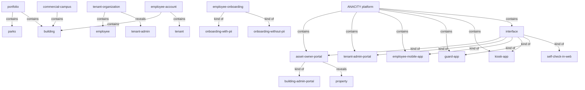
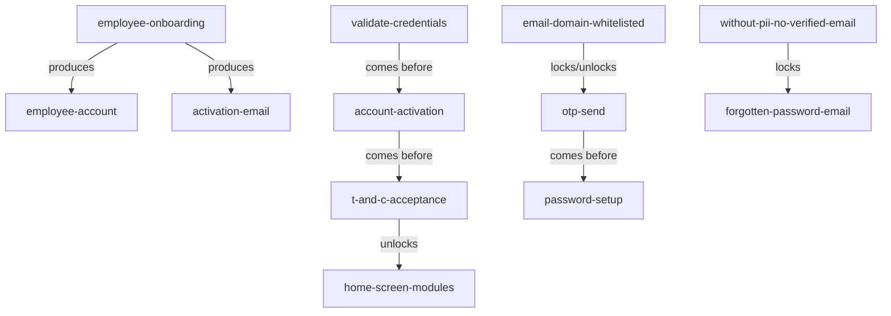

# Platform, containers & onboarding — section glossary draft (Commercial)

**Source header** — Commercial (BRD-Commercial.txt): 1. Introduction / Platform Overview / Platform Interfaces / Abbreviations (L111-228), Tenant Admin 1.2 Employee Onboarding (L1842-1983), Employee Mobile 1.1 Login & Onboarding (L2482-2577). Re-scan = **NEW everywhere** (new build). `Com` = Commercial.

---

## 1. Ontology

### Objects

| # | Term | Meaning (≤12 words, from source) | Evidence (exact quote — where) | Re-scan |
|---|---|---|---|---|
| 1 | Asset Owner Portal | web admin portal to configure the platform | "The web-based administrative portal used by the Embassy SYNC property management team to configure the platform" (Com 1.4) | NEW = "Building Admin Portal" |
| 2 | Building Admin Portal | alternate name for the Asset Owner Portal | "the Asset Owner Portal (also referred to as the Building Admin Portal)" (Com 3) | NEW = "Asset Owner Portal" |
| 3 | Tenant Admin Portal | company-level management portal for tenant admins | "Navigate to Employee Onboarding in the Tenant Admin Portal" (Com 1.2.2) | NEW |
| 4 | Mobile App | employee mobile app (iOS & Android) | "Mobile App (iOS & Android) ... Day-to-day employee actions" (Com 1.3) | NEW = "ANACITY app" (Res) |
| 5 | Kiosk App | tablet app at reception for visitor self-check-in | "The tablet application deployed at the building reception desk, enabling visitor self-check-in" (Com 1.4) | NEW |
| 6 | Guard App | mobile app for on-ground security personnel | "The mobile application used by on-ground security personnel for visitor verification" (Com 1.4) | NEW |
| 7 | Self-check in web | web self-check-in by scanning reception QR cards | "Self-check in web by scanning QR cards displayed at the reception or lobby area" (Com 1.3) | NEW |
| 8 | interface | one of the six components making up the platform | "The platform consists of six primary interfaces that work together" (Com 1.3) | NEW |
| 9 | commercial campus | large multi-tenant commercial site managed on platform | "a multi-tenant commercial campus like Embassy SYNC" (Com 1.2) | NEW = "community" (Res) |
| 10 | property | a property whose operations the platform covers | "Real-time visibility across all properties and operational areas from a single interface" (Com 1.2) | NEW |
| 11 | building | a building managed at building level | "management of access, visitors, service requests, amenities, and communications at building level" (Com 1.3) | NEW = "block" (Res) |
| 12 | portfolio | grouping of parks and buildings under one owner | "Standardized and scalable operations across multiple parks and buildings under one portfolio" (Com 1.2) | NEW = "builder account" (Res) |
| 13 | tenant organization | a tenant company operating within the platform | "The authorized representative of a tenant organization within the platform." (Com 1.4) | NEW |
| 14 | employee account | account created for an onboarded employee | "Creates individual employee accounts in the background for all uploaded employees" (Com 1.2.2) | NEW |
| 15 | employee record | individual employee record entered or uploaded | "Download the Excel template, populate employee records, and upload the completed file" (Com 1.2.2) | NEW |
| 16 | activation email | system email activating an employee account | "Sends each employee a system-generated activation email on their registered email address" (Com 1.2.2) | NEW = "welcome email" (Res) |
| 17 | Terms and Conditions (T&C) | document accepted at first-time login | "review and accept the Terms and Conditions document" (Com 1.1) | NEW |
| 18 | PII (Personally Identifiable Information) | personal data identifying an individual | "Information that can be used to identify an individual, such as name, email address, phone number, employee ID" (Com 1.4) | NEW |
| 19 | Pseudo ID | mapped identifier used in without-PII onboarding | "Employee ID or Pseudo ID (a mapped identifier assigned by the admin)" (Com 1.2.3) | NEW |
| 20 | User ID | unique login id generated for an employee | "Generates a unique User ID and a temporary Password for each uploaded employee" (Com 1.2.3) | NEW |
| 21 | Employee ID | employer-assigned employee identifier | "Full Name, Official Email ID, Mobile Number, Employee ID, Gender" (Com 1.2.2) | NEW |
| 22 | OTP (One-Time Password) | code emailed to verify sign-up identity | "Sends a One-Time Password (OTP) to the entered email address for verification." (Com Sign-Up) | NEW |

### Roles

| # | Term | Meaning (≤12 words, from source) | Evidence (exact quote — where) | Re-scan |
|---|---|---|---|---|
| 1 | Tenant Admin | authorized representative of a tenant organization | "The authorized representative of a tenant organization within the platform." (Com 1.4) | NEW; drift w/ Res Admin |
| 2 | Employee | end user onboarded by the tenant organization | "The Employee Onboarding module enables Tenant Administrators to register their employees" (Com 1.2.1) | NEW = "Resident" (Res, functional) |
| 3 | Property Managers | Asset Owner Portal users managing the property | "Property Managers, Facility Managers, Security Supervisors" (Com 1.3 Asset Owner Portal) | NEW |
| 4 | Facility Managers | Asset Owner Portal users managing facilities | "Property Managers, Facility Managers, Security Supervisors" (Com 1.3) | NEW |
| 5 | Security Supervisors | Asset Owner Portal users overseeing security | "Property Managers, Facility Managers, Security Supervisors" (Com 1.3) | NEW |
| 6 | HR / Office Managers | Tenant Admin Portal users at the tenant company | "Tenant Admin, HR, Office Managers" (Com 1.3 Tenant Admin Portal) | NEW |
| 7 | Tenant Staff | employees/staff using the Mobile App | "Employees, Tenant Staff" (Com 1.3 Mobile App) | NEW |
| 8 | Visitors | people checking in at reception | "Visitors at Reception" (Com 1.3 Kiosk App) | NEW |
| 9 | Security Personnel | on-ground security using the Guard App | "Guard App | Security Personnel" (Com 1.3) | NEW |
| 10 | ANACITY configuration team | ANACITY-side team configuring the deployment | "the ANACITY configuration team" (Com 1.1) | NEW = "ANACITY Implementation Team" (Res) |
| 11 | Embassy SYNC property management team | client team configuring the platform | "used by the Embassy SYNC property management team to configure the platform" (Com 1.4) | NEW |

> Note: Commercial Section 2 (User Roles and Permissions) states "The Asset Owner Portal alone supports 45+ granular roles" — the full role taxonomy (announcements, helpdesk, facility, security, incident, user-management roles) sits outside this section's scope and belongs to the roles/permissions section-reader.

### Steps

| # | Term | Meaning (≤12 words, from source) | Evidence (exact quote — where) | Re-scan |
|---|---|---|---|---|
| 1 | Employee Onboarding | tenant admin registers employees into system | "The Employee Onboarding module enables Tenant Administrators to register their employees" (Com 1.2.1) | NEW; drift w/ Res Onboarding |
| 2 | Onboarding With PII | onboarding model storing personal data | "Model 1: Onboarding With PII Data" (Com 1.2.2) | NEW |
| 3 | Onboarding Without PII | onboarding model storing minimal/no personal data | "Model 2: Onboarding Without PII Data" (Com 1.2.3) | NEW |
| 4 | First-time login / activation | first login and account activation step | "First-time login, account activation, T&C acceptance, and module initialization" (Com 1.1) | NEW |
| 5 | account activation | activate the employee account | "First-time login, account activation" (Com 1.1) | NEW |
| 6 | T&C acceptance | accept terms and conditions step | "T&C acceptance" (Com 1.1) | NEW |
| 7 | module initialization | enable modules for the employee | "module initialization for both PII and non-PII onboarding models" (Com 1.1) | NEW |
| 8 | Employee Sign-Up | self-service account creation via mobile app | "Employee Sign-Up and Account Creation Process" (Com Sign-Up) | NEW |
| 9 | Add Associate | tenant admin onboards a new associate | "Add Associate: Tenant Admins can onboard new employees or associates" (Com 1.2.3) | NEW |
| 10 | bulk upload | create records via Excel upload | "bulk upload via the provided Excel template" (Com 1.2.2) | NEW |
| 11 | manual entry | create records individually | "manual entry of individual records (in batch of 5)" (Com 1.2.2) | NEW |
| 12 | password reset | employee resets temporary password | "Employees are then asked to reset the password" (Com 1.2.3) | NEW |

### States & values

| # | Term | States / values (each on own line) | Evidence (exact quote — where) | Re-scan |
|---|---|---|---|---|
| 1 | onboarding model | • With PII • Without PII | "two distinct onboarding models to accommodate different organizational data privacy policies" (Com 1.2.1) | NEW |
| 2 | employee account status | • activated • deactivated | "Activate / Deactivate Employees: Enable or disable an employee's access to the platform" (Com 1.2.3) | NEW |
| 3 | Pre-Invite enablement | • enabled • disabled | "Enable or Disable Pre-Invites: Control whether a specific employee can create visitor pre-invites" (Com 1.2.3) | NEW |
| 4 | password type | • temporary • personal | "Generates a unique User ID and a temporary Password" (Com 1.2.3); "sets a personal password upon first login" (Com 1.1) | NEW |
| 5 | building/tenant association | • single association • multiple associations | "Checks whether the same email is associated with multiple buildings or tenants" (Com Sign-Up) | NEW |

---

## 2. Topology — the tree

### Verbatim

| Parent (A) | relationship | Child (B) | Evidence (exact quote — where) |
|---|---|---|---|
| ANACITY platform | contains | • Asset Owner Portal • Tenant Admin Portal • Employee Mobile App • Guard App • Kiosk App | "It encompasses the Asset Owner Portal, Tenant Admin Portal, Employee Mobile App, Guard App, and Kiosk App -- all operating as a single connected ecosystem." (Com 1.4) |
| ANACITY platform | contains | • interface (six primary) | "The platform consists of six primary interfaces that work together" (Com 1.3) |
| interface | kind of | • Asset Owner Portal • Tenant Admin Portal • Mobile App • Kiosk App • Guard App • Self-check in web | "six primary interfaces ... Asset Owner Portal ... Tenant Admin ... Mobile App ... Kiosk App ... Guard App ... Self-check in web" (Com 1.3) |
| Asset Owner Portal | kind of | • Building Admin Portal | "the Asset Owner Portal (also referred to as the Building Admin Portal)" (Com 3) |
| portfolio | contains | • parks • buildings | "Standardized and scalable operations across multiple parks and buildings under one portfolio" (Com 1.2) |
| commercial campus | contains | • building | "a large-scale commercial campus -- access control ... at building level" (Com 1.2 / 1.3) |
| tenant organization | contains | • employee | "Tenant Admins can manage employees within their organization" (Com 1.2.3) |
| tenant organization | reveals | • Tenant Admin | "The authorized representative of a tenant organization within the platform." (Com 1.4) |
| employee account | contains | • building • tenant | "automatically assigns the default building and tenant to the employee account" (Com Sign-Up) |
| Asset Owner Portal | reveals | • property (all) | "Real-time visibility across all properties and operational areas from a single interface" (Com 1.2) |
| Employee Onboarding | kind of | • Onboarding With PII • Onboarding Without PII | "two distinct onboarding models" (Com 1.2.1) |

### Mermaid

---

## 3. Choreography — states + gates

### States

| Thing | States (each on own line) | Evidence (exact quote — where) |
|---|---|---|
| employee account | • created • activated • deactivated | "Creates individual employee accounts" → "Activates the employee account" → "Activate / Deactivate Employees" (Com 1.2.2 / 1.2.3) |
| password | • temporary • reset to personal | "temporary Password" (Com 1.2.3); "asked to reset the password" (Com 1.2.3) |
| onboarding model | • With PII • Without PII | "two distinct onboarding models" (Com 1.2.1) |
| Pre-Invite (per employee) | • enabled • disabled | "Enable or Disable Pre-Invites" (Com 1.2.3) |

### Gates (verbatim)

| A | relationship | B | Evidence (exact quote — where) |
|---|---|---|---|
| Employee Onboarding | produces | employee accounts | "Creates individual employee accounts in the background for all uploaded employees" (Com 1.2.2) |
| Employee Onboarding | produces | activation email | "Sends each employee a system-generated activation email" (Com 1.2.2) |
| validate credentials | comes before | account activation | "Validates the credentials and activates the employee account" (Com 1.1) |
| account activation | comes before | T&C acceptance | "Prompts the employee to review and accept the Terms and Conditions" (Com 1.1) |
| T&C acceptance | unlocks | home screen (all modules) | "Reads and accepts the T&C to proceed" → "Loads the home screen with all modules enabled" (Com 1.1) |
| email domain whitelisted | locks / unlocks | sign-up (OTP send) | "checks that the email domain is whitelisted ... Sends a One-Time Password (OTP)" (Com Sign-Up) |
| OTP validated | comes before | password setup | "Validates the OTP and proceeds to the password setup screen." (Com Sign-Up) |
| Without-PII (no verified email) | locks | forgotten-password email | "the system cannot send forgotten password emails as there is no verified email address stored" (Com 1.2.4) |

### Gates (mermaid)

---

## 4. Conflict flags (for Gate 1)

**Commercial ↔ Residential drift (same thing, different word) — from the Commercial side:**
- Top managed container: Commercial **commercial campus** / **property** / **building** (Com 1.2, 1.3) — Residential deployment uses **community** (Res 4.1).
- Parent owner entity: Commercial **portfolio** (Com 1.2) / Embassy REIT asset-owner framing — Residential uses **builder / builder account**.
- Web admin portal: Commercial **Asset Owner Portal / Building Admin Portal** (Com 1.4, 3) — Residential uses **Admin Portal / admin console**.
- End-user mobile app: Commercial **Mobile App / Employee Mobile App** (Com 1.3, 1.4) — Residential uses **ANACITY app**.
- End-user role: Commercial **Employee** (Com 1.2.1) — Residential uses **Resident**; same functional slot (person who logs into the app).
- Structural sub-container: Commercial **building / tower / floor / zone** (Com) — Residential uses **block** ("Tower A").
- ANACITY-side setup role: Commercial **ANACITY configuration team** (Com 1.1) — Residential uses **Support Staff / CSR / ANACITY Implementation Team**.
- Onboarding email: Commercial **activation email** (Com 1.2.2) — Residential uses **welcome email**.

**One word, two meanings:**
- **Tenant** — in Commercial an *organization* (tenant company; Com 1.4 "tenant organization"); in Residential a *person* (relationship-type value, a resident who rents). Same word, different kind.
- **Onboarding** — Commercial = registering employees ("Employee Onboarding", Com 1.2.1); Commercial also = the PII/non-PII *data model* ("onboarding models", Com 1.2.1); Residential = setting up a whole community.
- **Admin** — Com "Tenant Admin" (tenant company rep, Com 1.4); Com "Administrator" (commercial super user, Com 2.1); Res "Community Administrator" (portal super user). Overloaded.
- **Portal** — Commercial admin-facing consoles **Asset Owner Portal / Tenant Admin Portal** vs the Residential per-community "community portal" (data-container sense). Same word spans admin-console and data-container senses.

**Several words, one thing (synonyms within a BRD):**
- **Asset Owner Portal** = **Building Admin Portal** (Com 3, explicit "also referred to as").
- **First-time login / First-Time Activation** = **account activation** (Com 1.1, overlapping labels).

**Part vs whole:**
- **interface** (the set of six) vs each **portal/app** (a member of it).
- **PII** (data category) vs **Employee ID / User ID / Pseudo ID / OTP** (individual identifiers within it).

**Collides with method (OTC) words:**
- Source uses **"Step"** and **"Actor"** as process-table headers (Com 1.2.2) — collides with the method's *step* kind.
- Source uses **"Role"** for its 45+ role taxonomy (Com 2) — collides with the method's *role* kind.
- Source uses **"status"** heavily (activation status) — collides with the method's *state* notion.
