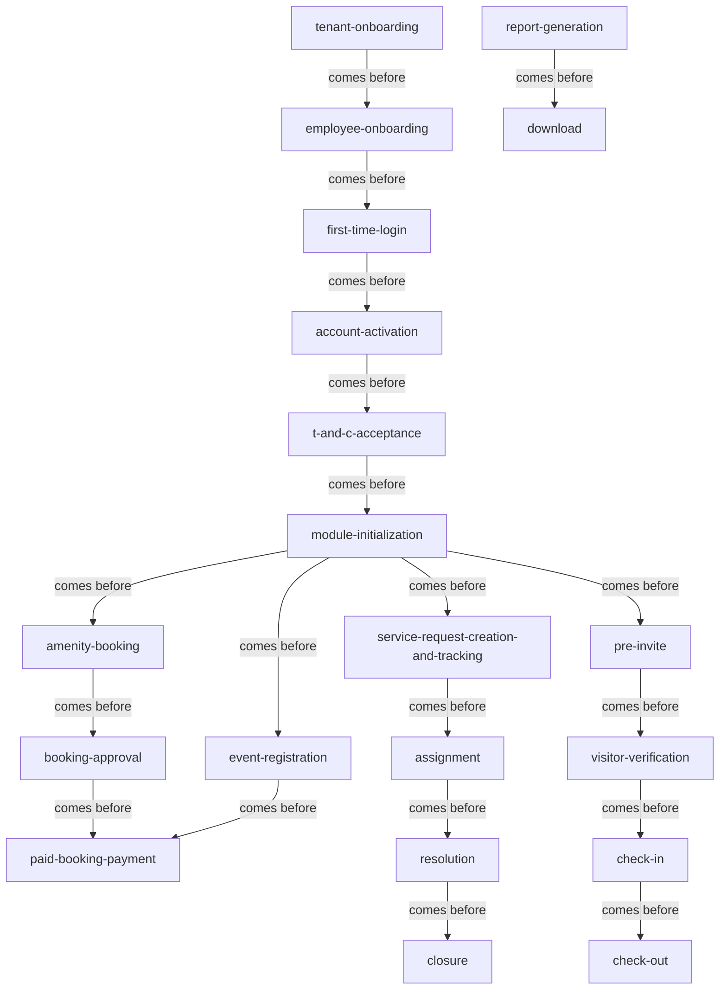

<!-- Assembled per glossary-assembly-principles.md - Part A + Part B: map -->
# Map

The joined picture of the ANACITY Business platform ("Embassy SYNC", Embassy REIT): how the terms connect across all four kinds, as the joined hierarchy and the forward flow. Because the hierarchy is large, this page draws the top level only - the family roots and how they connect through the six interfaces; each family's full subtree lives in its section of [objects.md](objects.md). Every relationship is shown twice, as a mermaid and as a matching verbatim link table.

## How to read this document

- Terms are backticked and kebab-case; the six interfaces of the platform are the hubs the module roots hang off.
- Relationship words: `contains` (parent is the whole, child a part), `reveals` (parent opens on demand to show the child), `comes before` (the first stage runs, then the next).
- The joined hierarchy shows structure (what sits inside what); the forward flow shows sequence (what runs before what).
- This is the Commercial dialect. Shared concepts carry an `Other deployment:` pointer to the Residential word in the kind files; the Residential glossary is the companion dialect.

## Joined hierarchy (top level)

### Verbatim

| Parent (A) | relationship | Child (B) |
|---|---|---|
| `anacity-platform` | contains | `interface` |
| `anacity-platform` | contains | `campus` |
| `anacity-platform` | contains | `portfolio` |
| `anacity-platform` | contains | `role-based-access-model` |
| `campus` | contains | `building` |
| `portfolio` | contains | `building` |
| `building` | contains | `tenant-organization` |
| `interface` | reveals | `asset-owner-portal` |
| `interface` | reveals | `tenant-admin-portal` |
| `interface` | reveals | `mobile-app` |
| `interface` | reveals | `guard-app` |
| `interface` | reveals | `kiosk-app` |
| `interface` | reveals | `self-check-in-web` |
| `asset-owner-portal` | reveals | `directory` |
| `asset-owner-portal` | reveals | `tenants-module` |
| `asset-owner-portal` | reveals | `announcements-module` |
| `asset-owner-portal` | reveals | `event-management-module` |
| `asset-owner-portal` | reveals | `helpdesk-module` |
| `asset-owner-portal` | reveals | `smart-access-module` |
| `asset-owner-portal` | reveals | `amenity-module` |
| `asset-owner-portal` | reveals | `home-dashboard` |
| `asset-owner-portal` | reveals | `report` |
| `asset-owner-portal` | reveals | `payment-gateway` |
| `tenant-admin-portal` | reveals | `tenant-portal` |
| `mobile-app` | reveals | `home-screen` |
| `mobile-app` | reveals | `profile` |
| `mobile-app` | reveals | `in-campus-food-ordering` |
| `mobile-app` | reveals | `notification` |
| `guard-app` | reveals | `visitor-management-system` |
| `kiosk-app` | reveals | `visitor-management-system` |

### Mermaid

```mermaid
flowchart TD
    plat["anacity-platform"] -->|contains| iface["interface"]
    plat -->|contains| campus["campus"]
    plat -->|contains| portf["portfolio"]
    plat -->|contains| rbam["role-based-access-model"]
    campus -->|contains| bldg["building"]
    portf -->|contains| bldg
    bldg -->|contains| torg["tenant-organization"]
    iface -->|reveals| aop["asset-owner-portal"]
    iface -->|reveals| tap["tenant-admin-portal"]
    iface -->|reveals| ma["mobile-app"]
    iface -->|reveals| ga["guard-app"]
    iface -->|reveals| ka["kiosk-app"]
    iface -->|reveals| scw["self-check-in-web"]
    aop -->|reveals| dir["directory"]
    aop -->|reveals| tm["tenants-module"]
    aop -->|reveals| am["announcements-module"]
    aop -->|reveals| emm["event-management-module"]
    aop -->|reveals| hm["helpdesk-module"]
    aop -->|reveals| sam["smart-access-module"]
    aop -->|reveals| amod["amenity-module"]
    aop -->|reveals| hd["home-dashboard"]
    aop -->|reveals| report["report"]
    aop -->|reveals| pg["payment-gateway"]
    tap -->|reveals| tport["tenant-portal"]
    ma -->|reveals| hs["home-screen"]
    ma -->|reveals| prof["profile"]
    ma -->|reveals| icfo["in-campus-food-ordering"]
    ma -->|reveals| notif["notification"]
    ga -->|reveals| vms["visitor-management-system"]
    ka -->|reveals| vms
```

## Forward flow (whole platform)

### Verbatim

| A | relationship | B |
|---|---|---|
| `tenant-onboarding` | comes before | `employee-onboarding` |
| `employee-onboarding` | comes before | `first-time-login` |
| `first-time-login` | comes before | `account-activation` |
| `account-activation` | comes before | `t-and-c-acceptance` |
| `t-and-c-acceptance` | comes before | `module-initialization` |
| `module-initialization` | comes before | `amenity-booking` |
| `module-initialization` | comes before | `event-registration` |
| `module-initialization` | comes before | `service-request-creation-and-tracking` |
| `module-initialization` | comes before | `pre-invite` |
| `amenity-booking` | comes before | `booking-approval` |
| `booking-approval` | comes before | `paid-booking-payment` |
| `event-registration` | comes before | `paid-booking-payment` |
| `service-request-creation-and-tracking` | comes before | `assignment` |
| `assignment` | comes before | `resolution` |
| `resolution` | comes before | `closure` |
| `pre-invite` | comes before | `visitor-verification` |
| `visitor-verification` | comes before | `check-in` |
| `check-in` | comes before | `check-out` |
| `report-generation` | comes before | `download` |

### Mermaid

## Related pages

| page | why it relates |
|---|---|
| [objects.md](objects.md) | each family's full subtree, drawn per family |
| [steps.md](steps.md) | the stage definitions behind the forward flow |
| [roles.md](roles.md) | which role-group operates each interface hub |
| [decisions.md](decisions.md) | why the joined terms have the words they do |
