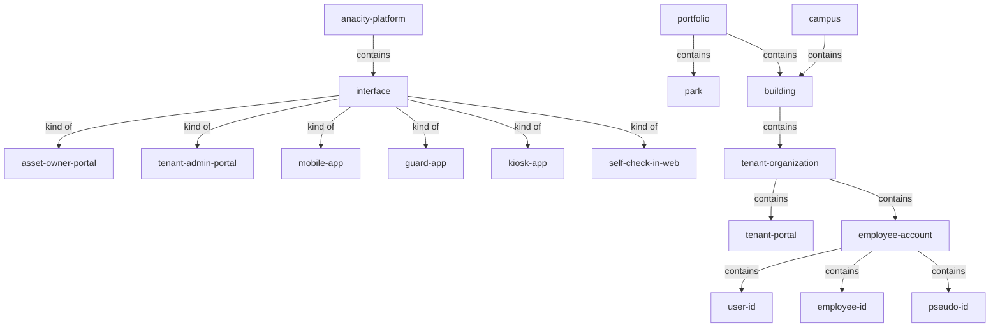
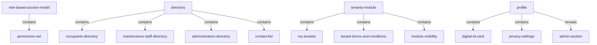
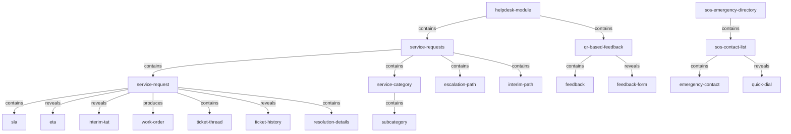
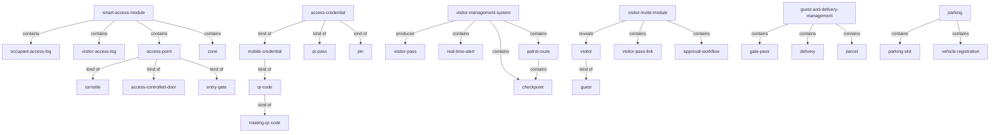
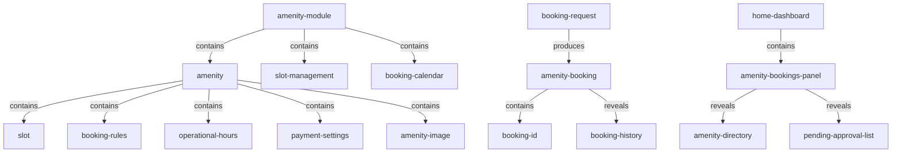
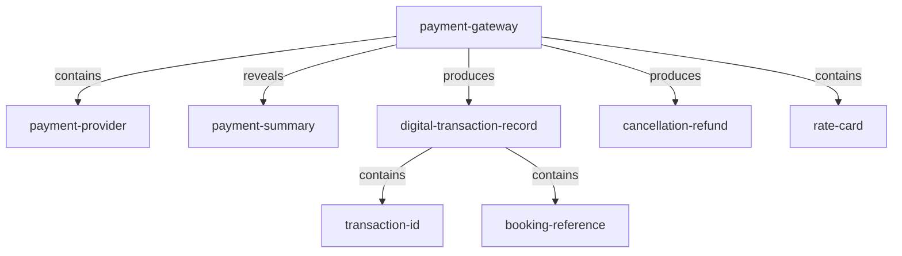
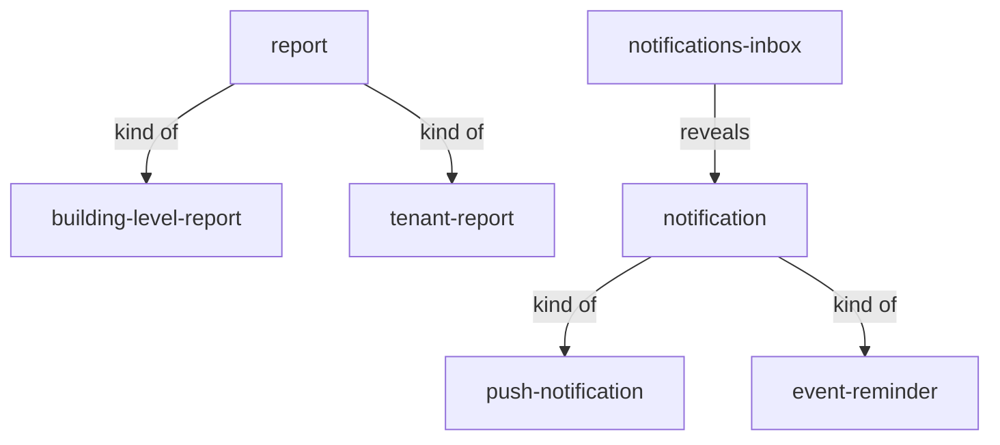

<!-- Assembled per glossary-assembly-principles.md - Part A + Part B: objects -->
# Objects

The things the ANACITY Business platform ("Embassy SYNC", Embassy REIT) stores, shows, or acts on. Terms are grouped first by `family` (the platform's own module areas, in platform order) and then by their parent term. Every definition is the Commercial BRD's own meaning, stated plainly; where a concept also exists in the Residential deployment under a different word, an `Other deployment:` note names that word so the two dialects stay linked.

## How to read this document

- `term` - the Commercial word, kebab-case and backticked.
- `what it is` - one plain sentence naming the kind of thing and what sets it apart. An `Other deployment:` clause names the Residential word for the same concept.
- `source` - the deployment that attests the term; always `Com` (Commercial BRD) here.
- `decision` - a link to the register row that settled a contested word, else `-`.
- `relationship` - how this thing sits against its neighbours, using: `contains` (parent is the whole, child a part), `reveals` (parent opens on demand to show the child), `kind of` (child is a type of the parent), `produces` (parent creates the child as it runs). `part of <x>` names the parent when the row sits under a group.
- Each family opens in the families-at-a-glance table, then lists its parent groups; each family closes with a verbatim link table and the matching mermaid (same links, both ways).

## Families at a glance

| family | root term(s) | what it covers | source |
|---|---|---|---|
| `platform-and-onboarding` | `anacity-platform` | the six interfaces, the campus/portfolio/building containers, the tenant-organization model, and employee onboarding | Com |
| `people-roles-and-directory` | `role-based-access-model`, `directory` | the access model, the building directory, the tenants module, and employee profile | Com |
| `communication-and-engagement` | `announcements-module` | announcements, polls, surveys, forums, clubs, events, newsletters, feed, offers, food ordering, and the home-screen aggregators | Com |
| `helpdesk-and-incidents` | `helpdesk-module` | service requests (tickets), the service desk, escalation, QR-based feedback, contact us, and the SOS directory | Com |
| `access-visitors-and-security` | `smart-access-module`, `visitor-management-system` | smart access, visitor management, the guard/kiosk apps, guest and delivery, and parking | Com |
| `amenities-and-bookings` | `amenity-module` | amenities, slots, the booking calendar, and the Home Dashboard | Com |
| `accounting-and-finance` | `payment-gateway` | in-app paid bookings and event payments through the payment gateway | Com |
| `dashboards-reports-and-notifications` | `report`, `notification` | operational reports, the notifications inbox, and cross-cutting integrations | Com |

---

## Family: `platform-and-onboarding`

### `anacity-platform`
The full ANACITY Business platform as deployed for Embassy SYNC, operating as a single connected ecosystem. Other deployment: same platform, Residential (DIEZ Dubai) deployment.

| term | what it is | source | decision | relationship |
|---|---|---|---|---|
| `interface` | one of the six primary interfaces that work together to make up the platform | Com | - | part of `anacity-platform`; contains the six members below |

### `interface`
One of the six primary interfaces that make up the platform.

| term | what it is | source | decision | relationship |
|---|---|---|---|---|
| `asset-owner-portal` | web administration portal the Embassy SYNC property-management team uses to configure the platform; also called the Building Admin Portal. Other deployment: Admin Portal (Res) | Com | [D-4](decisions.md#d-4) | kind of `interface` |
| `tenant-admin-portal` | company-level management portal for Tenant Admins, HR, and Office Managers of a tenant organization | Com | - | kind of `interface` |
| `mobile-app` | employee mobile app (iOS and Android) for day-to-day actions. Other deployment: ANACITY app (Res) | Com | [D-5](decisions.md#d-5) | kind of `interface` |
| `guard-app` | mobile app used by on-ground security personnel for visitor verification and patrol. Other deployment: Gatekeeper App (Res) | Com | [D-28](decisions.md#d-28) | kind of `interface` |
| `kiosk-app` | tablet app (Smart Lobby) at the reception desk for visitor self-check-in | Com | - | kind of `interface` |
| `self-check-in-web` | web self-check-in reached by scanning QR cards at reception or the lobby | Com | - | kind of `interface` |

### `portfolio`
Grouping of parks and buildings under one owner (Embassy REIT). Other deployment: builder account (Res). See [D-3](decisions.md#d-3).

| term | what it is | source | decision | relationship |
|---|---|---|---|---|
| `park` | one park operated within the portfolio | Com | - | part of `portfolio` |
| `building` | a building managed at building level. Other deployment: block (Res) | Com | [D-2](decisions.md#d-2) | part of `portfolio`; contains `tenant-organization` |

### `campus`
The multi-tenant commercial campus (Embassy SYNC) whose operations the platform covers; also referred to as the property. Other deployment: community (Res). See [D-1](decisions.md#d-1).

| term | what it is | source | decision | relationship |
|---|---|---|---|---|
| `building` | a building within the campus, managed at building level | Com | [D-2](decisions.md#d-2) | part of `campus` |

### `building`
A building managed at building level; the structural container tenant organizations sit within. Other deployment: block (Res).

| term | what it is | source | decision | relationship |
|---|---|---|---|---|
| `tenant-organization` | a company leasing space in the building | Com | [D-21](decisions.md#d-21) | part of `building` |

### `tenant-organization`
A company leasing space in the campus/building - the Commercial sense of "tenant". Commercial-exclusive tenant model. Other deployment: (Residential "tenant" is a renting resident, not an organization). See [D-8](decisions.md#d-8), [D-21](decisions.md#d-21).

| term | what it is | source | decision | relationship |
|---|---|---|---|---|
| `tenant-portal` | the provisioned portal environment created for one tenant organization, reached through the Tenant Admin Portal | Com | - | part of `tenant-organization` |
| `employee-account` | the account created in the background for each onboarded employee of the organization | Com | - | part of `tenant-organization` |

### `employee-account`
The account created for an onboarded employee, carrying its login identifiers and the assigned building and tenant.

| term | what it is | source | decision | relationship |
|---|---|---|---|---|
| `user-id` | unique login id generated for an employee | Com | - | part of `employee-account` |
| `employee-id` | employer-assigned employee identifier, editable only by the Tenant Admin | Com | - | part of `employee-account` |
| `pseudo-id` | mapped identifier assigned by the admin, used in the without-PII onboarding model | Com | - | part of `employee-account` |

### Standalone

| term | what it is | source | decision | relationship |
|---|---|---|---|---|
| `employee-record` | the individual employee record entered manually or uploaded by bulk upload | Com | - | - |
| `activation-email` | system-generated email that activates an employee account. Other deployment: welcome email (Res) | Com | [D-7](decisions.md#d-7) | - |
| `terms-and-conditions` | the T&C document every user must accept before accessing the platform | Com | - | - |
| `acceptance-log` | record of each T&C acceptance event with a precise timestamp | Com | - | - |
| `otp` | one-time password sent to an email or phone number to verify identity | Com | - | - |
| `pii` | personally identifiable information - data that identifies an individual (name, email, phone, employee id) | Com | - | - |
| `excel-template` | downloadable template for bulk upload of employee (and other) records | Com | - | - |

### Family links (verbatim)

| Parent (A) | relationship | Child (B) |
|---|---|---|
| `anacity-platform` | contains | `interface` |
| `interface` | kind of | `asset-owner-portal` |
| `interface` | kind of | `tenant-admin-portal` |
| `interface` | kind of | `mobile-app` |
| `interface` | kind of | `guard-app` |
| `interface` | kind of | `kiosk-app` |
| `interface` | kind of | `self-check-in-web` |
| `portfolio` | contains | `park` |
| `portfolio` | contains | `building` |
| `campus` | contains | `building` |
| `building` | contains | `tenant-organization` |
| `tenant-organization` | contains | `tenant-portal` |
| `tenant-organization` | contains | `employee-account` |
| `employee-account` | contains | `user-id` |
| `employee-account` | contains | `employee-id` |
| `employee-account` | contains | `pseudo-id` |

---

## Family: `people-roles-and-directory`

### `role-based-access-model`
The structured, role-based access model governing roles, permissions, and visibility; the Asset Owner Portal alone supports 45+ granular roles (the persons are collapsed into role-groups in [roles.md](roles.md)).

| term | what it is | source | decision | relationship |
|---|---|---|---|---|
| `permission-set` | the distinct permissions and module visibility attached to a granular role | Com | - | part of `role-based-access-model` |

### `directory`
The Directory Management module - a searchable directory of all people associated with the building.

| term | what it is | source | decision | relationship |
|---|---|---|---|---|
| `occupants-directory` | directory of all registered employees across all tenants. Other deployment: resident directory (Res) | Com | [D-30](decisions.md#d-30) | part of `directory` |
| `maintenance-staff-directory` | directory of facility and maintenance personnel | Com | - | part of `directory` |
| `administrators-directory` | directory of all admin users with their roles and contacts | Com | - | part of `directory` |
| `contact-list` | directory of emergency and key operational contacts. Other deployment: Contact List (Res, a standalone module) | Com | - | part of `directory` |

### `tenants-module`
The Asset Owner Portal module managing the full lifecycle of tenant organizations.

| term | what it is | source | decision | relationship |
|---|---|---|---|---|
| `my-tenants` | sub-module listing and managing the building's tenant organizations | Com | - | part of `tenants-module` |
| `tenant-terms-and-conditions` | the T&C published to Tenant Admin users, versioned and re-accepted on update | Com | - | part of `tenants-module` |
| `module-visibility` | per-tenant enable/disable of features, set from the tenant's contract | Com | - | part of `tenants-module` |

### `profile`
The employee's personal account and settings hub in the Mobile App.

| term | what it is | source | decision | relationship |
|---|---|---|---|---|
| `digital-id-card` | QR-based smart-access credential card shown with a wallet-style animation | Com | - | part of `profile` |
| `privacy-settings` | visibility toggles on profile fields and in-app calling | Com | - | part of `profile` |
| `admin-section` | the dedicated Asset Admin section inside the Mobile App (Overview, Service Requests, Amenity Approval) | Com | - | reveals from `profile` |

### Family links (verbatim)

| Parent (A) | relationship | Child (B) |
|---|---|---|
| `role-based-access-model` | contains | `permission-set` |
| `directory` | contains | `occupants-directory` |
| `directory` | contains | `maintenance-staff-directory` |
| `directory` | contains | `administrators-directory` |
| `directory` | contains | `contact-list` |
| `tenants-module` | contains | `my-tenants` |
| `tenants-module` | contains | `tenant-terms-and-conditions` |
| `tenants-module` | contains | `module-visibility` |
| `profile` | contains | `digital-id-card` |
| `profile` | contains | `privacy-settings` |
| `profile` | reveals | `admin-section` |

---

## Family: `communication-and-engagement`

### `announcements-module`
The module that lets authorized administrators broadcast structured communications and run engagement tools. Other deployment: Communication (Res).

| term | what it is | source | decision | relationship |
|---|---|---|---|---|
| `announcement` | a structured broadcast communication delivered to employees. Other deployment: notice (Res) | Com | [D-15](decisions.md#d-15) | part of `announcements-module` |
| `poll` | a vote with real-time result tracking | Com | - | part of `announcements-module` |
| `survey` | a structured questionnaire that collects employee responses | Com | - | part of `announcements-module` |
| `interest-based-group` | an engagement group (Club) employees join and discuss in | Com | - | part of `announcements-module` |
| `announcement-history` | the searchable list of all past communications | Com | - | reveals from `announcements-module` |

### `announcement`
A structured broadcast communication delivered to employees. Other deployment: notice (Res).

| term | what it is | source | decision | relationship |
|---|---|---|---|---|
| `communication-type-template` | the format/category applied to an announcement (General Notification, Campus Event Update, Emergency Alert); the publishing workflow is unchanged | Com | - | kind of `announcement` |

### `discussion-forum`
The module holding discussion topics and interest-based groups.

| term | what it is | source | decision | relationship |
|---|---|---|---|---|
| `interest-based-group` | a Club / interest-based group created within the forum | Com | - | part of `discussion-forum` |

### `interest-based-group`
An interest-based group (Club) employees join and discuss in; joining an invitation-only group needs approval. A joiner becomes a `group-member` - the Commercial "member" sense, kept distinct from the Residential resident/owner sense. See [D-22](decisions.md#d-22).

| term | what it is | source | decision | relationship |
|---|---|---|---|---|
| `post` | a text post, image post, or poll a member creates in the group | Com | - | part of `interest-based-group` |
| `group-timeline` | where the group's posts are shown | Com | - | reveals `post` |
| `group-card` | tappable card showing a group's name, description, and member count | Com | - | reveals from `interest-based-group` |
| `join-request` | a request to join an invitation-only group, sent to the Forum Administrator | Com | - | part of `interest-based-group` |

### `event-management-module`
The module Asset Administrators use to create, publish, and manage campus-wide events. Other deployment: Events module (Res).

| term | what it is | source | decision | relationship |
|---|---|---|---|---|
| `event` | an admin-configured, employee-bookable campus event | Com | - | part of `event-management-module` |

### `event`
An admin-configured, employee-bookable campus event (free or paid).

| term | what it is | source | decision | relationship |
|---|---|---|---|---|
| `seating-category` | a ticket area with its own price and seats (e.g. Platinum, Gold, Silver Area). Other deployment: ticket category (Res) | Com | [D-18](decisions.md#d-18) | part of `event` |
| `rate-card` | one pricing schedule; here the prices for paid event bookings (the same `rate-card` object also carries gateway settlement pricing under `payment-gateway`). Other deployment: pricing model (Res) | Com | [D-18](decisions.md#d-18) | part of `event` |
| `registration-field` | a customizable field on the event registration form. Other deployment: participation form field (Res) | Com | [D-19](decisions.md#d-19) | part of `registration-form` |
| `registration-form` | the form a Participant completes when registering for an event | Com | [D-19](decisions.md#d-19) | part of `event` |
| `bill-summary` | the page showing ticket type, quantity, and pricing before payment | Com | - | reveals from `event` |

### `home-screen`
The Mobile App landing surface that aggregates cards and sections from other modules. Other deployment: dashboard / home (Res). See [D-29](decisions.md#d-29).

| term | what it is | source | decision | relationship |
|---|---|---|---|---|
| `whats-new-section` | home section showing the latest campus events and announcements | Com | - | part of `home-screen` |
| `pending-approvals-section` | home section listing visitor approvals awaiting the employee host | Com | - | part of `home-screen` |
| `your-activity-section` | home section showing today's visitors, amenity bookings, and events | Com | - | part of `home-screen` |
| `quick-actions-section` | home shortcuts to common actions (Invite Visitor, Raise a Request, Book Amenity, Explore All) | Com | - | part of `home-screen` |
| `bookings-section` | single view of the employee's active and upcoming amenity and event bookings | Com | - | part of `home-screen` |
| `snip-snack-dine-card` | home card that opens the in-campus food-ordering experience | Com | - | reveals `f-and-b-platform` |

### `whats-new-section`
Home section showing the latest campus events and announcements.

| term | what it is | source | decision | relationship |
|---|---|---|---|---|
| `event-card` | a scrollable card for one upcoming event | Com | - | part of `whats-new-section` |
| `announcement-card` | a card that opens the full announcement content | Com | - | part of `whats-new-section` |

### `in-campus-food-ordering`
The integrated in-app food-ordering experience (F&B Integration). Commercial-exclusive.

| term | what it is | source | decision | relationship |
|---|---|---|---|---|
| `f-and-b-platform` | the integrated food-ordering system behind the experience (values: Smart Q, HungerBox) | Com | - | part of `in-campus-food-ordering` |
| `menu` | the food choices per campus outlet | Com | - | part of `f-and-b-platform` |
| `cart` | the items an employee selects before checkout | Com | - | part of `f-and-b-platform` |
| `order` | a placed and confirmed food order, tracked to fulfilment | Com | - | part of `f-and-b-platform` |
| `order-reference` | the identifier confirming an order | Com | - | part of `order` |
| `food-outlet` | a campus restaurant or food court that fulfils orders | Com | - | reveals from `f-and-b-platform` |

### Standalone

| term | what it is | source | decision | relationship |
|---|---|---|---|---|
| `newsletter` | a scheduled informational publication the Asset Owner publishes | Com | - | - |
| `feed` | the campus activity stream shown in one section (activity feed). Commercial-exclusive | Com | - | - |
| `popular-offers` | curated promotions, partner offers, and employee benefit programmes. Commercial-exclusive | Com | - | contains `partner-offer` |
| `partner-offer` | a third-party promotion offered to employees | Com | - | part of `popular-offers` |
| `credits` | a refunded amount held to the user's wallet / profile credit balance | Com | - | - |

### Family links (verbatim)

| Parent (A) | relationship | Child (B) |
|---|---|---|
| `announcements-module` | contains | `announcement` |
| `announcements-module` | contains | `poll` |
| `announcements-module` | contains | `survey` |
| `announcements-module` | contains | `interest-based-group` |
| `announcements-module` | reveals | `announcement-history` |
| `announcement` | kind of | `communication-type-template` |
| `discussion-forum` | contains | `interest-based-group` |
| `interest-based-group` | contains | `post` |
| `interest-based-group` | contains | `join-request` |
| `interest-based-group` | reveals | `group-card` |
| `group-timeline` | reveals | `post` |
| `event-management-module` | contains | `event` |
| `event` | contains | `seating-category` |
| `event` | contains | `rate-card` |
| `event` | contains | `registration-form` |
| `registration-form` | contains | `registration-field` |
| `event` | reveals | `bill-summary` |
| `home-screen` | contains | `whats-new-section` |
| `home-screen` | contains | `pending-approvals-section` |
| `home-screen` | contains | `your-activity-section` |
| `home-screen` | contains | `quick-actions-section` |
| `home-screen` | contains | `bookings-section` |
| `home-screen` | reveals | `snip-snack-dine-card` |
| `whats-new-section` | contains | `event-card` |
| `whats-new-section` | contains | `announcement-card` |
| `in-campus-food-ordering` | contains | `f-and-b-platform` |
| `f-and-b-platform` | contains | `menu` |
| `f-and-b-platform` | contains | `cart` |
| `f-and-b-platform` | contains | `order` |
| `order` | contains | `order-reference` |
| `popular-offers` | contains | `partner-offer` |

```mermaid
flowchart TD
    am["announcements-module"] -->|contains| ann["announcement"]
    am -->|contains| poll["poll"]
    am -->|contains| survey["survey"]
    am -->|contains| ibg["interest-based-group"]
    am -->|reveals| ah["announcement-history"]
    ann -->|kind of| ctt["communication-type-template"]
    forum["discussion-forum"] -->|contains| ibg
    ibg -->|contains| post["post"]
    ibg -->|contains| jr["join-request"]
    ibg -->|reveals| gc["group-card"]
    gt["group-timeline"] -->|reveals| post
    emm["event-management-module"] -->|contains| event["event"]
    event -->|contains| sc["seating-category"]
    event -->|contains| rc["rate-card"]
    event -->|contains| rf["registration-form"]
    rf -->|contains| rfield["registration-field"]
    event -->|reveals| bs["bill-summary"]
    hs["home-screen"] -->|contains| wn["whats-new-section"]
    hs -->|contains| pa["pending-approvals-section"]
    hs -->|contains| ya["your-activity-section"]
    hs -->|contains| qa["quick-actions-section"]
    hs -->|contains| bk["bookings-section"]
    hs -->|reveals| ssd["snip-snack-dine-card"]
    wn -->|contains| ec["event-card"]
    wn -->|contains| ac["announcement-card"]
    icfo["in-campus-food-ordering"] -->|contains| fbp["f-and-b-platform"]
    fbp -->|contains| menu["menu"]
    fbp -->|contains| cart["cart"]
    fbp -->|contains| order["order"]
    order -->|contains| oref["order-reference"]
    po["popular-offers"] -->|contains| poff["partner-offer"]
```

---

## Family: `helpdesk-and-incidents`

### `helpdesk-module`
The complete end-to-end service-request management system. Other deployment: helpdesk / Complaint Box (Res).

| term | what it is | source | decision | relationship |
|---|---|---|---|---|
| `service-requests` | sub-module carrying the full ticket lifecycle from creation to closure; the configured system is the Service Desk | Com | [D-16](decisions.md#d-16) | part of `helpdesk-module` |
| `qr-based-feedback` | sub-module for anonymous scan-and-rate feedback (E-Feedback) | Com | - | part of `helpdesk-module` |

### `service-requests`
The sub-module (a.k.a. the Service Desk) where tickets are configured, raised, routed, and closed.

| term | what it is | source | decision | relationship |
|---|---|---|---|---|
| `service-request` | a facility ticket an employee or Tenant Admin raises; the logged item whose lifecycle is tracked (a.k.a. ticket). Other deployment: complaint (Res) | Com | [D-16](decisions.md#d-16) | part of `service-requests` |
| `service-category` | a main category classifying service requests (e.g. Electrical, Plumbing, Housekeeping). Other deployment: complaint category (Res) | Com | - | part of `service-requests` |
| `escalation-path` | the configured escalation matrix of up to three levels. Other deployment: escalation matrix (Res) | Com | [D-17](decisions.md#d-17) | part of `service-requests` |
| `interim-path` | pre-escalation notification rule applied when SLA windows are at risk. Commercial-exclusive | Com | - | part of `service-requests` |

### `service-request`
A facility ticket an employee or Tenant Admin raises (a.k.a. ticket). Other deployment: complaint (Res).

| term | what it is | source | decision | relationship |
|---|---|---|---|---|
| `subcategory` | a classification nested under a service category | Com | - | part of `service-category` |
| `sla` | the service target window that drives escalation; timers start when a ticket is logged | Com | - | part of `service-request` |
| `eta` | the expected time displayed per ticket | Com | - | reveals from `service-request` |
| `interim-tat` | the interim turnaround time shown per ticket | Com | - | reveals from `service-request` |
| `work-order` | the work order (a.k.a. job card) generated from a service request and worked by facility staff or a service vendor; mirrored in the facility team's CAFM/FM platform. Other deployment: maintenance action item (Res) | Com | [D-27](decisions.md#d-27) | produces from `service-request` |
| `ticket-thread` | the in-app comment thread on a ticket | Com | - | part of `service-request` |
| `ticket-history` | the full record of a ticket's notes and status changes | Com | - | reveals from `service-request` |
| `resolution-details` | the recorded outcome and optional completion images at resolution | Com | - | part of `service-request` |

### `qr-based-feedback`
Sub-module for anonymous scan-and-rate feedback (E-Feedback).

| term | what it is | source | decision | relationship |
|---|---|---|---|---|
| `feedback` | the rating and comments submitted against a QR location | Com | - | part of `qr-based-feedback` |
| `feedback-form` | the form opened when a QR code is scanned | Com | - | reveals from `qr-based-feedback` |

### `sos-emergency-directory`
The always-accessible list of critical emergency contacts, openable from anywhere in the app; syncs to all employees' Mobile Apps.

| term | what it is | source | decision | relationship |
|---|---|---|---|---|
| `sos-contact-list` | the configured list of emergency contacts | Com | - | part of `sos-emergency-directory` |
| `emergency-contact` | a critical emergency number with contact name and role (fire, ambulance, police, building security hotline, FM SPOC) | Com | - | part of `sos-contact-list` |
| `quick-dial` | one-tap direct call to an emergency contact | Com | - | reveals from `sos-contact-list` |

### Standalone

| term | what it is | source | decision | relationship |
|---|---|---|---|---|
| `contact-us` | the in-app way to reach building management or the Tenant Admin (in-app messaging, email, direct call) | Com | - | - |
| `note-template` | a predefined note used during ticket handling | Com | - | - |

### Family links (verbatim)

| Parent (A) | relationship | Child (B) |
|---|---|---|
| `helpdesk-module` | contains | `service-requests` |
| `helpdesk-module` | contains | `qr-based-feedback` |
| `service-requests` | contains | `service-request` |
| `service-requests` | contains | `service-category` |
| `service-requests` | contains | `escalation-path` |
| `service-requests` | contains | `interim-path` |
| `service-category` | contains | `subcategory` |
| `service-request` | contains | `sla` |
| `service-request` | reveals | `eta` |
| `service-request` | reveals | `interim-tat` |
| `service-request` | produces | `work-order` |
| `service-request` | contains | `ticket-thread` |
| `service-request` | reveals | `ticket-history` |
| `service-request` | contains | `resolution-details` |
| `qr-based-feedback` | contains | `feedback` |
| `qr-based-feedback` | reveals | `feedback-form` |
| `sos-emergency-directory` | contains | `sos-contact-list` |
| `sos-contact-list` | contains | `emergency-contact` |
| `sos-contact-list` | reveals | `quick-dial` |

---

## Family: `access-visitors-and-security`

### `smart-access-module`
Centralized access-control management for the asset, capturing entry and exit events across all access points.

| term | what it is | source | decision | relationship |
|---|---|---|---|---|
| `occupant-access-log` | real-time employee entry/exit record | Com | - | part of `smart-access-module` |
| `visitor-access-log` | visitor movement record validated by QR pass | Com | - | part of `smart-access-module` |
| `access-point` | a door, turnstile, or gate where an entry or exit event occurs | Com | - | part of `smart-access-module` |
| `zone` | an access-permission area (floor or tower) permissions are configured at | Com | - | part of `smart-access-module` |

### `access-point`
A controlled entry point (door, turnstile, or vehicle gate) where an access event occurs.

| term | what it is | source | decision | relationship |
|---|---|---|---|---|
| `turnstile` | a controlled entry barrier | Com | - | kind of `access-point` |
| `access-controlled-door` | a controlled door | Com | - | kind of `access-point` |
| `entry-gate` | a controlled vehicle gate | Com | - | kind of `access-point` |

### `access-credential`
A token presented at a reader to gain entry.

| term | what it is | source | decision | relationship |
|---|---|---|---|---|
| `mobile-credential` | a phone-based credential (QR, Bluetooth, or NFC) | Com | - | kind of `access-credential` |
| `qr-code` | a scannable code used as an access, checkpoint, or feedback credential | Com | - | kind of `mobile-credential` |
| `qr-pass` | a visitor's scannable entry pass | Com | - | kind of `access-credential` |
| `rotating-qr-code` | a dynamic, time-limited access QR shown for smart QR access | Com | - | kind of `qr-code` |
| `pin` | a code entered for visitor check-in | Com | - | kind of `access-credential` |

### `visitor-management-system`
The on-ground operational layer for physical visitor access, made up of the Kiosk App and the Guard App.

| term | what it is | source | decision | relationship |
|---|---|---|---|---|
| `visitor-pass` | the pass created to grant a visitor entry; generates a validity-bound QR code | Com | - | produces from `visitor-management-system` |
| `real-time-alert` | an operational alert (unauthorized access, overstay, missed patrol) | Com | - | part of `visitor-management-system` |
| `checkpoint` | a location verified during a guard patrol | Com | - | part of `visitor-management-system` |
| `patrol-route` | an ordered set of checkpoints a guard walks | Com | - | part of `visitor-management-system` |

### `visitor-invite-module`
The Tenant Portal / Mobile App feature for inviting visitors ahead of arrival and tracking walk-ins.

| term | what it is | source | decision | relationship |
|---|---|---|---|---|
| `visitor` | a non-employee entrant; a walk-in or a pre-invited/pre-approved guest is a kind of visitor. Other deployment: visitor (Res) | Com | [D-12](decisions.md#d-12) | reveals from `visitor-invite-module` |
| `visitor-pass-link` | the URL to a visitor pass, sent to the visitor by SMS | Com | - | part of `visitor-invite-module` |
| `approval-workflow` | the configurable routing applied per visitor type. Other deployment: Approver List Hierarchy / ALH (Res) | Com | - | part of `visitor-invite-module` |

### `guest-and-delivery-management`
The Mobile App feature for pre-inviting guests and managing deliveries, with digital gate passes.

| term | what it is | source | decision | relationship |
|---|---|---|---|---|
| `gate-pass` | a digital gate pass generated from the Mobile App | Com | - | part of `guest-and-delivery-management` |
| `guest` | a pre-invited non-employee (personal guest, interview candidate, or contractor); a kind of visitor | Com | [D-12](decisions.md#d-12) | kind of `visitor` |
| `delivery` | a delivered item managed in the app | Com | - | part of `guest-and-delivery-management` |
| `parcel` | a tracked package | Com | - | part of `guest-and-delivery-management` |

### `parking`
Parking monitored across the campus (Park+ Phase 2).

| term | what it is | source | decision | relationship |
|---|---|---|---|---|
| `parking-slot` | a monitored parking space with real-time availability. Other deployment: parking lot (Res) | Com | [D-26](decisions.md#d-26) | part of `parking` |
| `vehicle-registration` | vehicle registration data captured for access and logs | Com | - | part of `parking` |

### Standalone

| term | what it is | source | decision | relationship |
|---|---|---|---|---|
| `smart-access-permissions` | the physical-location access set for an occupant, mapped via Spintly | Com | - | - |
| `attendance-device` | a physical device at entry/exit points that records entry and exit | Com | - | - |
| `government-issued-id` | an identity document validated at visitor entry | Com | - | - |

### Family links (verbatim)

| Parent (A) | relationship | Child (B) |
|---|---|---|
| `smart-access-module` | contains | `occupant-access-log` |
| `smart-access-module` | contains | `visitor-access-log` |
| `smart-access-module` | contains | `access-point` |
| `smart-access-module` | contains | `zone` |
| `access-point` | kind of | `turnstile` |
| `access-point` | kind of | `access-controlled-door` |
| `access-point` | kind of | `entry-gate` |
| `access-credential` | kind of | `mobile-credential` |
| `mobile-credential` | kind of | `qr-code` |
| `access-credential` | kind of | `qr-pass` |
| `qr-code` | kind of | `rotating-qr-code` |
| `access-credential` | kind of | `pin` |
| `visitor-management-system` | produces | `visitor-pass` |
| `visitor-management-system` | contains | `real-time-alert` |
| `visitor-management-system` | contains | `checkpoint` |
| `visitor-management-system` | contains | `patrol-route` |
| `patrol-route` | contains | `checkpoint` |
| `visitor-invite-module` | reveals | `visitor` |
| `visitor-invite-module` | contains | `visitor-pass-link` |
| `visitor-invite-module` | contains | `approval-workflow` |
| `guest-and-delivery-management` | contains | `gate-pass` |
| `visitor` | kind of | `guest` |
| `guest-and-delivery-management` | contains | `delivery` |
| `guest-and-delivery-management` | contains | `parcel` |
| `parking` | contains | `parking-slot` |
| `parking` | contains | `vehicle-registration` |

---

## Family: `amenities-and-bookings`

### `amenity-module`
The module Asset Administrators use to configure and manage all bookable facilities. "Amenity" is the agreed word; "facility" is retired to it. Other deployment: Amenities / Facilities (Res).

| term | what it is | source | decision | relationship |
|---|---|---|---|---|
| `amenity` | a bookable campus facility employees or Tenant Admins reserve (e.g. conference room, cafeteria, gym). Other deployment: facility (Res) | Com | [D-9](decisions.md#d-9) | part of `amenity-module` |
| `slot-management` | sub-module generating slots and managing real-time availability | Com | - | part of `amenity-module` |
| `booking-calendar` | the visual calendar showing all bookings across all amenities | Com | - | part of `amenity-module` |

### `amenity`
A bookable campus facility. Other deployment: facility (Res).

| term | what it is | source | decision | relationship |
|---|---|---|---|---|
| `slot` | a bookable time window on an amenity. Other deployment: slot (Res) | Com | [D-10](decisions.md#d-10) | part of `amenity` |
| `booking-rules` | the configured constraints (duration, frequency, advance window) enforced on bookings | Com | - | part of `amenity` |
| `operational-hours` | the days and time windows an amenity accepts bookings | Com | - | part of `amenity` |
| `payment-settings` | the amount and payment-gateway configuration for a paid amenity | Com | - | part of `amenity` |
| `amenity-image` | media displayed for an amenity | Com | - | part of `amenity` |

### `amenity-booking`
An employee's or Tenant Admin's reservation of an amenity slot. Other deployment: booking (Res).

| term | what it is | source | decision | relationship |
|---|---|---|---|---|
| `booking-request` | a submitted booking awaiting validation or approval | Com | [D-11](decisions.md#d-11) | produces `amenity-booking` |
| `booking-id` | the unique identifier issued for a confirmed booking | Com | - | part of `amenity-booking` |
| `booking-history` | the record of a user's past and upcoming bookings | Com | - | reveals from `amenity-booking` |

### `home-dashboard`
The Asset Owner Portal's consolidated operational overview for the building-management team, first screen after login.

| term | what it is | source | decision | relationship |
|---|---|---|---|---|
| `amenity-bookings-panel` | dashboard widget showing bookings pending approval | Com | - | part of `home-dashboard` |
| `amenity-directory` | the navigable list of amenities | Com | - | reveals from `amenity-bookings-panel` |
| `pending-approval-list` | the list of bookings awaiting admin approval | Com | - | reveals from `amenity-bookings-panel` |

### Family links (verbatim)

| Parent (A) | relationship | Child (B) |
|---|---|---|
| `amenity-module` | contains | `amenity` |
| `amenity-module` | contains | `slot-management` |
| `amenity-module` | contains | `booking-calendar` |
| `amenity` | contains | `slot` |
| `amenity` | contains | `booking-rules` |
| `amenity` | contains | `operational-hours` |
| `amenity` | contains | `payment-settings` |
| `amenity` | contains | `amenity-image` |
| `booking-request` | produces | `amenity-booking` |
| `amenity-booking` | contains | `booking-id` |
| `amenity-booking` | reveals | `booking-history` |
| `home-dashboard` | contains | `amenity-bookings-panel` |
| `amenity-bookings-panel` | reveals | `amenity-directory` |
| `amenity-bookings-panel` | reveals | `pending-approval-list` |

---

## Family: `accounting-and-finance`

### `payment-gateway`
The integrated online payment provider enabling secure in-app digital transactions. Other deployment: Mollak / Noqodi escrow collection (Res).

| term | what it is | source | decision | relationship |
|---|---|---|---|---|
| `payment-provider` | the online provider processing transactions (values: Pine Labs, RazorPay) | Com | [D-25](decisions.md#d-25) | part of `payment-gateway` |
| `payment-summary` | the page showing booking details, amount, and applicable taxes before payment | Com | - | reveals from `payment-gateway` |
| `digital-transaction-record` | the reconcilable record of a payment (transaction id, amount, booking reference, timestamp) | Com | - | produces from `payment-gateway` |
| `cancellation-refund` | a refund handled per the booking cancellation policy. Other deployment: Credit Note (Res) | Com | [D-25](decisions.md#d-25) | produces from `payment-gateway` |
| `rate-card` | the same `rate-card` object, here the agreed gateway settlement pricing shared with the developer for direct settlement | Com | [D-18](decisions.md#d-18) | part of `payment-gateway` |

### `digital-transaction-record`
The reconcilable record of a payment, accessible to Asset Administrators.

| term | what it is | source | decision | relationship |
|---|---|---|---|---|
| `transaction-id` | the id logged per payment transaction | Com | - | part of `digital-transaction-record` |
| `booking-reference` | the booking reference logged per transaction | Com | - | part of `digital-transaction-record` |

### Standalone

| term | what it is | source | decision | relationship |
|---|---|---|---|---|
| `paid-amenity-booking` | an amenity booking that requires in-app payment | Com | - | - |
| `paid-event-registration` | an event registration that requires in-app payment (Participant or Audience) | Com | - | - |

### Family links (verbatim)

| Parent (A) | relationship | Child (B) |
|---|---|---|
| `payment-gateway` | contains | `payment-provider` |
| `payment-gateway` | reveals | `payment-summary` |
| `payment-gateway` | produces | `digital-transaction-record` |
| `payment-gateway` | produces | `cancellation-refund` |
| `payment-gateway` | contains | `rate-card` |
| `digital-transaction-record` | contains | `transaction-id` |
| `digital-transaction-record` | contains | `booking-reference` |

---

## Family: `dashboards-reports-and-notifications`

### `report`
A single reporting object with typed children (not one entry per report type); scheduled or on-demand across every module, run from the Asset Owner Portal (building-wide) or scoped to a tenant. Other deployment: report (Res). Report types are listed as the `report-type` value set in [states.md](states.md).

| term | what it is | source | decision | relationship |
|---|---|---|---|---|
| `building-level-report` | the full building report set run by the Building Admin | Com | [D-20](decisions.md#d-20) | kind of `report` |
| `tenant-report` | a filtered, isolated subset of the building-level reports scoped to one tenant organization | Com | [D-20](decisions.md#d-20) | kind of `report` |

### `notification`
An app alert delivered for a triggered event. "Notification" is the agreed word; "alert" and "reminder" collapse to it. Other deployment: notification (Res).

| term | what it is | source | decision | relationship |
|---|---|---|---|---|
| `push-notification` | a device notification for a triggered event | Com | - | kind of `notification` |
| `event-reminder` | a pre-event reminder notification at configured intervals | Com | - | kind of `notification` |
| `notifications-inbox` | the centralized list of all app alerts | Com | - | reveals `notification` |

### Standalone

| term | what it is | source | decision | relationship |
|---|---|---|---|---|
| `campaign` | a Moengage campaign for user data (future change request) | Com | - | - |
| `offers-section` | the offers/programme surface populated in a later phase | Com | - | - |

### Family links (verbatim)

| Parent (A) | relationship | Child (B) |
|---|---|---|
| `report` | kind of | `building-level-report` |
| `report` | kind of | `tenant-report` |
| `notification` | kind of | `push-notification` |
| `notification` | kind of | `event-reminder` |
| `notifications-inbox` | reveals | `notification` |

---

## Related pages

| page | why it relates |
|---|---|
| [map.md](map.md) | the joined tree that links these objects to roles, steps, and states, plus the forward flow |
| [states.md](states.md) | the named conditions and value-sets these objects move through (booking status, ticket status, report type) |
| [steps.md](steps.md) | the stages of work that create and change these objects |
| [decisions.md](decisions.md) | why each contested object word was chosen and how it maps to the Residential dialect |
