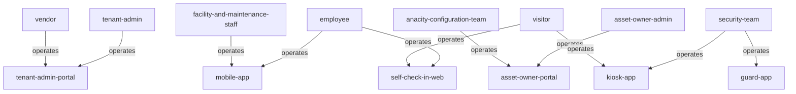

<!-- Assembled per glossary-assembly-principles.md - Part A + Part B: roles -->
# Roles

The kinds of person the ANACITY Business platform ("Embassy SYNC", Embassy REIT) serves and records. Per the settled decision, granular job titles are collapsed into a small set of role-groups (personas); the specific role names appear as values inside the group they belong to, not as their own rows. Each role-group is defined in the Commercial deployment's own words, with an `Other deployment:` note naming the Residential word for the same persona.

## How to read this document

- `term` - the role-group (persona), kebab-case and backticked.
- `what it is` - one plain sentence naming who the person is and what sets them apart, with an `Other deployment:` clause where the Residential word differs.
- `source` - the deployment that attests the group; always `Com` here.
- `decision` - a link to the register row that settled a contested word, else `-`.
- `persona or role` - the granular role names / personas the Commercial BRD lists under this group (the values collapsed into it).
- Relationships are shown two ways below: a verbatim table and a matching mermaid, using `operates` (the role-group is the primary user of that interface).

## Role-groups

| term | what it is | source | decision | persona or role |
|---|---|---|---|---|
| `employee` | the campus end user who logs into the Mobile App - the platform's central persona. Other deployment: resident (Res) | Com | [D-6](decisions.md#d-6) | Employee; Occupant; Tenant Staff; host employee; user; group member |
| `tenant-admin` | the authorized representative of a tenant organization who manages its employees and settings. First-class in the Commercial tenant model | Com | [D-21](decisions.md#d-21) | Tenant Admin; HR Manager; Office Manager; Authorized Employee |
| `asset-owner-admin` | a platform/property administrator configuring and running the campus from the Asset Owner Portal (the portal supports 45+ granular roles). Other deployment: Community Administrator / sub-admin roles (Res) | Com | [D-31](decisions.md#d-31) | Administrator (full access); Asset Administrator / Asset Admin (super-user); Property Manager; Building Admin; Noticeboard Administrator; Forum Administrator; Poll Administrator; Complaint Box Administrator; Complaint Category Administrator; Request Box Administrator; Request Box Assistant; Request Approver; Action Item Administrator; Facility Booking Administrator; Facility Booking Assistant; Vendor Administrator; User Management Administrator; User Management Assistant; Notification Administrator; Incident Reporting Administrator; Incident Reporting Category Admin; CRM; Data Entry Operator; Asset Owner |
| `facility-and-maintenance-staff` | staff who operate and maintain the building and resolve work on the ground. Other deployment: maintenance staff (Res) | Com | [D-32](decisions.md#d-32) | Maintenance Staff; Facility Manager; Maintenance Staff Administrator; Asset Operator; Store Coordinator; Complaint Field Staff; Incident Reporting Field Staff; facility team / building operations team; FM SPOC |
| `security-team` | the guard-facing security personnel who verify visitors, log entry/exit, and patrol. Other deployment: security guard / gatekeeper (Res) | Com | [D-13](decisions.md#d-13) | Security Guard; Security Supervisor; Security Front Office; Security Personnel; reception staff |
| `vendor` | an external provider whose profiles, bills, and service work are managed. Other deployment: vendor (Res) | Com | [D-14](decisions.md#d-14) | Vendor; service vendor; supplier |
| `visitor` | a non-employee entrant to the building; a walk-in or a pre-invited/pre-approved guest is a kind of visitor. Other deployment: visitor (Res) | Com | [D-12](decisions.md#d-12) | walk-in visitor; pre-invited visitor; pre-approved visitor; guest (personal guest, interview candidate, contractor); non-logged-in user |
| `anacity-configuration-team` | the ANACITY-side team, with the Embassy SYNC property-management team, that configures the deployment. Other deployment: ANACITY Implementation Team (Res) | Com | [D-33](decisions.md#d-33) | ANACITY configuration team; Embassy SYNC property management team |

## Relationships

### Verbatim (role-group operates interface)

| Role-group (A) | relationship | Interface (B) |
|---|---|---|
| `employee` | operates | `mobile-app` |
| `employee` | operates | `self-check-in-web` |
| `tenant-admin` | operates | `tenant-admin-portal` |
| `asset-owner-admin` | operates | `asset-owner-portal` |
| `facility-and-maintenance-staff` | operates | `mobile-app` |
| `security-team` | operates | `guard-app` |
| `security-team` | operates | `kiosk-app` |
| `vendor` | operates | `tenant-admin-portal` |
| `visitor` | operates | `kiosk-app` |
| `visitor` | operates | `self-check-in-web` |
| `anacity-configuration-team` | operates | `asset-owner-portal` |

### Mermaid

## Related pages

| page | why it relates |
|---|---|
| [objects.md](objects.md) | the interfaces each role-group operates and the things they act on |
| [steps.md](steps.md) | the stages of work each role-group performs |
| [decisions.md](decisions.md) | why each role-group word was chosen and how it maps to the Residential dialect |
