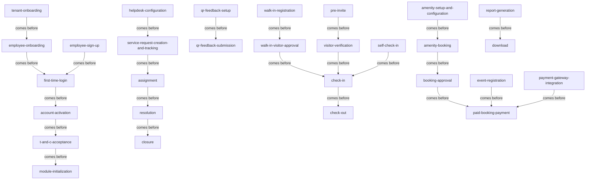

<!-- Assembled per glossary-assembly-principles.md - Part A + Part B: steps -->
# Steps

The named stages of the work on the ANACITY Business platform ("Embassy SYNC", Embassy REIT), grouped by the platform module area (`family`) they belong to and shown in the order they run. Every stage is the Commercial BRD's own, with an `Other deployment:` note where the Residential word for the same stage differs. Where one source word covered several stages, it has been split (for example `onboarding` into `employee-onboarding`, `tenant-onboarding`, and `onboarding-model`; `booking` into `amenity-booking` and `event-registration`).

## How to read this document

- `term` - the stage word, kebab-case and backticked.
- `what it is` - one plain sentence naming the stage and what it does.
- `source` - the deployment that attests the stage; always `Com` here.
- `decision` - a link to the register row that settled a contested word, else `-`.
- `relationship` - how the stage sits in the flow, using `comes before` (this stage runs, then the next) and `part of <process>` (the stage belongs to a larger named process).
- The forward flow is shown two ways at the end: a verbatim table and a matching mermaid, carrying the same `comes before` links.

## Families at a glance

| family | root stage(s) | what it covers | source |
|---|---|---|---|
| `platform-and-onboarding` | `employee-onboarding`, `tenant-onboarding` | registering tenants and employees, sign-up, activation, and password reset | Com |
| `people-roles-and-directory` | `directory-search-and-access` | directory lookups, group joining, and profile management | Com |
| `communication-and-engagement` | `announcement-creation-and-publishing` | creating announcements, polls, surveys, groups, event registration, and food ordering | Com |
| `helpdesk-and-incidents` | `ticket-lifecycle` | configuring, raising, assigning, escalating, resolving, and closing tickets, and QR feedback | Com |
| `access-visitors-and-security` | `visitor-verification` | inviting, verifying, checking in visitors, smart access, and guard patrol | Com |
| `amenities-and-bookings` | `amenity-booking` | configuring amenities and booking, approving, and cancelling | Com |
| `accounting-and-finance` | `paid-booking-payment` | completing an in-app payment through the gateway | Com |
| `dashboards-reports-and-notifications` | `report-generation` | generating and downloading reports and managing notifications | Com |

---

## Family: `platform-and-onboarding`

| term | what it is | source | decision | relationship |
|---|---|---|---|---|
| `tenant-onboarding` | onboard a new tenant organization and provision its Tenant Portal | Com | [D-24](decisions.md#d-24) | comes before `employee-onboarding` |
| `employee-onboarding` | Tenant Admin registers the organization's employees into the system. Other deployment: (Residential onboarding sets up a whole community) | Com | [D-24](decisions.md#d-24) | comes before `first-time-login` |
| `bulk-upload` | create employee records by uploading the completed Excel template | Com | - | part of `employee-onboarding` |
| `manual-entry` | create employee records individually, in batches of five | Com | - | part of `employee-onboarding` |
| `add-associate` | a Tenant Admin onboards a new employee or associate | Com | - | part of `employee-onboarding` |
| `employee-sign-up` | self-service account creation through the Mobile App | Com | - | comes before `first-time-login` |
| `first-time-login` | the employee's first login. Other deployment: resident login / first-time login (Res) | Com | - | comes before `account-activation` |
| `account-activation` | validate credentials and activate the employee account | Com | - | comes before `t-and-c-acceptance` |
| `t-and-c-acceptance` | the employee accepts the Terms and Conditions | Com | - | comes before `module-initialization` |
| `module-initialization` | enable the modules for the employee, loading the home screen | Com | - | - |
| `password-reset` | the employee resets the temporary password to a personal one | Com | - | part of `first-time-login` |

## Family: `people-roles-and-directory`

| term | what it is | source | decision | relationship |
|---|---|---|---|---|
| `directory-search-and-access` | search and view directory records across occupants, staff, and administrators | Com | - | - |
| `terms-and-conditions-acceptance` | display, accept, and log the tenant T&Cs; a T&C update forces re-acceptance | Com | - | part of `tenant-onboarding` |
| `group-discovery-and-joining` | discover interest groups and join, or request to join, one | Com | - | - |
| `profile-update` | edit the profile photo and editable profile fields | Com | - | - |
| `change-password` | enter the current password and set and confirm a new one | Com | - | part of `profile-update` |
| `delete-account` | irreversibly delete the employee account (re-onboarding required after) | Com | - | - |

## Family: `communication-and-engagement`

| term | what it is | source | decision | relationship |
|---|---|---|---|---|
| `announcement-creation-and-publishing` | create and broadcast a structured announcement | Com | - | - |
| `poll-creation-and-distribution` | create and publish a poll | Com | - | - |
| `survey-creation-and-response-collection` | create a survey and gather responses | Com | - | - |
| `interest-group-creation-and-management` | create a group and moderate its discussions | Com | - | - |
| `event-registration-management` | employee registers for an event and admin tracks attendance | Com | - | - |
| `event-registration` | an employee signs up for an event (Audience or Participant). Other deployment: event booking (Res) | Com | [D-11](decisions.md#d-11) | comes before `paid-booking-payment` |
| `in-campus-food-ordering` | browse menus, order, pay, and track food to fulfilment | Com | - | - |

## Family: `helpdesk-and-incidents`

| term | what it is | source | decision | relationship |
|---|---|---|---|---|
| `helpdesk-configuration` | admin setup of the ticketing system, categories, and escalation paths | Com | - | comes before `service-request-creation-and-tracking` |
| `service-request-creation-and-tracking` | an employee or Tenant Admin raises and tracks a facility ticket | Com | - | comes before `assignment` |
| `assignment` | a ticket is assigned to facility staff or a service vendor | Com | - | comes before `resolution` |
| `escalation` | an unresolved ticket is moved to the next level when SLA or interim limits pass | Com | - | part of `ticket-lifecycle` |
| `resolution` | staff record the resolution details and mark the ticket resolved | Com | - | comes before `closure` |
| `closure` | the user confirms the resolution and the ticket is archived | Com | - | - |
| `ticket-lifecycle` | the end-to-end flow from creation to closure | Com | [D-16](decisions.md#d-16) | - |
| `qr-feedback-setup` | admin generates and places a feedback QR | Com | - | comes before `qr-feedback-submission` |
| `qr-feedback-submission` | a user scans the QR and submits feedback | Com | - | - |

## Family: `access-visitors-and-security`

| term | what it is | source | decision | relationship |
|---|---|---|---|---|
| `pre-invite` | an employee or Tenant Admin invites a visitor in advance | Com | - | comes before `visitor-verification` |
| `bulk-visitor-invite` | invite many visitors via Excel upload | Com | - | part of `pre-invite` |
| `send-invite` | the employee sends the visitor invite, delivering a pass link | Com | - | part of `pre-invite` |
| `walk-in-registration` | register a visitor on arrival at reception | Com | - | comes before `walk-in-visitor-approval` |
| `walk-in-visitor-approval` | the employee host approves or rejects a walk-in from the home screen | Com | - | comes before `check-in` |
| `visitor-verification` | the guard verifies the visitor before entry | Com | - | comes before `check-in` |
| `self-check-in` | the visitor checks in unaided at the kiosk | Com | - | comes before `check-in` |
| `check-in` | record the visitor's arrival and grant entry | Com | - | comes before `check-out` |
| `check-out` | record the visitor's departure | Com | - | - |
| `tap-access` | employee entry by tapping the device to the reader (NFC or Bluetooth) | Com | - | - |
| `smart-qr-access` | employee entry via a rotating QR code | Com | - | - |
| `guard-patrol` | a guard's scheduled round of checkpoints. Other deployment: guard patrolling (Res) | Com | - | - |
| `checkpoint-verification` | verifying presence at a checkpoint by QR scan or NFC tap | Com | - | part of `guard-patrol` |

## Family: `amenities-and-bookings`

| term | what it is | source | decision | relationship |
|---|---|---|---|---|
| `amenity-setup-and-configuration` | create and configure an amenity, generating its slots | Com | - | comes before `amenity-booking` |
| `amenity-booking` | an employee browses, selects a slot, and confirms a booking. Other deployment: resident booking flow (Res) | Com | [D-11](decisions.md#d-11) | comes before `booking-approval` |
| `booking-approval` | admin approves or rejects a pending booking | Com | - | comes before `paid-booking-payment` |
| `make-booking` | admin creates a booking on behalf of a user from the calendar | Com | - | - |
| `cancel-booking` | cancel a booking, releasing the slot and refunding per policy | Com | - | - |

## Family: `accounting-and-finance`

| term | what it is | source | decision | relationship |
|---|---|---|---|---|
| `payment-gateway-integration` | integrate the in-app payment provider | Com | - | comes before `paid-booking-payment` |
| `paid-booking-payment` | book, pay through the gateway, confirm, and record the transaction | Com | - | - |

## Family: `dashboards-reports-and-notifications`

| term | what it is | source | decision | relationship |
|---|---|---|---|---|
| `report-generation` | generate a report on demand or on schedule, queued in the background | Com | - | comes before `download` |
| `download` | download the generated report in the configured format. Other deployment: export (Res) | Com | [D-23](decisions.md#d-23) | - |
| `notification-management` | view and manage notifications and their preferences | Com | - | - |

---

## Forward flow

### Verbatim (A comes before B)

| A | relationship | B |
|---|---|---|
| `tenant-onboarding` | comes before | `employee-onboarding` |
| `employee-onboarding` | comes before | `first-time-login` |
| `employee-sign-up` | comes before | `first-time-login` |
| `first-time-login` | comes before | `account-activation` |
| `account-activation` | comes before | `t-and-c-acceptance` |
| `t-and-c-acceptance` | comes before | `module-initialization` |
| `helpdesk-configuration` | comes before | `service-request-creation-and-tracking` |
| `service-request-creation-and-tracking` | comes before | `assignment` |
| `assignment` | comes before | `resolution` |
| `resolution` | comes before | `closure` |
| `qr-feedback-setup` | comes before | `qr-feedback-submission` |
| `pre-invite` | comes before | `visitor-verification` |
| `walk-in-registration` | comes before | `walk-in-visitor-approval` |
| `walk-in-visitor-approval` | comes before | `check-in` |
| `visitor-verification` | comes before | `check-in` |
| `self-check-in` | comes before | `check-in` |
| `check-in` | comes before | `check-out` |
| `amenity-setup-and-configuration` | comes before | `amenity-booking` |
| `amenity-booking` | comes before | `booking-approval` |
| `booking-approval` | comes before | `paid-booking-payment` |
| `event-registration` | comes before | `paid-booking-payment` |
| `payment-gateway-integration` | comes before | `paid-booking-payment` |
| `report-generation` | comes before | `download` |

### Mermaid

## Related pages

| page | why it relates |
|---|---|
| [map.md](map.md) | the joined tree and the same forward flow set in the whole-platform picture |
| [objects.md](objects.md) | the things these stages create and change |
| [states.md](states.md) | the conditions objects pass through as these stages run |
| [decisions.md](decisions.md) | why contested stage words were chosen and how splits were made |
