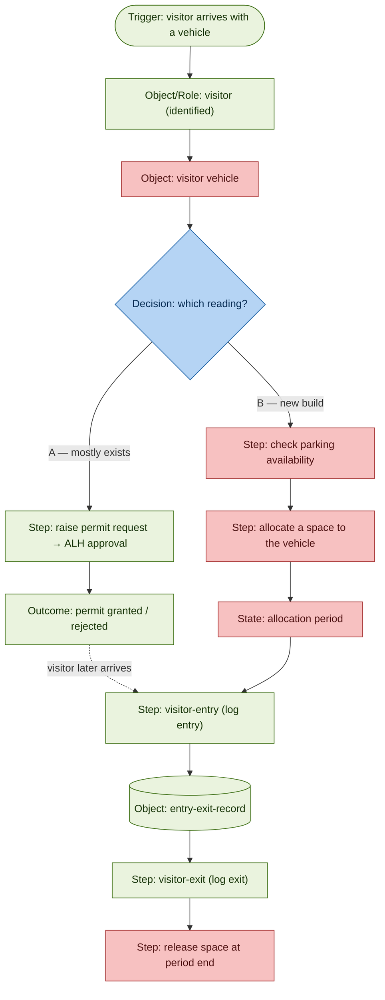
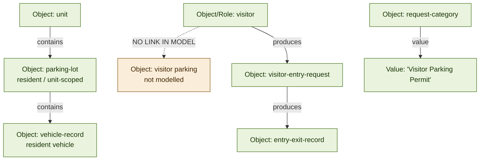

# Feature fit — "Check & allocate visitor parking for a visitor vehicle for a period"

- **Date:** 2026-09-30
- **Glossary:** unset (Residential / Commercial)
- **Family:** `access-visitors-and-security`

> Convention:
> - `glossary terms and values` are in pills
> - *file names* are in italics
> - kinds are tagged in [square brackets]

---

## How this was read — the four layers

| Layer | What it unravels | How it helps |
|---|---|---|
| Layer 1 — Family | which part of the product this belongs to | narrows the search to one family, so you don't read the whole glossary |
| Layer 2 — Term & kind | the agreed word, and whether it's an object, role, step or state | gives the exact word to match, and points to the right document |
| Layer 3 — Structure & movement | how the term connects, and the step-by-step flow with its gates | shows whether the feature can reuse existing rails, and where it plugs in |
| Layer 4 — Proof & close calls | the exact quotes, the deployment differences, the reuse-vs-missing call | lets you cite every claim and settle the tricky calls honestly |

---

## Files this view drew on

Grouped by the layer each file served here — the narrowed reading list, not the whole glossary.

### Layer 1 — Family

| File | What it gave |
|---|---|
| *residential/map.md* | the families overview; the all-families search for "Visitor Parking" |

### Layer 2 — Term & kind

| File | What it gave |
|---|---|
| *residential/objects.md* | `visitor` `parking-lot` `vehicle-record` `request-category` (holds the "Visitor Parking Permit" value) |
| *residential/roles.md* | `visitor` as a persona (D-4) — the Role half of the split |
| *residential/states.md* | `slot-state` `released` — the release analogue |
| *residential/decisions.md* | D-4 (`visitor` canonical) |

### Layer 3 — Structure & movement

| File | What it gave |
|---|---|
| *residential/steps.md* | `visitor-entry` / `visitor-exit` the absent parking-allocation step |

### Layer 4 — Proof & close calls

| File | What it gave |
|---|---|
| *residential/_analysis/access-visitors-and-security-glossary.md* | parking is unit-scoped the roles (gatekeeper-admin, resident, security-guard) |
| *commercial/_analysis/access-visitors-and-security-glossary.md* | `visitor pass validity` `invite duration` check-in / check-out host approval |
| *_reconciliation/assembled-glossary.md* | Commercial parking is Park+ Phase 2 |

---

## Verdict — New capability

We can reuse the nouns (`visitor`, parking space, vehicle) and an existing approval path, but the product does **not** model allocating a parking space to a visitor for a period. That part is a build, not a config.

**At a glance**

- Reuse: 8 elements (see table)
- Net-new: 5 elements (the capability itself)
- Decisions that block: 2 (reading, glossary)

**Reuse — already in the glossary**

| Concept | Kind | Residential | Commercial |
|---|---|---|---|
| visitor (entrant) | Object | `visitor` | `visitor` / `guest` |
| visitor (persona) | Role | `visitor` | `visitor` / `guest` |
| parking space | Object | `parking-lot` | `parking-slot` (Phase 2) |
| vehicle | Object | `vehicle-record` | `vehicle-registration` |
| permit category | Object | `request-category` | — |
| approval | Step | `member-request-flow` (ALH) | host approval |
| entry logging | Step | `visitor-entry` | `check-in` |
| exit logging | Step | `visitor-exit` | `check-out` |

**Net-new — the build**

| Net-new element | Kind | Why it's new |
|---|---|---|
| visitor-scoped parking | Object | parking hangs off `unit`, never off `visitor`; needs a new `visitor` → parking link |
| availability check | Step | Residential has none; Commercial availability is Park+ Phase 2 (future) |
| allocate / assign a space | Step | no reserve-a-space step or gate exists anywhere |
| allocation period | State | periods exist only on visitor passes, never on parking |
| release at period end | Step | an analogue exists (`slot` `released`) but it is a different object |

**Decisions that block**

- Reading: a permit request, or a live check-and-allocate
- Glossary: Residential, or Commercial

---

## Diagram 1 — Movement (how the feature would flow)

**Colours**

- Green — already in the glossary (reuse)
- Red — not in the glossary (new)
- Blue — a decision you must make

**Read it:** the only continuous green rail is identify visitor → (permit approval) → log entry/exit. Everything that makes this feature what it is — check, allocate, period, release — is red.

---

## Diagram 2 — Model (what the analysis found in the term graph)

**Read it:** parking hangs off `unit` (a resident), never off `visitor`. "Visitor Parking" exists only as a permit value, not as an allocatable space. The dashed edge is the gap.

**Values referenced**

- `visitor-request-status` [State] values (Res):
  - `waiting`
  - `approved`
  - `rejected`
- `visitor pass validity` [State] values (Com) — the nearest time-bound analogue, on passes not parking:
  - `single-use`
  - `time-bound`
  - `expired`
- `invite duration` [State] values (Com):
  - `single-day`
  - `multi-day`

---

## Who acts (roles)

| Step | Who | Kind | Source |
|---|---|---|---|
| Manage vehicles and parking | `gatekeeper-admin` / `security-supervisor` | Role | residential access glossary:48, 50 |
| Approve the visitor or permit | `resident` (Res) / `host employee` (Com) | Role | residential access glossary:45 / commercial access glossary:60 |
| Log entry and exit | `security-guard` (via Gatekeeper/Guard App) | Role | residential access glossary:49 |

No new role is needed — the actors already exist. Only the capability is missing.

---

## Steps followed (the operation trace)

**Decomposed tokens**

- `visitor` (root)
- visitor parking
- visitor vehicle
- check
- allocate
- for a period of time

**Token: visitor**

| Input | What you did | Processing | Output |
|---|---|---|---|
| visitor | pick the Glossary | not stated; parking differs sharply by glossary | unset → carry both (open question) |
| visitor | find the Family | scan families | `access-visitors-and-security` |
| visitor | Kind → Object/Role; match rung 1 (exact) | search *objects.md* / *roles.md* / *decisions.md* | exact term `visitor` — both Object and Role (D-4) → REUSE |

**Token: visitor parking**

| Input | What you did | Processing | Output |
|---|---|---|---|
| visitor parking | Kind → Object | search *objects.md* for a parking term | `parking-lot` (Res, unit-scoped) / `parking-slot` (Com) |
| visitor parking | check the "visitor" qualifier | search topology for a visitor↔parking link | Res parking is unit-scoped; no link from `visitor` to parking |
| visitor parking | match — rung 2 (synonym) | search *decisions.md* for "visitor parking" | not a term/synonym |
| visitor parking | search all families | search for "Visitor Parking" | only a Value of `request-category` — "Visitor Parking Permit" |
| result | — | — | GAP — parking exists; visitor-scoped parking does not |

**Token: visitor vehicle**

| Input | What you did | Processing | Output |
|---|---|---|---|
| visitor vehicle | Kind → Object | search *objects.md* for a vehicle term | `vehicle-record` (Res, unit-bound) / `vehicle-registration` (Com) |
| visitor vehicle | check the "visitor" qualifier | is it tied to a visitor? | resident/unit-bound; no visitor vehicle |
| result | — | — | GAP |

**Token: check**

| Input | What you did | Processing | Output |
|---|---|---|---|
| check | Kind → Step/State | search for a parking-availability concept | Com only: real-time parking availability (Park+ Phase 2); Res none |
| result | — | — | Partial (Com, Phase 2) / GAP (Res) |

**Token: allocate**

| Input | What you did | Processing | Output |
|---|---|---|---|
| allocate | Kind → Step | search *steps.md* access family for allocate/assign/reserve parking | no parking allocation step; only "create lots" and "save vehicle record" |
| result | — | — | GAP |

**Token: for a period of time**

| Input | What you did | Processing | Output |
|---|---|---|---|
| for a period of time | Kind → State/value | search *states.md* for a parking duration | none for parking |
| for a period of time | find the nearest time-bound | search access states | `visitor pass validity`, `invite duration` — on passes, not parking |
| result | — | — | GAP for parking; a pass-validity analogue exists but is a different object |

---

## Evidence & traceability (appendix)

| Claim | Element | Kind | Source |
|---|---|---|---|
| visitor is a defined term, both persona and object | `visitor` (D-4) | Object / Role / Decision | roles.md:25 / objects.md:508 / decisions.md:22 |
| parking is unit-scoped | `parking-lot` "for a unit" | Object | objects.md:511 |
| a unit can hold many lots | `unit` contains `parking-lot` | Relationship | residential access glossary:90 |
| vehicle is resident's | `vehicle-record` "against a lot and unit" | Object | objects.md:512 |
| "Visitor Parking Permit" is a permit value | Value of `request-category` | Value | objects.md:373 |
| request → approval path exists | `member-request-flow` → ALH → output/rejection | Step | steps.md:191 |
| visitor entry/exit logging exists | `visitor-entry` / `visitor-exit` → `entry-exit-record` | Step | steps.md:76 |
| no parking allocation step | absent from access steps | Step | steps.md:71-80 |
| period only on passes | `visitor pass validity`, `invite duration` | State | commercial access glossary:100-101 |
| Commercial parking is Phase 2 | scope note | — | assembled-glossary.md:138 |
| release analogue (different object) | `slot-state` includes `released` | State | states.md:103 |
