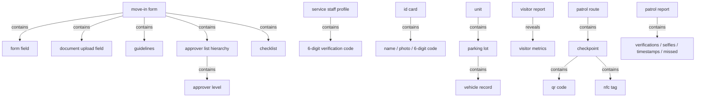
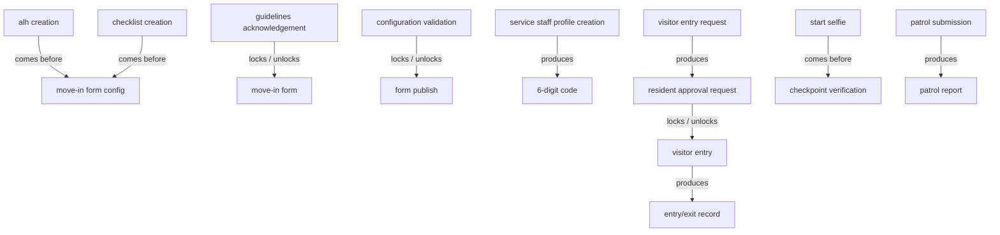

# Section glossary — Access, visitors, gatekeeper & security — Residential

**Source read:** Res 4.9 Move-In & Move-Out (1482–1650), Res 4.14 Gatekeeper (2567–2813), Res 4.23 Guard Patrolling (4618–4827). Integration mechanism (Spintly hardware/reader, Park+) dropped per brief; product terms kept.

---

## Ontology

### Objects

| # | Term | Meaning (≤12 words, from the source) | Evidence (exact quote — where) | Re-scan |
|---|---|---|---|---|
| 1 | Move-In form | resident-facing form to move into a unit | "Open Move-In form in the ANACITY app" (Res 4.9) | NEW |
| 2 | Move-Out form | resident-facing form to move out of a unit | "an identical configuration flow for Move-Out forms" (Res 4.9) | NEW |
| 3 | Approver List Hierarchy (ALH) | the approval chain routing a resident submission | "Create Approver List Hierarchy" (Res 4.9) | NEW |
| 4 | checklist | items an approver reviews before approval | "the checklist is displayed to the approver before approval" (Res 4.9) | NEW |
| 5 | form field | a configurable field on the Move-In/Out form | "Add form fields: Field Name, Type, Applicability" (Res 4.9) | NEW |
| 6 | document upload field | field for uploading documents on the form | "Configure document upload fields: formats, size limits" (Res 4.9) | NEW |
| 7 | guidelines | text shown to residents before form unlock | "Add guidelines for resident display" (Res 4.9) | NEW |
| 8 | service staff profile | record of a service-staff member | "create a service staff profile with full details" (Res 4.14) | NEW |
| 9 | 6-digit verification code | unique code identifying a service staff member | "auto-generates a unique 6-digit verification code upon save" (Res 4.14) | NEW |
| 10 | ID card | printable card with name, photo, code | "generate a printable ID card for each service staff member, containing name, photo, and 6-digit code" (Res 4.14) | NEW |
| 11 | parking lot | a mapped parking space for a unit | "Create parking lots with details (Lot ID, location, type)" (Res 4.14) | NEW = "parking slot" (Com) |
| 12 | vehicle record | registered vehicle against a lot and unit | "Save the vehicle record associated with the parking lot and unit" (Res 4.14) | NEW |
| 13 | visitor | a non-resident/non-employee entering the building | "Enter the visitor's mobile number" (Res 4.14) | NEW |
| 14 | visitor entry request | request routed to the resident for approval | "Submit the visitor entry request" (Res 4.14) | NEW |
| 15 | visitor report (Detailed Report) | record of visitor entries, filterable/exportable | "Gatekeeper > Visitors > Detailed Report" (Res 4.14) | NEW = "visitor records" |
| 16 | visitor metrics | visitor volume/trends in a bar chart | "view visitor metrics in bar graph format via visitor metrics CTA" (Res 4.14) | NEW |
| 17 | Gatekeeper App | app used by security guards in real time | "Gatekeeper App is used by security guards in real time" (Res 4.14) | NEW = "Guard App" (Com) |
| 18 | entry/exit record | logged entry and exit of a person | "Sync entry and exit record to admin portal visitor report" (Res 4.14) | NEW |
| 19 | checkpoint | a location verified during a patrol | "Create checkpoints in the Gatekeeper App" (Res 4.23) | NEW |
| 20 | patrol route | an ordered set of checkpoints | "Create a named patrol route using multiple checkpoints" (Res 4.23) | NEW |
| 21 | QR code | scannable code at a checkpoint or for access | "generate and print a QR code" (Res 4.23) | NEW |
| 22 | NFC tag | tappable tag at a checkpoint | "place a physical NFC tag at the location" (Res 4.23) | NEW |
| 23 | selfie | photo capturing patrol start/end identity | "Initiate the patrol session by capturing a selfie" (Res 4.23) | NEW |
| 24 | patrol summary | pop-up of duration and missed checkpoints | "Review the patrol summary pop-up" (Res 4.23) | NEW |
| 25 | patrol report (Guard Patrolling Report) | report of a patrol session | "automatically generate a patrol report" (Res 4.23) | NEW |
| 26 | incident | issue raised during a patrol | "raise an incident directly through the Guard Patrolling module" (Res 4.23) | NEW — cross-module (Incident Management) |

### Roles

| # | Term | Meaning (≤12 words, from the source) | Evidence (exact quote — where) | Re-scan |
|---|---|---|---|---|
| 1 | Community Administrator | configures forms and reports (Residential) | "Owner: Community Administrator" (Res 4.9) | NEW |
| 2 | Resident | unit occupant who approves visitors | "Send a real-time approval request to the resident" (Res 4.14) | NEW |
| 3 | Owner | a resident who owns the unit | "Applicability (Owner/Tenant/Both)" (Res 4.9) | NEW |
| 4 | Tenant | a resident who rents the unit (Residential) | "Applicability (Owner/Tenant/Both)" (Res 4.9) | NEW — drift vs Com "tenant organisation" |
| 5 | Security Supervisor | admin over gatekeeper, patrol, staff | "allow a Security Supervisor to create a service staff profile" (Res 4.14) | NEW |
| 6 | Security Guard | field guard logging entry and patrol | "The system shall allow guards to record visitor entry" (Res 4.14) | NEW |
| 7 | Gatekeeper Admin | admin of vehicles and parking | "Security Supervisor / Gatekeeper Admin" (Res 4.14) | NEW |
| 8 | service staff | worker serving a unit (e.g. helper) | "Map the service staff to a residential unit" (Res 4.14) | NEW ~ "Maintenance Staff" (Com) |

### Steps

| # | Term | Meaning (≤12 words, from the source) | Evidence (exact quote — where) | Re-scan |
|---|---|---|---|---|
| 1 | move-in | process of moving a resident into a unit | "the admin-side configuration of Move-In and Move-Out workflows" (Res 4.9) | NEW |
| 2 | move-out | process of moving a resident out of a unit | "the admin-side configuration of Move-In and Move-Out workflows" (Res 4.9) | NEW |
| 3 | guidelines acknowledgement | resident acknowledges guidelines to unlock form | "Read and acknowledge guidelines (checkbox)" (Res 4.9) | NEW |
| 4 | bulk upload | uploading many staff/vehicle records via template | "Download the Excel template from the portal" (Res 4.14) | NEW ~ "bulk visitor invite" |
| 5 | visitor entry | logging a visitor's entry | "Guard Flow -- Visitor Entry" (Res 4.14) | NEW |
| 6 | visitor exit | logging a visitor's exit | "Record visitor exit with timestamp when the visitor departs" (Res 4.14) | NEW |
| 7 | service staff entry | logging staff entry via 6-digit code | "log service staff entry and exit using the 6-digit verification code" (Res 4.14) | NEW |
| 8 | guard patrol (patrol) | guard's scheduled round of checkpoints | "structured patrol routes across a community" (Res 4.23) | NEW |
| 9 | checkpoint verification | verifying presence by QR scan or NFC tap | "record a verified checkpoint entry when the Guard scans the QR code or taps the NFC tag" (Res 4.23) | NEW |

### States & values

| # | Term | States / values (from the source) | Evidence (exact quote — where) | Re-scan |
|---|---|---|---|---|
| 1 | hierarchy type | • Single-Level • Multi-Level | "Select hierarchy type (Single-Level or Multi-Level)" (Res 4.9) | NEW |
| 2 | field applicability | • Owner • Tenant • Both | "Applicability (Owner/Tenant/Both)" (Res 4.9) | NEW |
| 3 | visitor request status | • Waiting • Approved • Rejected | "Monitor the 'Waiting' screen for the resident's approval or rejection" (Res 4.14) | NEW |
| 4 | service staff status | • Exited (on exit) • deactivated (not deleted) | "update status to 'Exited'"; "profiles can be deactivated (not deleted)" (Res 4.14) | NEW |
| 5 | patrol outcome | • completed • missed checkpoints | "number of missed checkpoints (if any)" (Res 4.23) | NEW |

---

## Topology — the tree

### Verbatim

| Parent (A) | relationship | Child (B) | Evidence (exact quote — where) |
|---|---|---|---|
| Move-In form | contains | • form field • document upload field • guidelines | "add form fields, configure document uploads, and add guidelines" (Res 4.9) |
| Move-In form | contains | • ALH • checklist | "map an ALH, link a checklist" (Res 4.9) |
| ALH | contains | • approver level | "add Level 2 and further levels with respective approver details" (Res 4.9) |
| service staff profile | contains | 6-digit verification code | "auto-generates a unique 6-digit verification code upon save" (Res 4.14) |
| ID card | contains | • name • photo • 6-digit code | "printable ID card ... containing name, photo, and 6-digit code" (Res 4.14) |
| unit | contains | parking lot | "A unit can have multiple parking lots" (Res 4.14) |
| parking lot | contains | vehicle record | "add vehicle details against a mapped parking lot" (Res 4.14) |
| visitor report | reveals | visitor metrics | "view visitor metrics in bar graph format via visitor metrics CTA" (Res 4.14) |
| patrol route | contains | checkpoint | "Create a named patrol route using multiple checkpoints" (Res 4.23) |
| checkpoint | contains | • QR code • NFC tag | "For each checkpoint, either (a) generate ... a QR code ... or (b) place a physical NFC tag" (Res 4.23) |
| patrol report | contains | • verifications • selfies • timestamps • missed checkpoints | "capturing all verifications, selfies, timestamps, duration, and missed checkpoints" (Res 4.23) |

### Mermaid

---

## Choreography — states + gates

### States

| Thing | States (each on its own line) | Evidence (exact quote — where) |
|---|---|---|
| Move-In form | • locked • unlocked (after acknowledgement) | "Unlock form after acknowledgment" (Res 4.9) |
| visitor entry request | • Waiting • Approved • Rejected | "Monitor the 'Waiting' screen for the resident's approval or rejection" (Res 4.14) |
| service staff profile | • active • deactivated (not deleted) | "Service staff profiles can be deactivated (not deleted)" (Res 4.14) |
| service staff entry | • entered • Exited | "Record exit timestamp and update status to 'Exited'" (Res 4.14) |
| patrol session | • initiated (start selfie) • completed (closing selfie) • submitted | "capture a closing selfie ... Submit the patrol to finalise the record" (Res 4.23) |
| checkpoint | • verified • missed | "record a verified checkpoint entry"; "number of missed checkpoints" (Res 4.23) |

### Gates (verbatim)

| A | relationship | B | Evidence (exact quote — where) |
|---|---|---|---|
| ALH creation | comes before | Move-In form configuration | "ALH must exist before Move-In form configuration" (Res 4.9) |
| checklist creation | comes before | Move-In form configuration | "Checklist must be created before Move-In form configuration" (Res 4.9) |
| guidelines acknowledgement | locks / unlocks | Move-In form | "Unlock form after acknowledgment" (Res 4.9) |
| configuration validation | locks / unlocks | form publish | "auto-validate all required components ... before publishing the form" (Res 4.9) |
| service staff profile creation | produces | 6-digit verification code | "auto-generates a unique 6-digit verification code upon save" (Res 4.14) |
| visitor entry request | produces | resident approval request | "Send a real-time approval request to the resident" (Res 4.14) |
| resident approval | locks / unlocks | visitor entry | "Grant entry if approved; deny entry if rejected" (Res 4.14) |
| visitor entry/exit | produces | entry/exit record (to report) | "Sync entry and exit record to admin portal visitor report" (Res 4.14) |
| start selfie | comes before | checkpoint verification | "Initiate the patrol session by capturing a selfie" (Res 4.23) |
| patrol submission | produces | patrol report | "Upon patrol submission, the system shall automatically generate a Guard Patrolling Report" (Res 4.23) |

### Gates (mermaid)

---

## Conflict flags (for Gate 1)

**Several words, one thing (synonym clusters)**
- **Residential `visitor`** (Res 4.14) — the Commercial deployment also uses guest / walk-in visitor / pre-invited visitor / pre-approved visitor for the same non-employee entrant. "guest" (Com 1.17 Gate Pass) vs "visitor" (used everywhere else).
- **pass cluster: visitor pass / QR pass / gate pass / digital gate pass / digital access pass / temporary QR pass / visitor pass link** — all "an entry credential/document". (Brief's expected "e-pass" term not found in source; nearest is "visitor pass link".)
- **Residential `Security Guard`** (Res 4.14) — the Commercial deployment also names the same field security role guard / security personnel / Security & Reception Staff. "security personnel (Guard App)" (Com 1.3) vs "Security Guard" (Res 4.14 / Com VMS 5).

**One word, two meanings**
- **Tenant** — Residential = a *resident who rents a unit* (Owner/Tenant/Both, Res 4.9); Commercial = a *tenant organisation* leasing space, with its own Tenant Admin (Com 1.4). Different referents.
- **Guard Patrol** — Residential uses it as a *step/process* (Res 4.23); the Commercial deployment also uses it as a named *sub-module/object* (Com 1.5 Sub-Module D; Com VMS 5 Sub-Module C).

**Part vs whole**
- checkpoint is part of patrol route; QR code / NFC tag are part of a checkpoint (Res 4.23).
- visitor metrics is part of (revealed by) the visitor report (Res 4.14).

**Collides with method words**
- **gate** — source "entry gate" / "gate pass" vs Choreography's "gate" (flow control). Same word, different concept.
- **state** — source "Access Not Enabled State" (Com 1.8) vs the method's "state/value" kind.
- **step** — source "Process Steps" tables vs the method's "step" kind.

**Residential vs Commercial drift (same platform, two deployments)**
- **Residential `Gatekeeper App`** — the Commercial deployment uses `Guard App` for the same guard-facing mobile app.
- **Approver of a visitor:** Residential routes visitor approval to the `Resident` (Res 4.14) — the Commercial deployment routes it to the `host employee` instead.
- **Residential `service staff`** (Res 4.14) — the Commercial deployment uses `Maintenance Staff` (Com 1.5) for the non-employee worker (Res = helpers serving a unit; Com = building operations staff).
- **Admin roles:** Residential `Community Administrator` / `Security Supervisor` — the Commercial deployment uses `Asset Admin` / `Tenant Admin` for governance (governance model drift).
- **Credential scheme:** Residential uses the `6-digit verification code` for service staff — the Commercial deployment uses QR pass + PIN / rotating QR / Tap Access for visitors & employees. Residential is manual guard-mediated; Commercial is Spintly smart-access / turnstile self-service.
- **Residential `parking lot`** (Gatekeeper-managed, mapped to unit) — the Commercial deployment uses `parking slot` (Park+ Phase 2, slot availability) for the parking object.
- **Move-In / Move-Out** (Res 4.9) has no Commercial counterpart in this section — resident onboarding form vs commercial occupant onboarding via Tenant Admin.

**Mechanism dropped (not terms, per brief)**
- Spintly (hardware/reader/integration), Park+ platform, Excel template upload, SMS/URL/WebView/deep link delivery — integration/how, excluded; the *product* terms they carry (access point, turnstile, gate pass, parking, QR pass, PIN) are kept.
