# Section glossary — Accounting, Finance & Procurement — Residential

**Source read:** Residential BRD 7. Module Requirements 7.1 Accounting Module Setup [AC] → 7.14 Defaulter Reminder [DR] (incl. 7.11 Reports), 8. Master Data Requirements, 9. Specific Requirements (lines 5010–6807). Locators: `Res <module>`. Re-scan = **NEW BUILD** (every row NEW).

---

## 1. Ontology — the things, by kind

### Objects

| # | Term | Meaning (≤12 words, from source) | Evidence (exact quote — where) | Re-scan |
|---|---|---|---|---|
| 1 | Accounting Module | the accounting capability being onboarded and activated | "onboarding and activating the Accounting Module within ANACITY for DIEZ" (Res 7.1) | NEW |
| 2 | bank account | account configured to receive/make payments | "configure bank accounts (Account Number, Bank Name, Account Type, Closing Balance)" (Res 7.1 BR-AC-001) | NEW |
| 3 | Cash and Bank Accounts | accounts set up to receive/make payments | "Cash and Bank Accounts are set up manually to receive/make payments" (Res 7.1) | NEW |
| 4 | Petty Cash account | default cash account available without manual creation | "A default Petty Cash account shall be available without manual creation" (Res 7.1 BR-AC-001) | NEW |
| 5 | charge category | income/expenditure head invoices are raised against | "Charge categories are created for both income and expenditure streams" (Res 7.1) | NEW |
| 6 | accounting head | head created per charge category | "Charge Category / Accounting Head Creation" (Res 7.1) | NEW |
| 7 | Receivable/Payable head | head auto-generated per charge category | "Receivable/Payable heads are auto-generated per category" (Res 7.1) | NEW |
| 8 | GL account | general-ledger account a category maps to | "mapped to corresponding GL accounts" (Res 7.1 BR-AC-002) | NEW |
| 9 | Chart of Accounts (COA) | the approved account structure, all classes | "The Chart of Accounts is auto-created during charge category setup" (Res 7.1) | NEW |
| 10 | accounting class | class of account: Assets/Liabilities/Revenues/Expenses | "all accounting classes: Assets, Liabilities, Revenues, and Expenses" (Res 7.1) | NEW |
| 11 | Member income category | income category for resident invoicing | "Member income categories (General Fund, Reserved Fund, Additional Charges)" (Res 7.1) | NEW |
| 12 | Non-Member income category | income category for ad hoc income | "Non-Member income categories (Access Card Charges, Violation Charges)" (Res 7.1) | NEW |
| 13 | Expense category | category configured for expenditure | "and Expense categories are configured" (Res 7.1) | NEW |
| 14 | General Fund | a member income category / fund | "Member income categories (General Fund, Reserved Fund, Additional Charges)" (Res 7.1) | NEW |
| 15 | Reserved Fund | a member income category / fund | "General Fund, Reserved Fund, Additional Charges" (Res 7.1) | NEW = "Reserve Fund" |
| 16 | Additional Charges | a member income category | "General Fund, Reserved Fund, Additional Charges" (Res 7.1) | NEW |
| 17 | Access Card Charges | a non-member income category | "Non-Member income categories (Access Card Charges, Violation Charges)" (Res 7.1) | NEW |
| 18 | Violation Charges | a non-member income category | "(Access Card Charges, Violation Charges)" (Res 7.1) | NEW |
| 19 | Accounting Period | period required before any accounting transaction | "An Accounting Period must be set up before any accounting transactions" (Res 7.1) | NEW |
| 20 | financial year period | the current-year accounting period | "The current financial year period (Jan 2026–Dec 2026) is available by default" (Res 7.1) | NEW |
| 21 | closing balance | unit balance uploaded at initiation | "Upload closing balances for all units/flats (one-time activity at system initiation)" (Res 7.1) | NEW = "opening balance" |
| 22 | opening balance | one-time balance loaded before live transactions | "Opening balance upload is a one-time activity" (Res 7.1 assumption 5) | NEW = "closing balance" |
| 23 | outstanding balance | positive uploaded balance owed by unit | "Positive values = outstanding balance" (Res 7.1) | NEW |
| 24 | advance | negative uploaded balance credited to unit | "Negative values = advance from unit" (Res 7.1) | NEW |
| 25 | Excel template | provided template for upload | "An Excel template is provided" (Res 7.1) | NEW |
| 26 | prefix | prefix configured for documents; FY + number appended | "A prefix is configured for Member and Non-Member income invoices, payments, and credit notes" (Res 7.1) | NEW |
| 27 | invoice | document billing a member/unit for charges | "generates invoice with a unique sequential number" (Res 7.2) | NEW |
| 28 | receipt | money-received document | "Invoice / Receipt / Credit Note Prefix Setup" (Res 7.1) | NEW |
| 29 | payment | money paid/received against a charge | "invoices, payments, and credit notes" (Res 7.1) | NEW |
| 30 | tax structure | structure defining tax types, cap, rounding, validity | "Tax structures are created with: Tax Structure Name, applicable tax types" (Res 7.1) | NEW = "tax slab" |
| 31 | tax slab | mapped tax applied to charge categories | "Each created tax slab is mapped to the relevant charge categories" (Res 7.1) | NEW = "tax structure" |
| 32 | tax type | Input VAT / Output VAT / Standard Rated | "applicable tax types (Input VAT, Output VAT, Standard Rated)" (Res 7.1) | NEW |
| 33 | Input VAT | VAT paid on purchases | "Input VAT Report — VAT paid on purchases" (Res 7.11) | NEW |
| 34 | Output VAT | VAT collected on sales/services | "Output VAT Report — VAT collected on sales/services" (Res 7.11) | NEW |
| 35 | capped amount | ceiling on a tax structure | "capped amount, rounding option, and validity period" (Res 7.1) | NEW |
| 36 | unit / flat | the billed community property | "Upload closing balances for all units/flats" (Res 7.1) | NEW |
| 37 | Block | grouping of units | "Unit and Block data shall be pre-filled" (Res 7.1 BR-AC-003) | NEW |
| 38 | charge | levy added to units under a category | "navigates to Income > Add Charges" (Res 7.2) | NEW |
| 39 | Charge Type | Fixed Amount or Variable Charge | "Selects Charge Type: Fixed Amount … or Variable Charge" (Res 7.2) | NEW |
| 40 | Fixed Amount | same amount to all selected units | "Fixed Amount (same amount to all selected units)" (Res 7.2) | NEW |
| 41 | Variable Charge | per-unit charge from area | "Variable Charge (calculated per unit based on Super Built-up Area, Plot Area, or Terrace Area)" (Res 7.2) | NEW |
| 42 | Super Built-up Area | area basis for variable charge | "based on Super Built-up Area, Plot Area, or Terrace Area" (Res 7.2) | NEW |
| 43 | Plot Area | area basis for variable charge | "Super Built-up Area, Plot Area, or Terrace Area" (Res 7.2) | NEW |
| 44 | Terrace Area | area basis for variable charge | "Super Built-up Area, Plot Area, or Terrace Area" (Res 7.2) | NEW |
| 45 | charge breakup | breakup details shown on invoice | "Charge breakup details … shall be included on the invoice" (Res 7.2 BR-IV-001) | NEW |
| 46 | terms and conditions | T&C included on invoice | "applicable terms and conditions shall be included on the invoice" (Res 7.2 BR-IV-001) | NEW |
| 47 | Residential Unit Master Data | unit sq. ft. data for variable invoicing | "unit master data (sq. ft. area) must be accurate" (Res 7.2) | NEW |
| 48 | recurring invoice | auto-generated invoice on a schedule | "automated generation of recurring invoices for member income" (Res 7.3) | NEW |
| 49 | frequency | recurring cadence | "Frequency (Weekly/Monthly/Quarterly/Half-Yearly/Yearly)" (Res 7.3) | NEW |
| 50 | Due Date Policy | days after charge date payment is due | "Due Date Policy (X days after charge date)" (Res 7.3) | NEW |
| 51 | Rounding Off Rule | rounding applied to charges | "and Rounding Off Rule" (Res 7.3) | NEW |
| 52 | Penalty/Interest Scheme | scheme linked to a recurring invoice | "Optionally links a Penalty/Interest Scheme and sets Penalty Start Date" (Res 7.3) | NEW |
| 53 | Penalty Start Date | date overdue penalties begin accruing | "penalty start date (the date from which overdue penalties begin accruing)" (Res 7.3 BR-RI-005) | NEW |
| 54 | penalty scheme | scheme controlling overdue-charge calculation | "configuring penalty and late payment schemes" (Res 7.4) | NEW = "late payment scheme" |
| 55 | Penalty Charge Type | penalty type, e.g. Normal CAT | "Select Penalty Charge Type — Choose applicable type (e.g., Normal CAT)" (Res 7.4) | NEW |
| 56 | Calculation Type | % Based or Fixed | "Select Calculation Type — Choose: % Based or Fixed" (Res 7.4) | NEW |
| 57 | Calculation Method | e.g. Per Overdue Day | "Select Calculation Method — Choose: Per Overdue Day" (Res 7.4) | NEW |
| 58 | Minimum Amount Due | minimum outstanding to trigger penalty | "Enter Minimum Amount Due to Apply Penalty" (Res 7.4) | NEW |
| 59 | Minimum Penalty Amount | floor amount for any penalty | "Enter Minimum Penalty Amount — Set the floor amount" (Res 7.4) | NEW |
| 60 | Penalty % Per Annum | annual penalty percentage | "Enter Penalty % Per Annum" (Res 7.4) | NEW |
| 61 | Pending Amount | base penalty is calculated on | "Calculate Penalty On — Define the base: Pending Amount" (Res 7.4) | NEW |
| 62 | overdue charge | charge past due, penalised | "how overdue charges are calculated and applied to unit accounts" (Res 7.4) | NEW |
| 63 | non-member invoice | invoice not linked to unit statement | "Non-member invoices are not linked to unit statements of account" (Res 7.5) | NEW |
| 64 | vendor charges | a non-member income source | "including vendor charges, event rentals, stall fees" (Res 7.5) | NEW |
| 65 | event rentals | a non-member income source | "vendor charges, event rentals, stall fees" (Res 7.5) | NEW |
| 66 | stall fees | a non-member income source | "event rentals, stall fees, and other ad hoc income" (Res 7.5) | NEW |
| 67 | ad hoc income | non-member income not tied to units | "other ad hoc income not linked to community members or unit accounts" (Res 7.5) | NEW |
| 68 | Payer Details | Bill To Name, TRN, Address | "Enters Payer Details: Bill To Name, Tax Registration Number (TRN, if applicable), Address" (Res 7.5) | NEW |
| 69 | Tax Registration Number (TRN) | payer's VAT registration number | "Tax Registration Number (TRN, if applicable)" (Res 7.5) | NEW |
| 70 | Income Category | category selected on non-member invoice | "Selects Income Category" (Res 7.5) | NEW |
| 71 | VAT Amount | VAT auto-calculated on charge | "System auto-calculates VAT Amount and Total" (Res 7.5) | NEW |
| 72 | charge line | one line item on an invoice/note/bill | "Admin can add additional charge lines" (Res 7.5) | NEW = "line item" |
| 73 | statement of account (SOA) | unit account statement | "Non-member invoices are not linked to unit statements of account" (Res 7.5); "Statement of Account (SOA)" (Res 7.14) | NEW |
| 74 | Debit Note | note for additional charges | "Debit Notes for additional charges" (Res 7.6) | NEW |
| 75 | Credit Note | note for adjustments and refunds | "Credit Notes are used for adjustments and refunds" (Res 7.6) | NEW |
| 76 | Note Type | Debit Note or Credit Note | "Admin selects Note Type (Debit Note or Credit Note)" (Res 7.6) | NEW |
| 77 | Customer account | member/unit or vendor account note is against | "Selects the Customer account" (Res 7.6) | NEW |
| 78 | vendor account | account a note can be raised against | "against member/unit accounts and vendor accounts" (Res 7.6) | NEW |
| 79 | Reference Details | original invoice, reason, amount, line items | "Enters Reference Details (original invoice, reason, amount, line items)" (Res 7.6) | NEW |
| 80 | line item | a description+amount line on a note/bill | "multiple charge line items within a single debit or credit note" (Res 7.6 BR-DN-003) | NEW = "charge line" |
| 81 | attachment | supporting document mandatory before submission | "Attachment shall be mandatory before submission" (Res 7.6 BR-DN-005) | NEW |
| 82 | note number | official number generated on approval | "System generates the official note number" (Res 7.6) | NEW |
| 83 | Journal Voucher (JV) | accounting journal entry auto-posted on approval | "automatically create the corresponding accounting journal entry (JV)" (Res 7.6 BR-DN-006) | NEW = "journal entry" |
| 84 | open invoice | outstanding invoice a credit note adjusts | "applied as an adjustment against one or more open invoices" (Res 7.6 BR-DN-007) | NEW |
| 85 | Approval Hierarchy (ALH) | configured approver chain for approvals | "Approval hierarchy (ALH) is configured before note submission" (Res 7.6) | NEW = "Approval List / Approver List" |
| 86 | Vendor Portal | portal for vendors to submit/track bills | "The Vendor Portal enables registered vendors to directly submit bills" (Res 7.7) | NEW |
| 87 | bill | vendor's invoice submitted for payment | "Navigates to Bills & Payments > Submit Bills" (Res 7.7) | NEW = "invoice / expense bill" |
| 88 | Public Vendor List | list of self-registered vendors pending mapping | "Registered vendors shall appear in the Public Vendor List" (Res 7.7 BR-VP-002) | NEW |
| 89 | My Vendor List | community's mapped active vendor list | "pending mapping to the community's My Vendor List" (Res 7.7 BR-VP-002) | NEW |
| 90 | Trade License Number | vendor identifier, dedup key | "If Trade License Number already exists, system auto-fetches vendor details" (Res 7.7) | NEW |
| 91 | vendor profile | vendor's editable details record | "Vendor Profile Management" (Res 7.7) | NEW |
| 92 | chat | bill-specific vendor–admin channel | "Chat is available per bill. Supports file attachments" (Res 7.7) | NEW |
| 93 | expense bill | bill linked to an approved PO or PR | "creating and recording expense bills linked to approved Purchase Orders (PO) or Purchase Requests (PR)" (Res 7.8) | NEW = "bill" |
| 94 | Purchase Order (PO) | approved order a bill/accrual links to | "linked to an approved PO or PR number" (Res 7.8 BR-EB-001) | NEW |
| 95 | Purchase Request (PR) | request created and approved before RFQ/PO | "Purchase Request (PR) creation and approval" (Res 7.10) | NEW |
| 96 | Budget Period | financial period a bill/accrual is attributed to | "Select Budget Period — Choose the budget period applicable to this bill" (Res 7.8) | NEW |
| 97 | Expense Category | expense head on a line item | "Add line items with: Expense Category, Item Name, Type, Unit, Quantity, Price, Taxes, Total" (Res 7.8) | NEW |
| 98 | Vendor Master | maintained vendor master data | "System Dependency: PO/PR module, Vendor Master" (Res 7.8) | NEW |
| 99 | Mollak | UAE regulatory escrow management platform | "integrates with Mollak — the UAE regulatory escrow management platform" (Res 7.9) | NEW |
| 100 | service charge invoice | invoice synced with Mollak | "All service charge invoices and receipts must be synchronised with Mollak" (Res 7.9) | NEW |
| 101 | service charge receipt | receipt synced/posted with Mollak | "Import and Post Service Charge Receipts (date range)" (Res 7.9) | NEW |
| 102 | Owner Details | owner data imported from Mollak | "Import Owner Details and verify" (Res 7.9) | NEW |
| 103 | Consumer ID | ANACITY consumer identifier for Mollak | "Enter ANACITY Consumer ID and Property Group ID" (Res 7.9) | NEW |
| 104 | Property Group ID | Mollak property group identifier | "Enter ANACITY Consumer ID and Property Group ID" (Res 7.9) | NEW |
| 105 | Property ID | Mollak/ANACITY property mapping id | "Download Mollak and ANACITY Property ID files" (Res 7.9) | NEW |
| 106 | Noqodi | payment source that auto-syncs to Mollak | "Noqodi payments auto-sync; offline payments must be manually posted" (Res 7.9) | NEW |
| 107 | offline payment | payment manually posted in ANACITY | "offline payments must be manually posted in ANACITY" (Res 7.9) | NEW |
| 108 | Mollak Receipt Bank | mapped bank for Noqodi settlement | "Noqodi Settlement Bank → Mollak Receipt Bank" (Res 7.9) | NEW |
| 109 | GF Escrow Bank | escrow bank mapped to General Fund | "General Fund Bank → GF Escrow Bank" (Res 7.9) | NEW |
| 110 | RF Escrow Bank | escrow bank mapped to Reserve Fund | "Reserve Fund Bank → RF Escrow Bank" (Res 7.9) | NEW |
| 111 | Violation Invoice | invoice type configured in Mollak | "Configure Violation Invoice settings" (Res 7.9) | NEW |
| 112 | Budget | approved budget imported from Mollak | "Import Budget by selecting relevant period" (Res 7.9) | NEW |
| 113 | Legal Notice | notice imported from Mollak | "Import Legal Notices" (Res 7.9) | NEW |
| 114 | Rental Dispute Centre (RDC) | dispute data viewed/imported from Mollak | "View Rental Dispute Centre (RDC) details" (Res 7.9) | NEW |
| 115 | Management Report | utility/report exported to Mollak | "export report to Mollak or download as Excel" (Res 7.9) | NEW |
| 116 | Utility details | utility Name, Provider, Meter Number | "Add Utility details (Name, Provider, Meter Number)" (Res 7.9) | NEW |
| 117 | Failed Data Sync log | log of failed sync records to reprocess | "Navigate to Mollak > Transactions > Failed Data Sync. Review failed sync logs" (Res 7.9) | NEW |
| 118 | Auto Sync | setting keeping sync automatic | "Ensure Auto Sync remains enabled" (Res 7.9) | NEW |
| 119 | Request for Quotation (RFQ) | quotation request issued to vendors | "Request for Quotation (RFQ) issuance to vendors" (Res 7.10) | NEW |
| 120 | quotation / quote | vendor's priced response to an RFQ | "Vendors receive email, submit quotes via Vendor Portal" (Res 7.10) | NEW = "bid" |
| 121 | Approval List | created approver list / hierarchy | "Workflow > Approver List > Create Approval List" (Res 7.10) | NEW = "ALH" |
| 122 | Approval Level | L1/L2/L3 approval level | "Approval Levels (L1/L2/L3)" (Res 7.10 BR-PR-001) | NEW |
| 123 | Budget Line Item | budget line mapped in hierarchy/PO | "Budget Line Items/Expense Categories" (Res 7.10) | NEW |
| 124 | PO Type | type of purchase order | "Enter: PO Title, PO Type, Vendor Name" (Res 7.10) | NEW |
| 125 | Scope of Work | work scope on PR/RFQ/PO | "PR Title, Item, Quantity, Budget Line Item/Expense Category, Scope of Work" (Res 7.10) | NEW |
| 126 | Amount Threshold | amount trigger for approval routing | "Amount Thresholds (if applicable)" (Res 7.10 BR-PR-001) | NEW |
| 127 | budget exceeded warning | warning shown, does not block submission | "System displays budget exceeded warning but does not block submission" (Res 7.10) | NEW |
| 128 | Sealed Bid | confidential bid workflow (CR — future) | "Sealed Bid workflow to be implemented" (Res 7.10 Req-4) | NEW |
| 129 | NDA | agreement gating RFQ view/quote (CR) | "view and accept NDA before a vendor is able view and submit quote" (Res 7.10 Req-9) | NEW |
| 130 | Tejari | external integration (out of scope) | "Explore Tejari integration with ANACITY" (Res 7.10 Req-3) | NEW |
| 131 | evaluation | Technical & Commercial bid evaluation | "There will be 2 evaluations - Technical & Commercial" (Res 7.10 Req-4) | NEW |
| 132 | accrual | expense incurred, invoice not yet received | "recording of expenses that have been incurred but for which vendor invoices have not yet been received" (Res 7.12) | NEW |
| 133 | accrual entry | recorded accrual record | "create accrual entries and later create bills against those accruals" (Res 7.12) | NEW |
| 134 | vendor payable | payable recorded when bill knocks off accrual | "knock off the accrual and record the vendor payable" (Res 7.12) | NEW |
| 135 | Expense Type (GF / RF) | fund type on an accrual | "Expense Type (GF / RF)" (Res 7.12) | NEW |
| 136 | Bank Reconciliation Statement (BRS) | statement of reconciled/unreconciled transactions | "generate and display a Bank Reconciliation Statement (BRS)" (Res 7.13 BR-BRS-005) | NEW |
| 137 | bank statement | uploaded external statement to reconcile | "reconciliation process between the bank statement and the bank book entries" (Res 7.13) | NEW |
| 138 | Bank Book | system-recorded bank transactions | "These entries form the Bank Book transactions that will be reconciled" (Res 7.13) | NEW |
| 139 | probable match | system-highlighted matching statement entry | "automatically identify probable matches" (Res 7.13) | NEW |
| 140 | MT-940 format | SWIFT bank-statement upload format (CR — future) | "MT-940 format option of upload required for Bank reconciliation" (Res 7.13 Req-1) | NEW |
| 141 | journal entry | posted accounting entry (approval CR) | "Need approval hierarchy for Journal entries" (Res 7.13 Req-2) | NEW = "Journal Voucher (JV)" |
| 142 | defaulter | unit owner with outstanding invoices | "send payment reminders to unit owners with outstanding invoices" (Res 7.14) | NEW |
| 143 | Defaulter Reminder | reminder sent to defaulters | "The Defaulter Reminder module" (Res 7.14) | NEW |
| 144 | Ageing | ageing period of outstanding invoices | "Ageing of Defaulters — defines the ageing period of outstanding invoices" (Res 7.14) | NEW |
| 145 | Charge Date | the invoice date used to find overdue | "Charge Date — refers to the Invoice Date used to determine overdue invoices" (Res 7.14) | NEW = "Invoice Date" |
| 146 | Threshold Limit | minimum outstanding to be a defaulter | "Threshold Limit — defines the minimum outstanding amount" (Res 7.14) | NEW |
| 147 | reminder type | Unit Level or Invoice Level | "Select the reminder type: Unit Level Reminder or Invoice Level Reminder" (Res 7.14) | NEW |
| 148 | reminder email template | configured reminder email | "Configure the reminder email template" (Res 7.14) | NEW |
| 149 | outstanding invoice | unpaid invoice triggering reminders | "Outstanding invoices must exist for reminders to be triggered" (Res 7.14) | NEW |
| 150 | master data | data configured before accounting transactions | "master data must be configured before accounting transactions can begin" (Res 8) | NEW |
| 151 | vendor master data | vendor Name, Trade License, Contact Details | "Vendor master data (Name, Trade License, Contact Details)" (Res 8 MDR-VP-001) | NEW |
| 152 | No Dues Certificate | certificate report of cleared dues | "No Dues Certificate Report" (Res 7.11) | NEW |
| 153 | Ledger account | account whose statement is reported | "Statement of Ledger Accounts — As on Date" (Res 7.11) | NEW |
| 154 | Balance Sheet | financial statement report | "Balance Sheet — As on Date" (Res 7.11) | NEW |
| 155 | Income & Expenditure Statement | financial statement report | "Income & Expenditure Statement — As on Date" (Res 7.11) | NEW |
| 156 | Sundry Creditors | creditors report as on date | "Sundry Creditors Report — As on Date" (Res 7.11) | NEW |
| 157 | TDS | tax deducted at source (report) | "TDS Deducted Report" (Res 7.11) | NEW |
| 158 | RERA Audit Annexure | RERA-prescribed regulatory report | "RERA Audit Annexure (RERA-prescribed format)" (Res 7.11) | NEW |
| 159 | Noqodi Settlement Report | fund-wise Mollak–Noqodi settlement report | "Mollak–Noqodi Settlement Report — Fund-wise separation (GF and RF)" (Res 7.11) | NEW |

### Roles

| # | Term | Meaning (≤12 words, from source) | Evidence (exact quote — where) | Re-scan |
|---|---|---|---|---|
| 1 | Community Administrator | super user of the portal | "Community Administrator (super user)" (Res 7.1) | NEW |
| 2 | Accounting Administrator | accounting superuser, financial records | "Accounting Administrator (accounting superuser)" (Res 7.1) | NEW |
| 3 | Finance Department | owner of the accounting workstream | "Owner: Finance Department" (Res 7.1) | NEW = "Finance Team / Finance team" |
| 4 | Owner | resident the invoice is shared with | "shall automatically share the invoice with the Owners" (Res 7.2 BR-IV-004) | NEW = "member / unit owner / resident" |
| 5 | resident | party a note is shared with | "shares with resident" (Res 7.6) | NEW = "owner / member" |
| 6 | unit owner | owner receiving defaulter reminders | "send payment reminders to unit owners" (Res 7.14) | NEW = "owner / member" |
| 7 | Vendor | party submitting bills / quotes | "The Vendor Portal enables registered vendors to directly submit bills" (Res 7.7) | NEW = "Supplier" |
| 8 | Procurement team | maps vendors, manages procurement | "The Procurement team maps vendors from the Public Vendor List" (Res 7.7) | NEW |
| 9 | Procurement/Community Administrator | may add vendors | "Vendors may be added by the Procurement/Community Administrator" (Res 7.7) | NEW |
| 10 | Accounts Payable Team | owner of expense/bills | "Owner: Accounts Payable Team / Finance Team" (Res 7.8) | NEW |
| 11 | PR Requestor | creates purchase requests | "Stakeholders: … PR Requestor" (Res 7.10) | NEW = "Requestor" |
| 12 | Request Approver | approves PR/PO requests | "PR Requestor, Request Approver, Procurement/Admin User, Vendor" (Res 7.10) | NEW = "Approver" |
| 13 | Finance Admin | approves vendor bank-account changes (CR) | "it should go for an approval of the Finance Admin" (Res 7.10 Req-2) | NEW |
| 14 | Accounts team | records bank transactions, reconciles | "The Accounts team must record all bank-related transactions" (Res 7.13) | NEW |

### Steps

| # | Term | Meaning (≤12 words, from source) | Evidence (exact quote — where) | Re-scan |
|---|---|---|---|---|
| 1 | Accounting Module Setup | onboarding/activating accounting before live transactions | "7.1. Accounting Module Setup" (Res 7.1) | NEW |
| 2 | Bank Account Setup | configure cash/bank accounts | "Bank Account Setup" (Res 7.1) | NEW |
| 3 | Charge Category / Accounting Head Creation | create income/expense categories | "Charge Category / Accounting Head Creation" (Res 7.1) | NEW |
| 4 | Accounting Period Setup | set up period before transactions | "Accounting Period Setup" (Res 7.1) | NEW |
| 5 | Closing Balance Upload | one-time upload of unit balances | "Closing Balance Upload" (Res 7.1) | NEW |
| 6 | Prefix Setup | configure document prefix | "Invoice / Receipt / Credit Note Prefix Setup" (Res 7.1) | NEW |
| 7 | Chart of Accounts Verification | verify auto-created COA | "Chart of Accounts … Verification" (Res 7.1) | NEW |
| 8 | Tax Slab Setup | create tax structures | "Tax Slab Setup" (Res 7.1) | NEW |
| 9 | Tax Slab Mapping | map tax slab to charge categories | "Tax Slab Mapping to Charge Categories" (Res 7.1) | NEW |
| 10 | Invoice Creation | create member/non-member invoices | "7.2. Invoice Creation" (Res 7.2) | NEW |
| 11 | Invoice Distribution | share invoice via app and email | "Invoice Distribution via App and Email" (Res 7.2) | NEW |
| 12 | Recurring Invoice Configuration | configure a recurring invoice | "Recurring Invoice Configuration" (Res 7.3) | NEW |
| 13 | Automatic Invoice Generation | auto-generate invoices on schedule | "Automatic Invoice Generation" (Res 7.3) | NEW |
| 14 | Penalty Setup | configure penalty scheme | "7.4. Penalty Setup" (Res 7.4) | NEW |
| 15 | Save & Apply | save and activate penalty scheme | "Save & Apply — Save configuration and activate the penalty scheme" (Res 7.4 Step 14) | NEW |
| 16 | Non-Member Invoice Creation | create a non-member invoice | "Non-Member Invoice Creation" (Res 7.5) | NEW |
| 17 | Invoice and Payment Posting | post invoice and payment together | "post an invoice and its corresponding payment simultaneously" (Res 7.5 BR-NM-004) | NEW |
| 18 | Debit Note / Credit Note Creation | create a debit/credit note | "Debit Note / Credit Note Creation" (Res 7.6) | NEW |
| 19 | Approval | submit note/PR/PO/bill for approval | "Submits for Approval" (Res 7.6) | NEW |
| 20 | Journal Voucher Auto-Posting | auto-post JV on approval | "Journal Voucher Auto-Posting" (Res 7.6 BR-DN-006) | NEW |
| 21 | Credit Adjustment Against Invoice | apply credit note to open invoices | "Credit Adjustment Against Invoice" (Res 7.6 BR-DN-007) | NEW |
| 22 | Bill Creation | submit a vendor bill | "Bill Creation" (Res 7.7) | NEW |
| 23 | Submission and Status Tracking | submit bill, track status real-time | "Submission and Status Tracking" (Res 7.7) | NEW |
| 24 | Modification and Re-submission | edit and resubmit bill | "Modification and Re-submission" (Res 7.7) | NEW |
| 25 | Vendor Self-Registration | vendor self-registers via portal | "Vendor Self-Registration via Portal" (Res 7.7 BR-VP-002) | NEW |
| 26 | Expense and Bills | record expense bills vs PO/PR | "7.8. Expense and Bills" (Res 7.8) | NEW |
| 27 | Mollak Integration | sync data with Mollak | "7.9. Mollak Integration" (Res 7.9) | NEW |
| 28 | Import Data from Mollak | import owner/budget/invoices/receipts | "Step 2 — Import Data from Mollak" (Res 7.9) | NEW |
| 29 | Export Data to Mollak | export offline payments/credit notes | "Step 3 — Export Data to Mollak" (Res 7.9) | NEW |
| 30 | Failed Data Sync Management | review and reprocess failed syncs | "Step 5 — Failed Data Sync Management" (Res 7.9) | NEW |
| 31 | Approval Hierarchy Setup | create approval hierarchy before PR/PO | "Approval Hierarchy Setup" (Res 7.10) | NEW |
| 32 | Purchase Request (PR) Creation | create and submit a PR | "Purchase Request (PR) Creation" (Res 7.10) | NEW |
| 33 | Request for Quotation (RFQ) Creation | create and share an RFQ | "Request for Quotation (RFQ) Creation" (Res 7.10) | NEW |
| 34 | Purchase Order (PO) Creation | create, approve and share a PO | "Purchase Order (PO) Creation" (Res 7.10) | NEW |
| 35 | Create Accrual | create an accrual entry | "Accrual >> Create Accrual" (Res 7.12) | NEW |
| 36 | Create Bill Against Accrual | create a bill selecting an accrual | "Create Bill Against Accrual" (Res 7.12) | NEW |
| 37 | Accrual Knock-off | knock off accrual on bill creation | "Accrual Knock-off (System)" (Res 7.12) | NEW |
| 38 | Record Bank Book Transactions | record receipts/payments/deposits/withdrawals | "Record Bank Book Transactions" (Res 7.13) | NEW |
| 39 | Upload Bank Statement | upload statement via Excel template | "Upload Bank Statement" (Res 7.13) | NEW |
| 40 | Perform Bank Reconciliation | match and reconcile entries | "Perform Bank Reconciliation" (Res 7.13) | NEW |
| 41 | Manual Reminder | identify defaulters and send now | "Manual reminders allow administrators to identify defaulters" (Res 7.14) | NEW |
| 42 | Auto Reminder | schedule automated reminders | "Automated reminders allow administrators to schedule reminder notifications" (Res 7.14) | NEW |

### States & values

| # | Term | States / values (from source) | Evidence (exact quote — where) | Re-scan |
|---|---|---|---|---|
| 1 | charge category stream | • income • expenditure | "created for both income and expenditure streams" (Res 7.1) | NEW |
| 2 | accounting period | • current (default) • prior (manually created) • closed (locked) | "current financial year period … available by default. Prior financial year periods must be manually created"; "Closed periods cannot be modified" (Res 7.1) | NEW |
| 3 | closing/opening balance value | • positive = outstanding balance • negative = advance | "Positive values = outstanding balance; Negative values = advance from unit" (Res 7.1) | NEW |
| 4 | tax type | • Input VAT • Output VAT • Standard Rated | "applicable tax types (Input VAT, Output VAT, Standard Rated)" (Res 7.1) | NEW |
| 5 | frequency | • Weekly • Monthly • Quarterly • Half-Yearly • Yearly | "Frequency (Weekly/Monthly/Quarterly/Half-Yearly/Yearly)" (Res 7.3) | NEW |
| 6 | recurring charge type | • Fixed • Super Built-up • Terrace • Plot Area | "Type: Fixed/Super Built-up/Terrace/Plot Area" (Res 7.3) | NEW |
| 7 | Calculation Type (penalty) | • % Based • Fixed | "Choose: % Based or Fixed" (Res 7.4) | NEW |
| 8 | penalty scheme | • activated (on Save & Apply) | "Save & Apply — Save configuration and activate the penalty scheme" (Res 7.4) | NEW |
| 9 | non-member invoice status | • Issued • Partially Paid • Paid • Void (if cancelled) | "Issued → Partially Paid → Paid (or Void if cancelled)" (Res 7.5 BR-NM-006) | NEW |
| 10 | debit/credit note state | • Approved • Rejected | "If Approved: … If Rejected: … note is marked Rejected" (Res 7.6) | NEW |
| 11 | bill status | • Submitted • Approved • Pending Approval • Ask for Modification • Rejected • Partially Paid • Paid | "Submitted → Approved / Pending Approval / Ask for Modification / Rejected / Partially Paid / Paid" (Res 7.7) | NEW |
| 12 | vendor status | • Active • Inactive | "set and update vendor status (Active / Inactive)" (Res 7.7 BR-VP-003) | NEW |
| 13 | payment sync mode | • Noqodi = auto-sync • offline = manually posted | "Noqodi payments auto-sync; offline payments must be manually posted" (Res 7.9) | NEW |
| 14 | Noqodi settlement status | • Settled • Unsettled | "entry-wise settlement status (Settled/Unsettled)" (Res 7.11) | NEW |
| 15 | PR/PO approval action | • Approve • Reject • Ask for Modification | "Approver can Approve, Reject, or Ask for Modification" (Res 7.10) | NEW |
| 16 | Expense Type (accrual) | • GF • RF | "Expense Type (GF / RF)" (Res 7.12) | NEW |
| 17 | accrual status | • Open • Closed • Partially Knocked Off | "status = Open"; "Accrual status becomes Closed"; "Status becomes Partially Knocked Off" (Res 7.12) | NEW |
| 18 | accrual knock-off scenario | • Bill = Accrual (Closed) • Bill < Accrual (Partially Knocked Off) • Bill > Accrual (excess as additional payable) | "If Bill Amount = Accrual Amount … < … > … remaining amount added as additional payable" (Res 7.12) | NEW |
| 19 | bank book transaction type | • receipts • payments • deposits • withdrawals | "receipts, payments, deposits, and withdrawals" (Res 7.13) | NEW |
| 20 | transaction reconciliation state | • reconciled • unreconciled | "showing reconciled and unreconciled transactions" (Res 7.13 BR-BRS-005) | NEW |
| 21 | reminder type | • Unit Level Reminder • Invoice Level Reminder | "Unit Level Reminder or Invoice Level Reminder" (Res 7.14) | NEW |
| 22 | reminder trigger condition | • Before Due Date • After Due Date | "Condition (Before Due Date / After Due Date)" (Res 7.14) | NEW |
| 23 | Ageing period | • 30 Days • 60 Days • 90 Days | "e.g., 30 Days, 60 Days, 90 Days" (Res 7.14) | NEW |
| 24 | SOA period | • Last 3 Months • Last 6 Months • Last 12 Months • Start of Current FY till Date | "Last 3 Months, Last 6 Months, Last 12 Months, Start of Current Financial Year till Date" (Res 7.14) | NEW |
| 25 | VIP user reminder | • Enabled (included) • Disabled (excluded) | "Send to VIP User Enabled … Send to VIP User Disabled" (Res 7.14) | NEW |

---

## 2. Topology — where each thing sits

### Verbatim (parent → child)

| Parent (A) | relationship | Child (B) | Evidence (exact quote — where) |
|---|---|---|---|
| Chart of Accounts | contains | • Assets • Liabilities • Revenues • Expenses | "covering all accounting classes: Assets, Liabilities, Revenues, and Expenses" (Res 7.1) |
| charge category | kind of | • Member Income • Non-Member Income • Expense | "creation of Member Income, Non-Member Income, and Expense charge categories" (Res 7.1 BR-AC-002) |
| Member income category | kind of | • General Fund • Reserved Fund • Additional Charges | "Member income categories (General Fund, Reserved Fund, Additional Charges)" (Res 7.1) |
| Non-Member income category | kind of | • Access Card Charges • Violation Charges | "Non-Member income categories (Access Card Charges, Violation Charges)" (Res 7.1) |
| tax structure | contains | • tax types • capped amount • rounding option • validity period | "Tax structures are created with: Tax Structure Name, applicable tax types …, capped amount, rounding option, and validity period" (Res 7.1) |
| tax type | kind of | • Input VAT • Output VAT • Standard Rated | "applicable tax types (Input VAT, Output VAT, Standard Rated)" (Res 7.1) |
| Charge Type | kind of | • Fixed Amount • Variable Charge | "Selects Charge Type: Fixed Amount … or Variable Charge" (Res 7.2) |
| Variable Charge | kind of | • Super Built-up Area • Plot Area • Terrace Area | "Variable Charge (calculated per unit based on Super Built-up Area, Plot Area, or Terrace Area)" (Res 7.2) |
| recurring invoice | contains | • Frequency • Start/End Date • Due Date Policy • Rounding Off Rule • Charges | "Enters: Invoice Name, Frequency …, Start Date, End Date, Due Date Policy …, and Rounding Off Rule. Configures Charges" (Res 7.3) |
| non-member income | kind of | • vendor charges • event rentals • stall fees • ad hoc income | "including vendor charges, event rentals, stall fees, and other ad hoc income" (Res 7.5) |
| non-member invoice | contains | • Payer Details • Income Category • Charge Description • Amount • VAT | "Enters Payer Details … Selects Income Category. Enters Charge Description and Amount (exclusive of VAT). Selects applicable VAT %" (Res 7.5) |
| Note Type | kind of | • Debit Note • Credit Note | "Admin selects Note Type (Debit Note or Credit Note)" (Res 7.6) |
| Reference Details | contains | • original invoice • reason • amount • line items | "Enters Reference Details (original invoice, reason, amount, line items)" (Res 7.6) |
| debit/credit note | contains | • line items | "multiple charge line items within a single debit or credit note" (Res 7.6 BR-DN-003) |
| bill | contains | • line items (quantity, unit price) | "line items (quantity, unit price), mandatory attachment, and notes" (Res 7.7) |
| bill | reveals | • chat | "Chat is available per bill" (Res 7.7) |
| expense bill | contains | • line items (Expense Category, Item Name, Type, Unit, Quantity, Price, Taxes, Total) | "Add line items with: Expense Category, Item Name, Type, Unit, Quantity, Price, Taxes, Total" (Res 7.8) |
| Procurement | contains | • Purchase Request (PR) • Request for Quotation (RFQ) • Purchase Order (PO) | "procurement workflow at the building portal level: Purchase Request (PR) …, Request for Quotation (RFQ) …, and Purchase Order (PO)" (Res 7.10) |
| Approval Hierarchy | contains | • List of Approvers • Approval Levels • Module Mapping • Budget Line Item/Expense Category Mapping • Amount Thresholds | "including: List of Approvers, Approval Levels (L1/L2/L3), Module Mapping …, Budget Line Item/Expense Category Mapping, and Amount Thresholds" (Res 7.10 BR-PR-001) |
| Approval Level | kind of | • L1 • L2 • L3 | "Approval Levels (L1/L2/L3)" (Res 7.10) |
| evaluation | kind of | • Technical • Commercial | "There will be 2 evaluations - Technical & Commercial" (Res 7.10 Req-4) |
| accrual | contains | • Accrual Title • Vendor Name • Budget Period • Expense Category • Expense Type • Item Name/Quantity/Unit Price | "Enter the following details: Accrual Title, Vendor Name …, Budget Period, Expense Category, Expense Type (GF / RF), Item Name, Quantity, Unit Price" (Res 7.12) |
| Expense Type | kind of | • GF • RF | "Expense Type (GF / RF)" (Res 7.12) |
| Bank Book | contains | • receipts • payments • deposits • withdrawals | "record all bank-related transactions … receipts, payments, deposits, and withdrawals" (Res 7.13) |
| Defaulter Reminder | kind of | • Manual Reminder • Automated Reminder | "supports both Manual Reminder and Automated Reminder functionalities" (Res 7.14) |
| reminder type | kind of | • Unit Level Reminder • Invoice Level Reminder | "Select the reminder type: Unit Level Reminder or Invoice Level Reminder" (Res 7.14) |
| Reports | contains | • Financial Statements • MIS/Member Reports • Vendor/Supplier Reports • Cash/Bank Reports • VAT Reports • Regulatory Reports | "The following reports are available within the Accounting workstream" (Res 7.11) |

### Mermaid

```mermaid
flowchart TD
    coa["chart of accounts"] -->|contains| assets["assets"]
    coa -->|contains| liab["liabilities"]
    coa -->|contains| rev["revenues"]
    coa -->|contains| exp["expenses"]
    cc["charge category"] -->|kind of| mi["member income"]
    cc -->|kind of| nmi["non-member income"]
    cc -->|kind of| ec["expense"]
    mi -->|kind of| gf["general fund"]
    mi -->|kind of| rf["reserved fund"]
    mi -->|kind of| ac["additional charges"]
    nmi -->|kind of| acc["access card charges"]
    nmi -->|kind of| vc["violation charges"]
    ts["tax structure"] -->|contains| tt["tax type"]
    ts -->|contains| cap["capped amount"]
    tt -->|kind of| ivat["input vat"]
    tt -->|kind of| ovat["output vat"]
    tt -->|kind of| sr["standard rated"]
    ct["charge type"] -->|kind of| fa["fixed amount"]
    ct -->|kind of| vch["variable charge"]
    vch -->|kind of| sba["super built-up area"]
    vch -->|kind of| pa["plot area"]
    vch -->|kind of| ta["terrace area"]
    ri["recurring invoice"] -->|contains| freq["frequency"]
    ri -->|contains| ddp["due date policy"]
    ri -->|contains| chg["charges"]
    nmi2["non-member income"] -->|kind of| vchg["vendor charges"]
    nmi2 -->|kind of| erent["event rentals"]
    nmi2 -->|kind of| sfee["stall fees"]
    nmi2 -->|kind of| ahi["ad hoc income"]
    nmiv["non-member invoice"] -->|contains| payd["payer details"]
    nmiv -->|contains| icat["income category"]
    nmiv -->|contains| vatp["vat"]
    nt["note type"] -->|kind of| dn["debit note"]
    nt -->|kind of| cn["credit note"]
    rd["reference details"] -->|contains| oinv["original invoice"]
    rd -->|contains| li["line items"]
    note["debit/credit note"] -->|contains| li2["line items"]
    bill["bill"] -->|contains| bli["line items"]
    bill -->|reveals| chat["chat"]
    ebill["expense bill"] -->|contains| eli["line items"]
    proc["procurement"] -->|contains| pr["purchase request"]
    proc -->|contains| rfq["request for quotation"]
    proc -->|contains| po["purchase order"]
    ah["approval hierarchy"] -->|contains| appr["list of approvers"]
    ah -->|contains| alvl["approval levels"]
    ah -->|contains| athr["amount thresholds"]
    alvl -->|kind of| l1["l1"]
    alvl -->|kind of| l2["l2"]
    alvl -->|kind of| l3["l3"]
    evaln["evaluation"] -->|kind of| tech["technical"]
    evaln -->|kind of| comm["commercial"]
    acr["accrual"] -->|contains| atitle["accrual title"]
    acr -->|contains| etype["expense type"]
    etype -->|kind of| gff["gf"]
    etype -->|kind of| rff["rf"]
    bb["bank book"] -->|contains| rcpt["receipts"]
    bb -->|contains| pmt["payments"]
    bb -->|contains| dep["deposits"]
    bb -->|contains| wdl["withdrawals"]
    dr["defaulter reminder"] -->|kind of| manr["manual reminder"]
    dr -->|kind of| autr["automated reminder"]
    rtype["reminder type"] -->|kind of| ulr["unit level reminder"]
    rtype -->|kind of| ilr["invoice level reminder"]
    rep["reports"] -->|contains| fs["financial statements"]
    rep -->|contains| mis["mis / member reports"]
    rep -->|contains| vsr["vendor / supplier reports"]
    rep -->|contains| vatr["vat reports"]
    rep -->|contains| regr["regulatory reports"]
```

---

## 3. Choreography — states + gates

### States

| Thing | States (each on its own line) | Evidence (exact quote — where) |
|---|---|---|
| accounting period | • current (default) • prior (manually created) • closed (locked) | "Prior financial year periods must be manually created"; "Closed periods cannot be modified" (Res 7.1) |
| non-member invoice | • Issued • Partially Paid • Paid • Void | "Issued → Partially Paid → Paid (or Void if cancelled)" (Res 7.5 BR-NM-006) |
| debit/credit note | • (submitted) • Approved • Rejected | "If Approved … If Rejected … note is marked Rejected" (Res 7.6) |
| bill | • Submitted • Pending Approval • Ask for Modification • Approved • Rejected • Partially Paid • Paid | "Submitted → Approved / Pending Approval / Ask for Modification / Rejected / Partially Paid / Paid" (Res 7.7) |
| vendor | • Active • Inactive | "vendor status (Active / Inactive)" (Res 7.7) |
| accrual | • Open • Partially Knocked Off • Closed | "status = Open"; "Partially Knocked Off"; "status becomes Closed" (Res 7.12) |
| bank book / statement transaction | • unreconciled • reconciled | "Reconciled entries must be marked and separated from unreconciled entries" (Res 7.13 BR-BRS-004) |
| PO | • (submitted for approval) • Approved / Reject / Ask for Modification | "Approver can Approve, Reject, or Ask for Modification. Once approved, PO is shared with vendor" (Res 7.10) |

### Gates (verbatim, A → relationship → B)

| A | relationship | B | Evidence (exact quote — where) |
|---|---|---|---|
| Accounting Period | locks / unlocks | accounting transaction | "No transactions can be recorded outside an active accounting period" (Res 7.1) |
| master data | locks / unlocks | accounting transaction | "master data must be configured before accounting transactions can begin" (Res 8) |
| Accounting Setup (tax structure) | comes before | invoice generation | "must be defined during Accounting Setup before invoice generation" (Res 7.2 BR-IV-003) |
| tax slab mapping | produces | automatic tax on invoice | "mapped to the relevant charge categories to automate tax calculation on invoices" (Res 7.1) |
| invoice generation | produces | unique sequential number + app/email distribution | "generates invoice with a unique sequential number and shares via App and Email" (Res 7.2) |
| Recurring Invoice Configuration | produces | auto-generated invoices | "System auto-generates invoices per schedule and distributes via App and Email" (Res 7.3) |
| minimum due amount met | locks / unlocks | penalty | "Penalties are applied only when the minimum due amount condition is met" (Res 7.4) |
| Invoice and Payment Posting | produces | income + receipt | "post an invoice and its corresponding payment simultaneously … recording the transaction as both income and receipt" (Res 7.5 BR-NM-004) |
| ALH | comes before | note submission | "Approval hierarchy (ALH) is configured before note submission" (Res 7.6) |
| attachment | locks / unlocks | note submission | "Attachment shall be mandatory before submission" (Res 7.6 BR-DN-005) |
| note approval | produces | note number + JV posting | "If Approved: System generates the official note number"; "automatically create the corresponding accounting journal entry (JV)" (Res 7.6) |
| note rejection | locks | note process | "If Rejected: Process is stopped; note is marked Rejected" (Res 7.6) |
| credit note | produces | reduced outstanding balance | "applied as an adjustment against one or more open invoices … reducing the outstanding balance" (Res 7.6 BR-DN-007) |
| vendor mapping (Public → My Vendor List) | comes before | transactions | "maps vendors from the Public Vendor List to the community's 'My Vendor List' before transactions can begin" (Res 7.7) |
| Active vendor | locks / unlocks | bill submission and PO creation | "Only Active vendors shall be available for bill submission and PO creation" (Res 7.7 BR-VP-003) |
| bill submission | produces | status = Submitted | "Upon submission, bill status = Submitted" (Res 7.7) |
| Ask for Modification | comes before | vendor edit and resubmit | "Vendor receives notification, views remarks, edits the bill, and resubmits" (Res 7.7) |
| PO/PR linkage | produces | auto-populated bill details | "Linking to a PO/PR shall auto-populate relevant bill details" (Res 7.8 BR-EB-001) |
| attachment | locks / unlocks | bill save | "require at least one attachment … before a bill can be saved" (Res 7.8 BR-EB-004) |
| Budget approval (Mollak) | comes before | import of budgets/invoices/receipts | "Budget is approved before importing budgets, invoices, receipts, legal notices, or violation invoices" (Res 7.9) |
| Approval Hierarchy | locks / unlocks | PR or PO submission | "no PR or PO can be submitted without a configured hierarchy" (Res 7.10 BR-PR-001) |
| RFQ closing date | locks / unlocks | vendor quotation | "Vendors shall submit quotations via the Vendor Portal before the closing date" (Res 7.10 BR-PR-003) |
| PO approval | produces / unlocks | PO shared with vendor; vendor can create bill | "Once approved, PO is shared with vendor and visible in Vendor Portal. Vendor can create bill against the approved PO" (Res 7.10) |
| accrual save | produces | accrual status = Open | "System records the accrual with status = Open" (Res 7.12) |
| bill created against accrual | produces | accrual knock-off + vendor payable | "the system will knock off the accrual and record the vendor payable" (Res 7.12) |
| opening balance update | comes before | reconciliation | "This is a one-time activity and must be completed before starting the reconciliation process" (Res 7.13) |
| select Bank Book entry | produces | highlighted probable match | "Select a Bank Book entry — the system highlights the probable matching bank statement entry" (Res 7.13) |
| click Reconcile | produces | completed reconciliation | "Click Reconcile to complete the reconciliation" (Res 7.13) |
| defaulter criteria (ageing + threshold) | produces | defaulter list | "The system fetches the list of defaulter unit owners based on the selected criteria" (Res 7.14) |
| Schedule Reminder | produces | auto reminder notifications | "System sends reminder notifications at each scheduled trigger automatically" (Res 7.14) |

### Gates (mermaid)

```mermaid
flowchart TD
    ap["accounting period"] -->|locks| atxn["accounting transaction"]
    md["master data"] -->|locks| atxn
    accset["accounting setup: tax structure"] -->|comes before| invgen["invoice generation"]
    tslab["tax slab mapping"] -->|produces| autotax["automatic tax on invoice"]
    invgen -->|produces| seqnum["unique sequential number + distribution"]
    ricfg["recurring invoice configuration"] -->|produces| autoinv["auto-generated invoices"]
    mindue["minimum due amount met"] -->|unlocks| pen["penalty"]
    ipp["invoice and payment posting"] -->|produces| increc["income + receipt"]
    alh["alh"] -->|comes before| notesub["note submission"]
    att["attachment"] -->|locks| notesub
    napprove["note approval"] -->|produces| nnum["note number + jv posting"]
    nreject["note rejection"] -->|locks| nproc["note process"]
    cnote["credit note"] -->|produces| redob["reduced outstanding balance"]
    vmap["vendor mapping public to my vendor"] -->|comes before| vtxn["vendor transactions"]
    actv["active vendor"] -->|unlocks| billsub["bill submission + po creation"]
    billsubmit["bill submission"] -->|produces| statsub["status submitted"]
    askmod["ask for modification"] -->|comes before| vedit["vendor edit + resubmit"]
    polink["po/pr linkage"] -->|produces| autopop["auto-populated bill details"]
    att2["attachment"] -->|locks| billsave["bill save"]
    budapp["budget approval mollak"] -->|comes before| mimport["import budgets/invoices/receipts"]
    ahg["approval hierarchy"] -->|locks| prposub["pr or po submission"]
    rfqclose["rfq closing date"] -->|locks| vquote["vendor quotation"]
    poapprove["po approval"] -->|produces| poshare["po shared; vendor creates bill"]
    acrsave["accrual save"] -->|produces| acropen["accrual status open"]
    billacr["bill against accrual"] -->|produces| knockoff["accrual knock-off + vendor payable"]
    obupd["opening balance update"] -->|comes before| recon["reconciliation"]
    selbb["select bank book entry"] -->|produces| probm["probable match highlighted"]
    clickrec["click reconcile"] -->|produces| donerec["completed reconciliation"]
    defcrit["defaulter criteria ageing + threshold"] -->|produces| deflist["defaulter list"]
    schrem["schedule reminder"] -->|produces| autorem["auto reminder notifications"]
```

---

## 4. Conflict flags (for Gate 1)

**Several words, one thing (synonyms):**
- **bill / invoice / expense bill** — vendor-side document is "bill" (Res 7.7, 7.8) but the same object is "invoice" for member/non-member income (Res 7.2, 7.5); expense-side is "expense bill" (Res 7.8).
- **member / owner / unit owner / resident** — the billed party: "Member Income" invoices are shared with "Owners" (Res 7.2), notes are shared "with resident" (Res 7.6), reminders go to "unit owners" (Res 7.14).
- **Approval Hierarchy / ALH / Approval List / Approver List** — one thing, four labels (Res 7.6 "ALH", Res 7.10 "Approver List > Create Approval List").
- **charge category / accounting head / GL account / Receivable-Payable head** — "Charge Category / Accounting Head Creation", "mapped to corresponding GL accounts", "Receivable/Payable heads … per category" (Res 7.1).
- **tax structure / tax slab** — used interchangeably (Res 7.1 "Tax structures are created" vs "Each created tax slab is mapped").
- **quotation / quote / bid** — "submit quotes" / "compare quotations" (Res 7.10) vs "vendor bids" (Res 7.10 Req-4 Sealed Bid).
- **Journal Voucher (JV) / journal entry** — "accounting journal entry (JV)" (Res 7.6) vs "Journal entries" (Res 7.13 Req-2).
- **penalty / interest / late payment** — "penalty and late payment schemes" (Res 7.4) vs "Penalty/Interest Scheme" (Res 7.3).
- **Vendor / Supplier** — "Vendor" throughout, but reports say "Vendor / Supplier Reports", "Sundry Creditors", "Supplier Advances/Balances" (Res 7.11, RERA Annexure).
- **defaulter / overdue / outstanding** — a defaulter is a unit owner with "outstanding invoices"/"overdue invoices" (Res 7.14).
- **Statement of Account (SOA) / unit statement / Unit-Wise Transaction Statement** — "unit statements of account" (Res 7.5), "Statement of Account (SOA)" (Res 7.14), "Unit-Wise Transaction Statements" (Res 7.11).
- **Charge Date = Invoice Date** — explicitly "Charge Date — refers to the Invoice Date" (Res 7.14).
- **closing balance = opening balance** — "Closing Balance Upload" is the one-time initiation load, described elsewhere as "Opening balance upload is a one-time activity" (Res 7.1).

**One word, two meanings:**
- **Fixed** — invoice "Fixed Amount" charge type (Res 7.2) vs penalty "Fixed" calculation type (Res 7.4) vs recurring "Fixed Charge" (Res 7.3).
- **Reserved Fund vs Reserve Fund** — member income category "Reserved Fund" (Res 7.1) vs "Reserve Fund Bank → RF Escrow Bank" (Res 7.9); likely the same fund (GF/RF).
- **Approval** — a workflow step ("Submits for Approval", Res 7.6) and the configured object ("Approval Hierarchy", Res 7.10).
- **note** — a real object here (Debit/Credit Note, Res 7.6) though "a note" is an Ontology drop-list example; keep it as a term.

**Part vs whole:**
- **line item** part of bill / invoice / debit-credit note / accrual (Res 7.6, 7.7, 7.8).
- **Approval Level (L1/L2/L3)** part of Approval Hierarchy (Res 7.10).
- **tax type** part of tax structure (Res 7.1).
- **GF / RF** part of Expense Type and of the fund structure (Res 7.12, 7.9).

**Collides with method words:**
- **step** — source numbers penalty config as "Step 1 … Step 14" (Res 7.4); method uses "step" as a KIND.
- **status / state** — source uses "status" heavily (bill status, accrual status, invoice status); method KIND is "state / value".
- **module** — source calls each 7.x a "module" (Res "This module …"); method uses "section/module" as a reading unit.

**Drift between the two BRDs (Residential vs Commercial):**
- **Billed party:** Residential billed party = Owner / Member / unit owner / resident (Res 7.2, 7.14) — the Commercial deployment bills the Employee, plus Participant/Audience for events (Com 7.2).
- **Collection mechanism:** Residential collects service charges via **Mollak / Noqodi** escrow (Res 7.9) — the Commercial deployment collects amenity/event payments via a **Payment Gateway (Pine Labs / RazorPay)** (Com 7.2).
- **Refund:** Residential refund = **Credit Note** (Res 7.6) — the Commercial deployment issues a **cancellation refund** through the payment gateway per booking cancellation policy (Com 7.2).
- **Admin / reconciliation owner:** Residential = Accounting Administrator / Community Administrator / Accounts team (Res) — the Commercial deployment uses the **Asset Administrator** in the **Asset Owner Portal** (Com 7.2).
- **Transaction record:** Residential = receipt / ledger / SOA (Res) — the Commercial deployment records a **digital transaction record** (transaction ID, booking reference, timestamp) (Com 7.2).
- **VAT / tax framing:** Residential = explicit UAE VAT structures (Input/Output VAT, TRN, FTA) (Res 7.1, 7.5) — the Commercial deployment shows generic "applicable taxes" on the payment summary (Com 7.2).
