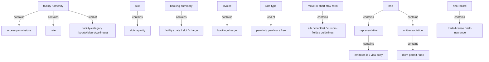

# Section glossary — Amenities, facilities & bookings — Residential

**Source read:** Res 4.10 Holiday Homes (1651–1882); Res 4.15 Amenities / Facilities (2814–3134).

---

## Ontology

### Objects

| # | Term | Meaning (≤12 words, from source) | Evidence (exact quote — where) | Re-scan |
|---|---|---|---|---|
| 1 | facility | a bookable amenity with name, category, hours | "create a new facility by entering Facility Name, Facility Category" (Res 4.15) | NEW = "amenity" |
| 2 | facility category | grouping a facility belongs to | "Select Facility Category (e.g., Sports, Leisure, Wellness)" (Res 4.15) | NEW |
| 3 | slot | a bookable time window on a facility | "Define fixed booking slot duration (e.g., 60 minutes for tennis)" (Res 4.15) | NEW = "time slot / booking slot" |
| 4 | slot capacity | maximum bookings allowed in one slot | "Set maximum bookings per slot (slot capacity)" (Res 4.15) | NEW |
| 5 | booking | a user's reservation of a facility slot | "Confirm booking" (Res 4.15) / "make bookings" (Com 1.6) | NEW = "reservation" |
| 6 | reservation | a single booking (per-reservation limits) | "Maximum Booking Duration per reservation (in minutes)" (Res 4.15) | NEW = "booking" |
| 7 | booking request | a submitted booking awaiting validation/approval | "Submit booking request for a facility" (Res 4.15) / "Creates the booking request" (Com 1.11) | NEW |
| 8 | booking summary | pre-confirm review of a booking | "Review booking summary: facility, date, slot, charge" (Res 4.15) | NEW |
| 9 | Booking Quota Limit | max open bookings a unit may hold | "Set Booking Quota Limit (max open bookings per unit at any time)" (Res 4.15) | NEW |
| 10 | Maximum Booking Duration | max length allowed per reservation | "Set Maximum Booking Duration per reservation (in minutes)" (Res 4.15) | NEW |
| 11 | Advance Booking Window | how far ahead a booking may be made | "Set Advance Booking Window (how far in advance a booking can be made)" (Res 4.15) | NEW |
| 12 | access permissions | per-facility who-can-book toggles | "Configure access permissions: toggles for Owners, Tenants, Guests of Owners, Guests of Tenants" (Res 4.15) | NEW = "access flags" |
| 13 | access category | booker group a facility is filtered by | "Browse facilities available to their access category" (Res 4.15) | NEW |
| 14 | opening time / closing time | facility open and close times | "Set facility opening time and closing time" (Res 4.15) | NEW |
| 15 | blocked weekdays | weekdays blocked from accepting bookings | "Select blocked weekdays (checkboxes per day)" (Res 4.15) | NEW |
| 16 | rate | monetary charge for a booking (AED) | "Enter monetary rate (AED)" (Res 4.15) | NEW = "pricing" |
| 17 | rate type | pricing model of a facility | "Select rate type: Per Slot / Per Hour / Free" (Res 4.15) | NEW |
| 18 | Booking Charge | invoice line item for a booking | "Generate invoice with line items: Booking Charge" (Res 4.15) | NEW |
| 19 | invoice | bill generated for a paid booking | "automatically generate an invoice for paid amenity bookings" (Res 4.15) | NEW |
| 20 | account ledger | resident account the invoice posts to | "Post invoice to resident's account ledger" (Res 4.15) | NEW |
| 21 | deposit | configurable deposit for a booking | "support deposit configuration for amenity bookings" (Res 4.15) | NEW |
| 22 | UAE VAT | 5% tax on paid amenity charges | "apply UAE VAT (5%) to all paid amenity booking charges" (Res 4.15) | NEW |
| 23 | approval workflow | per-facility approve-before-confirm process | "enable or disable an approval workflow per facility" (Res 4.15) | NEW |
| 24 | approval SLA | deadline for actioning a pending booking | "enforce a configurable approval SLA on pending bookings" (Res 4.15) | NEW |
| 25 | Move-In Short Stay form | short-stay guest check-in config form | "configure the Move-In Short Stay form" (Res 4.10) | NEW |
| 26 | Move-Out Short Stay form | short-stay check-out config form | "Move-Out Short Stay form independently from the Move-In form" (Res 4.10) | NEW |
| 27 | checklist | mandatory checklist attached to a form | "Select a pre-configured Checklist or add a new checklist (mandatory)" (Res 4.10) | NEW |
| 28 | Approver List Hierarchy (ALH) | mandatory approver hierarchy for a form | "Select a pre-configured Approver List Hierarchy or add a new one" (Res 4.10) | NEW |
| 29 | custom fields | community-scoped extra form fields | "Add custom fields via Community  Custom Fields" (Res 4.10) | NEW |
| 30 | guidelines content | guidance text entered on a form | "Enter Move-In Short Stay guidelines content" (Res 4.10) | NEW |
| 31 | HHO record | registered holiday-home operator record | "save the HHO as an active operator record" (Res 4.10) | NEW |
| 32 | Trade License | HHO trade license (number, dates, copy) | "Enter Trade License Number, Issue Date, and Expiry Date" (Res 4.10) | NEW |
| 33 | Risk Insurance | HHO all-risk insurance (number, expiry, copy) | "Company Risk Insurance Number and Risk Insurance Expiry Date" (Res 4.10) | NEW |
| 34 | unit | a residential/community unit | "Select the target unit from the community unit list" (Res 4.10) | NEW |
| 35 | unit association | link of a unit to an HHO | "Save the unit association(s)" (Res 4.10) | NEW |
| 36 | DTCM Permit | tourism permit for a holiday-home unit | "Upload DTCM Permit Copy (max 10MB)" (Res 4.10) | NEW |
| 37 | NOC | no-objection certificate for the unit | "Upload NOC Copy (max 10MB)" (Res 4.10) | NEW |
| 38 | representative | HHO contact person | "add representatives for each HHO" (Res 4.10) | NEW |
| 39 | Emirates ID | 15-digit representative identity number | "Enter Emirates ID Number (15-digit numeric)" (Res 4.10) | NEW |
| 40 | Visa Copy | representative visa document | "Upload Visa Copy (max 10MB)" (Res 4.10) | NEW |
| 41 | Primary Contact | designated main representative of an HHO | "auto-designate as Primary Contact if not already set" (Res 4.10) | NEW |
| 42 | guest check-in | short-stay guest registration | "used by Holiday Home Operators to register guest check-ins" (Res 4.10) | NEW |

### Roles

| # | Term | Meaning (≤12 words, from source) | Evidence (exact quote — where) | Re-scan |
|---|---|---|---|---|
| 1 | Community Administrator | top community admin; assigns facility roles | "allow the Community Administrator to assign the Facility Booking Administrator role" (Res 4.15) | NEW |
| 2 | Facility Booking Administrator | staff role managing amenities and bookings | "Assign Facility Booking Administrator role" (Res 4.15) | NEW |
| 3 | Facility Admin / Admin | acting amenity administrator | "Facility Admin Review booking details" (Res 4.15) / "Admin Navigate to Amenities" (Res 4.15) | NEW = "Facility Booking Administrator" |
| 4 | Resident | community member who books amenities | "Resident Submit booking request for a facility" (Res 4.15) | NEW |
| 5 | Owner | unit owner (access category) | "toggles for Owners, Tenants, Guests of Owners, Guests of Tenants" (Res 4.15) | NEW |
| 6 | Tenant | unit tenant (access category) | "toggles for Owners, Tenants" (Res 4.15) | NEW |
| 7 | Guest of Owner | owner's guest who may book | "Guests of Owners" (Res 4.15) | NEW |
| 8 | Guest of Tenant | tenant's guest who may book | "Guests of Tenants" (Res 4.15) | NEW |
| 9 | Maintenance Staff | staff member who can receive facility role | "assign the Facility Booking Administrator role to a maintenance staff member" (Res 4.15) | NEW |
| 10 | Holiday Home Operator (HHO) | registered short-stay rental operator | "registration of Holiday Home Operators (HHO)" (Res 4.10) | NEW |
| 11 | Administrator | community admin configuring holiday-home forms | "Administrator Navigate to Helpdesk  Move-In & Move-Out Requests" (Res 4.10) | NEW |
| 12 | Operations Department | provides holiday-home form content | "Owner Community Administrator (content by Operations Department)" (Res 4.10) | NEW = "DIEZ Operations team" |

### Steps

| # | Term | Meaning (≤12 words, from source) | Evidence (exact quote — where) | Re-scan |
|---|---|---|---|---|
| 1 | Move-In Short Stay Setup | configure the move-in short-stay form | "Move-In Short Stay Setup" (Res 4.10) | NEW |
| 2 | Move-Out Short Stay Setup | configure the move-out short-stay form | "Move-Out Short Stay Setup" (Res 4.10) | NEW |
| 3 | Holiday Home Operator Registration | register an HHO with regulatory documents | "Holiday Home Operator Registration" (Res 4.10) | NEW |
| 4 | Unit Association | associate residential units with an HHO | "Unit Association" (Res 4.10) | NEW |
| 5 | Representative Management | add representatives for an HHO | "Representative Management" (Res 4.10) | NEW |
| 6 | Facility Admin Role Assignment | assign the facility booking admin role | "Facility Admin Role Assignment" (Res 4.15) | NEW |
| 7 | Amenity Configuration | create and configure a facility | "Amenity Configuration" (Res 4.15) / "Amenity Setup and Configuration" (Com 1.6) | NEW = "Amenity Setup and Configuration" |
| 8 | Booking Rules Configuration | set quota, duration, window, capacity rules | "Booking Rules Configuration" (Res 4.15) | NEW |
| 9 | Pricing and Charges | configure facility rate and charging | "Pricing and Charges" (Res 4.15) | NEW |
| 10 | Approval Workflow | approve/reject a pending booking | "Approval Workflow" (Res 4.15) | NEW |
| 11 | Resident Booking Flow | resident browses, selects slot, confirms booking | "Resident Booking Flow" (Res 4.15) / "Amenity Booking Flow (Mobile App)" (Com 1.11) | NEW = "Amenity Booking Flow" |
| 12 | Booking Calendar and Management | admin views and manages all bookings | "Booking Calendar and Management" (Res 4.15) | NEW |
| 13 | Make Booking | admin creates a booking for a resident | "Actions  Make Booking  Select resident/unit and slot" (Res 4.15) | NEW |
| 14 | Cancel Booking | cancel a booking with reason, release slot | "Cancel  Provide reason  Confirm" (Res 4.15) / "Cancels a booking from the app" (Com 1.11) | NEW |

### States & values

| # | Term | Meaning (≤12 words, from source) | Evidence (exact quote — where) | Re-scan |
|---|---|---|---|---|
| 1 | booking status | • Pending Approval • Confirmed • Rejected • Cancelled • Pending • auto-cancelled | "Create booking in Pending Approval state" / "set status to Confirmed" / "set status to Rejected" / "Confirmed, Pending, Cancelled" / "bookings not actioned within the SLA period are auto-cancelled" (Res 4.15) | NEW |
| 2 | slot state | • Available • Fully Booked • Blocked • soft-held • released | "Shows the status of each slot clearly as Available, Fully Booked, or Blocked" (Com 1.6) / "slot is soft-held" / "release slot" (Res 4.15) | NEW |
| 3 | amenity/facility state | • active (activated / bookable) • deactivated • blocked out (date range) | "Activate the amenity -- it becomes visible and bookable" (Com 1.6) / "block out a facility for a date range" (Res 4.15) | NEW |
| 4 | HHO state | • active • deactivated | "activate or deactivate an HHO record. Deactivated operators cannot associate new units" (Res 4.10) | NEW |
| 5 | rate type value | • Per Slot • Per Hour • Free | "Select rate type: Per Slot / Per Hour / Free" (Res 4.15) | NEW |
| 6 | facility category value | • Sports • Leisure • Wellness | "Select Facility Category (e.g., Sports, Leisure, Wellness)" (Res 4.15) | NEW |
| 7 | access category value | • Owners • Tenants • Guests of Owners • Guests of Tenants | "toggles for Owners, Tenants, Guests of Owners, Guests of Tenants" (Res 4.15) | NEW |
| 8 | calendar view mode | • Day • Week • Month | "Select view mode: Day / Week / Month" (Res 4.15) | NEW |

---

## Topology

### Verbatim

| Parent (A) | relationship | Child (B) | Evidence (exact quote — where) |
|---|---|---|---|
| facility | contains | • access permissions • rate | "Configure booking rules … Configure access permissions … Configure operational hours … Open Facility Pricing Settings" (Res 4.15 / Com 1.6) |
| slot | contains | slot capacity | "Set maximum bookings per slot (slot capacity)" (Res 4.15) |
| facility | kind of | • Sports • Leisure • Wellness | "Select Facility Category (e.g., Sports, Leisure, Wellness)" (Res 4.15) |
| booking summary | contains | • facility • date • slot • charge | "Review booking summary: facility, date, slot, charge" (Res 4.15) |
| invoice | contains | Booking Charge | "Generate invoice with line items: Booking Charge" (Res 4.15) |
| rate type | kind of | • Per Slot • Per Hour • Free | "Select rate type: Per Slot / Per Hour / Free" (Res 4.15) |
| Move-In Short Stay form | contains | • ALH • checklist • custom fields • guidelines | "selecting a mandatory ALH and checklist, adding custom fields, and entering guidelines" (Res 4.10) |
| HHO | contains | • representative • unit association | "add representatives for each HHO" / "association of units with HHOs" (Res 4.10) |
| HHO record | contains | • Trade License • Risk Insurance | "capturing mandatory trade license and insurance details including numbers, dates, and document uploads" (Res 4.10) |
| unit association | contains | • DTCM Permit • NOC | "uploading DTCM Permit and NOC documents" (Res 4.10) |
| representative | contains | • Emirates ID • Visa Copy | "capturing contact name, mobile, email, Emirates ID, Visa Copy, and Emirates ID Copy" (Res 4.10) |

### Mermaid

---

## Choreography

### States

| Thing | States (each on its own line) | Evidence (exact quote — where) |
|---|---|---|
| booking | Pending Approval Confirmed Rejected Cancelled Pending auto-cancelled | "Create booking in Pending Approval state" / "On approval: set status to Confirmed" / "On rejection: set status to Rejected" / "Confirmed, Pending, Cancelled" / "auto-cancelled and the slot released" (Res 4.15) |
| slot | Available Fully Booked Blocked soft-held released | "as Available, Fully Booked, or Blocked" (Com 1.6) / "slot is soft-held" / "release slot" (Res 4.15) |
| amenity/facility | active (activated / bookable) deactivated blocked out (date range) | "Activate the amenity -- it becomes visible and bookable" (Com 1.6) / "block out a facility for a date range" (Res 4.15) |
| HHO | active deactivated | "activate or deactivate an HHO record. Deactivated operators cannot associate new units" (Res 4.10) |

### Gates — Verbatim

| A | relationship | B | Evidence (exact quote — where) |
|---|---|---|---|
| HHO active | unlocks | Unit Association | "Verify HHO is active … show Associate Units CTA only if active" (Res 4.10) |
| HHO deactivated | locks | new unit association | "Deactivated operators cannot associate new units" (Res 4.10) |
| ALH + checklist selected | unlocks | save form | "prevent saving the Move-In Short Stay form unless both ALH and checklist selections are made" (Res 4.10) |
| select date | produces | available time slots | "Display available time slots for that date" (Res 4.15) |
| Confirm booking (approval required) | produces | Pending Approval | "If approval required: set to Pending Approval and notify admin" (Res 4.15) |
| Confirm booking (auto-approval) | produces | Confirmed booking + invoice | "If auto-approval: confirm booking, generate invoice, notify resident" (Res 4.15) |
| Submit booking request | produces | soft-held slot | "Create booking in Pending Approval state; slot is soft-held" (Res 4.15) |
| Approve | produces | Confirmed booking + invoice | "On approval: set status to Confirmed, generate invoice, notify resident" (Res 4.15) |
| Reject | produces | Rejected + released slot | "On rejection: set status to Rejected, release slot, notify resident with reason" (Res 4.15) |
| booking confirmation | produces | invoice | "generate an invoice for paid amenity bookings upon booking confirmation" (Res 4.15) |
| invoice | comes before | account ledger post | "Post invoice to resident's account ledger" (Res 4.15) |
| approval SLA lapse | produces | auto-cancelled booking + released slot | "bookings not actioned within the SLA period are auto-cancelled and the slot released" (Res 4.15) |
| slot at capacity | locks | new booking | "prevent new bookings when a slot has reached its capacity" (Res 4.15) |
| booking rules | locks | booking attempt | "Enforce all rules at booking time for every resident booking attempt" (Res 4.15) |
| role revoked | locks | Amenities module access | "the staff member loses Amenities module access immediately" (Res 4.15) |

### Gates — Mermaid

```mermaid
flowchart TD
    hhoactive["hho-active"] -->|unlocks| unitassoc["unit-association"]
    hhodeact["hho-deactivated"] -->|locks| newassoc["new-unit-association"]
    alhchk["alh + checklist selected"] -->|unlocks| saveform["save-form"]
    seldate["select-date"] -->|produces| availslots["available-time-slots"]
    confapp["confirm-booking (approval required)"] -->|produces| pending["pending-approval"]
    confauto["confirm-booking (auto-approval)"] -->|produces| confirmed["confirmed-booking + invoice"]
    submitreq["submit-booking-request"] -->|produces| softheld["soft-held-slot"]
    approve["approve"] -->|produces| confinv["confirmed-booking + invoice"]
    reject["reject"] -->|produces| rejrel["rejected + released-slot"]
    bkgconf["booking-confirmation"] -->|produces| inv["invoice"]
    inv -->|comes before| ledger["account-ledger-post"]
    slalapse["approval-sla-lapse"] -->|produces| autocancel["auto-cancelled + released-slot"]
    slotfull["slot-at-capacity"] -->|locks| newbk["new-booking"]
    rules["booking-rules"] -->|locks| attempt["booking-attempt"]
    rolerev["role-revoked"] -->|locks| modaccess["amenities-module-access"]
```

---

## Conflict flags (for Gate 1)

- **Several words, one thing (synonyms):**
  - **facility = amenity** — Residential uses `facility`/`amenity` interchangeably: it titles the module "Amenities / Facilities" and says "Facility appears in amenity list" (Res 4.15); note Commercial's "Amenity module" (Com 1.6).
  - **slot = time slot = booking slot** — Residential "Define fixed booking slot duration" (Res 4.15); Commercial uses "automatically generates time slots" and "generates all available booking slots" (Com 1.6).
  - **booking = reservation** — Residential uses both: "Maximum Booking Duration per reservation" (Res 4.15); Commercial "make bookings" (Com 1.6).
  - **booking = booking request** — Residential "Confirm booking" vs "Submit booking request" (Res 4.15); Commercial "Creates the booking request" (Com 1.11).
  - **Booking Quota Limit ≈ booking frequency limit** — Residential "Set Booking Quota Limit (max open bookings per unit)" (Res 4.15); Commercial "booking frequency limits" (Com 1.6).
  - **Admin acting role — many names for one function:** Residential uses "Facility Booking Administrator" / "Facility Admin" / "Admin" (Res 4.15); Commercial uses "Asset Administrator" / "Asset Admin (Facility Booking Admin)" (Com 1.6).

- **One word, two meanings:**
  - **booking** — an amenity slot **reservation** (Res 4.15) **collides** with (a) **holiday-home short-stay guest stay** — a "Move-In Short Stay" reservation / "guest check-ins" (Res 4.10) is a rental booking, not an amenity slot; and (b) **Booking Calendar and Management** names an admin view, not a reservation (Res 4.15). → "booking" needs disambiguation across amenity-reservation vs short-stay-rental.
  - **Blocked** — a **slot** state (unavailable): "Available, Fully Booked, or Blocked" (Com 1.6); vs **blocked weekdays** config (Res 4.15); vs admin **block out a facility for a date range** (Res 4.15). Three "block" meanings.
  - **Pending vs Pending Approval** — calendar indicator says "Pending" (Res 4.15) but the state is "Pending Approval" (Res 4.15 / Com 1.11); same or different?
  - **Confirmed** — a booking **status** ("set status to Confirmed") vs **Confirm booking** the action (Res 4.15).

- **Part vs whole:**
  - **facility/amenity (whole) → slot (part) → slot capacity (part)**.
  - **booking rules (whole)** vs its parts (quota, duration, window, slot capacity).

- **Collides with method words:** minimal — "step" (process steps) and "state" (slot/booking states) echo OTC lens vocabulary but are used as product terms here; note only.

- **Drift between the two BRDs (Residential vs Commercial):**
  - **Booker role:** Residential = **Resident** (owner/tenant/guest); Commercial = **Employee / Tenant Admin / User**. Same act (book a slot), different persona.
  - **Slot states named:** Residential never names "Fully Booked" — expresses it as "slot has reached its capacity" (Res 4.15); Commercial explicitly names **Available / Fully Booked / Blocked** (Com 1.6). Drift in slot-state vocabulary.
  - **Money model:** Residential = **invoice → resident account ledger + UAE VAT (5%) + deposit** (Res 4.15, Mollak-style accounting); Commercial = **payment gateway / Pay Now**, and paid cancellations **credit the employee's wallet/profile credit** per refund policy (Com 1.11). Different charging & refund concepts.
  - **Quota term:** Residential "**Booking Quota Limit**" (per unit) (Res 4.15) vs Commercial "**booking frequency limits**" (Com 1.6).
  - **Approval lifecycle depth:** Residential adds **approval SLA + auto-cancellation** and soft-hold (Res 4.15); Commercial pairs approval with **Pay Now** unlock (Com 1.11).
  - **Holiday Homes is Residential-only:** HHO, DTCM Permit, NOC, Trade License, Move-In/Out Short Stay, representative/Primary Contact appear only in Residential (Res 4.10); Commercial has no short-stay-rental equivalent. This subdomain does not drift — it simply has no Commercial counterpart.
