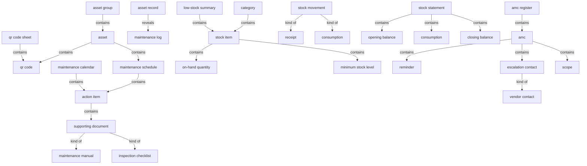

# Assets, inventory & maintenance (AMC) — section glossary draft — Residential

**Source read:** Residential 4.17 Assets (3384–3594), 4.18 Inventory (3595–3759), 4.19 AMC — Annual Maintenance Contracts (3760–3910). NEW BUILD (Re-scan = NEW).

---

## 1. Ontology

### Objects

| # | Term | Meaning (≤12 words, from source) | Evidence (exact quote — where) | Re-scan |
|---|---|---|---|---|
| 1 | asset | a physical item the community registers and tracks | "add a single asset" (Res 4.17 Assets) | NEW |
| 2 | asset record | the stored record of an asset | "Save the asset record with status = In Use" (Res 4.17 Assets) | NEW = "asset" |
| 3 | Asset Group | a classification grouping that assets are assigned to | "asset classification via Asset Groups" (Res 4.17 Assets) | NEW |
| 4 | Asset Number | unique asset identifier within a community | "enforce the uniqueness of Asset Numbers within a community" (Res 4.17 Assets) | NEW |
| 5 | QR code | unique code auto-generated and affixed to an asset | "auto-generate a unique QR code" (Res 4.17 Assets) | NEW |
| 6 | QR code sheet | print-ready sheet of QR codes for selected assets | "print-ready QR code sheet containing QR codes for the selected assets" (Res 4.17 Assets) | NEW |
| 7 | maintenance schedule | per-asset schedule of maintenance action items | "Manage Maintenance Schedule" (Res 4.17 Assets) | NEW |
| 8 | action item | a scheduled maintenance action on an asset | "Save the action item with status = Scheduled and link it to the asset record" (Res 4.17 Assets) | NEW (aka maintenance action item) |
| 9 | maintenance calendar | centralised view of all scheduled action items | "the centralised maintenance calendar" (Res 4.17 Assets) | NEW |
| 10 | maintenance log | record of maintenance performed on an asset | "the full asset detail record and maintenance logs" (Res 4.17 Assets) | NEW = "maintenance history" |
| 11 | maintenance history | maintenance record viewed on QR scan | "scan a QR code ... to view asset detail and maintenance history" (Res 4.17 Assets) | NEW = "maintenance log" |
| 12 | supporting document | attachment on a maintenance action | "attach supporting documents (maintenance manuals, inspection checklists)" (Res 4.17 Assets) | NEW |
| 13 | Excel template | standardised template for bulk data upload | "Download the standardised Excel template" (Res 4.17 Assets) | NEW (shared: Assets/Inventory/AMC) |
| 14 | error report | row-by-row report of upload validation issues | "generate a row-by-row error report for rows with issues" (Res 4.17 Assets) | NEW (shared) |
| 15 | stock item | an inventory item tracked by quantity | "register a single stock item" (Res 4.18 Inventory) | NEW |
| 16 | stock | physical stock quantity received or consumed | "Arrange procurement and add stocks when new stock arrives" (Res 4.18 Inventory) | NEW = "stock item" |
| 17 | category | classification grouping for stock items | "creation of stock categories" (Res 4.18 Inventory) | NEW (parallels "Asset Group") |
| 18 | Stock ID | unique identifier of a stock item | "Validate mandatory fields and uniqueness of Stock ID" (Res 4.18 Inventory) | NEW |
| 19 | Minimum Stock Level | configured threshold triggering low-stock | "enter Stock ID, Stock Name, Unit of Measurement, and Minimum Stock Level" (Res 4.18 Inventory) | NEW |
| 20 | on-hand quantity | current quantity of a stock item | "recalculate the on-hand quantity for the item" (Res 4.18 Inventory) | NEW |
| 21 | stock movement | a receipt or consumption event on stock | "After every stock movement (receipt or consumption)" (Res 4.18 Inventory) | NEW |
| 22 | low-stock alert | alert for an item below its minimum | "Review the low-stock alert and identify items requiring replenishment" (Res 4.18 Inventory) | NEW |
| 23 | low-stock summary | panel listing items below minimum stock level | "a dedicated low-stock summary panel in the Inventory module" (Res 4.18 Inventory) | NEW |
| 24 | consumption report | month-wise report of quantities consumed | "the month-wise consumption report" (Res 4.18 Inventory) | NEW |
| 25 | stock statement | opening balance, consumption, closing balance for a month | "the stock statement: opening balance, consumption during the month, and closing balance" (Res 4.18 Inventory) | NEW |
| 26 | AMC | annual maintenance contract with a vendor | "Annual Maintenance Contracts (AMC)" (Res 4.19 AMC) | NEW = "maintenance contract" |
| 27 | AMC record | the stored AMC | "Save the AMC record and compute status" (Res 4.19 AMC) | NEW = "AMC" |
| 28 | AMC register | paginated listing of all AMCs | "Display the saved AMC in the AMC register with its computed status" (Res 4.19 AMC) | NEW |
| 29 | reminder | a lead-time renewal reminder on an AMC | "Select Add Reminder and enter the lead time in days" (Res 4.19 AMC) | NEW |
| 30 | renewal reminder notification | reminder dispatched to the AMC Administrator | "dispatch a renewal reminder notification to the AMC Administrator" (Res 4.19 AMC) | NEW |
| 31 | lead time | days before end date for reminder/escalation | "enter the lead time in days (e.g., 90 days before end date)" (Res 4.19 AMC) | NEW |
| 32 | escalation contact | vendor contact configured for escalation | "Select Add Escalation Contact" (Res 4.19 AMC) | NEW (aka vendor escalation contact) |
| 33 | escalation notification | escalation dispatched to a vendor contact | "dispatch escalation notifications to each vendor contact" (Res 4.19 AMC) | NEW |
| 34 | scope | the covered systems or assets of an AMC | "Enter the scope / covered systems or assets" (Res 4.19 AMC) | NEW |
| 35 | End Date | AMC end date that drives status | "changes to the end date trigger a status recomputation" (Res 4.19 AMC) | NEW |

*Dropped as mechanism / "how":* CAFM system, FM platform, integration/API, scheduled job (the cron), Renew CTA, admin portal, Excel file format (.xlsx). *Dropped as attribute/field-label:* Asset Name, Physical Location, Unit of Measurement, Vendor Email/Phone, Start Date, contract reference number.

### Roles

| # | Term | Meaning (≤12 words, from source) | Evidence (exact quote — where) | Re-scan |
|---|---|---|---|---|
| 1 | Assets Administrator | manages asset groups, assets, schedules, QR codes | "Assets Administrator Navigate to Assets" (Res 4.17 Assets) | NEW |
| 2 | Inventory Administrator | manages categories, stock items, low-stock, reports | "Inventory Administrator Navigate to Assets Inventory" (Res 4.18 Inventory) | NEW |
| 3 | AMC Administrator | manages AMC records, reminders, escalations | "AMC Administrator Navigate to Assets AMC" (Res 4.19 AMC) | NEW |
| 4 | Community Administrator | owning administrator across modules | "Owner: Assets Administrator / Community Administrator" (Res 4.17 Assets) | NEW (join) |
| 5 | Field Staff | scans asset QR codes in the field via mobile app | "Field Staff Open the ANACITY mobile app and activate the QR scanner" (Res 4.17 Assets) | NEW |
| 6 | Maintenance Staff | staff member assignable to a maintenance action | "Assign one staff member from the Maintenance Staff directory" (Res 4.17 Assets) | NEW (role owned by another section — see flags) |
| 7 | Assets role | app permission to scan and view assets | "Authenticated app users with the Assets role" (Res 4.17 Assets) | NEW |
| 8 | Facility Management Team | team raising asset/inventory requirements | "Specific Requirement from Facility Management Team" (Res 4.17 Assets) | NEW |
| 9 | vendor | external maintenance contractor on an AMC | "Enter Vendor Name, Vendor Contact Person, Vendor Email" (Res 4.19 AMC) | NEW (join) |
| 10 | vendor contact | named vendor contact / escalation recipient | "Vendor Contact Name, Vendor Email, Vendor Mobile Number" (Res 4.19 AMC) | NEW |

### Steps

| # | Term | Meaning (≤12 words, from source) | Evidence (exact quote — where) | Re-scan |
|---|---|---|---|---|
| 1 | Asset Group Creation | create and manage asset groups | "Asset Group Creation" (Res 4.17 Assets) | NEW |
| 2 | Asset Addition | register assets individually or in bulk | "Asset Addition -- Individual" / "Asset Addition -- Bulk" (Res 4.17 Assets) | NEW = "Asset Registration" |
| 3 | Bulk Asset Upload | Excel-template bulk import of assets | "Bulk Asset Upload via Excel Template" (Res 4.17 Assets) | NEW |
| 4 | Maintenance Scheduling | add maintenance action items per asset | "Maintenance Scheduling" (Res 4.17 Assets) | NEW |
| 5 | QR Code Management | generate, print, and scan asset QR codes | "QR Code Management" (Res 4.17 Assets) | NEW |
| 6 | Mobile QR Scan | scan an asset QR code in the field | "mobile QR scanning for field staff" (Res 4.17 Assets) | NEW |
| 7 | Category Setup | create stock categories | "Category Setup" (Res 4.18 Inventory) | NEW |
| 8 | Stock Addition | register stock items individually or in bulk | "Stock Addition -- Individual" (Res 4.18 Inventory) | NEW |
| 9 | Stock Monitoring and Reports | monitor low-stock and generate reports | "Stock Monitoring and Reports" (Res 4.18 Inventory) | NEW |
| 10 | procurement | arrange purchase and add low stock | "Arrange procurement and add stocks when new stock arrives" (Res 4.18 Inventory) | NEW (aka replenishment) |
| 11 | AMC Creation | create AMC records | "AMC Creation" (Res 4.19 AMC) | NEW |
| 12 | Renewal Reminders | configure and dispatch renewal reminders | "Renewal Reminders" (Res 4.19 AMC) | NEW |
| 13 | Vendor Escalations | configure vendor escalation contacts | "Open an AMC record and navigate to the Vendor Escalations section" (Res 4.19 AMC) | NEW |
| 14 | Bulk Upload | Excel-template bulk import of records | "Bulk Upload" (Res 4.19 AMC) | NEW (shared) |
| 15 | Status Recomputation | daily recompute of all AMC statuses | "Status Recomputation Daily system job -- recalculates all AMC statuses" (Res 4.19 AMC) | NEW |

*Dropped as pure integration mechanism (per brief):* "CAFM Service Request Sync Process" (the routing/sync flow) — the product terms it carries (service request, ticket, work order, ticket status) are kept above.

### States & values

| # | Term | States / values (each on its own line) | Evidence (exact quote — where) | Re-scan |
|---|---|---|---|---|
| 1 | asset status | • In Use | "Save the asset record with status = In Use" (Res 4.17 Assets) | NEW (only value stated; no "active/retired" attested) |
| 2 | action item status | • Scheduled • Overdue | "status = Scheduled" / "automatically mark ... action items as Overdue when their due date passes" (Res 4.17 Assets) | NEW |
| 3 | stock level state | • below minimum stock level (low-stock) | "all items below their minimum stock level" (Res 4.18 Inventory) | NEW (no explicit "in-stock/issued" state) |
| 4 | on-hand quantity | • initial = 0 (if not entered) | "Save the stock item with initial on-hand quantity = 0 if not entered" (Res 4.18 Inventory) | NEW |
| 5 | stock movement type | • receipt • consumption | "stock movement (receipt or consumption)" (Res 4.18 Inventory) | NEW |
| 6 | AMC status | • Active • Expiring • Expired | "compute status: Active, Expiring, or Expired based on end date and lead time" (Res 4.19 AMC) | NEW ("Expiring" = renewal-due sense) |

---

## 2. Topology

### Verbatim (parent → child)

| Parent (A) | relationship | Child (B) | Evidence (exact quote — where) |
|---|---|---|---|
| Asset Group | contains | asset | "asset classification via Asset Groups" / "assets already assigned to it" (Res 4.17 Assets) |
| asset | contains | • QR code • maintenance schedule | "auto-generate a unique QR code" / "Manage Maintenance Schedule" (Res 4.17 Assets) |
| maintenance schedule | contains | action item | "Manage Maintenance Schedule  Add Action Item" (Res 4.17 Assets) |
| maintenance calendar | contains | action item | "Display all scheduled action items across all assets in the centralised maintenance calendar" (Res 4.17 Assets) |
| action item | contains | supporting document | "Optionally attach supporting documents" (Res 4.17 Assets) |
| supporting document | kind of | • maintenance manual • inspection checklist | "supporting documents (maintenance manuals, inspection checklists)" (Res 4.17 Assets) |
| QR code sheet | contains | QR code | "QR code sheet containing QR codes for the selected assets" (Res 4.17 Assets) |
| asset record | reveals | maintenance log | "display the full asset detail record and maintenance logs linked to the scanned asset" (Res 4.17 Assets) |
| category | contains | stock item | "existing stock items under it retain their category assignment" (Res 4.18 Inventory) |
| stock item | contains | • on-hand quantity • Minimum Stock Level | "recalculate the on-hand quantity for the item" / "Minimum Stock Level" (Res 4.18 Inventory) |
| stock movement | kind of | • receipt • consumption | "stock movement (receipt or consumption)" (Res 4.18 Inventory) |
| low-stock summary | contains | stock item (below minimum) | "summary panel ... showing all items below their minimum stock level" (Res 4.18 Inventory) |
| stock statement | contains | • opening balance • consumption • closing balance | "the stock statement: opening balance, consumption during the month, and closing balance" (Res 4.18 Inventory) |
| AMC register | contains | AMC | "Display the saved AMC in the AMC register" (Res 4.19 AMC) |
| AMC | contains | • reminder • escalation contact • scope | "up to 4 reminders per AMC" / "maximum two per AMC" / "Enter the scope / covered systems or assets" (Res 4.19 AMC) |
| escalation contact | kind of | vendor contact | "dispatch escalation notifications to each vendor contact" (Res 4.19 AMC) |

### Mermaid

---

## 3. Choreography

### States

| Thing | States (each on its own line) | Evidence (exact quote — where) |
|---|---|---|
| asset | • In Use | "Save the asset record with status = In Use" (Res 4.17 Assets) |
| action item | • Scheduled • Overdue (due date passes without completion) | "status = Scheduled" / "mark ... as Overdue when their due date passes without completion" (Res 4.17 Assets) |
| stock item | • below minimum stock level (low-stock) | "all items below their minimum stock level" (Res 4.18 Inventory) |
| on-hand quantity | • initial = 0 (if not entered) | "initial on-hand quantity = 0 if not entered" (Res 4.18 Inventory) |
| stock movement | • receipt • consumption | "stock movement (receipt or consumption)" (Res 4.18 Inventory) |
| AMC | • Active • Expiring • Expired | "compute status: Active, Expiring, or Expired" (Res 4.19 AMC) |

### Gates (verbatim)

| A | relationship | B | Evidence (exact quote — where) |
|---|---|---|---|
| Asset Group (exists) | locks / unlocks | asset creation | "enforce that an Asset Group exists before an individual asset can be created" (Res 4.17 Assets) |
| asset assigned | locks | Asset Group deletion | "An Asset Group cannot be deleted if it has assets assigned" (Res 4.17 Assets) |
| asset save | produces | QR code | "Automatically generate a unique QR code when an asset record is saved" (Res 4.17 Assets) |
| action item due date passes | produces | Overdue flag & notification | "automatically mark maintenance action items as Overdue when their due date passes without completion" (Res 4.17 Assets) |
| category (exists) | locks / unlocks | stock item creation | "Stock Item Addition requires Category to exist" (Res 4.18 Inventory) |
| stock item assigned | locks | category deletion | "deletion blocked if stock items are assigned" (Res 4.18 Inventory) |
| stock movement | produces | recalculated on-hand quantity | "After every stock movement (receipt or consumption), recalculate the on-hand quantity" (Res 4.18 Inventory) |
| on-hand quantity below minimum | produces | low-stock alert | "Compare the updated on-hand quantity against the item's configured Minimum Stock Level" / "Review the low-stock alert" (Res 4.18 Inventory) |
| AMC end date + lead time | produces | AMC status | "compute status: Active, Expiring, or Expired based on end date and lead time" (Res 4.19 AMC) |
| reminder lead time match | produces | renewal reminder notification | "When a match is found, dispatch a renewal reminder notification" (Res 4.19 AMC) |
| escalation lead time match | produces | escalation notification | "If matched, dispatch escalation notifications to each vendor contact" (Res 4.19 AMC) |
| daily system job | produces | recomputed AMC statuses | "Daily system job -- recalculates all AMC statuses based on current date" (Res 4.19 AMC) |

### Gates (mermaid)

```mermaid
flowchart TD
    assetGroup["asset group exists"] -->|locks unlocks| assetCreation["asset creation"]
    assetAssigned["asset assigned"] -->|locks| groupDeletion["asset group deletion"]
    assetSave["asset save"] -->|produces| qrCode["qr code"]
    dueDate["action item due date passes"] -->|produces| overdue["overdue flag and notification"]
    category["category exists"] -->|locks unlocks| stockCreation["stock item creation"]
    stockAssigned["stock item assigned"] -->|locks| categoryDeletion["category deletion"]
    stockMovement["stock movement"] -->|produces| onHand["recalculated on-hand quantity"]
    belowMin["on-hand below minimum"] -->|produces| lowStockAlert["low-stock alert"]
    endDate["amc end date plus lead time"] -->|produces| amcStatus["amc status"]
    reminderMatch["reminder lead time match"] -->|produces| renewalNotif["renewal reminder notification"]
    escMatch["escalation lead time match"] -->|produces| escNotif["escalation notification"]
    dailyJob["daily system job"] -->|produces| recompStatus["recomputed amc statuses"]
```

---

## 4. Conflict flags (for Gate 1)

**Several words, one thing (synonyms):**
- **asset / asset record / asset detail record** — all name the stored asset ("add a single asset" / "Save the asset record" / "the full asset detail record", Res 4.17).
- **maintenance log / maintenance history** — same maintenance record, two labels within one section ("maintenance logs" vs "maintenance history", Res 4.17).
- **stock item / stock** — item definition vs physical quantity ("register a single stock item" vs "add stocks when new stock arrives", Res 4.18).
- **AMC / Annual Maintenance Contract / maintenance contract** — one contract object ("Annual Maintenance Contracts (AMC)", Res 4.19). Confirms brief's `AMC / maintenance contract` synonym.
- **escalation contact / vendor escalation contact / vendor contact** — the vendor person configured for escalation (Res 4.19).
- **service request / ticket / work order** — Residential Assets/Inventory/AMC has no native *ticket*; the Commercial CAFM deployment introduces the request as it flows and crosses platforms — raised as a *service request*, recorded as a *ticket*, mirrored as a *work order* ("service requests raised" → "Creates the ticket" → "Creates a corresponding work order", Com 7.4).
- **asset / equipment** — brief asked to flag this; **"equipment" is NOT attested** in these ranges — "asset" (and "covered systems or assets") is the sole term. No drift found.

**One word, two meanings:**
- **maintenance** — three distinct senses collide: (a) *asset preventive maintenance* — "Maintenance Scheduling" / "action item" (Res 4.17); (b) *contractual maintenance* — "Annual Maintenance Contract" (Res 4.19); (c) the **Maintenance Staff** role (Res 4.17), which is **owned by another section** (staff/roles). Same stem, different things — needs disambiguation at the gate.
- **job / work order** — brief asked to flag `work order / job` as synonyms; in-source, **"job" is NOT a synonym for work order**. "job" appears only as *"scheduled job" / "daily system job"* — a system cron (Res 4.19), a different sense; "work order" (Com 7.4) is the FM work item. Flag as one-word-two-meanings, not a synonym pair.
- **consumption** — a stock-movement type ("receipt or consumption") *and* a stock-statement component ("consumption during the month") (Res 4.18) — related but used at two levels.
- **status** — asset status (In Use), action item status (Scheduled/Overdue), AMC status (Active/Expiring/Expired) — one word, three state sets across the section.

**Part vs whole:**
- **action item vs maintenance schedule vs maintenance calendar** — action item is the part; the schedule is per-asset; the calendar is the cross-asset roll-up of the same action items (Res 4.17).
- **stock statement vs opening/consumption/closing balance** — statement is the whole; the three balances are its parts (Res 4.18).

**Collides with method words:** none material. ("category" is a domain object here, not the method's "kind"; note it if the assembled glossary reuses "category" generically.)

**Drift between the two BRDs (Residential vs Commercial):**
- **Assets Administrator (Res 4.17) vs Asset Administrator (Com 7.4)** — same admin role, singular/plural + "Assets"/"Asset" drift.
- **Maintenance handling model differs** — Residential handles maintenance *natively*: "maintenance action item" / "maintenance schedule" worked by **Maintenance Staff** (Res 4.17); Commercial *routes out* to an external CAFM as a **work order** worked by the **facility team** (Com 7.4). The same real-world "do the maintenance work" concept surfaces as *action item* (Res) vs *work order* (Com).
- **Facility Management Team (Res 4.17, a requirements source) vs facility team / Facility Management team (Com 7.4, the CAFM operators)** — same label, different actor role per deployment.
- **ticket** — **absent** from the Residential Assets/Inventory/AMC ranges (Residential uses "maintenance action item" / native lifecycle); a first-class object only in the Commercial CAFM deployment (Com 7.4). Likely a join term owned by a helpdesk/community-request section.

**Join terms (shared vocabulary likely used by other sections):** community, vendor, notification, Excel template, error report, ticket, service request, work order, employee, Tenant Admin, Community Administrator, Asset Owner Portal, asset.
