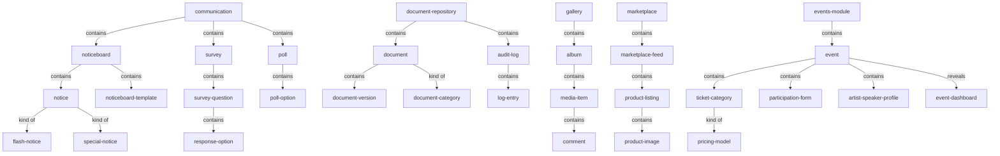
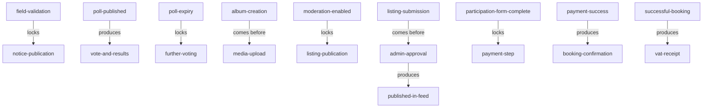

# Communication, community & engagement — section glossary (NEW BUILD) — Residential

**Source read:** Residential — 4.6 Communication (1020-1224), 4.7 Document Repository (1225-1372), 4.8 Gallery (1373-1481), 4.11 Marketplace (1883-2041), 4.16 Events (3135-3383).

---

## 1. Ontology

### Objects

| # | Term | Meaning (<=12 words, from source) | Evidence (exact quote — where) | Re-scan |
|---|---|---|---|---|
| 1 | Communication (module) | community's three communication tools grouped | "three community communication tools: Noticeboard … Surveys … and Polls" (Res 4.6) | NEW |
| 2 | Noticeboard | admin-published announcements with targeting and scheduling | "Noticeboard (admin-published announcements with audience targeting and scheduling)" (Res 4.6) | NEW = "Announcements module" (Com) |
| 3 | notice / admin notice | announcement admins publish to residents | "Navigate to 'Post New Admin Notice'" (Res 4.6) | NEW = "announcement" (Com) |
| 4 | Noticeboard template | reusable notice with subject and description | "Add Noticeboard Template' to create a reusable template" (Res 4.6) | NEW |
| 5 | Survey | structured questionnaire collecting resident responses | "Surveys (structured questionnaires with response collection)" (Res 4.6) | NEW |
| 6 | survey question | one question in a survey | "Add one or more survey questions" (Res 4.6) | NEW |
| 7 | response option | selectable answer for a question | "Enter response options for single-choice and multiple-choice questions" (Res 4.6) | NEW |
| 8 | Poll | voting with real-time result tracking | "Polls (voting with real-time result tracking)" (Res 4.6) | NEW |
| 9 | poll option | one voting choice in a poll | "Enter at least two voting response options" (Res 4.6) | NEW |
| 10 | vote | a resident's recorded poll choice | "open poll, cast vote within validity period" (Res 4.6) | NEW |
| 11 | poll results | live and final vote counts | "final poll results through the poll management view" (Res 4.6) | NEW |
| 12 | flash notice | notice displayed on login | "Flash Notice display on login" (Res 4.6) | NEW |
| 13 | special notice | notice flagged as special | "Special Notice flag" (Res 4.6) | NEW |
| 14 | community corner | where published surveys appear to residents | "make them visible in the community corner" (Res 4.6) | NEW |
| 15 | Document Repository | store of community documents | "management … of community documents" (Res 4.7) | NEW |
| 16 | document / community document | uploaded community file with metadata | "upload documents with mandatory metadata" (Res 4.7) | NEW |
| 17 | document record | created record for an uploaded document | "Create document record and make immediately visible" (Res 4.7) | NEW |
| 18 | document version | auto-incremented revision of a document | "Upload New Version"; "auto-increments the version number" (Res 4.7) | NEW |
| 19 | audit log / log entry | logged record of each document interaction | "Automatically log every document interaction" (Res 4.7) | NEW |
| 20 | export file | audit log exported as PDF or CSV | "Generate and deliver the export file" (Res 4.7) | NEW |
| 21 | Gallery / Photo Gallery | community photo/video album collection | "Navigate to Forum → Photo Gallery" (Res 4.8) | NEW |
| 22 | album | named collection of media | "Create Album … Enter Album Name" (Res 4.8) | NEW |
| 23 | media / media item | photo or video in an album | "delete individual media item with confirmation" (Res 4.8) | NEW |
| 24 | comment | resident remark on a media item | "post a comment on a media item" (Res 4.8) | NEW |
| 25 | Marketplace | resident product listings feed | "published marketplace feed accessible to all community residents" (Res 4.11) | NEW |
| 26 | product listing / listing | resident-posted product for sale | "create a product listing" (Res 4.11) | NEW |
| 27 | Marketplace feed | published listings browsable by residents | "visible in the community Marketplace feed" (Res 4.11) | NEW |
| 28 | product image | required image on a listing | "Upload a minimum of 1 product image" (Res 4.11) | NEW |
| 29 | rejection reason | mandatory reason when rejecting a listing | "must provide a mandatory rejection reason" (Res 4.11) | NEW |
| 30 | event | admin-configured, resident-bookable community/campus event | "Navigate to Events module … click Create Event" (Res 4.16) | NEW |
| 31 | ticket category | named event ticket with price and seat limit | "create multiple named ticket categories per event" (Res 4.16) | NEW = "seating category" (Com) |
| 32 | participation form | custom form completed at event booking | "Custom Participation Form Builder" (Res 4.16) | NEW = "registration form/field" (Com) |
| 33 | booking | resident's confirmed event reservation | "Records the booking once the payment … is successful" (Res 4.16 / Com 1.8) | NEW |
| 34 | booking confirmation | confirmation issued on successful booking | "deliver booking confirmation" (Res 4.16) | NEW |
| 35 | VAT receipt | UAE VAT-compliant receipt for booking | "a UAE VAT-compliant receipt" (Res 4.16) | NEW |
| 36 | invoice description | mandatory text for ticketed events | "Enter Invoice Description (mandatory, up to 500 characters)" (Res 4.16) | NEW |
| 37 | Event Dashboard | admin view of bookings and capacity | "View the Event Dashboard: number of bookings, booking details" (Res 4.16) | NEW |
| 38 | offer / discount | optional event promotion with dates | "create offer/discount with start date, end date, and optional image" (Res 4.16) | NEW |
| 39 | attendee list | full registrant list per event, exportable | "view the full attendee list per event and export it" (Res 4.16) | NEW |
| 40 | artist/speaker profile | guest profile added to an event | "add artist/speaker profiles (name, bio, highlights, photo/video)" (Res 4.16) | NEW |

### Roles

| # | Term | Meaning (<=12 words, from source) | Evidence (exact quote — where) | Re-scan |
|---|---|---|---|---|
| 1 | Administrator / Community Administrator | creates, posts, and owns communications | "Only administrators can create, update, and post notices" (Res 4.6) | NEW |
| 2 | Resident | community member; reads notices, votes, books | "Residents have read-only access to the Noticeboard" (Res 4.6) | NEW = "Employee" (Com) |
| 3 | Admin / Manager (Property Manager) | uploads/manages repository documents | "Admin / Manager Navigate to Repository" (Res 4.7) | NEW |
| 4 | Authorised User | may upload media to an album | "media upload by authorized users" (Res 4.8) | NEW |
| 5 | Resident (Seller) | resident who lists a product | "resident-initiated product listing"; "Seller Contact Number" (Res 4.11) | NEW |
| 6 | Resident (Buyer) | resident who browses/contacts a listing | "Resident (Buyer) Browse the Marketplace feed" (Res 4.11) | NEW |
| 7 | Event Admin | designated role that configures events | "Event Admin is a designated role assigned by the Community Administrator" (Res 4.16) | NEW |
| 8 | attendee | registered event participant/audience | "the URL is visible only to registered attendees" (Res 4.16) | NEW |

*Note: Owners, Tenants, Committee Members, Residing Only appear only as audience-target values (see States & values); flagged as role-vs-value in Conflict flags.*

### Steps

| # | Term | Meaning (<=12 words, from source) | Evidence (exact quote — where) | Re-scan |
|---|---|---|---|---|
| 1 | Post New Admin Notice | publish/schedule a notice to audience | "Navigate to 'Post New Admin Notice'" (Res 4.6) | NEW |
| 2 | Document Upload | upload a document with metadata | "Document Upload … Upload Document" (Res 4.7) | NEW |
| 3 | Access and Visibility Configuration | set a document's target audience | "Access and Visibility Configuration" (Res 4.7) | NEW |
| 4 | Document Management | edit, version, expire, archive, delete | "Document Management … Select action: Edit Metadata / Upload New Version" (Res 4.7) | NEW |
| 5 | Audit and Logs | review and export interaction logs | "Audit and Logs … Review log entries" (Res 4.7) | NEW |
| 6 | Album Creation | create a media album | "Album Creation … click CREATE ALBUM" (Res 4.8) | NEW |
| 7 | Media Upload | add photos/videos to an album | "Media Upload … click Upload Media" (Res 4.8) | NEW |
| 8 | Product Listing Flow | resident submits a listing | "Product Listing Flow … Submit the listing" (Res 4.11) | NEW |
| 9 | Admin Approval Workflow | admin approves/rejects a listing | "Admin Approval Workflow … Approve or Reject" (Res 4.11) | NEW |
| 10 | Event Setup | enter event details, capacity, media | "Event Setup … Create Event screen with Event Details, Booking Details, Registration Details" (Res 4.16) | NEW |
| 11 | Ticket Categories and Pricing | define ticket categories and prices | "Ticket Categories and Pricing" (Res 4.16) | NEW |
| 12 | Registration Details | configure registration settings | "Registration Details step" (Res 4.16) | NEW |
| 13 | Resident Booking Flow | resident selects, pays, books event | "Resident Booking Flow" (Res 4.16) | NEW |

### States & values

| # | Term | States / values (each on its own line) | Evidence (exact quote — where) | Re-scan |
|---|---|---|---|---|
| 1 | notice visibility audience (Res) | • All • Residing Only • Owners Only • Tenants Only • Committee Members | "visibility audience (All / Residing Only / Owners Only / Tenants Only / Committee Members)" (Res 4.6) | NEW = "target audience" (Com) |
| 2 | distribution level (Res) | • Community • Block • Unit | "Select distribution level (Community / Block / Unit)" (Res 4.6) | NEW; drifts to building/office (Com) |
| 3 | notice optional flags | • Flash Notice • Expiry Date • Send Email Notification • Special Notice | "Configure optional flags: Flash Notice, Expiry Date, Send Email Notification, Special Notice" (Res 4.6) | NEW |
| 4 | response type | • Single choice • Multiple choice • Text | "response type … (Single choice / Multiple choice / Text)" (Res 4.6) | NEW ≈ survey response types (Com) |
| 5 | voting rights | • one per user / One per employee • one per unit | "voting rights (one per user / one per unit)" (Res 4.6); "One per employee' or 'One per unit'" (Com 1.2) | NEW; user-vs-employee drift |
| 6 | poll state | • active/live • closed (at expiry) | "automatically close polls at the configured Expiry Date, lock further voting" (Res 4.6) | NEW |
| 7 | document category | • Agreement • Notice • Invoice • Policy • Others | "Document Category … Agreement, Notice, Invoice, Policy, Others" (Res 4.7) | NEW; "Notice" collides with communication notice |
| 8 | document target audience | • All Members • Owners Only • Tenants Only • Committee Members | "Target Audience: All Members / Owners Only / Tenants Only / Committee Members" (Res 4.7) | NEW |
| 9 | document status | • Expiring/Expired • Archived | "flag document as Expiring/Expired" (Res 4.7) | NEW |
| 10 | audit action type | • upload • view • download • edit • archive • delete • version change | "log every document interaction (upload, view, download, edit, archive, delete, version change)" (Res 4.7) | NEW |
| 11 | export format | • PDF • CSV | "export filtered log as PDF or CSV" (Res 4.7) | NEW |
| 12 | listing status | • Pending Approval • Published • Rejected • Archived • Removed | "all listings across all statuses (Pending, Published, Archived)" (Res 4.11) | NEW |
| 13 | moderation | • enabled • disabled | "If moderation is enabled … if disabled: publish directly" (Res 4.11) | NEW |
| 14 | booking type | • Paid • Free | "Booking Type as Paid or Free" (Res 4.16); "Set event type: Free … or Paid" (Com 1.8) | NEW |
| 15 | pricing model (Res) | • Standard Fixed • Early Bird • Dynamic | "pricing model: Standard Fixed, Early Bird, or Dynamic seat categories" (Res 4.16) | NEW |
| 16 | event status (Res) | • Draft • Published • Cancelled • Completed | "System Status Values: Draft, Published, Cancelled, Completed" (Res 4.16) | NEW |
| 17 | event capacity state | • Fully Booked (no tickets remain) | "display 'Fully Booked' if no tickets remain" (Res 4.16) | NEW |

---

## 2. Topology

### Verbatim (Parent → Child)

| Parent (A) | relationship | Child (B) | Evidence (exact quote — where) |
|---|---|---|---|
| Communication | contains | • Noticeboard • Survey • Poll | "three community communication tools: Noticeboard … Surveys … and Polls" (Res 4.6) |
| Noticeboard | contains | • notice • Noticeboard template | "The Noticeboard is the official and sole platform for community announcements"; "Add Noticeboard Template" (Res 4.6) |
| notice | kind of | • flash notice • special notice | "Configure optional flags: Flash Notice … Special Notice" (Res 4.6) |
| Survey | contains | • survey question | "Add one or more survey questions" (Res 4.6) |
| survey question | contains | • response option | "Enter response options for single-choice and multiple-choice questions" (Res 4.6) |
| Poll | contains | • poll option | "Enter at least two voting response options" (Res 4.6) |
| Document Repository | contains | • document • audit log | "management … of community documents"; "Automatically log every document interaction" (Res 4.7) |
| document | contains | • document version | "Upload New Version"; "auto-increments the version number" (Res 4.7) |
| document | kind of | • document category (Agreement/Notice/Invoice/Policy/Others) | "Select Document Category … Agreement, Notice, Invoice, Policy, Others" (Res 4.7) |
| audit log | contains | • log entry | "Display filtered audit log entries in tabular format" (Res 4.7) |
| Gallery | contains | • album | "Photo Gallery → Create Album" (Res 4.8) |
| album | contains | • media | "Deleting an album also deletes all media contained within it" (Res 4.8) |
| media | contains | • comment | "post a comment on a media item" (Res 4.8) |
| Marketplace | contains | • Marketplace feed | "published marketplace feed" (Res 4.11) |
| Marketplace feed | contains | • product listing | "Listing is visible in the community Marketplace feed if it is published" (Res 4.11) |
| product listing | contains | • product image | "Upload a minimum of 1 product image" (Res 4.11) |
| Events module | contains | • event | "Navigate to Events module … click Create Event" (Res 4.16) |
| event | contains | • ticket category • participation form • artist/speaker profile | "create multiple named ticket categories per event"; "Custom Participation Form Builder"; "add artist/speaker profiles … to an event" (Res 4.16) |
| event | reveals | • Event Dashboard | "View the Event Dashboard: number of bookings" (Res 4.16) |
| ticket category | kind of | • pricing model (Standard Fixed/Early Bird/Dynamic) | "Select a pricing model: Standard Fixed, Early Bird, or Dynamic seat categories" (Res 4.16) |

### Mermaid

---

## 3. Choreography

### States

| Thing | States (each on its own line) | Evidence (exact quote — where) |
|---|---|---|
| notice / announcement | • draft/scheduled • published (active) • expired | "publish the notice now or schedule it for later" (Res 4.6); "Only active announcements are visible … Past and expired announcements are not shown" (Com 1.2) |
| poll | • published (active) • closed (at expiry, voting locked) | "poll becomes active from 00:00 hrs on start date and closes shortly after 24:00 hrs" (Com 1.2); "close polls … lock further voting" (Res 4.6) |
| product listing | • Pending Approval • Published • Rejected • Archived • Removed | "all listings across all statuses (Pending, Published, Archived)"; "If Rejected"; "On removal: listing is removed immediately" (Res 4.11) |
| event | • Draft • Published • Cancelled • Completed • Fully Booked (capacity) | "System Status Values: Draft, Published, Cancelled, Completed"; "display 'Fully Booked' if no tickets remain" (Res 4.16) |
| document | • Expiring/Expired • Archived • Deleted (hard) | "flag document as Expiring/Expired"; "permanently remove document" (Res 4.7) |

### Gates — Verbatim (A → relationship → B)

| A | relationship | B | Evidence (exact quote — where) |
|---|---|---|---|
| mandatory field validation | locks | notice publication | "Validate that mandatory fields (Subject, Description) are complete" (Res 4.6) |
| poll (published) | produces | vote, poll results | "Record vote and update live result count" (Res 4.6) |
| poll expiry | locks | further voting | "automatically close polls … lock further voting, and record final results" (Res 4.6) |
| album creation | comes before | media upload | "Album must exist before media can be uploaded" (Res 4.8) |
| moderation enabled | locks | listing publication | "If moderation is enabled: send listing for admin approval; if disabled: publish directly" (Res 4.11) |
| listing submission | comes before | admin approval | "send listing for admin approval" (Res 4.11) |
| admin approval | produces / unlocks | published listing in feed | "Upon approval, the listing is Published and becomes visible in the feed" (Res 4.11) |
| participation form completion | locks | payment step | "form must be completed by the resident before they can proceed to the payment step" (Res 4.16) |
| payment success | produces | booking confirmation, seat decrement | "On payment success: confirm the booking, decrement available seat count, and deliver booking confirmation" (Res 4.16) |
| successful booking | produces | VAT receipt | "the system must generate a booking confirmation and a UAE VAT-compliant receipt" (Res 4.16) |

### Gates — Mermaid

---

## 4. Conflict flags (for Gate 1)

**Several words, one thing (synonym clusters):**
- **Residential `notice` / `admin notice`** (on the `Noticeboard`) — the Commercial deployment uses `announcement` (Announcements module). Same object. (Res 4.6)
- **Residential `Noticeboard`** — the same container tool is named `Announcements module` in the Commercial deployment.
- **Residential `ticket category`** (VIP, Standard, Early Bird) — the Commercial deployment calls this `seating category` (Platinum, Gold, Silver Area), and uses `rate card` for the same pricing role Residential calls `pricing model`.
- **Residential `participation form`** — the Commercial deployment calls this the `registration form` with `registration fields`. Same custom event form.
- **Residential `Events module`** — the Commercial deployment calls it the `Event Management module`. Same module.
- **Residential `offer` / `discount`** (event-level promotion, Res 4.16) — the Commercial deployment has separate `promotion` / `partner offer` / `Popular Offers` vocabulary for curated campus offers (different scope).
- **poll option / voting response option / voting option / poll choice** — same object, several labels. (Res 4.6)
- **survey / questionnaire** — "structured questionnaires" = Survey. (Res 4.6)

**One word, two meanings:**
- **"Notice"** — (a) a published community communication (notice/notification) vs (b) a **document category** value {Agreement, **Notice**, Invoice, Policy, Others} in the Document Repository (Res 4.7). Distinct meanings within Residential.
- **"template"** — Residential `Noticeboard template` = reusable notice content (subject/description) (Res 4.6); the Commercial deployment's `communication type template` is a different concept (a format/category label only). Distinct meanings.
- **"Audience"** — Residential `Target Audience` = recipient set for notices/documents (All/Owners/Tenants/…) (Res 4.6, 4.7); the Commercial deployment reuses `Audience` for an event registration type (spectator, opposite of Participant). Same word, distinct meanings.
- **"post"** — Residential `Post` is the publish action ("Click Post to publish", Res 4.6); the Commercial deployment also uses `post` as a noun (a forum post object). Different senses.
- **"event"** — consistently the **community/campus event** across this section (Res 4.16). Flag against the classic collision with a system/audit "event" — not seen in these ranges (audit log here uses "document interaction"/"action", Res 4.7), so the collision, if any, lives in audit/security sections; raise for cross-section reconciliation.
- **"feed"** — Residential `Marketplace feed` = list of published product listings (Res 4.11); the Commercial deployment separately uses `Feed` / `activity feed` for a campus activity stream. Distinct.
- **"category"** — Residential `category` spans several scopes: `document category` (Repository), product `category` (Marketplace), and ticket `category` (Events) — one word, multiple scopes.

**Part vs whole:**
- Residential `Communication` ⊃ {`Noticeboard`, `Survey`, `Poll`} — the Commercial deployment's equivalent whole is named `Announcements module` and additionally includes Interest-Based Groups.
- `album` ⊃ `media` ⊃ `comment`; `Document Repository` ⊃ `document` ⊃ `version`; `event` ⊃ `ticket category` + `participation form`. (Res 4.7, 4.8, 4.16)

**Collides with method / neutral words:**
- **"event"** collides with the method/audit sense of "event" (see one-word-two-meanings) — reconcile at whole-picture.
- **"post", "feed", "audit log"** are borderline product-vs-mechanism; kept as product objects here because the source treats them as things users see/act on.

**Residential vs Commercial drift (same platform, two deployments):**
- Consumer role: Residential **Resident** — the Commercial deployment calls the same actor **Employee**.
- Admin roles fragment: Residential **Community Administrator / Admin / Manager / Event Admin** — the Commercial deployment splits these into **Noticeboard Admin / Poll Administrator / Forum Administrator / Asset Admin / Tenant Admin / Building Admin**.
- Location/targeting hierarchy: Residential **Community / Block / Unit** — the Commercial deployment uses **entire organisation / building / tenant office / user group**.
- Audience target values: Residential **{All, Residing Only, Owners Only, Tenants Only, Committee Members}** — the Commercial deployment uses **{entire organisation, specific tenant offices, selected user groups}**.
- Voting rights: Residential **"one per user"** — the Commercial deployment says **"One per employee"** (user-vs-employee).
- Survey response types: Residential **{Single choice, Multiple choice, Text}** — the Commercial deployment adds **star rating** (**{single select, multi-select, open text, star rating}**).
- Event ticket tiers & pricing: Residential **VIP/Standard/Early Bird + pricing model** — the Commercial deployment uses **Platinum/Gold/Silver Area + rate card**.
- Event lifecycle vocab: Residential event status **{Draft, Published, Cancelled, Completed}** — the Commercial deployment surfaces booking status **{Active, Past, Cancelled}** (Residential tracks the event; Commercial surfaces the booking).
- Residential **Marketplace** (resident-to-resident selling) ≠ the Commercial deployment's **Popular Offers** (curated partner/employee offers) — both use "listings/offers" vocabulary but are different concepts; do not merge.
