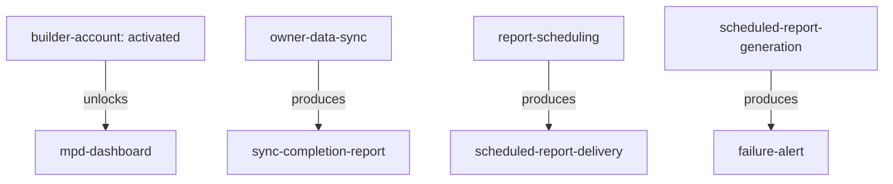

# Section glossary — Dashboards, reports, notifications & cross-cutting integrations — Residential

**Source read:** Res 4.20 Multi Property Dashboard (3911–4266); Res 4.21 Reports (4267–4422); Res 6 Reporting Requirements (4998–5009).
Locators: `Res 4.20`, `Res 4.21`, `Res 6`. NEW BUILD → every Re-scan = NEW.

---

## 1. Ontology

### Objects

| # | Term | Meaning (≤12 words, from source) | Evidence (exact quote — where) | Re-scan |
|---|---|---|---|---|
| 1 | Multi Property Dashboard (MPD) | cross-community admin console for a builder's communities | "the MPD dashboard becomes accessible" (Res 4.20) | NEW |
| 2 | Builder Account | parent entity encompassing multiple communities | "a Builder Account that acts as a parent entity encompassing multiple communities" (Res 4.20 BR-PD-001) | NEW |
| 3 | MPD portal | portal showing all mapped communities to the admin | "Access the MPD portal and confirm visibility of all mapped communities" (Res 4.20) | NEW |
| 4 | community | a residential community mapped to a builder | "list of communities to map" (Res 4.20) | NEW = join term |
| 5 | consolidated view | single aggregated view across mapped communities | "in a single consolidated view" (Res 4.20 BR-PD-008) | NEW |
| 6 | service request | helpdesk request raised in a community | "all service requests and NOC requests" (Res 4.20 BR-PD-008) | NEW = join term |
| 7 | NOC request | no-objection-certificate request in helpdesk | "service requests and NOC requests" (Res 4.20) | NEW |
| 8 | Request Box | helpdesk item admin approves or rejects | "for Request Box -- approve or reject" (Res 4.20) | NEW |
| 9 | Purchase Request (PR) | procurement request consolidated in MPD | "consolidate all Purchase Requests and Purchase Orders" (Res 4.20 BR-PD-010) | NEW |
| 10 | Purchase Order (PO) | procurement order consolidated in MPD | "consolidate all Purchase Requests and Purchase Orders" (Res 4.20 BR-PD-010) | NEW |
| 11 | Notice Board | where global admin notices are posted | "Notice Board → Post Admin Notice" (Res 4.20) | NEW |
| 12 | notice | posted communication delivered to residents | "post a single notice to all or selected mapped communities" (Res 4.20 BR-PD-011) | NEW; drift → announcement (Com) |
| 13 | lease record | tenant lease shown with status indicators | "View consolidated lease records across all mapped communities" (Res 4.20) | NEW = join term |
| 14 | lease renewal | renewal the admin approves or rejects | "Approve or reject the lease renewal" (Res 4.20) | NEW |
| 15 | owner data | Mollak/ANACITY owner details compared and synced | "fetch the latest owner data for all mapped communities" (Res 4.20 BR-PD-017) | NEW |
| 16 | comparison view | side-by-side Mollak vs ANACITY owner details | "Display a side-by-side comparison view" (Res 4.20) | NEW |
| 17 | discrepancy | mismatch surfaced in the comparison view | "Highlight discrepancies: Missing records and Mismatched fields" (Res 4.20) | NEW |
| 18 | mismatch report | downloadable owner-data mismatch report | "download the mismatch report for offline review" (Res 4.20) | NEW |
| 19 | sync completion report | report generated after owner data sync | "Generate a sync completion report" (Res 4.20) | NEW |
| 20 | audit trail | immutable log of mapping, actions, sync | "Create an immutable audit trail entry" (Res 4.20) | NEW = join term |
| 21 | welcome email | email with credentials or activation link | "Generate a welcome email with temporary credentials or an account activation link" (Res 4.20) | NEW |
| 22 | report | scheduled or on-demand output across modules | "the scheduled and on-demand reporting capabilities of the ANACITY platform" (Res 4.21) | NEW = join term (reach-heavy) |
| 23 | complaint report | filterable report of complaints | "All complaint reports must support filtering" (Res 4.21 BR-RP-003) | NEW |
| 24 | incident report | on-demand report of incidents | "incident reports must be generated on-demand" (Res 4.21 BR-RP-005) | NEW |
| 25 | SMS activity report | SMS usage and delivery report | "generate SMS usage and delivery reports" (Res 4.21 BR-RP-006) | NEW |
| 26 | inventory summary report | report of current stock levels | "Inventory Summary report showing current stock levels" (Res 4.21 BR-RP-007) | NEW |
| 27 | AMC list report | contracts report with status indicators | "AMC list report showing all contracts with status indicators" (Res 4.21 BR-RP-008) | NEW |
| 28 | action item report | overdue action items and status summary | "generate overdue action items and status summary reports" (Res 4.21 BR-RP-010) | NEW |
| 29 | service staff directory report | staff directory report by staff type | "service staff directory reports by staff type" (Res 4.21 BR-RP-012) | NEW |
| 30 | resident directory report | flat, occupancy and resident directory reports | "the full suite of flat directory, occupancy, and resident reports" (Res 4.21) | NEW |
| 31 | expiring lease report | leases expiring in a forward date range | "generate an expiring lease report configurable by forward date range" (Res 4.21) | NEW |
| 32 | signature list report | printable list segmented by resident type | "printable signature list reports segmented by resident type" (Res 4.21) | NEW |
| 33 | contact directory report | community-wide contact directory report | "community-wide contact directory report" (Res 4.21) | NEW |
| 34 | parking lot and vehicle report | unallocated vehicles and empty parking slots | "parking-related reports identifying unallocated vehicles and empty parking slots" (Res 4.21) | NEW |
| 35 | visitor parking report | visitor parking occupancy and log report | "visitor parking occupancy and log reports" (Res 4.21) | NEW |
| 36 | facility visit report | facility usage/visit log report | "facility usage/visit log report" (Res 4.21) | NEW |
| 37 | maintenance staff leave report | leave report for maintenance staff | "leave report for all maintenance staff" (Res 4.21) | NEW |
| 38 | T&C acceptance report | tracks who has accepted the terms | "T&C acceptance tracking reports" (Res 4.21) | NEW |
| 39 | login activity report | login activity by user and by unit | "login activity reports by user and by unit" (Res 4.21) | NEW |
| 40 | payment gateway settlement report | transactions with gross, fees, net amounts | "payment gateway settlement report showing all transactions" (Res 4.21 BR-RP-021) | NEW |
| 41 | form submission report | export of all form submissions | "data export of all form submissions for any selected form" (Res 4.21 BR-RP-022) | NEW |
| 42 | gatekeeper patrol report | patrol swipe and route compliance report | "patrol swipe and patrol route compliance reports" (Res 4.21 BR-RP-023) | NEW; drift → Guard Patrol Reports (Com) |

> **Not captured — no body quote in range:** *widget* / *KPI* — **None** in these ranges (the dashboard shows "consolidated list", "status indicators", "comparison view", not widgets/KPIs).

### Roles

| # | Term | Meaning (≤12 words, from source) | Evidence (exact quote — where) | Re-scan |
|---|---|---|---|---|
| 1 | Client (DIEZ) | the residential client organisation | "Client (DIEZ) Provide: official builder entity name" (Res 4.20) | NEW |
| 2 | ANACITY Team | back-office team provisioning builder/admin accounts | "ANACITY Team Validate request" (Res 4.20) | NEW |
| 3 | MPD Admin | admin with full access to all mapped communities | "Create the MPD Admin account in the system" (Res 4.20) | NEW; "Admin" overloaded |
| 4 | MPD staff user | staff scoped to assigned communities | "create MPD staff user accounts, define their role, and assign community scope" (Res 4.20 BR-PD-006) | NEW |
| 5 | Community Administrator | owner of scheduled reports | "Owner  Community Administrator" (Res 4.21) | NEW = join term |
| 6 | recipient | who a scheduled report is delivered to | "delivered to specified recipients" (Res 4.21 BR-RP-001) | NEW |
| 7 | resident / requester | notified of a request status change | "Send notification to the resident/requester about the status change" (Res 4.20) | NEW = join term |
| 8 | security manager | audits guard patrol activity | "enabling security managers to audit guard activity" (Res 4.21 BR-RP-023) | NEW |

### Steps

| # | Term | Meaning (≤12 words, from source) | Evidence (exact quote — where) | Re-scan |
|---|---|---|---|---|
| 1 | Builder and Community Mapping | mapping communities to a Builder Account | "Builder and Community Mapping" (Res 4.20) | NEW |
| 2 | MPD Admin Setup | provisioning the MPD admin account | "MPD Admin Setup" (Res 4.20) | NEW |
| 3 | User Access Management | creating staff users with community scope | "User Access Management" (Res 4.20) | NEW |
| 4 | Mollak Owner Data Sync | fetch, compare, verify and sync owner data | "Mollak Owner Data Sync" (Res 4.20) | NEW |
| 5 | Report Scheduling | configuring a report's frequency and recipients | "Report Scheduling Configuration" (Res 4.21 BR-RP-001) | NEW |
| 6 | Reporting Requirements | all reporting captured under Module 4.21 | "All reporting requirements … are captured under Module 4.21 (Reports)" (Res 6) | NEW |

### States & values

| # | Term | Meaning (≤12 words, from source) | Evidence (exact quote — where) | Re-scan |
|---|---|---|---|---|
| 1 | report frequency | Daily / Weekly / Monthly / On-demand | "Configurable: Daily / Weekly / Monthly (scheduled); On-demand" (Res 4.21) | NEW |
| 2 | export format (Res) | CSV / PDF | "Export Formats  CSV / PDF" (Res 4.21) | NEW; drift → CSV/Excel (Com) |
| 3 | notice state | draft / published / scheduled | "existing notices from all communities (draft, published, scheduled)" (Res 4.20) | NEW |
| 4 | request status (MPD) | pending / approved / rejected | "list of pending, approved, and rejected requests" (Res 4.20) | NEW |
| 5 | AMC contract status | expired / expiring / active | "status indicators for expired, expiring, and active contracts" (Res 4.21) | NEW |
| 6 | complaint SLA state | SLA breached | "where the SLA response or resolution deadline has been breached" (Res 4.21 BR-RP-004) | NEW |
| 7 | discrepancy type | Missing records / Mismatched fields | "Missing records and Mismatched fields" (Res 4.20) | NEW |
| 8 | permission level | view-only / action-permitted | "view-only vs. action-permitted" (Res 4.20) | NEW |
| 9 | sync freshness | 'Last synced' timestamp per data module | "display a 'Last synced' timestamp for each data module view" (Res 4.20) | NEW |
| 10 | scheduled report outcome | delivered / generation failed (failure alert) | "with failure alerts if generation fails" (Res 4.21 BR-RP-002) | NEW |

> **Dropped as pure integration/API mechanism (per brief):** Mollak API, Spintly, Puntualiti, Park+, Moengage, sendgrid, gupshup, WATI (WhatsApp), Smart Q WebView, email integrator, background queue. (*Smart Q* / *HungerBox* kept — they are the branded ordering experience the employee sees, not just the API.)

---

## 2. Topology

### Verbatim (parent → child)

| Parent (A) | relationship | Child (B) | Evidence (exact quote — where) |
|---|---|---|---|
| Multi Property Dashboard | contains | • Helpdesk view • PR/PO • Notice Board • Leases • Move In & Move Out • Owner Data Sync | "centralised cross-community operations: helpdesk, PR/PO, noticeboard, lease management, move-in/out approvals, and Mollak owner data sync" (Res 4.20) |
| Builder Account | contains | community | "a parent entity encompassing multiple communities" (Res 4.20 BR-PD-001) |
| Helpdesk view | contains | • service request • NOC request • Request Box | "View the consolidated list of service requests or NOC requests" / "Service Request or Request Box" (Res 4.20) |
| PR/PO | contains | • Purchase Request • Purchase Order | "Purchase Request or Purchase Orders" (Res 4.20) |
| Notice Board | contains | notice | "Notice Board → Post Admin Notice" (Res 4.20) |
| comparison view | reveals | discrepancy | "Display a side-by-side comparison view … Highlight discrepancies" (Res 4.20) |
| discrepancy | kind of | • Missing records • Mismatched fields | "Highlight discrepancies: Missing records and Mismatched fields" (Res 4.20) |
| report | kind of | • complaint report • incident report • inventory report • AMC report • parking report • visitor report • facility report • payment report • gatekeeper report | "spanning complaint, incident, inventory, AMC, asset, staff, resident, parking, visitor, facility, payment, and gatekeeper reports" (Res 4.21) |
| report | kind of | • scheduled report • on-demand report | "the scheduled and on-demand reporting capabilities" (Res 4.21) |

### Mermaid

```mermaid
flowchart TD
    mpd["multi-property-dashboard"] -->|contains| helpdesk["helpdesk-view"]
    mpd -->|contains| prpo["pr-po"]
    mpd -->|contains| nb["notice-board"]
    mpd -->|contains| leases["leases"]
    mpd -->|contains| mimo["move-in-move-out"]
    mpd -->|contains| ods["owner-data-sync"]
    ba["builder-account"] -->|contains| comm["community"]
    helpdesk -->|contains| sr["service-request"]
    helpdesk -->|contains| noc["noc-request"]
    helpdesk -->|contains| rb["request-box"]
    prpo -->|contains| pr["purchase-request"]
    prpo -->|contains| po["purchase-order"]
    nb -->|contains| notice["notice"]
    cv["comparison-view"] -->|reveals| disc["discrepancy"]
    disc -->|kind of| miss["missing-records"]
    disc -->|kind of| mism["mismatched-fields"]
    report["report"] -->|kind of| crep["complaint-report"]
    report -->|kind of| irep["incident-report"]
    report -->|kind of| invrep["inventory-report"]
    report -->|kind of| amcrep["amc-report"]
    report -->|kind of| gkrep["gatekeeper-report"]
    report -->|kind of| sched["scheduled-report"]
    report -->|kind of| ondem["on-demand-report"]
```

---

## 3. Choreography

### States

| Thing | States (each on its own line) | Evidence (exact quote — where) |
|---|---|---|
| Builder Account | • created • activated (unlocks MPD dashboard) | "Activate the Builder Account; the MPD dashboard becomes accessible" (Res 4.20) |
| MPD request (move-in/out) | • pending • approved • rejected | "list of pending, approved, and rejected requests" (Res 4.20) |
| notice | • draft • published • scheduled | "existing notices from all communities (draft, published, scheduled)" (Res 4.20) |
| owner data | • fetched • compared • synced ('Last synced' timestamp) | "display a 'Last synced' timestamp for each data module view" (Res 4.20) |
| discrepancy | • Missing records • Mismatched fields | "Highlight discrepancies: Missing records and Mismatched fields" (Res 4.20) |
| scheduled report | • generated / delivered • generation failed (failure alert) | "with failure alerts if generation fails" (Res 4.21 BR-RP-002) |
| complaint (in report) | • SLA breached | "where the SLA response or resolution deadline has been breached" (Res 4.21) |
| AMC contract | • expired • expiring • active | "status indicators for expired, expiring, and active contracts" (Res 4.21) |

### Gates (verbatim)

| A | relationship | B | Evidence (exact quote — where) |
|---|---|---|---|
| Builder Account (activated) | unlocks | MPD dashboard | "Activate the Builder Account; the MPD dashboard becomes accessible" (Res 4.20) |
| Owner Data Sync | produces | sync completion report | "Generate a sync completion report" (Res 4.20) |
| Report Scheduling | produces | scheduled report delivery | "run at a defined frequency and be delivered to specified recipients" (Res 4.21 BR-RP-001) |
| scheduled report generation | produces | failure alert | "with failure alerts if generation fails" (Res 4.21 BR-RP-002) |

### Gates (mermaid)

---

## 4. Conflict flags (for Gate 1)

- **Several words, one thing — report / statement:** flag as likely cross-section synonym. NOTE: "statement" does **not** appear in my ranges (my ranges use "report" everywhere incl. "settlement report", Res 4.21 BR-RP-021); the accounting workstream (Res Part 2, Res 6) is the probable home of "statement" — raise for the accounting section.
- **Several words, one thing — dashboard / home screen:** Res 4.20 "Multi Property Dashboard" / "MPD dashboard" (admin web console) vs Com 7.3/8 "home screen" (employee mobile landing). Both are the aggregating landing surface; different word per deployment.
- **Several words, one thing — notice / announcement:** Residential `Notice Board` / `notice` (Res 4.20) — the Commercial deployment uses `announcement` / `Announcement Alerts` (Com Emp 1.21 / Com 8). Same concept (a broadcast communication) — **Residential vs Commercial drift**.
- **Several words, one thing — download / Download Manager / export:** Res 4.20/4.21 treat it as an action ("download the mismatch report", "Export Formats CSV/PDF") while Com AO 1.9 names a **Download Manager** module and "Downloads the report". Part-vs-whole + naming drift.
- **One word, two meanings — report:** reach-heavy. Spans ~23 named report types in Res 4.21 plus Occupant Access/Service Request/Guard Patrol (Com AO), Visitor/Service Request/Amenity Booking (Com Ten). Nearly every module contributes a "report" — decide whether "report" is one glossary object with typed children, or each report type is its own entry.
- **One word, two meanings — Admin:** "Admin" = MPD Admin (Res 4.20), Building Admin (Com AO 1.9), Community Administrator (Res 4.21), Tenant Admin (Com Ten 1.7), Asset Owner (Com Emp 1.21). Roles section owns; flag the overload.
- **Part vs whole — notification vs channel:** the notification (the product term) vs its delivery channels — Residential uses "push notification and/or email" (Res 4.20); the Commercial deployment adds SMS and WhatsApp (Com 8). Channels are the *how*; the product term is the notification.
- **Residential vs Commercial drift — gatekeeper vs guard:** Res 4.21 "Gatekeeper Patrol Reports" vs Com AO 1.9 "Guard Patrol Reports" — same patrol-compliance report, different role word (ties to the roles section's gatekeeper/guard split).
- **Residential vs Commercial drift — multi-property dashboard vs home dashboard:** Res has a cross-community admin **Multi Property Dashboard**; Commercial has no equivalent "home dashboard" — the landing role is split between the **Asset Owner Portal** (admin) and the **home screen** (employee). Confirm whether these map to one concept.
- **Residential vs Commercial drift — export format value set:** Res 4.21 "CSV / PDF" vs Com AO 1.9 "CSV or Excel". Same value slot, divergent members.
- **Absent but expected — widget / KPI:** the brief lists them, but neither appears in these ranges; the MPD/reports surfaces use "consolidated list", "status indicators", "comparison view" instead. Honest **None** — do not invent.
