# Section glossary — Helpdesk, service requests & incidents — Residential

**Source read:** Residential BRD 4.12 Helpdesk / Complaint Box (2042–2383), 4.13 Request Box (2384–2566), 4.22 Incident Reporting (4423–4617). NEW BUILD — every Re-scan cell is `NEW`.

Locators: `Res 4.12` = Residential Helpdesk/Complaint Box · `Res 4.13` = Request Box · `Res 4.22` = Incident Reporting.

## Ontology

### Objects

| # | Term | Meaning (≤12 words, from the source) | Evidence (exact quote — where) | Re-scan |
|---|---|---|---|---|
| 1 | helpdesk | module holding the complaint/ticket lifecycle and its config | "Navigate to Helpdesk module  Complaint box" (Res 4.12) | NEW |
| 2 | complaint box | the container where complaints are logged and configured | "Helpdesk module  Complaint box  complaint category" (Res 4.12) | NEW |
| 3 | complaint | the logged issue a resident or admin raises | "complaint logging by resident or admin, lifecycle management" (Res 4.12) | NEW = "ticket" |
| 4 | ticket | the logged item whose lifecycle is tracked | "Ticket Lifecycle and Audit Trail" (Res 4.12) | NEW = "complaint" / "service request" |
| 5 | complaint category | classification a complaint is filed under | "Select Category from the configured category list" (Res 4.12) | NEW |
| 6 | subcategory | classification nested under a parent category | "Add multiple subcategories under each main category" (Res 4.12 BR-HD-002) | NEW |
| 7 | complaint nature | the field classifying a complaint's kind | "Select Complaint Nature (e.g., Complaint, Service Request, Inquiry)" (Res 4.12) | NEW |
| 8 | complaint type | secondary classification field on a complaint | "Select Complaint Type" (Res 4.12) | NEW |
| 9 | RCA template | named root-cause template shown at complaint resolution | "template is shown upon complaint resolution in the complaint detail" (Res 4.12) | NEW |
| 10 | escalation matrix | per-category chain of owners and time windows | "configure a 3-level escalation matrix per category with owners and time windows" (Res 4.12 BR-HD-005) | NEW = "escalation path" |
| 11 | SLA | service target window that drives escalation | "Auto-escalate complaints in the category that breach their SLA windows" (Res 4.12) | NEW |
| 12 | note template | predefined note text used during ticket handling | "create predefined note templates with a name and message body" (Res 4.12 BR-HD-007) | NEW |
| 13 | note | update text added to a complaint | "When adding a note to a complaint, select a saved template" (Res 4.12) | NEW |
| 14 | complaint ID | unique identifier generated per complaint | "Generate a unique Complaint ID and set status to 'Open'" (Res 4.12) | NEW = "ticket ID" / "service request ID" |
| 15 | audit trail | immutable time-stamped log of lifecycle events | "record all complaint lifecycle events in an immutable, time-stamped audit log" (Res 4.12) | NEW |
| 16 | complaint detail | the record view exposing history and audit trail | "View the full audit trail from the complaint detail page" (Res 4.12) | NEW |
| 17 | attachment | image or document uploaded with a complaint | "Optionally upload attachments (images or PDF documents)" (Res 4.12) | NEW |
| 18 | complaint settings | community-level config for escalation, SLA, re-open | "Navigate to Community  Complaint Settings" (Res 4.12) | NEW |
| 19 | maintenance staff directory | directory of staff eligible for helpdesk roles | "Assign a Level 1 owner (role or individual) from the Maintenance Staff Directory" (Res 4.12) | NEW |
| 20 | request box | admin area configuring approval-driven request categories | "4.13 Request Box" (Res 4.13) | NEW |
| 21 | request desk | member-facing area where requests are raised | "category becomes active and visible in the Request Desk" (Res 4.13) | NEW = "request box" |
| 22 | request | member-initiated item approved through ALH | "the member-initiated request lifecycle from submission through ALH approval" (Res 4.13) | NEW |
| 23 | request category | approval-workflow category (e.g. NOC, Pet Registration) | "Enter the request category name (e.g., NOC – Renovation, Pet Registration, Visitor Parking Permit)" (Res 4.13) | NEW |
| 24 | ALH | Approver List Hierarchy defining who approves and order | "Map the category to an Approver List Hierarchy (ALH)" (Res 4.13) | NEW |
| 25 | checklist | list an approver must verify before approving | "Map a checklist to the category – a list of items the admin must verify before approving" (Res 4.13) | NEW |
| 26 | output certificate template | template rendered and pushed to member on approval | "Select an output certificate template – the template pushed to the member on approval" (Res 4.13) | NEW |
| 27 | output certificate | the rendered certificate delivered on approval | "render the output certificate template and push it to the member via email" (Res 4.13) | NEW |
| 28 | category description | text shown to member after selecting a category | "Add a category description – text shown to the member after they select the category" (Res 4.13) | NEW |
| 29 | form | data-capture form mapped to a request category | "Map a form to the category ... Load the data-capture form mapped to the selected category" (Res 4.13) | NEW |
| 30 | form library | store of existing forms to map to categories | "selecting an existing form from the form library" (Res 4.13) | NEW |
| 31 | chat channel | per-request thread for member and approver | "Each submitted request has a dedicated chat channel" (Res 4.13 BR-RB-009) | NEW = "ticket thread" |
| 32 | rejection reason | reason returned to member on request reject | "notify the member with the rejection reason; request marked Rejected" (Res 4.13) | NEW |
| 33 | incident reporting | module for logging, managing and resolving incidents | "The Incident Reporting module provides a structured, multi-channel mechanism for logging, managing, and resolving incidents" (Res 4.22) | NEW |
| 34 | incident | a security/property/community event that is logged | "logging, managing, and resolving incidents within a community" (Res 4.22) | NEW |
| 35 | incident category | pre-configured classification for an incident | "Create incident categories in the Admin Portal (e.g., Security Breach, Property Damage...)" (Res 4.22) | NEW |
| 36 | incident report | the submitted incident record | "Submit the completed incident report. System logs the report" (Res 4.22) | NEW |
| 37 | geographical coordinates | latitude/longitude captured at incident reporting | "Capture the geographical coordinates (latitude and longitude) of the incident location" (Res 4.22) | NEW |
| 38 | image | media uploaded as supporting evidence | "Upload images to support the incident report and serve as documentation" (Res 4.22) | NEW |
| 39 | in-app chat | real-time chat between reporter and administrators | "The system shall provide an in-app chat feature allowing the incident reporter and administrators to communicate" (Res 4.22 BR-IR-008) | NEW = "chat channel" |
| 40 | member app | resident channel for raising incidents/requests | "Residents via the Member App" (Res 4.22) | NEW |
| 41 | gatekeeper app | security-team channel for raising incidents | "Security personnel via the Gatekeeper App" (Res 4.22) | NEW |
| 42 | web portal | administrator channel for incidents | "Administrators via the Web Portal" (Res 4.22) | NEW |
| 43 | admin app | administrator app channel | "Administrators via the Web Portal and Admin App" (Res 4.22) | NEW |
| 44 | notification | alert sent on lifecycle/status events | "Send notification to assigned staff and confirmation to resident" (Res 4.12) | NEW |

### Roles

| # | Term | Meaning (≤12 words, from the source) | Evidence (exact quote — where) | Re-scan |
|---|---|---|---|---|
| 1 | community administrator | admin who configures and owns helpdesk/request/incident | "Owner: Community Administrator" (Res 4.12) | NEW |
| 2 | resident | community member who logs complaints | "complaint logging by resident or admin" (Res 4.12) | NEW = "member" |
| 3 | member | resident who initiates requests / raises incidents | "the member-initiated request lifecycle" (Res 4.13) | NEW = "resident" |
| 4 | agent | staff member who adds notes to a complaint | "The system shall allow agents to select a note template" (Res 4.12 BR-HD-008) | NEW |
| 5 | manager | role that views the complaint audit trail | "Admin / Manager  View the full audit trail" (Res 4.12) | NEW |
| 6 | maintenance staff | staff assigned helpdesk roles / complaint ownership | "Navigate to Directory  Maintenance Staff" (Res 4.12) | NEW = "facility staff" |
| 7 | complaint box admin | staff role with full helpdesk access | "Select either 'Complaint Box Admin' (full access)" (Res 4.12) | NEW |
| 8 | complaint category admin | staff role with restricted-scope helpdesk access | "or 'Complaint Category Admin' (restricted scope)" (Res 4.12) | NEW |
| 9 | request approver | role notified to review and approve a request | "set request status to In Review and notify the Request Approver" (Res 4.13) | NEW |
| 10 | ALH approver | approver in the Approver List Hierarchy | "ALH Approver" (Res 4.13) | NEW = "request approver" |
| 11 | incident administrator | admin who configures incident categories/matrix | "Community Admin / Incident Admin" (Res 4.22) | NEW |
| 12 | category administrator | admin who oversees, manages and resolves incidents | "Assign a Category Administrator to oversee, manage, and resolve incidents" (Res 4.22) | NEW = "category admin" |
| 13 | incident field staff | staff assigned for on-ground incident resolution | "Configure and assign Incident Field Staff roles ... on-ground resolution" (Res 4.22) | NEW = "field staff" / "facility staff" |
| 14 | security personnel | security team raising incidents via gatekeeper app | "Security personnel via the Gatekeeper App" (Res 4.22) | NEW |
| 15 | incident reporter | the party who raised the incident | "communicate directly with the incident reporter through the in-app chat" (Res 4.22) | NEW = "user" |

### Steps

| # | Term | Meaning (≤12 words, from the source) | Evidence (exact quote — where) | Re-scan |
|---|---|---|---|---|
| 1 | category and subcategory setup | admin config of complaint categories | "Category and Subcategory Setup" (Res 4.12) | NEW |
| 2 | RCA template configuration | admin config of root-cause templates | "RCA Template Configuration" (Res 4.12) | NEW |
| 3 | escalation matrix setup | admin config of escalation owners/windows | "Escalation Matrix Setup" (Res 4.12) | NEW |
| 4 | complaint admin role assignment | granting staff helpdesk roles | "Complaint Admin Role Assignment" (Res 4.12) | NEW |
| 5 | complaint logging | resident/admin logs a complaint | "Complaint Logging Flow" (Res 4.12) | NEW |
| 6 | escalation | moving an unresolved item to the next level | "Auto-escalate complaints in the category that breach their SLA windows" (Res 4.12) | NEW |
| 7 | re-open | reopening a closed complaint/ticket | "the maximum number of times a closed complaint can be re-opened" (Res 4.12 BR-HD-015) | NEW |
| 8 | resolution | addressing and marking an item resolved | "Once the incident is addressed, mark it as resolved" (Res 4.22) | NEW |
| 9 | member request flow | member submits request through ALH to closure | "Member Request Flow" (Res 4.13) | NEW |
| 10 | incident raising | member/security/admin raises an incident | "Phase B -- Incident Raising (Member / Security / Admin)" (Res 4.22) | NEW |
| 11 | incident resolution | category admin/field staff resolve the incident | "Phase C -- Incident Resolution (Category Admin / Field Staff)" (Res 4.22) | NEW |

### States & values

| # | Term | Meaning (≤12 words, from the source) | Evidence (exact quote — where) | Re-scan |
|---|---|---|---|---|
| 1 | complaint status | • Open • In Progress • Resolved • Closed | "Open  In Progress  Resolved  Closed, with each transition logged" (Res 4.12 BR-HD-014) | NEW |
| 2 | complaint status (extended) | • Cancelled • Re-opened | "maximum re-open count for closed or cancelled complaints" (Res 4.12) | NEW |
| 3 | complaint nature | • Complaint • Service Request • Inquiry | "Select Complaint Nature (e.g., Complaint, Service Request, Inquiry)" (Res 4.12) | NEW |
| 4 | request status | • In Review • Closed • Rejected | "set request status to In Review"; "request marked Closed"; "request marked Rejected" (Res 4.13) | NEW |
| 5 | request category status | • Active | "category becomes active and visible in the Request Desk" (Res 4.13) | NEW |
| 6 | incident status | • Open • In Progress • Escalated • Resolved | "current status of each incident (e.g., Open, In Progress, Escalated, Resolved)" (Res 4.22) | NEW |

## Topology

### Verbatim (parent → child)

| Parent (A) | relationship | Child (B) | Evidence (exact quote — where) |
|---|---|---|---|
| helpdesk | contains | complaint box | "Navigate to Helpdesk module  Complaint box" (Res 4.12) |
| complaint box | contains | complaint category | "Complaint box  complaint category  setup category" (Res 4.12) |
| complaint category | contains | subcategory | "add multiple subcategories under each main category" (Res 4.12 BR-HD-002) |
| helpdesk | contains | escalation matrix | "Navigate to Helpdesk  Escalation Matrix" (Res 4.12) |
| escalation matrix | contains | • Level 1 owner • Level 2 owner • Level 3 owner | "Assign a Level 1 owner ... Assign a Level 2 owner ... Assign a Level 3 owner" (Res 4.12) |
| complaint | contains | • complaint nature • complaint type • category • subcategory • description • attachment | "Select Complaint Nature ... Complaint Type ... Category ... Subcategory ... Enter a description ... upload attachments" (Res 4.12) |
| complaint nature | kind of | • Complaint • Service Request • Inquiry | "Complaint Nature (e.g., Complaint, Service Request, Inquiry)" (Res 4.12) |
| complaint | reveals | RCA template | "template is shown upon complaint resolution in the complaint detail" (Res 4.12) |
| complaint detail | reveals | audit trail | "View the full audit trail from the complaint detail page" (Res 4.12) |
| request box | contains | request category | "Request Box  Category Management  Create Category" (Res 4.13) |
| request category | contains | • ALH • checklist • output certificate template • category description • form | "All further configuration (ALH, checklist, template, description, form) is mapped to this category" (Res 4.13 BR-RB-001) |
| form library | contains | form | "selecting an existing form from the form library" (Res 4.13) |
| request desk | contains | request | "navigate to Request Desk ... Tap the + button to create a new request" (Res 4.13) |
| request | reveals | category description | "Display the category description configured by the admin" (Res 4.13) |
| request | contains | chat channel | "Each submitted request has a dedicated chat channel" (Res 4.13 BR-RB-009) |
| incident reporting | contains | incident category | "Create incident categories in the Admin Portal" (Res 4.22) |
| incident category | contains | escalation matrix | "each with its own escalation matrix and category administrator assignment" (Res 4.22 BR-IR-002) |
| escalation matrix | contains | • escalation level • escalation timeline | "multi-level escalation matrices per incident category, with definable timelines for each escalation level" (Res 4.22) |
| incident category | kind of | • Security Breach • Property Damage • Noise Complaint • Medical Emergency | "(e.g., Security Breach, Property Damage, Noise Complaint, Medical Emergency)" (Res 4.22) |
| incident | contains | • incident category • geographical coordinates • description • image | "Select the ... incident category ... Capture the geographical coordinates ... Enter a brief description ... Upload images" (Res 4.22) |
| reporting channel | kind of | • member app • gatekeeper app • web portal • admin app | "raised by Members (via Member App), Security Personnel (via Gatekeeper App), and Administrators (via Web Portal and Admin App)" (Res 4.22 BR-IR-001) |

### Mermaid

```mermaid
flowchart TD
    helpdesk["helpdesk"] -->|contains| complaintbox["complaint-box"]
    complaintbox -->|contains| complaintcategory["complaint-category"]
    complaintcategory -->|contains| subcategory["subcategory"]
    helpdesk -->|contains| escmatrix["escalation-matrix"]
    escmatrix -->|contains| lvl1["level-1-owner"]
    escmatrix -->|contains| lvl2["level-2-owner"]
    escmatrix -->|contains| lvl3["level-3-owner"]
    complaint["complaint"] -->|contains| cnature["complaint-nature"]
    complaint -->|contains| ctype["complaint-type"]
    complaint -->|contains| cdesc["description"]
    complaint -->|contains| cattach["attachment"]
    cnature -->|kind of| ncomplaint["complaint"]
    cnature -->|kind of| nservreq["service-request"]
    cnature -->|kind of| ninquiry["inquiry"]
    complaint -->|reveals| rcatemplate["rca-template"]
    complaintdetail["complaint-detail"] -->|reveals| audittrail["audit-trail"]
    requestbox["request-box"] -->|contains| requestcategory["request-category"]
    requestcategory -->|contains| alh["alh"]
    requestcategory -->|contains| checklist["checklist"]
    requestcategory -->|contains| octemplate["output-certificate-template"]
    requestcategory -->|contains| catdesc["category-description"]
    requestcategory -->|contains| form["form"]
    formlibrary["form-library"] -->|contains| form
    requestdesk["request-desk"] -->|contains| request["request"]
    request -->|reveals| catdesc
    request -->|contains| chatchannel["chat-channel"]
    incidentreporting["incident-reporting"] -->|contains| incidentcategory["incident-category"]
    incidentcategory -->|contains| escmatrix2["escalation-matrix"]
    escmatrix2 -->|contains| esclevel["escalation-level"]
    escmatrix2 -->|contains| esctimeline["escalation-timeline"]
    incidentcategory -->|kind of| secbreach["security-breach"]
    incidentcategory -->|kind of| propdamage["property-damage"]
    incidentcategory -->|kind of| noise["noise-complaint"]
    incidentcategory -->|kind of| medemerg["medical-emergency"]
    incident["incident"] -->|contains| incidentcategory
    incident -->|contains| geocoords["geographical-coordinates"]
    incident -->|contains| image["image"]
    reportingchannel["reporting-channel"] -->|kind of| memberapp["member-app"]
    reportingchannel -->|kind of| gatekeeperapp["gatekeeper-app"]
    reportingchannel -->|kind of| webportal["web-portal"]
    reportingchannel -->|kind of| adminapp["admin-app"]
```

## Choreography

### States

| Thing | States (each on its own line) | Evidence (exact quote — where) |
|---|---|---|
| complaint | Open In Progress Resolved Closed Cancelled Re-opened | "Open  In Progress  Resolved  Closed, with each transition logged" (Res 4.12 BR-HD-014); "closed or cancelled complaints" + re-open (Res 4.12) |
| request | In Review Closed Rejected | "set request status to In Review"; "request marked Closed"; "request marked Rejected" (Res 4.13) |
| request category | Active | "category becomes active and visible in the Request Desk" (Res 4.13) |
| incident | Open In Progress Escalated Resolved | "current status of each incident (e.g., Open, In Progress, Escalated, Resolved)" (Res 4.22) |

### Gates (verbatim)

| A | relationship | B | Evidence (exact quote — where) |
|---|---|---|---|
| submit complaint | produces | complaint ID (status Open) | "Generate a unique Complaint ID and set status to 'Open'" (Res 4.12) |
| submit complaint | produces | notification to assigned staff | "Send notification to assigned staff and confirmation to resident" (Res 4.12) |
| SLA window breach | produces | escalation (next level) | "automatically escalate complaints to the next level when the SLA window is breached" (Res 4.12 BR-HD-006) |
| submit request | produces | status In Review + notify approver | "Set request status to In Review and notify the Request Approver" (Res 4.13) |
| submit request | comes before | ALH routing | "Route the request through the ALH mapped to the category" (Res 4.13) |
| ALH approval | produces | output certificate (request Closed) | "On Approve: render the output certificate template and push it to the member via email; request marked Closed" (Res 4.13) |
| ALH rejection | produces | rejection reason (request Rejected) | "On Reject: notify the member with the rejection reason; request marked Rejected" (Res 4.13) |
| mapped ALH | locks / unlocks | request category Active | "A category must have an ALH mapped before it can be set to Active" (Res 4.13) |
| category description | comes before | form load | "The category description is always displayed to the member before the form loads" (Res 4.13) |
| rejected request | locks / unlocks | re-open (blocked) | "A rejected request cannot be re-opened" (Res 4.13) |
| submit incident report | produces | notification to category administrator | "System logs the report and triggers notifications to the assigned Category Administrator" (Res 4.22) |
| unresolved past escalation timeline | produces | auto-escalation | "If the incident is not resolved within the configured escalation timeline, automatically escalate it to the next level" (Res 4.22) |
| mark incident resolved | produces | resolution timestamp + notify reporter | "mark it as resolved. The system logs the resolution timestamp and notifies the reporter" (Res 4.22) |

### Gates (mermaid)

```mermaid
flowchart TD
    submitcomplaint["submit-complaint"] -->|produces| complaintid["complaint-id-open"]
    submitcomplaint -->|produces| notifystaff["notify-assigned-staff"]
    slabreach["sla-window-breach"] -->|produces| escalation["escalation-next-level"]
    submitrequest["submit-request"] -->|produces| inreview["status-in-review-notify-approver"]
    submitrequest -->|comes before| alhroute["alh-routing"]
    alhapprove["alh-approval"] -->|produces| outputcert["output-certificate-closed"]
    alhreject["alh-rejection"] -->|produces| rejectreason["rejection-reason-rejected"]
    mappedalh["mapped-alh"] -->|locks/unlocks| catactive["request-category-active"]
    catdescgate["category-description"] -->|comes before| formload["form-load"]
    rejectedreq["rejected-request"] -->|locks/unlocks| reopenblocked["re-open-blocked"]
    submitincident["submit-incident-report"] -->|produces| notifycatadmin["notify-category-admin"]
    unresolvedinc["unresolved-past-timeline"] -->|produces| autoesc["auto-escalation"]
    resolveinc["mark-incident-resolved"] -->|produces| restimestamp["resolution-timestamp-notify-reporter"]
```

## Conflict flags (for Gate 1)

- **Several words, one thing — the core raise/route/resolve object.** Residential logs a "complaint" but titles its lifecycle "Ticket Lifecycle and Audit Trail" — so complaint = `ticket` in Res 4.12. The Commercial deployment uses `service request` for the same raise/route/resolve object. *Note:* "case" does **not** appear in any Residential source range.
- **One word, two meanings — `request` / `service request`.** In Residential, `request` (Res 4.13 Request Box) is an **approval-workflow** item (NOC, Pet Registration, Visitor Parking Permit) that closes via ALH and a certificate — NOT a facility ticket. The Commercial deployment uses `service request` for its facility ticket, so the same word family names two different objects across deployments.
- **One word, two meanings — "Complaint" and "Service Request" as nature values.** Res 4.12 makes "Complaint Nature ∈ {Complaint, Service Request, Inquiry}", so "Complaint" is both the whole object and a value of its own nature field, and "Service Request" is both a Residential nature value and the Commercial ticket object.
- **Several words, one thing — the ticket ID.** Residential `complaint ID` (Res 4.12) is the same identifier the Commercial deployment calls `service request ID` and `ticket ID`.
- **Res vs Com drift — escalation config.** Residential uses `escalation matrix` (Res 4.12 / 4.22); the Commercial deployment names the same 3-level construct `escalation path` ("Define Escalation Paths") and adds `interim paths` / `interim TAT`, which have **no Residential equivalent**.
- **Res vs Com drift — the ticket area / module name.** The module is "Helpdesk" in both, but the Residential ticket area is `complaint box`, whereas the Commercial deployment uses `service requests` / `service desk`.
- **Within-BRD synonym — Request Box vs Request Desk (Res 4.13).** Admin-config area `request box` vs member-facing `request desk` for the same feature.
- **Several words, one thing — note template & note; chat.** Residential has `note template` / `note` ("Complaint Note Templates", Res 4.12) and, for messaging, a per-request `chat channel` (Res 4.13) plus `in-app chat` (Res 4.22); the Commercial deployment uses `comment` / `ticket thread` for the same.
- **Res vs Com drift — the raiser role.** The Residential raiser is `resident` / `member`, and the incident `reporter` (Res 4.22) is the party awaiting the resolution notice; the Commercial deployment uses `employee` / `tenant admin` and `user`.
- **Several words, one thing — the on-ground resolver.** Residential resolvers are `maintenance staff` (Res 4.12) and `incident field staff` (Res 4.22); the Commercial deployment uses `facility staff` plus `service vendor`.
- **Several words, one thing — the config admin.** Residential config admins are `community administrator` / `incident administrator` / `category administrator` / `complaint box admin` / `complaint category admin`; the Commercial deployment uses `asset administrator` / `helpdesk administrator`. Within Residential, `category administrator` means the incident-scope owner (Res 4.22) while Helpdesk uses `complaint category admin` (Res 4.12).
- **State-set drift across the same lifecycle.** Res complaint {Open, In Progress, Resolved, Closed} vs Res incident {Open, In Progress, Escalated, Resolved} vs Res request {In Review, Closed, Rejected}; the Commercial ticket set {Open/Submitted, Assigned, In Progress, On Hold, Resolved, Closed, Reopened, Cancelled} drifts further. Note "Open" (Res) vs "Open / Submitted" (Com); "Resolved" vs "Resolved or Completed" (Com).
- **Part vs whole.** complaint box ⊂ helpdesk; escalation level / escalation timeline ⊂ escalation matrix.
- **Asymmetry (feature exists on one side only).** Residential-only: `RCA template` (Res 4.12) — present in Residential with no Commercial counterpart. Absent from Residential (Commercial-only): interim paths / interim TAT, QR-based feedback, and the SOS / Emergency Directory and Contact Us features.
- **Collision with method words — none material.** Residential uses "status"/"state", "category", "note", "escalation" as product terms; none clashes with the OTC method vocabulary (section, term, picture, gate, lens). "gate" is not used in the source.
