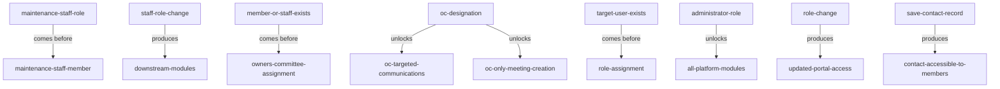

# Section glossary — People, roles, directory & access management — Residential

**Source read:** Residential 4.2 Maintenance Staff (484–647), 4.3 Owners Committee (648–750), 4.4 Administrators (751–879), 4.5 Contact List (880–1019). Re-scan = **NEW** (new build).

---

## 1. Ontology

### Roles

| # | Term | Meaning (≤12 words, from source) | Evidence (exact quote — where) | Re-scan |
|---|---|---|---|---|
| 1 | Admin | actor who manages staff, roles, contacts in a community | "Admin  Navigate to Directory  Maintenance Staff" (Res 4.2.2) | NEW |
| 2 | Community Administrator | named top admin role; owner of these modules | "Owner  Community Administrator" (Res 4.2.5); "at minimum: Community Administrator and sub-admin roles" (Res 4.4.4) | NEW |
| 3 | Community Admin | actor who assigns/revokes administrator roles | "Community Admin  Navigate to Directory  Members" (Res 4.4.2) | NEW = "Community Administrator" |
| 4 | sub-admin roles | lesser named admin roles with distinct permissions | "Community Administrator and sub-admin roles) with distinct permission sets" (Res 4.4.4) | NEW |
| 5 | Maintenance Staff (member) | facility/service staff persona recorded per community | "creation and management of maintenance staff roles and staff member profiles" (Res 4.2) | NEW |
| 6 | maintenance staff role | named staff job category (e.g. Plumber, Security) | "Enter the role name (e.g., Plumber, Electrician, Housekeeping, Security)" (Res 4.2.2) | NEW |
| 7 | member | resident/owner recorded in the Members directory | "Navigate to Directory  Members" (Res 4.3.2) | NEW |
| 8 | Owner's Committee Member (OC Member) | member or staff given committee designation | "Add to committee member' to assign Owner's Committee Member status" (Res 4.3.2) | NEW |
| 9 | Resident | community app user with read-only directory access | "Residents access the list in read-only mode via the app" (Res 4.5) | NEW |
| 10 | owner | a kind of community member | "community members (owners, tenants, residents)" (Res 4.5.4) | NEW |
| 11 | tenant (Res) | a kind of community member (individual) | "community members (owners, tenants, residents)" (Res 4.5.4) | NEW = "occupant" (Com) |
| 12 | Service Maid | resident's domestic worker (change request, out of scope) | "Service Maid should be added by a resident on the App" (Res 4.5.6) | NEW |
| 13 | System | the platform acting as an actor (non-human) | "System  Validate all mandatory fields" (Res 4.2.2) | NEW |

### Objects

| # | Term | Meaning (≤12 words, from source) | Evidence (exact quote — where) | Re-scan |
|---|---|---|---|---|
| 1 | community | the residential community that scopes staff, roles, contacts | "named maintenance staff role categories within the community" (Res 4.2.4) | NEW |
| 2 | staff member record | stored maintenance staff record linked to role & community | "Create the staff record linked to the selected role and the community" (Res 4.2.2) | NEW |
| 3 | staff profile | editable profile of a staff member | "update the staff profile photo or edit other fields" (Res 4.2.2) | NEW |
| 4 | profile photo | uploadable photo on a staff/employee record | "upload and update a profile photo for a staff member" (Res 4.2.4) | NEW |
| 5 | role directory | listing of created staff roles | "Save the role and add it to the role directory" (Res 4.2.2) | NEW |
| 6 | staff directory | searchable community staff listing | "provide a staff directory listing for the community, with search and filter" (Res 4.2.4) | NEW |
| 7 | Committee Role | named Owner's Committee role | "enter the names of Committee Roles to add to the community" (Res 4.3.2) | NEW |
| 8 | member record | a member's stored record with Actions menu | "Scroll to 'Actions' on the member record" (Res 4.3.2) | NEW |
| 9 | OC Member status | designation shown on a member/staff profile | "Update the member's profile to display OC Member status" (Res 4.3.2) | NEW |
| 10 | administrator role | named role granting portal permissions | "assign one or more named administrator roles to a member" (Res 4.4.4) | NEW |
| 11 | role assignment panel | UI panel showing current role assignment | "Display the current role assignment panel for the member" (Res 4.4.2) | NEW |
| 12 | permission set | distinct permissions attached to an admin role | "distinct permission sets" (Res 4.4.4) | NEW |
| 13 | Contact List | community emergency/service contact directory | "Contact List is the official community emergency and service directory" (Res 4.5.3) | NEW |
| 14 | contact record | stored community contact entry | "create community contact records with mandatory fields" (Res 4.5.4) | NEW |
| 15 | community directory | directory holding saved contacts | "save the contact record and add it to the community directory" (Res 4.5.2) | NEW |
| 16 | Service Offered | mandatory service-type field on a contact | "Enter Service Offered / service type (mandatory)" (Res 4.5.2) | NEW |
| 17 | maid profile | stored approved service-maid profile (change request) | "Storage of approved maid profiles in the system database" (Res 4.5.6) | NEW |

### Steps

| # | Term | Meaning (≤12 words, from source) | Evidence (exact quote — where) | Re-scan |
|---|---|---|---|---|
| 1 | Staff Role Creation and Management | create and manage named staff role categories | "Staff Role Creation and Management" (Res 4.2.2) | NEW |
| 2 | Staff Member Addition and Management | add and maintain staff member records | "Staff Member Addition and Management" (Res 4.2.2) | NEW |
| 3 | Staff Role Reassignment | change a staff member's role assignment | "change a staff member's role assignment on their profile" (Res 4.2.4) | NEW |
| 4 | Manage Member Committee Role | create/edit Owner's Committee roles | "Manage Member Committee Role" (Res 4.3.2) | NEW |
| 5 | Committee Member Assignment | assign OC Member status to member or staff | "Committee Member Assignment -- Member" (Res 4.3.2) | NEW |
| 6 | Role Assignment | assign admin roles to members/staff | "Role Assignment for Members" (Res 4.4.2) | NEW |
| 7 | Admin Role Revocation | revoke administrator roles from member/staff | "Admin Role Revocation -- Members" (Res 4.4.4) | NEW |
| 8 | Emergency Contact Setup | create community emergency/service contacts | "Emergency Contact Setup" (Res 4.5.2) | NEW |
| 9 | Contact Management | edit/delete/view contact records | "Contact Management" (Res 4.5.2) | NEW |

### States & values

| # | Term | States / values (from source) | Evidence (exact quote — where) | Re-scan |
|---|---|---|---|---|
| 1 | maintenance staff role type | • custom-created • (default/system) | "deactivate only custom created staff roles" (Res 4.2.4) | NEW |
| 2 | maintenance staff member | • active • deactivated | "deactivate a staff member, preventing further access and assignments" (Res 4.2.4) | NEW |
| 3 | OC Member status | • assigned • removed | "remove Owner's Committee Member status from a member or staff" (Res 4.3.4) | NEW |
| 4 | administrator role | • assigned • revoked | "assign one or more named administrator roles ... revoke administrator roles" (Res 4.4.4) | NEW |
| 5 | contact record access | • editable (admin) • read-only (resident) | "Residents have read-only access" (Res 4.5.3) | NEW |
| 6 | staff role name (value set) | • Plumber • Electrician • Housekeeping • Security | "e.g., Plumber, Electrician, Housekeeping, Security" (Res 4.2.2) | NEW |
| 7 | community member (value set) | • owners • tenants • residents | "community members (owners, tenants, residents)" (Res 4.5.4) | NEW |

---

## 2. Topology

### Verbatim (Parent A → Child B)

| Parent (A) | relationship | Child (B) | Evidence (exact quote — where) |
|---|---|---|---|
| Directory (Res) | contains | • Maintenance Staff • Members • Member Committee • Contact List | "Directory  Maintenance Staff" / "Directory  Members" / "Directory  Member Committee" / "Directory  Contact List" (Res 4.2–4.5) |
| community | contains | • maintenance staff role • staff member profile | "maintenance staff roles and staff member profiles within a community" (Res 4.2) |
| staff member record | contains | • role • community | "Create the staff record linked to the selected role and the community" (Res 4.2.2) |
| named administrator role | kind of | • Community Administrator • sub-admin roles | "at minimum: Community Administrator and sub-admin roles) with distinct permission sets" (Res 4.4.4) |
| community member | kind of | • owners • tenants • residents | "community members (owners, tenants, residents)" (Res 4.5.4) |
| Contact List | contains | • emergency contacts • service providers • utility numbers | "community contact directory -- emergency contacts, service providers, and utility numbers" (Res 4.5) |
| Owner's Committee | contains | • member (as OC member) • maintenance staff (as OC member) | "assignment of committee membership to existing members or maintenance staff" (Res 4.3) |

### Mermaid

```mermaid
flowchart TD
    dirRes["directory (Res)"] -->|contains| maintStaff["maintenance-staff"]
    dirRes -->|contains| members["members"]
    dirRes -->|contains| memberCommittee["member-committee"]
    dirRes -->|contains| contactListRes["contact-list"]
    community["community"] -->|contains| staffRole["maintenance-staff-role"]
    community -->|contains| staffProfile["staff-profile"]
    staffRecord["staff-member-record"] -->|contains| role["role"]
    staffRecord -->|contains| community
    namedAdminRole["named-administrator-role"] -->|kind of| commAdmin["community-administrator"]
    namedAdminRole -->|kind of| subAdmin["sub-admin-roles"]
    commMember["community-member"] -->|kind of| owners["owners"]
    commMember -->|kind of| tenantsRes["tenants"]
    commMember -->|kind of| residents["residents"]
    contactListRes -->|contains| emergencyContacts["emergency-contacts"]
    contactListRes -->|contains| serviceProviders["service-providers"]
    contactListRes -->|contains| utilityNumbers["utility-numbers"]
    ownersCommittee["owners-committee"] -->|contains| ocMember["oc-member"]
    ownersCommittee -->|contains| ocStaff["maintenance-staff-oc"]
```

---

## 3. Choreography

### States

| Thing | States | Evidence (exact quote — where) |
|---|---|---|
| maintenance staff role | • custom-created • (default/system) | "deactivate only custom created staff roles" (Res 4.2.4) |
| maintenance staff member | • active • deactivated | "deactivate a staff member, preventing further access and assignments" (Res 4.2.4) |
| OC Member status | • assigned • removed | "remove Owner's Committee Member status from a member or staff" (Res 4.3.4) |
| administrator role | • assigned • revoked | "assign one or more named administrator roles ... revoke administrator roles" (Res 4.4.4) |
| contact record | • editable (admin) • read-only (resident) | "Residents have read-only access" (Res 4.5.3) |

### Gates (verbatim)

| A | relationship | B | Evidence (exact quote — where) |
|---|---|---|---|
| maintenance staff role | comes before | maintenance staff member | "Maintenance Staff Roles must be created before adding Maintenance Staff Members" (Res 4.2.3) |
| maintenance staff role change | produces | propagation to downstream modules | "propagate the change to downstream modules" (Res 4.2.2) |
| member/maintenance staff (must exist) | comes before | Owner's Committee assignment | "Members/Maintenance Staff must already exist in the system before being assigned to the Owner's Committee" (Res 4.3.3) |
| OC designation | unlocks | OC-targeted communications; OC-only meeting creation | "OC designation unlocks targeted communications and OC-only meeting creation" (Res 4.3) |
| target user (must exist) | comes before | role assignment | "target users must exist before roles can be assigned" (Res 4.4.5) |
| administrator role | unlocks | access to all platform modules | "Administrator roles gate access to all platform modules" (Res 4.4) |
| role change | produces | updated portal access | "Member's portal access is updated to reflect new permissions" (Res 4.4.2) |
| save contact record | produces | contact accessible to members | "Contact is immediately accessible to community members via portal and app" (Res 4.5.2) |

### Gates (mermaid)

---

## 4. Conflict flags (for Gate 1)

**Residential vs Commercial drift (same kind of person, different word):**
- **Residential `resident` / `owner` / `member`** — the community end-user; the Commercial deployment uses `occupant` / `employee`. Res: "community members (owners, tenants, residents)" (Res 4.5.4); Com: "Occupants Directory -- all registered employees across all tenants" (Com 1.7). Core drift on the platform's central persona.
- **Residential `Community Administrator`** — the top admin; the Commercial deployment uses `Asset Administrator` / `Administrator`. Res: "Owner  Community Administrator" (Res 4.2.5); Com: "Super-user role" Asset Administrator (Com 2.3) and full-access "Administrator" (Com 2.1).
- **Residential `Maintenance Staff` persona** — Res treats "maintenance staff" as a directory of individuals with job roles (Plumber, Electrician…); the Commercial deployment names a role "Maintenance Staff Administrator" that manages them (Com 2.3) plus a "Maintenance Staff Directory" (Com 1.7).
- **Residential `Owners Committee` / `OC Member` (Res only)** — no Commercial equivalent; the commercial deployment has no owners committee persona. Absence flag.
- **Residential `Service Maid` (Res only, change request)** — domestic-worker persona, marked "This is a Change request. Not a part of the current project deliverable" (Res 4.5.6); no Commercial counterpart.

**One word, two meanings:**
- **Residential `tenant`** — an individual community member, "community members (owners, tenants, residents)" (Res 4.5.4); the Commercial deployment uses the same word for an organization leasing space, "all tenant organizations within the building" (Com 1.10). Same word, person vs organization.
- **Residential `member`** — a resident/owner in the Members directory (Res 4.3.2); the Commercial deployment uses the same word for an employee who joined an interest group, "added as a member" (Com 1.7 Clubs).
- **Residential `role`** — overloaded across maintenance staff job category (Res 4.2.2), administrator/permission role (Res 4.4.4), and Committee Role (Res 4.3.2); the Commercial deployment adds 45+ access roles (Com 2). Same word across job/permission/committee senses.
- **Residential `Admin`** — bare "Admin" as process actor (Res 4.2–4.5) is ambiguous between Community Administrator and sub-admin roles.

**Several words, one thing (synonyms within a BRD):**
- **Residential `Community Admin` = `Community Administrator`** — "Community Admin  Navigate to Directory" (Res 4.4.2) vs "Community Administrator" (Res 4.2.5).
- **Residential `Contact List` = `contact directory` = `community directory`** — "official community emergency and service directory" (Res 4.5.3); the Commercial deployment calls it "Contact List -- emergency and key operational contacts" (Com 1.7).

**Part vs whole:**
- **Residential `Contact List`** is a standalone module (Res 4.5); in the Commercial deployment it is a sub-module of Directory Management ("Sub-Module D: Contact List", Com 1.7).
- **Residential `Directory`** — a top-nav grouping (Maintenance Staff / Members / Member Committee / Contact List); the Commercial deployment has a "Directory Management" module with Occupants / Maintenance / Administrators / Contact sub-modules (Com 1.7).

**Collides with method words:**
- **"step"** — used as a process-step label ("Process Steps", Res 4.x.2) and as an Ontology kind; **"state"** and **"actor"** likewise overlap method vocabulary. **"System"** appears as an "Actor" but is the platform, not a human role.
