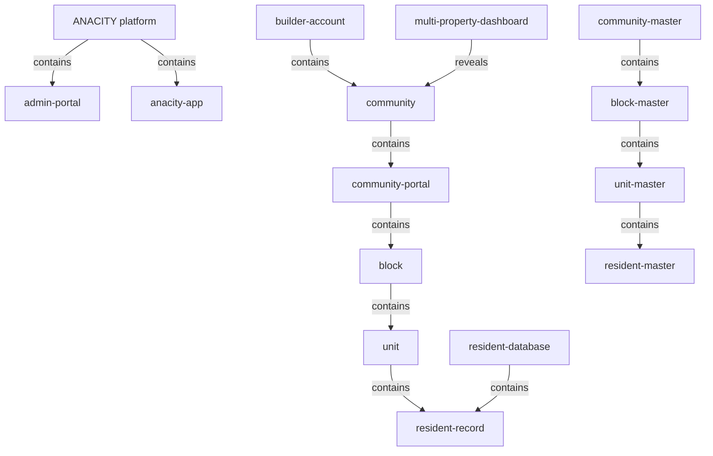
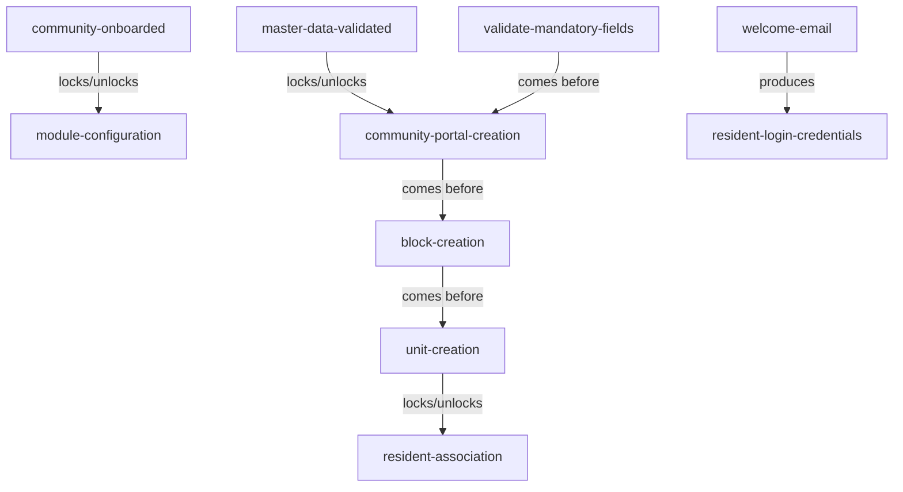

# Platform, containers & onboarding — section glossary draft — Residential

**Source header** — Residential (BRD-Residential.txt): title/Exec Summary + 1. Introduction + 1.2 Abbreviations & Glossary + 2. Global Assumptions (L1-212), 4.1 Onboarding (L213-483), 5. Master Data Requirements (L4828-4997). Re-scan = **NEW everywhere** (new build). `Res` = Residential, `Com` = Commercial.

---

## 1. Ontology

### Objects

| # | Term | Meaning (≤12 words, from source) | Evidence (exact quote — where) | Re-scan |
|---|---|---|---|---|
| 1 | ANACITY platform | the post-possession community/workplace management product deployed per client | "the full ANACITY Post-Possession Community Management Platform as deployed for DIEZ, Dubai" (Res Exec Summary) | NEW |
| 2 | community | a residential community managed on the platform | "the setup of a new community on the ANACITY platform" (Res 4.1) | NEW |
| 3 | community portal | the per-community site with segregated data | "Create the community portal" (Res 4.1.2 Community Creation) | NEW |
| 4 | builder | property developer entity owning multiple communities | "The property developer entity (e.g., DIEZ) that owns multiple communities." (Res 1.2) | NEW |
| 5 | builder account | parent-level account representing the developer entity | "A parent-level account in ANACITY representing the developer entity." (Res 1.2) | NEW = "portfolio" (Com) |
| 6 | Admin Portal | web administration portal for managers and supervisors | "ANACITY web-based administration portal used by community managers and supervisors." (Res 1.2) | NEW = "admin console"; drift w/ Asset Owner Portal |
| 7 | admin console | ANACITY console where community creation begins | "the Community Creation section in ANACITY admin console" (Res 4.1.2) | NEW = "Admin Portal" |
| 8 | ANACITY app | resident-facing mobile application | "Download the ANACITY app" (Res 4.1.2 Resident Login) | NEW = "Mobile App" (Com) |
| 9 | block | named structural block within a community | "create named structural blocks within a community" (Res BR-ON-002) | NEW = "building" (Com) |
| 10 | unit | a residential unit created within a block | "manually create units within a block using comma-separated entry" (Res BR-ON-007) | NEW |
| 11 | resident record | resident entry linked to a selected unit | "Create resident record linked to the selected unit" (Res 4.1.2) | NEW |
| 12 | resident database | the populated set of resident records | "resident database population and resident login" (Res 4.1) | NEW |
| 13 | master data | mandatory reference data entered at setup | "Enter all mandatory master data fields (see Master Data section)" (Res 4.1.2) | NEW |
| 14 | community record | record master data is persisted against | "Persist all master data against the community record" (Res 4.1.2) | NEW |
| 15 | Excel template | downloadable template for bulk record upload | "provide a downloadable Excel template for bulk unit creation" (Res BR-ON-005) | NEW |
| 16 | welcome email | onboarding email carrying resident login password | "choose to send or suppress the welcome email when creating resident records" (Res BR-ON) | NEW = "activation email" (Com) |
| 17 | Community Master | master data entity for a community | "Community Master ... Community name, country, currency, time zone, portal URL, subscription tier, community type" (Res MDR-ON-001) | NEW |
| 18 | Block Master | master data entity for a block | "Block Master ... Block name (unique within community), community reference" (Res MDR-ON-002) | NEW |
| 19 | Unit Master | master data entity for a unit | "Unit Master ... Unit number, block reference, unit type, super built-up area, floor number, status" (Res MDR-ON-003) | NEW |
| 20 | Resident Master | master data entity for a resident | "Resident Master ... Owner/tenant name, email, mobile ... relationship type, residing status" (Res MDR-ON-004) | NEW |
| 21 | Builder Account Master | master data entity for the builder account | "Builder entity name, mapped community list, activation status" (Res MDR-PD-001) | NEW |
| 22 | MPD User Account | multi-property dashboard user account | "MPD User Account ... assigned community scope, permission level (view-only vs. action-permitted)" (Res MDR-PD-002) | NEW |
| 23 | Admin Role Taxonomy | master data of admin roles and permissions | "Admin Role Taxonomy ... Role name, permission set description, applicable modules" (Res MDR-AD-001) | NEW |
| 24 | Multi Property Dashboard (MPD) | dashboard managing many communities under one builder account | "Multi Property Dashboard -- centralised dashboard for managing multiple communities under one builder account." (Res 1.2) | NEW |
| 25 | Emirates ID | UAE national/resident identity card, 15-digit | "UAE national/resident identity card -- 15-digit numeric ID." (Res 1.2) | NEW |

### Roles

| # | Term | Meaning (≤12 words, from source) | Evidence (exact quote — where) | Re-scan |
|---|---|---|---|---|
| 1 | Support Staff / CSR | ANACITY staff authorized to create communities | "Community creation will be performed only by authorized Support Staff/CSR." (Res 4.1.3) | NEW = "ANACITY configuration team" (Com, functional) |
| 2 | Admin / Community Administrator | super user of the community portal | "Community Administrator -- the super user of the community portal." (Res 1.2) | NEW |
| 3 | Resident | end user who logs into the community app | "Resident | Download the ANACITY app" (Res 4.1.2 Resident Login) | NEW = "Employee" (Com, functional) |
| 4 | Owner | resident holding an ownership relationship | "Residents see only applicable fields based on Owner/Tenant role" (Res 4.1.3) | NEW |
| 5 | Tenant (resident) | resident holding a tenancy relationship | "Owner/Tenant role during self-signup flows" (Res 4.1.3) | NEW; **one-word-two-meanings** vs Com tenant organization |
| 6 | ANACITY Implementation Team | ANACITY-side owner of onboarding setup | "Community Administrator / ANACITY Implementation Team" (Res 4.1.5 Owner) | NEW = "ANACITY configuration team" (Com) |
| 7 | community managers and supervisors | users of the Admin Portal | "used by community managers and supervisors" (Res 1.2 Admin Portal) | NEW |
| 8 | MPD Admin | admin of the multi-property dashboard | "MPD Admin" (Res MDR-PD-001 Owner) | NEW |

### Steps

| # | Term | Meaning (≤12 words, from source) | Evidence (exact quote — where) | Re-scan |
|---|---|---|---|---|
| 1 | Onboarding (community) | end-to-end setup of a new community | "the end-to-end setup of a new community on the ANACITY platform" (Res 4.1) | NEW; **one-word-two-meanings** vs Com Employee Onboarding |
| 2 | Community Creation | create a new community portal step | "Navigate to the Community Creation section in ANACITY admin console" (Res 4.1.2) | NEW |
| 3 | Block Creation | create named structural blocks step | "proceed to Block Creation" (Res 4.1.2) | NEW |
| 4 | Unit Creation | create units within a block step | "Proceed to Unit Creation" (Res 4.1.2) | NEW |
| 5 | Bulk Upload Units | upload units via Excel template step | "Navigate to Complex > Setup > Bulk Upload Units" (Res 4.1.2) | NEW |
| 6 | Resident Database Updation | add/upload resident records step | "Resident Database Updation -- Single Add" (Res 4.1.2) | NEW |
| 7 | Resident Login | resident signs in to their community | "Resident Login ... Land onto the homepage of the community they are mapped to" (Res 4.1.2) | NEW = "First-time login" (Com, functional) |

### States & values

| # | Term | States / values (each on own line) | Evidence (exact quote — where) | Re-scan |
|---|---|---|---|---|
| 1 | Relationship Type | • Co-owner • Registered Owner • Owner's Family • Tenant • Tenant's Family | "a defined set of relationship types ... Co-owner, Registered Owner, Owner's Family, Tenant, Tenant's Family" (Res BR-ON-016) | NEW |
| 2 | Residing Status | • Yes • No | "Set Residing Status (Yes/No)" (Res 4.1.2) | NEW |
| 3 | Onboarding reversibility | • No (not reversible) | "Reversible | No" (Res 4.1.5) | NEW |
| 4 | community portal status | • created • deactivated (post-creation) | "Community portal can be deactivated post-creation" (Res 4.1.5) | NEW |
| 5 | Fit / Gap | • Fit (supported in standard configuration) • Gap | "Fit -- The ANACITY platform supports this requirement in its standard configuration." (Res 1.2) | NEW |
| 6 | MPD permission level | • view-only • action-permitted | "permission level (view-only vs. action-permitted)" (Res MDR-PD-002) | NEW |
| 7 | activation status | • active • inactive | "mapped community list, activation status" (Res MDR-PD-001) | NEW |

---

## 2. Topology — the tree

### Verbatim

| Parent (A) | relationship | Child (B) | Evidence (exact quote — where) |
|---|---|---|---|
| ANACITY platform | contains | • Admin Portal • ANACITY app | "ANACITY web-based administration portal ..." (Res 1.2); "Download the ANACITY app" (Res 4.1.2) |
| builder account | contains | • community | "A parent-level account in ANACITY representing the developer entity."; "owns multiple communities" (Res 1.2) |
| community | contains | • community portal | "Each community will have a unique portal with segregated data." (Res 4.1.3) |
| community portal | contains | • block | "create named structural blocks within a community" (Res BR-ON-002) |
| block | contains | • unit | "manually create units within a block using comma-separated entry" (Res BR-ON-007) |
| unit | contains | • resident record | "Create resident record linked to the selected unit" (Res 4.1.2) |
| resident database | contains | • resident record | "resident database population" (Res 4.1) |
| Multi Property Dashboard (MPD) | reveals | • community (multiple) | "centralised dashboard for managing multiple communities under one builder account" (Res 1.2) |
| Community Master | contains | • Block Master | "Block name (unique within community), community reference" (Res MDR-ON-002) |
| Block Master | contains | • Unit Master | "Unit number, block reference" (Res MDR-ON-003) |
| Unit Master | contains | • Resident Master | "relationship type, residing status ..." linked via unit (Res MDR-ON-004; 4.1.2 "linked to the selected unit") |

### Mermaid

---

## 3. Choreography — states + gates

### States

| Thing | States (each on own line) | Evidence (exact quote — where) |
|---|---|---|
| community portal | • created • deactivated (post-creation) | "Create the community portal" (Res 4.1.2); "Community portal can be deactivated post-creation" (Res 4.1.5) |
| onboarding (community) | • not reversible | "Reversible | No" (Res 4.1.5) |
| resident record | • created (linked to unit) | "Create resident record linked to the selected unit" (Res 4.1.2) |

### Gates (verbatim)

| A | relationship | B | Evidence (exact quote — where) |
|---|---|---|---|
| community fully onboarded | locks / unlocks | module configuration | "All platform modules require a community to be fully onboarded (Section 4.1) before configuration." (Res Global Assumption 2) |
| mandatory master data validated | locks / unlocks | community portal creation | "All mandatory master data must be available and validated before creating the community portal." (Res 4.1.3) |
| validate all mandatory fields | comes before | create the community portal | "Validate all mandatory fields" then "Create the community portal" (Res 4.1.2) |
| community portal creation | comes before | Block Creation | "Receive confirmation of portal creation and proceed to Block Creation" (Res 4.1.2) |
| Block Creation | comes before | Unit Creation | "Proceed to Unit Creation" (Res 4.1.2) |
| Unit Creation | locks / unlocks | resident association | "All created units shall appear ... and be available for resident association." (Res BR-ON-012) |
| welcome email | produces | resident login credentials | "Password (shared via welcome email)" (Res 4.1.2 Resident Login) |

### Gates (mermaid)

---

## 4. Conflict flags (for Gate 1)

**Residential ↔ Commercial drift (same thing, different word):**
- Residential `community` (Res 4.1) — the Commercial deployment uses `commercial campus` / `property` / `building` (Com 1.2, 1.3).
- Residential `builder` / `builder account` (Res 1.2) — the Commercial deployment uses `portfolio` (Com 1.2) / Embassy REIT asset-owner framing.
- Residential `Admin Portal` / `admin console` (Res 1.2, 4.1.2) — the Commercial deployment uses `Asset Owner Portal` / `Building Admin Portal` (Com 1.4, 3).
- Residential `ANACITY app` (Res 4.1.2) — the Commercial deployment uses `Mobile App` / `Employee Mobile App` (Com 1.3, 1.4).
- Residential `Resident` (Res 4.1.2) — the Commercial deployment uses `Employee` (Com 1.2.1); same functional slot (person who logs into the app).
- Residential `block` ("Tower A") (Res 4.1.2) — the Commercial deployment uses `building` / `tower` / `floor` / `zone` (Com).
- Residential `Support Staff` / `CSR` / `ANACITY Implementation Team` (Res 4.1.3, 4.1.5) — the Commercial deployment uses `ANACITY configuration team` (Com 1.1).
- Residential `welcome email` (Res) — the Commercial deployment uses `activation email` (Com 1.2.2).

**One word, two meanings:**
- Residential `Tenant` is a *person* (relationship-type value, a resident who rents; Res BR-ON-016) — the Commercial deployment uses it for an *organization* (tenant company; Com 1.4 "tenant organization"). Same word, different kind.
- Residential `Onboarding` = setting up a whole community (Res 4.1) — the Commercial deployment uses it for registering employees ("Employee Onboarding", Com 1.2.1) and for the PII/non-PII *data model* ("onboarding models", Com 1.2.1).
- Residential `Community Administrator` (portal super user, Res 1.2) — the Commercial deployment overloads `Admin`: `Tenant Admin` (tenant company rep, Com 1.4) and `Administrator` (commercial super user, Com 2.1).
- Residential `community portal` (per-community tenant site) and `Admin Portal` (admin-facing console) — the Commercial deployment adds `Asset Owner Portal` / `Tenant Admin Portal`. Same word spans data-container and admin-console senses.

**Several words, one thing (synonyms within a BRD):**
- Residential `Admin Portal` = `admin console` = `ANACITY web-based administration portal` (Res 1.2, 4.1.2).

**Part vs whole:**
- Residential `community` (the place/people) vs `community portal` (the software instance for that community).
- Residential `builder account` (parent) vs `community` (child) vs `block` / `unit` (descendants).

**Collides with method (OTC) words:**
- Source uses **"Step"** and **"Actor"** as process-table headers (Res 4.1.2) — collides with the method's *step* kind.
- Source uses **"Role"** for its MDR "Admin Role Taxonomy" (Res) — collides with the method's *role* kind.
- Source uses **"status"** heavily (activation status, residing status, portal status) — collides with the method's *state* notion.
