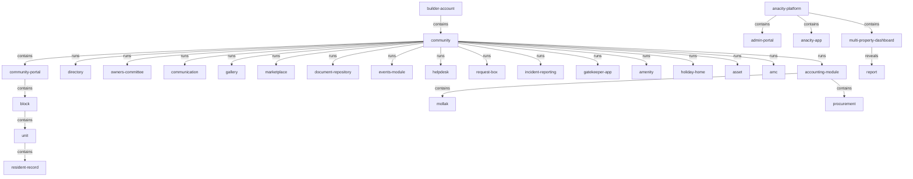
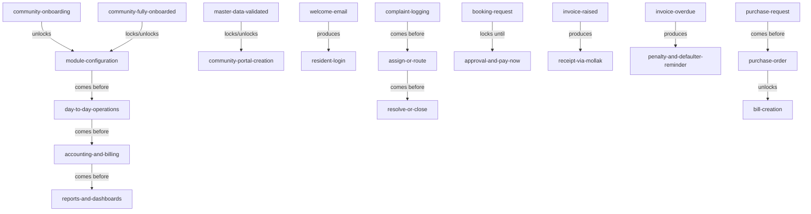

<!-- Assembled per glossary-assembly-principles.md - Part B: map -->
# Map

The joined view of the ANACITY Community Management glossary (DIEZ Dubai deployment): how the terms connect across all kinds, as the joined hierarchy and as the forward flow. Because the full object model exceeds a readable single diagram, the joined hierarchy here shows the top level only (the containment spine and each family's root); each family's full subtree lives in its own section of `objects.md`. Every diagram below has a matching verbatim link table.

## How to read this document

- Each diagram is a view; the verbatim link table beside it is the source of truth, one row per link as `parent | relationship | child`.
- Relationship words: `contains` (parent is the whole, child a part), `runs` (the place operates the module), `reveals` (parent opens on demand), `produces` (parent creates the child as it runs), `comes before` (first runs, then the second), `locks / unlocks` (first controls whether the second can happen).
- Every term is kebab-case and backticked; node ids in the diagrams are safe (alphanumeric) with the kebab term in the label.

## Joined hierarchy (top level)

| parent | relationship | child |
|---|---|---|
| `builder-account` | contains | `community` |
| `community` | contains | `community-portal` |
| `community-portal` | contains | `block` |
| `block` | contains | `unit` |
| `unit` | contains | `resident-record` |
| `anacity-platform` | contains | `admin-portal` |
| `anacity-platform` | contains | `anacity-app` |
| `anacity-platform` | contains | `multi-property-dashboard` |
| `community` | runs | `directory` |
| `community` | runs | `owners-committee` |
| `community` | runs | `communication` |
| `community` | runs | `gallery` |
| `community` | runs | `marketplace` |
| `community` | runs | `document-repository` |
| `community` | runs | `events-module` |
| `community` | runs | `helpdesk` |
| `community` | runs | `request-box` |
| `community` | runs | `incident-reporting` |
| `community` | runs | `gatekeeper-app` |
| `community` | runs | `amenity` |
| `community` | runs | `holiday-home` |
| `community` | runs | `asset` |
| `community` | runs | `amc` |
| `community` | runs | `accounting-module` |
| `accounting-module` | contains | `mollak` |
| `accounting-module` | contains | `procurement` |
| `multi-property-dashboard` | reveals | `report` |

## Cross-cutting objects

These objects are produced or used by many modules rather than owned by one place. Their detail sits in the family noted.

| term | relationship | used across | family |
|---|---|---|---|
| `notification` | produced by | helpdesk, gatekeeper, amenities, accounting, MPD | helpdesk-requests-and-incidents |
| `approver-list-hierarchy` | governs | move-in/out, requests, notes, procurement | access-visitors-and-security |
| `complaint` | raised in | helpdesk | helpdesk-requests-and-incidents |
| `request` | raised in | request-box | helpdesk-requests-and-incidents |
| `amenity-booking` | produced in | amenities, events | amenities-facilities-and-bookings |
| `invoice` | produced in | accounting, amenities, events | accounting-and-finance |
| `bill` | produced in | accounting, procurement | accounting-and-finance |
| `document` | stored in | document-repository, requests | communication-and-engagement |
| `report` | generated across | reports, accounting, all modules | dashboards-reports-and-integrations |
| `qr-code` | used in | assets, gatekeeper, patrols | assets-inventory-and-maintenance |
| `master-data` | validated before | all modules | platform-and-onboarding |

## Forward flow (the joined thread and the main gates)

| parent | relationship | child |
|---|---|---|
| `community-onboarding` | unlocks | module configuration |
| module configuration | comes before | day-to-day operations |
| day-to-day operations | comes before | accounting and billing |
| accounting and billing | comes before | reports and dashboards |
| master data validated | locks / unlocks | community portal creation |
| community fully onboarded | locks / unlocks | module configuration |
| `welcome-email` | produces | `resident-login` |
| `complaint-logging` | comes before | assign or route |
| assign or route | comes before | resolve or close |
| `booking-request` | locks until | approval and Pay Now |
| invoice raised | produces | receipt via Mollak |
| invoice overdue | produces | penalty and `defaulter-reminder` |
| `purchase-request` | comes before | `purchase-order` |
| `purchase-order` | unlocks | `bill-creation` |

## Related pages

| page | why it relates |
|---|---|
| [objects.md](objects.md) | each family's full object subtree that this top-level map summarises |
| [steps.md](steps.md) | the step-by-step version of the forward flow |
| [states.md](states.md) | the conditions objects pass through along the flow |
| [roles.md](roles.md) | the personas who drive the flow |
