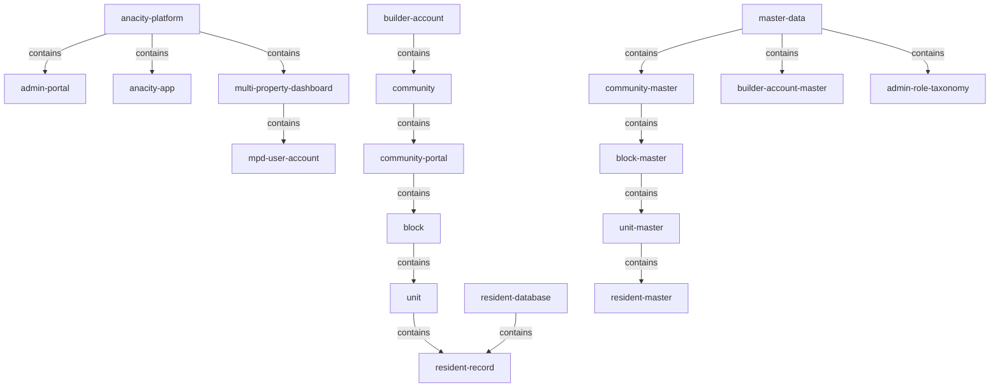
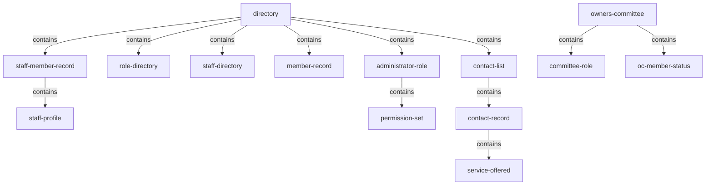
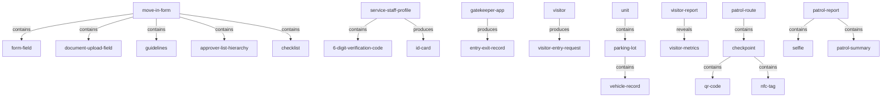
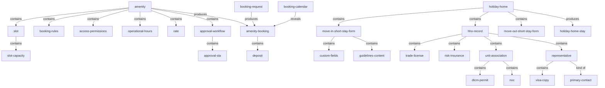
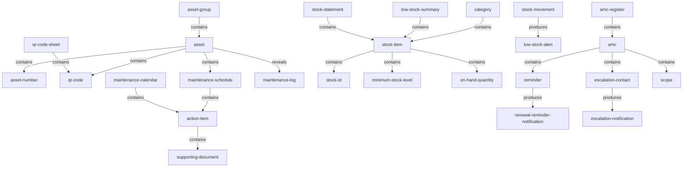
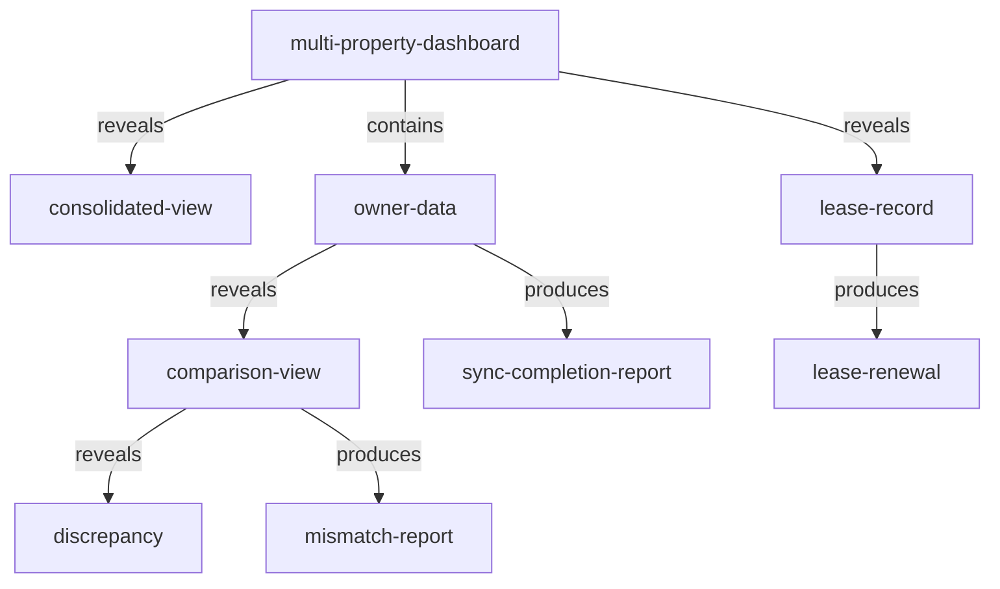

<!-- Assembled per glossary-assembly-principles.md - Part B: objects -->
# Objects

The things the ANACITY Community Management platform (DIEZ Dubai deployment) stores, shows, or acts on. Terms are partitioned into families taken from the Residential BRD's own module groups, and within each family they are grouped under their parent. Every relationship is shown twice per family: a mermaid diagram and a verbatim link table.

## How to read this document

- `term` - the agreed word, kebab-case and backticked.
- `what it is` - one plain sentence naming the kind of thing and what sets it apart; a shared concept also carries an `Other deployment:` pointer to the Commercial word.
- `source` - the deployment that defines it; always `Res` (Residential) here.
- `decision` - a link to the register when the term was contested, else `-`.
- `relationship` - how this term sits in the tree, using the relationship words below.
- Relationship words: `contains` (parent is the whole, child a part), `reveals` (parent opens on demand to show the child), `kind of` (child is a type of parent), `produces` (parent creates the child as it runs).

## Families at a glance

| family | root term(s) | what it covers | source |
|---|---|---|---|
| `platform-and-onboarding` | `anacity-platform`, `builder-account`, `community` | the platform, the containment chain (builder account to unit), and community onboarding master data | Res |
| `people-roles-and-directory` | `directory`, `owners-committee` | staff, member, committee and contact records held in the community directory | Res |
| `communication-and-engagement` | `communication`, `document-repository`, `gallery`, `marketplace`, `events-module` | notices, surveys, polls, documents, photo albums, resident listings and events | Res |
| `helpdesk-requests-and-incidents` | `helpdesk`, `request-box`, `incident-reporting` | the complaint, member request and incident lifecycles | Res |
| `access-visitors-and-security` | `move-in-form`, `gatekeeper-app`, `patrol-route` | move-in/out forms, visitor and service-staff entry, parking, and guard patrols | Res |
| `amenities-facilities-and-bookings` | `amenity`, `holiday-home` | bookable amenities and slots, and the Holiday Homes short-stay workstream | Res |
| `assets-inventory-and-maintenance` | `asset`, `stock-item`, `amc` | asset registers, stock, and annual maintenance contracts | Res |
| `accounting-and-finance` | `accounting-module`, `mollak`, `procurement` | the full accounting workstream, Mollak escrow sync and procurement | Res |
| `dashboards-reports-and-integrations` | `multi-property-dashboard`, `report` | the cross-community dashboard and the reporting capability | Res |

---

## platform-and-onboarding

### `anacity-platform`

The post-possession community management product deployed for DIEZ, Dubai.

| term | what it is | source | decision | relationship |
|---|---|---|---|---|
| `admin-portal` | the ANACITY web administration portal used by community managers and supervisors (also called the admin console). Other deployment: `asset-owner-portal` | Res | - | contained by `anacity-platform` |
| `anacity-app` | the resident-facing mobile application. Other deployment: `mobile-app` | Res | - | contained by `anacity-platform` |
| `multi-property-dashboard` | the centralised dashboard for managing many communities under one builder account (see `dashboards-reports-and-integrations`). Other deployment: `home-screen` (no direct equivalent) | Res | - | contained by `anacity-platform` |

### `builder-account`

A parent-level account in ANACITY representing the developer entity (for example DIEZ) that owns multiple communities. Other deployment: `portfolio`.

| term | what it is | source | decision | relationship |
|---|---|---|---|---|
| `builder` | the property developer entity that owns multiple communities. Other deployment: `portfolio` owner | Res | - | represented by `builder-account` |
| `community` | a residential community managed on the platform. Other deployment: `commercial-campus` / `property` | Res | [D-1](decisions.md#d-1) | contained by `builder-account` |

### `community`

A residential community managed on the platform, holding its own portal, blocks and units.

| term | what it is | source | decision | relationship |
|---|---|---|---|---|
| `community-portal` | the per-community site with segregated data | Res | - | contained by `community` |
| `block` | a named structural block within a community (for example "Tower A"). Other deployment: `building` | Res | - | contained by `community-portal` |
| `unit` | a residential unit created within a block | Res | - | contained by `block` |
| `resident-record` | a resident entry linked to a selected unit | Res | - | contained by `unit` |
| `resident-database` | the populated set of resident records | Res | - | contains `resident-record` |

### `master-data`

The mandatory reference data entered at setup and persisted against the community record.

| term | what it is | source | decision | relationship |
|---|---|---|---|---|
| `community-master` | the master-data entity for a community (name, country, currency, time zone, portal URL, tier, type) | Res | - | contained by `master-data` |
| `block-master` | the master-data entity for a block | Res | - | contained by `community-master` |
| `unit-master` | the master-data entity for a unit | Res | - | contained by `block-master` |
| `resident-master` | the master-data entity for a resident (owner/tenant name, contacts, relationship type, residing status) | Res | - | contained by `unit-master` |
| `builder-account-master` | the master-data entity for the builder account | Res | - | contained by `master-data` |
| `admin-role-taxonomy` | the master data of admin roles and their permission sets | Res | - | contained by `master-data` |

### standalone (platform-and-onboarding)

| term | what it is | source | decision | relationship |
|---|---|---|---|---|
| `emirates-id` | the UAE national/resident identity card, a 15-digit numeric id | Res | - | - |
| `excel-template` | a downloadable template for bulk record upload (units, staff, stock, assets, statements) | Res | - | - |
| `welcome-email` | the onboarding email carrying a resident's login password. Other deployment: `activation-email` | Res | - | produced during `resident-login` |
| `mpd-user-account` | a multi-property-dashboard user account with community scope and permission level | Res | - | contained by `multi-property-dashboard` |
| `community-record` | the record master data is persisted against | Res | - | represents `community` |

### Relationships (platform-and-onboarding)

| parent | relationship | child |
|---|---|---|
| `anacity-platform` | contains | `admin-portal` |
| `anacity-platform` | contains | `anacity-app` |
| `anacity-platform` | contains | `multi-property-dashboard` |
| `builder-account` | contains | `community` |
| `community` | contains | `community-portal` |
| `community-portal` | contains | `block` |
| `block` | contains | `unit` |
| `unit` | contains | `resident-record` |
| `resident-database` | contains | `resident-record` |
| `master-data` | contains | `community-master` |
| `community-master` | contains | `block-master` |
| `block-master` | contains | `unit-master` |
| `unit-master` | contains | `resident-master` |
| `master-data` | contains | `builder-account-master` |
| `master-data` | contains | `admin-role-taxonomy` |
| `multi-property-dashboard` | contains | `mpd-user-account` |

---

## people-roles-and-directory

### `directory`

The community directory that holds maintenance staff, members, the member committee and the contact list.

| term | what it is | source | decision | relationship |
|---|---|---|---|---|
| `staff-member-record` | a maintenance-staff record linked to a role and the community | Res | - | contained by `directory` |
| `staff-profile` | the editable profile of a staff member, including the profile photo | Res | - | contained by `staff-member-record` |
| `role-directory` | the listing of created staff roles | Res | - | contained by `directory` |
| `staff-directory` | the searchable, filterable community staff listing | Res | - | contained by `directory` |
| `member-record` | a member's stored record with an Actions menu | Res | - | contained by `directory` |
| `administrator-role` | a named role granting portal permissions to a member | Res | - | contained by `directory` |
| `permission-set` | the distinct permissions attached to an admin role | Res | - | contained by `administrator-role` |

### `contact-list`

The official community emergency and service directory (emergency contacts, service providers, utility numbers), read-only to residents.

| term | what it is | source | decision | relationship |
|---|---|---|---|---|
| `contact-record` | a stored community contact entry | Res | - | contained by `contact-list` |
| `service-offered` | the mandatory service-type field on a contact | Res | - | contained by `contact-record` |

### `owners-committee`

The Residential-exclusive governance body; committee membership is assigned to existing members or maintenance staff. Other deployment: none.

| term | what it is | source | decision | relationship |
|---|---|---|---|---|
| `committee-role` | a named Owners Committee role | Res | - | contained by `owners-committee` |
| `oc-member-status` | the committee designation shown on a member or staff profile | Res | - | contained by `owners-committee` |

### Relationships (people-roles-and-directory)

| parent | relationship | child |
|---|---|---|
| `directory` | contains | `staff-member-record` |
| `staff-member-record` | contains | `staff-profile` |
| `directory` | contains | `role-directory` |
| `directory` | contains | `staff-directory` |
| `directory` | contains | `member-record` |
| `directory` | contains | `administrator-role` |
| `administrator-role` | contains | `permission-set` |
| `directory` | contains | `contact-list` |
| `contact-list` | contains | `contact-record` |
| `contact-record` | contains | `service-offered` |
| `owners-committee` | contains | `committee-role` |
| `owners-committee` | contains | `oc-member-status` |

---

## communication-and-engagement

### `communication`

The community's three communication tools grouped together. Other deployment: `announcements-module`.

| term | what it is | source | decision | relationship |
|---|---|---|---|---|
| `noticeboard` | the official platform for admin-published announcements with audience targeting and scheduling. Other deployment: `announcements-module` | Res | - | contained by `communication` |
| `notice` | an announcement admins publish to residents. Other deployment: `announcement` | Res | [D-18](decisions.md#d-18) | contained by `noticeboard` |
| `noticeboard-template` | a reusable notice with subject and description | Res | - | contained by `noticeboard` |
| `flash-notice` | a notice displayed on login | Res | - | kind of `notice` |
| `special-notice` | a notice flagged as special | Res | - | kind of `notice` |
| `survey` | a structured questionnaire that collects resident responses | Res | - | contained by `communication` |
| `survey-question` | one question in a survey | Res | - | contained by `survey` |
| `response-option` | a selectable answer for a survey question | Res | - | contained by `survey-question` |
| `poll` | a vote with real-time result tracking | Res | - | contained by `communication` |
| `poll-option` | one voting choice in a poll | Res | - | contained by `poll` |
| `vote` | a resident's recorded poll choice | Res | - | produced by `poll` |
| `poll-results` | the live and final vote counts | Res | - | produced by `poll` |
| `community-corner` | where published surveys appear to residents | Res | - | reveals `survey` |

### `document-repository`

The store of community documents. Other deployment: none (Residential-exclusive).

| term | what it is | source | decision | relationship |
|---|---|---|---|---|
| `document` | an uploaded community file with mandatory metadata | Res | - | contained by `document-repository` |
| `document-version` | an auto-incremented revision of a document | Res | - | contained by `document` |
| `audit-log` | the logged record of each document interaction | Res | - | contained by `document-repository` |
| `log-entry` | one entry in the audit log | Res | - | contained by `audit-log` |
| `export-file` | the audit log exported as PDF or CSV | Res | - | produced by `audit-log` |

### `gallery`

The community photo and video album collection. Other deployment: none (Residential-exclusive).

| term | what it is | source | decision | relationship |
|---|---|---|---|---|
| `album` | a named collection of media | Res | - | contained by `gallery` |
| `media` | a photo or video in an album | Res | - | contained by `album` |
| `comment` | a resident remark on a media item | Res | - | contained by `media` |

### `marketplace`

The resident product-listings feed accessible to all community residents. Other deployment: none (Residential-exclusive; distinct from Commercial `popular-offers`).

| term | what it is | source | decision | relationship |
|---|---|---|---|---|
| `marketplace-feed` | the published listings browsable by residents | Res | - | contained by `marketplace` |
| `product-listing` | a resident-posted product for sale | Res | - | contained by `marketplace-feed` |
| `product-image` | a required image on a listing | Res | - | contained by `product-listing` |
| `rejection-reason` | the mandatory reason given when a listing is rejected | Res | - | produced by rejecting a `product-listing` |

### `events-module`

Where admins configure resident-bookable community events. Other deployment: `event-management-module`.

| term | what it is | source | decision | relationship |
|---|---|---|---|---|
| `event` | an admin-configured, resident-bookable community event | Res | - | contained by `events-module` |
| `ticket-category` | a named event ticket with price and seat limit. Other deployment: `seating-category` | Res | - | contained by `event` |
| `participation-form` | a custom form completed at event booking. Other deployment: `registration-form` | Res | - | contained by `event` |
| `artist-speaker-profile` | a guest profile (name, bio, highlights, media) added to an event | Res | - | contained by `event` |
| `offer` | an optional event promotion with start and end dates | Res | - | contained by `event` |
| `attendee-list` | the full, exportable registrant list per event | Res | - | produced by `event` |
| `event-dashboard` | the admin view of an event's bookings and capacity | Res | - | revealed by `event` |
| `booking-confirmation` | the confirmation issued on a successful event booking | Res | - | produced by `event-booking` |
| `vat-receipt` | a UAE VAT-compliant receipt for a booking | Res | - | produced by `event-booking` |

### Relationships (communication-and-engagement)

```mermaid
flowchart TD
    comm["communication"] -->|contains| nb["noticeboard"]
    comm -->|contains| survey["survey"]
    comm -->|contains| poll["poll"]
    nb -->|contains| notice["notice"]
    nb -->|contains| nbt["noticeboard-template"]
    notice -->|kind of| flash["flash-notice"]
    notice -->|kind of| special["special-notice"]
    survey -->|contains| sq["survey-question"]
    sq -->|contains| ro["response-option"]
    poll -->|contains| po["poll-option"]
    poll -->|produces| vote["vote"]
    poll -->|produces| pr["poll-results"]
    docrepo["document-repository"] -->|contains| doc["document"]
    doc -->|contains| dv["document-version"]
    docrepo -->|contains| al["audit-log"]
    al -->|contains| le["log-entry"]
    al -->|produces| ef["export-file"]
    gallery["gallery"] -->|contains| album["album"]
    album -->|contains| media["media"]
    media -->|contains| cmt["comment"]
    mkt["marketplace"] -->|contains| mf["marketplace-feed"]
    mf -->|contains| pl["product-listing"]
    pl -->|contains| pi["product-image"]
    em["events-module"] -->|contains| event["event"]
    event -->|contains| tc["ticket-category"]
    event -->|contains| pf["participation-form"]
    event -->|contains| asp["artist-speaker-profile"]
    event -->|contains| offer["offer"]
    event -->|produces| al2["attendee-list"]
    event -->|reveals| ed["event-dashboard"]
```

| parent | relationship | child |
|---|---|---|
| `communication` | contains | `noticeboard` |
| `communication` | contains | `survey` |
| `communication` | contains | `poll` |
| `noticeboard` | contains | `notice` |
| `noticeboard` | contains | `noticeboard-template` |
| `notice` | kind of | `flash-notice` |
| `notice` | kind of | `special-notice` |
| `survey` | contains | `survey-question` |
| `survey-question` | contains | `response-option` |
| `poll` | contains | `poll-option` |
| `poll` | produces | `vote` |
| `poll` | produces | `poll-results` |
| `document-repository` | contains | `document` |
| `document` | contains | `document-version` |
| `document-repository` | contains | `audit-log` |
| `audit-log` | contains | `log-entry` |
| `audit-log` | produces | `export-file` |
| `gallery` | contains | `album` |
| `album` | contains | `media` |
| `media` | contains | `comment` |
| `marketplace` | contains | `marketplace-feed` |
| `marketplace-feed` | contains | `product-listing` |
| `product-listing` | contains | `product-image` |
| `events-module` | contains | `event` |
| `event` | contains | `ticket-category` |
| `event` | contains | `participation-form` |
| `event` | contains | `artist-speaker-profile` |
| `event` | contains | `offer` |
| `event` | produces | `attendee-list` |
| `event` | reveals | `event-dashboard` |

---

## helpdesk-requests-and-incidents

### `helpdesk`

The module holding the complaint lifecycle and its configuration. Other deployment: `helpdesk-module`.

| term | what it is | source | decision | relationship |
|---|---|---|---|---|
| `complaint-box` | the container where complaints are logged and configured. Other deployment: `service-requests` | Res | - | contained by `helpdesk` |
| `complaint` | the logged issue a resident or admin raises (its lifecycle is titled the ticket lifecycle). Other deployment: `service-request` | Res | [D-10](decisions.md#d-10) | contained by `complaint-box` |
| `complaint-category` | the classification a complaint is filed under | Res | - | contained by `complaint-box` |
| `subcategory` | a classification nested under a parent complaint category | Res | - | contained by `complaint-category` |
| `complaint-nature` | the field classifying a complaint's kind (complaint, service request, inquiry) | Res | - | contained by `complaint` |
| `complaint-type` | a secondary classification field on a complaint | Res | - | contained by `complaint` |
| `attachment` | an image or document uploaded with a complaint | Res | - | contained by `complaint` |
| `note` | an update added to a complaint, optionally from a note template | Res | - | contained by `complaint` |
| `note-template` | predefined note text used during complaint handling | Res | - | contained by `helpdesk` |
| `rca-template` | a named root-cause template shown at complaint resolution | Res | - | revealed by `complaint` |
| `escalation-matrix` | a per-category chain of owners and time windows. Other deployment: `escalation-path` | Res | - | contained by `helpdesk` |
| `sla` | the service target window that drives escalation | Res | - | contained by `complaint-category` |
| `complaint-id` | the unique identifier generated per complaint | Res | - | produced by `complaint` |
| `audit-trail` | the immutable, time-stamped log of lifecycle events | Res | - | revealed by `complaint-detail` |
| `complaint-detail` | the record view exposing history and audit trail | Res | - | reveals `audit-trail` |
| `complaint-settings` | the community-level config for escalation, SLA and re-open rules | Res | - | contained by `helpdesk` |

### `request-box`

The Residential admin area configuring approval-driven request categories (and the member-facing area for raising them). Other deployment: none (distinct from Commercial service requests).

| term | what it is | source | decision | relationship |
|---|---|---|---|---|
| `request` | a member-initiated item approved through the ALH | Res | - | contained by `request-box` |
| `request-category` | an approval-workflow category (for example NOC-Renovation, Pet Registration, Visitor Parking Permit) | Res | - | contained by `request-box` |
| `checklist` | the list an approver must verify before approving | Res | - | contained by `request-category` |
| `output-certificate-template` | the template rendered and pushed to the member on approval | Res | - | contained by `request-category` |
| `output-certificate` | the rendered certificate delivered to the member on approval | Res | - | produced by `request` |
| `category-description` | the text shown to a member after they select a category | Res | - | contained by `request-category` |
| `form` | the data-capture form mapped to a request category | Res | - | contained by `request-category` |
| `form-library` | the store of existing forms to map to categories | Res | - | contains `form` |
| `chat-channel` | the dedicated per-request thread for member and approver | Res | - | contained by `request` |

### `incident-reporting`

The Residential module for logging, managing and resolving incidents via multiple channels. Other deployment: `incident-reporting` (commercial roles).

| term | what it is | source | decision | relationship |
|---|---|---|---|---|
| `incident` | a security, property or community event that is logged | Res | - | contained by `incident-reporting` |
| `incident-category` | a pre-configured classification for an incident (for example Security Breach, Property Damage, Noise Complaint, Medical Emergency) | Res | - | contained by `incident-reporting` |
| `incident-report` | the submitted incident record | Res | - | produced by `incident` |
| `geographical-coordinates` | the latitude/longitude captured at incident reporting | Res | - | contained by `incident` |
| `image` | media uploaded as supporting evidence for an incident | Res | - | contained by `incident` |
| `in-app-chat` | real-time chat between the incident reporter and administrators | Res | - | contained by `incident` |
| `member-app` | the resident channel for raising incidents. Other deployment: `mobile-app` | Res | - | kind of reporting channel |
| `gatekeeper-app` | the security-team channel for raising incidents. Other deployment: `guard-app` | Res | - | kind of reporting channel |
| `web-portal` | the administrator web channel for incidents | Res | - | kind of reporting channel |
| `admin-app` | the administrator app channel for incidents | Res | - | kind of reporting channel |

### standalone (helpdesk-requests-and-incidents)

| term | what it is | source | decision | relationship |
|---|---|---|---|---|
| `notification` | a system-generated alert sent on lifecycle or status events | Res | [D-19](decisions.md#d-19) | produced across modules |

### Relationships (helpdesk-requests-and-incidents)

```mermaid
flowchart TD
    hd["helpdesk"] -->|contains| cb["complaint-box"]
    cb -->|contains| complaint["complaint"]
    cb -->|contains| cc["complaint-category"]
    cc -->|contains| sub["subcategory"]
    cc -->|contains| sla["sla"]
    complaint -->|contains| cn["complaint-nature"]
    complaint -->|contains| ct["complaint-type"]
    complaint -->|contains| att["attachment"]
    complaint -->|contains| note["note"]
    complaint -->|reveals| rca["rca-template"]
    complaint -->|produces| cid["complaint-id"]
    hd -->|contains| em["escalation-matrix"]
    hd -->|contains| nt["note-template"]
    hd -->|contains| cs["complaint-settings"]
    cd["complaint-detail"] -->|reveals| at["audit-trail"]
    rb["request-box"] -->|contains| req["request"]
    rb -->|contains| rc["request-category"]
    rc -->|contains| chk["checklist"]
    rc -->|contains| oct["output-certificate-template"]
    rc -->|contains| catdesc["category-description"]
    rc -->|contains| form["form"]
    fl["form-library"] -->|contains| form
    req -->|contains| chat["chat-channel"]
    req -->|produces| oc["output-certificate"]
    ir["incident-reporting"] -->|contains| inc["incident"]
    ir -->|contains| ic["incident-category"]
    inc -->|produces| irep["incident-report"]
    inc -->|contains| geo["geographical-coordinates"]
    inc -->|contains| img["image"]
    inc -->|contains| iac["in-app-chat"]
    rch["reporting-channel"] -->|kind of| ma["member-app"]
    rch -->|kind of| gka["gatekeeper-app"]
    rch -->|kind of| wp["web-portal"]
    rch -->|kind of| aa["admin-app"]
```

| parent | relationship | child |
|---|---|---|
| `helpdesk` | contains | `complaint-box` |
| `complaint-box` | contains | `complaint` |
| `complaint-box` | contains | `complaint-category` |
| `complaint-category` | contains | `subcategory` |
| `complaint-category` | contains | `sla` |
| `complaint` | contains | `complaint-nature` |
| `complaint` | contains | `complaint-type` |
| `complaint` | contains | `attachment` |
| `complaint` | contains | `note` |
| `complaint` | reveals | `rca-template` |
| `complaint` | produces | `complaint-id` |
| `helpdesk` | contains | `escalation-matrix` |
| `helpdesk` | contains | `note-template` |
| `helpdesk` | contains | `complaint-settings` |
| `complaint-detail` | reveals | `audit-trail` |
| `request-box` | contains | `request` |
| `request-box` | contains | `request-category` |
| `request-category` | contains | `checklist` |
| `request-category` | contains | `output-certificate-template` |
| `request-category` | contains | `category-description` |
| `request-category` | contains | `form` |
| `form-library` | contains | `form` |
| `request` | contains | `chat-channel` |
| `request` | produces | `output-certificate` |
| `incident-reporting` | contains | `incident` |
| `incident-reporting` | contains | `incident-category` |
| `incident` | produces | `incident-report` |
| `incident` | contains | `geographical-coordinates` |
| `incident` | contains | `image` |
| `incident` | contains | `in-app-chat` |
| reporting channel | kind of | `member-app` |
| reporting channel | kind of | `gatekeeper-app` |
| reporting channel | kind of | `web-portal` |
| reporting channel | kind of | `admin-app` |

---

## access-visitors-and-security

### `move-in-form`

The resident-facing form to move into a unit; a Move-Out form follows an identical configuration flow. Other deployment: none (Residential-exclusive Move-In/Move-Out).

| term | what it is | source | decision | relationship |
|---|---|---|---|---|
| `move-out-form` | the resident-facing form to move out of a unit | Res | - | sibling of `move-in-form` |
| `form-field` | a configurable field on the move-in/out form | Res | - | contained by `move-in-form` |
| `document-upload-field` | a field for uploading documents on the form | Res | - | contained by `move-in-form` |
| `guidelines` | the text shown to residents before the form unlocks | Res | - | contained by `move-in-form` |
| `approver-list-hierarchy` | the approval chain routing a resident submission (ALH). Other deployment: approval workflow | Res | [D-7](decisions.md#d-7) | contained by `move-in-form` |
| `checklist` | the items an approver reviews before approval | Res | - | contained by `move-in-form` |

### `gatekeeper-app`

The app security guards use in real time to log visitor and service-staff entry. Other deployment: `guard-app`.

| term | what it is | source | decision | relationship |
|---|---|---|---|---|
| `service-staff-profile` | a record of a service-staff member serving a unit | Res | - | contained via directory |
| `6-digit-verification-code` | the unique code auto-generated to identify a service-staff member | Res | - | contained by `service-staff-profile` |
| `id-card` | a printable card with a service-staff member's name, photo and 6-digit code | Res | - | produced from `service-staff-profile` |
| `visitor` | a non-resident entering the community (walk-in is a kind of visitor). Other deployment: `visitor` / `guest` | Res | [D-4](decisions.md#d-4) | logged by `gatekeeper-app` |
| `visitor-entry-request` | the request routed to the resident for approval | Res | - | produced by `visitor` |
| `entry-exit-record` | the logged entry and exit of a person, synced to the visitor report | Res | - | produced by `gatekeeper-app` |
| `parking-lot` | a mapped parking space for a unit. Other deployment: `parking-slot` | Res | - | contained by `unit` |
| `vehicle-record` | a registered vehicle against a parking lot and unit | Res | - | contained by `parking-lot` |
| `visitor-report` | the detailed, filterable, exportable record of visitor entries | Res | - | reveals `visitor-metrics` |
| `visitor-metrics` | visitor volume and trends shown in a bar chart | Res | - | revealed by `visitor-report` |

### `patrol-route`

A named guard patrol route made of ordered checkpoints. Other deployment: `guard-patrol`.

| term | what it is | source | decision | relationship |
|---|---|---|---|---|
| `checkpoint` | a location verified during a patrol | Res | - | contained by `patrol-route` |
| `qr-code` | a scannable code placed at a checkpoint or on an asset | Res | - | contained by `checkpoint` |
| `nfc-tag` | a tappable tag placed at a checkpoint | Res | - | contained by `checkpoint` |
| `selfie` | a photo capturing patrol start and end identity | Res | - | contained by `patrol-report` |
| `patrol-summary` | the pop-up of a patrol's duration and missed checkpoints | Res | - | produced by a patrol |
| `patrol-report` | the report generated for a patrol session | Res | - | produced by a patrol |

### Relationships (access-visitors-and-security)

| parent | relationship | child |
|---|---|---|
| `move-in-form` | contains | `form-field` |
| `move-in-form` | contains | `document-upload-field` |
| `move-in-form` | contains | `guidelines` |
| `move-in-form` | contains | `approver-list-hierarchy` |
| `move-in-form` | contains | `checklist` |
| `service-staff-profile` | contains | `6-digit-verification-code` |
| `service-staff-profile` | produces | `id-card` |
| `gatekeeper-app` | produces | `entry-exit-record` |
| `visitor` | produces | `visitor-entry-request` |
| `unit` | contains | `parking-lot` |
| `parking-lot` | contains | `vehicle-record` |
| `visitor-report` | reveals | `visitor-metrics` |
| `patrol-route` | contains | `checkpoint` |
| `checkpoint` | contains | `qr-code` |
| `checkpoint` | contains | `nfc-tag` |
| `patrol-report` | contains | `selfie` |
| `patrol-report` | contains | `patrol-summary` |

---

## amenities-facilities-and-bookings

### `amenity`

A bookable community facility that residents reserve. Other deployment: `amenity` (same word).

| term | what it is | source | decision | relationship |
|---|---|---|---|---|
| `slot` | a bookable time window on an amenity. Other deployment: `slot` | Res | [D-3](decisions.md#d-3) | contained by `amenity` |
| `slot-capacity` | the maximum bookings allowed in one slot | Res | - | contained by `slot` |
| `booking-rules` | the configured constraints enforced on bookings (quota, duration, advance window, capacity) | Res | - | contained by `amenity` |
| `access-permissions` | the per-amenity toggles for who may book (owners, tenants, guests) | Res | - | contained by `amenity` |
| `operational-hours` | the days and time windows bookings are accepted | Res | - | contained by `amenity` |
| `rate` | the monetary charge for a booking, in AED | Res | - | contained by `amenity` |
| `amenity-booking` | a resident's reservation of an amenity slot | Res | [D-13](decisions.md#d-13) | produced against `amenity` |
| `booking-request` | a submitted booking awaiting validation or approval | Res | - | produces `amenity-booking` |
| `booking-summary` | the pre-confirm review of a booking (amenity, date, slot, charge) | Res | - | revealed before `amenity-booking` |
| `booking-charge` | the invoice line item for a booking | Res | - | contained by `invoice` |
| `booking-calendar` | the admin visual calendar of all bookings | Res | [D-13](decisions.md#d-13) | reveals `amenity-booking` |
| `event-booking` | a resident's confirmed event reservation (see `events-module`). Other deployment: `event-registration` | Res | [D-13](decisions.md#d-13) | produced against `event` |
| `deposit` | a configurable deposit taken for a booking | Res | - | contained by `amenity-booking` |
| `account-ledger` | the resident account an amenity invoice posts to | Res | - | receives `invoice` |
| `approval-workflow` | the per-amenity approve-before-confirm process | Res | - | contained by `amenity` |
| `approval-sla` | the deadline for actioning a pending booking | Res | - | contained by `approval-workflow` |

### `holiday-home`

The Residential-exclusive short-stay rental workstream, run by holiday-home operators. Other deployment: none.

| term | what it is | source | decision | relationship |
|---|---|---|---|---|
| `holiday-home-stay` | a short-stay guest reservation in a holiday-home unit | Res | [D-13](decisions.md#d-13) | produced against `holiday-home` |
| `move-in-short-stay-form` | the short-stay guest check-in configuration form | Res | - | contained by `holiday-home` |
| `move-out-short-stay-form` | the short-stay check-out configuration form | Res | - | contained by `holiday-home` |
| `custom-fields` | community-scoped extra fields added to a short-stay form | Res | - | contained by `move-in-short-stay-form` |
| `guidelines-content` | the guidance text entered on a short-stay form | Res | - | contained by `move-in-short-stay-form` |
| `hho-record` | the registered holiday-home operator record | Res | - | contained by `holiday-home` |
| `trade-license` | the operator's trade license (number, dates, copy) | Res | - | contained by `hho-record` |
| `risk-insurance` | the operator's all-risk insurance (number, expiry, copy) | Res | - | contained by `hho-record` |
| `unit-association` | the link of a unit to a holiday-home operator | Res | - | contained by `hho-record` |
| `dtcm-permit` | the tourism permit for a holiday-home unit | Res | - | contained by `unit-association` |
| `noc` | the no-objection certificate for the unit | Res | - | contained by `unit-association` |
| `representative` | a holiday-home operator's contact person | Res | - | contained by `hho-record` |
| `visa-copy` | a representative's visa document | Res | - | contained by `representative` |
| `primary-contact` | the designated main representative of an operator | Res | - | kind of `representative` |
| `guest-check-in` | the short-stay guest registration by an operator | Res | - | produced by `holiday-home` |

### Relationships (amenities-facilities-and-bookings)

| parent | relationship | child |
|---|---|---|
| `amenity` | contains | `slot` |
| `slot` | contains | `slot-capacity` |
| `amenity` | contains | `booking-rules` |
| `amenity` | contains | `access-permissions` |
| `amenity` | contains | `operational-hours` |
| `amenity` | contains | `rate` |
| `amenity` | contains | `approval-workflow` |
| `approval-workflow` | contains | `approval-sla` |
| `amenity` | produces | `amenity-booking` |
| `booking-request` | produces | `amenity-booking` |
| `amenity-booking` | contains | `deposit` |
| `booking-calendar` | reveals | `amenity-booking` |
| `holiday-home` | contains | `hho-record` |
| `holiday-home` | contains | `move-in-short-stay-form` |
| `holiday-home` | contains | `move-out-short-stay-form` |
| `move-in-short-stay-form` | contains | `custom-fields` |
| `move-in-short-stay-form` | contains | `guidelines-content` |
| `hho-record` | contains | `trade-license` |
| `hho-record` | contains | `risk-insurance` |
| `hho-record` | contains | `unit-association` |
| `unit-association` | contains | `dtcm-permit` |
| `unit-association` | contains | `noc` |
| `hho-record` | contains | `representative` |
| `representative` | contains | `visa-copy` |
| `representative` | kind of | `primary-contact` |
| `holiday-home` | produces | `holiday-home-stay` |

---

## assets-inventory-and-maintenance

### `asset`

A physical item the community registers and tracks (the asset record; `equipment` is merged into this term).

| term | what it is | source | decision | relationship |
|---|---|---|---|---|
| `asset-group` | a classification grouping that assets are assigned to | Res | - | contains `asset` |
| `asset-number` | the unique asset identifier within a community | Res | - | contained by `asset` |
| `qr-code-sheet` | a print-ready sheet of QR codes for selected assets | Res | - | contains `qr-code` |
| `maintenance-schedule` | the per-asset schedule of maintenance action items | Res | [D-14](decisions.md#d-14) | contained by `asset` |
| `action-item` | a scheduled preventive-maintenance action on an asset | Res | - | contained by `maintenance-schedule` |
| `maintenance-calendar` | the centralised view of all scheduled action items | Res | - | contains `action-item` |
| `supporting-document` | an attachment on a maintenance action (maintenance manual, inspection checklist) | Res | - | contained by `action-item` |
| `maintenance-log` | the record of maintenance performed on an asset (maintenance history) | Res | - | revealed by `asset` |

### `stock-item`

An inventory item tracked by quantity (the stock definition; `stock` is the same term).

| term | what it is | source | decision | relationship |
|---|---|---|---|---|
| `category` | a classification grouping for stock items | Res | - | contains `stock-item` |
| `stock-id` | the unique identifier of a stock item | Res | - | contained by `stock-item` |
| `minimum-stock-level` | the configured threshold that triggers a low-stock alert | Res | - | contained by `stock-item` |
| `on-hand-quantity` | the current quantity of a stock item | Res | - | contained by `stock-item` |
| `stock-movement` | a receipt or consumption event on stock | Res | - | changes `on-hand-quantity` |
| `low-stock-alert` | an alert raised for an item below its minimum | Res | - | produced by `stock-movement` |
| `low-stock-summary` | the panel listing items below minimum stock level | Res | - | contains `stock-item` |
| `consumption-report` | the month-wise report of quantities consumed | Res | - | produced from `stock-movement` |
| `stock-statement` | the opening balance, consumption and closing balance for a month | Res | - | produced from `stock-item` |

### `amc`

An annual maintenance contract with a vendor (the maintenance-contract term).

| term | what it is | source | decision | relationship |
|---|---|---|---|---|
| `amc-register` | the paginated listing of all AMCs | Res | - | contains `amc` |
| `reminder` | a lead-time renewal reminder on an AMC | Res | - | contained by `amc` |
| `escalation-contact` | a vendor contact configured for escalation | Res | - | contained by `amc` |
| `scope` | the covered systems or assets of an AMC | Res | - | contained by `amc` |
| `renewal-reminder-notification` | the reminder dispatched to the AMC administrator | Res | - | produced by `reminder` |
| `escalation-notification` | the escalation dispatched to a vendor contact | Res | - | produced by `escalation-contact` |
| `lead-time` | the days before end date for a reminder or escalation | Res | - | contained by `reminder` |

### standalone (assets-inventory-and-maintenance)

| term | what it is | source | decision | relationship |
|---|---|---|---|---|
| `error-report` | a row-by-row report of bulk-upload validation issues | Res | - | produced by `excel-template` upload |

### Relationships (assets-inventory-and-maintenance)

| parent | relationship | child |
|---|---|---|
| `asset-group` | contains | `asset` |
| `asset` | contains | `asset-number` |
| `asset` | contains | `qr-code` |
| `asset` | contains | `maintenance-schedule` |
| `maintenance-schedule` | contains | `action-item` |
| `maintenance-calendar` | contains | `action-item` |
| `action-item` | contains | `supporting-document` |
| `qr-code-sheet` | contains | `qr-code` |
| `asset` | reveals | `maintenance-log` |
| `category` | contains | `stock-item` |
| `stock-item` | contains | `stock-id` |
| `stock-item` | contains | `minimum-stock-level` |
| `stock-item` | contains | `on-hand-quantity` |
| `stock-movement` | produces | `low-stock-alert` |
| `low-stock-summary` | contains | `stock-item` |
| `stock-statement` | contains | `stock-item` |
| `amc-register` | contains | `amc` |
| `amc` | contains | `reminder` |
| `amc` | contains | `escalation-contact` |
| `amc` | contains | `scope` |
| `reminder` | produces | `renewal-reminder-notification` |
| `escalation-contact` | produces | `escalation-notification` |

---

## accounting-and-finance

The full Residential accounting workstream (Part 2). Other deployment: Commercial collects only amenity and event payments through a `payment-gateway`; the escrow, ledger and procurement objects below are Residential-exclusive.

### `accounting-module`

The accounting capability onboarded and activated within ANACITY for DIEZ.

| term | what it is | source | decision | relationship |
|---|---|---|---|---|
| `bank-account` | a cash or bank account set up to receive or make payments (a default petty cash account exists) | Res | - | contained by `accounting-module` |
| `accounting-period` | the period that must exist before any accounting transaction | Res | - | contained by `accounting-module` |
| `chart-of-accounts` | the auto-created account structure across all accounting classes (COA) | Res | - | contained by `accounting-module` |
| `charge-category` | an income or expenditure head invoices are raised against (the accounting head; maps to a GL account) | Res | - | contained by `chart-of-accounts` |
| `tax-structure` | a structure defining tax types, cap, rounding and validity, mapped to charge categories | Res | [D-23](decisions.md#d-23) | contained by `accounting-module` |
| `closing-balance` | a unit balance uploaded one-time at initiation (also called the opening balance) | Res | - | loaded into `account-ledger` |

### `invoice`

A document billing a member or unit for charges (a receivable, money owed to the community). Distinct from `bill`.

| term | what it is | source | decision | relationship |
|---|---|---|---|---|
| `charge` | a levy added to units under a category | Res | - | billed on `invoice` |
| `charge-breakup` | the breakup details shown on an invoice | Res | - | contained by `invoice` |
| `line-item` | a description-and-amount line on an invoice, note or bill (the charge line) | Res | - | contained by `invoice` |
| `recurring-invoice` | an invoice auto-generated on a schedule for member income | Res | - | kind of `invoice` |
| `non-member-invoice` | an invoice not linked to a unit statement (vendor charges, event rentals, stall fees, ad hoc income) | Res | - | kind of `invoice` |
| `receipt` | a money-received document | Res | - | produced against `invoice` |
| `payment` | money paid or received against a charge | Res | - | applied to `invoice` |
| `open-invoice` | an outstanding invoice a credit note can adjust | Res | - | kind of `invoice` |
| `statement-of-account` | a unit's account statement (SOA) | Res | [D-8](decisions.md#d-8) | produced from `account-ledger` |

### `penalty-scheme`

The scheme controlling how overdue charges are calculated and applied to unit accounts (the late-payment scheme).

| term | what it is | source | decision | relationship |
|---|---|---|---|---|
| `overdue-charge` | a charge past its due date that a penalty is applied to | Res | - | penalised by `penalty-scheme` |
| `penalty-interest-scheme` | the penalty or interest scheme linked to a recurring invoice | Res | - | linked to `recurring-invoice` |

### `credit-note`

A note for adjustments and refunds against member/unit or vendor accounts. Other deployment: `cancellation-refund`.

| term | what it is | source | decision | relationship |
|---|---|---|---|---|
| `debit-note` | a note for additional charges | Res | - | sibling of `credit-note` |
| `reference-details` | the original invoice, reason, amount and line items on a note | Res | - | contained by `credit-note` |
| `note-number` | the official number generated when a note is approved | Res | - | produced by `credit-note` |
| `journal-voucher` | the accounting journal entry auto-posted when a note is approved (JV) | Res | [D-21](decisions.md#d-21) | produced by `credit-note` |

### `bill`

A vendor's invoice submitted for payment (a payable, money owed by the community; the expense bill). Distinct from `invoice`.

| term | what it is | source | decision | relationship |
|---|---|---|---|---|
| `vendor-portal` | the portal where registered vendors submit and track bills | Res | - | contains `bill` |
| `public-vendor-list` | the list of self-registered vendors pending mapping | Res | - | contained by `vendor-portal` |
| `my-vendor-list` | the community's mapped, active vendor list | Res | - | contained by `vendor-portal` |
| `vendor-profile` | a vendor's editable details record | Res | - | contained by `vendor-portal` |
| `vendor-master` | the maintained vendor master data (name, trade license, contacts) | Res | - | contains `vendor-profile` |
| `expense-bill` | a bill linked to an approved purchase order or purchase request | Res | [D-15](decisions.md#d-15) | kind of `bill` |
| `accrual` | an expense incurred for which a vendor invoice has not yet been received | Res | - | knocked off by `bill` |
| `vendor-payable` | the payable recorded when a bill knocks off an accrual | Res | - | produced by `accrual` |

### `procurement`

The building-portal procurement workflow. Other deployment: none.

| term | what it is | source | decision | relationship |
|---|---|---|---|---|
| `purchase-request` | a request created and approved before an RFQ or PO (PR) | Res | - | contained by `procurement` |
| `request-for-quotation` | a quotation request issued to vendors (RFQ) | Res | - | contained by `procurement` |
| `purchase-order` | an approved order a bill or accrual links to (PO) | Res | - | contained by `procurement` |
| `quotation` | a vendor's priced response to an RFQ | Res | - | produced against `request-for-quotation` |
| `approval-level` | an L1/L2/L3 level within the approver list hierarchy | Res | - | contained by `approver-list-hierarchy` |
| `budget-line-item` | a budget line mapped in the hierarchy or PO | Res | - | contained by `purchase-order` |
| `evaluation` | a technical or commercial evaluation of bids | Res | - | applied to `quotation` |

### `mollak`

The UAE regulatory escrow management platform ANACITY synchronises service-charge invoices and receipts with. Other deployment: none (Residential-exclusive; Commercial uses `payment-gateway`).

| term | what it is | source | decision | relationship |
|---|---|---|---|---|
| `service-charge-invoice` | an invoice synchronised with Mollak | Res | - | synced to `mollak` |
| `service-charge-receipt` | a receipt imported and posted with Mollak | Res | - | synced to `mollak` |
| `owner-details` | owner data imported from Mollak | Res | - | imported from `mollak` |
| `noqodi` | a payment source that auto-syncs to Mollak | Res | - | feeds `mollak` |
| `offline-payment` | a payment manually posted in ANACITY | Res | - | exported to `mollak` |
| `violation-invoice` | an invoice type configured in Mollak | Res | - | contained by `mollak` |
| `budget` | an approved budget imported from Mollak | Res | - | imported from `mollak` |
| `legal-notice` | a notice imported from Mollak | Res | - | imported from `mollak` |
| `rental-dispute-centre` | dispute data viewed or imported from Mollak (RDC) | Res | - | imported from `mollak` |
| `failed-data-sync-log` | the log of failed sync records to reprocess | Res | - | produced by `mollak` |

### `bank-reconciliation-statement`

The statement of reconciled and unreconciled transactions (BRS).

| term | what it is | source | decision | relationship |
|---|---|---|---|---|
| `bank-statement` | the uploaded external statement to reconcile | Res | - | reconciled against `bank-book` |
| `bank-book` | the system-recorded bank transactions | Res | - | reconciled against `bank-statement` |
| `probable-match` | a system-highlighted matching statement entry | Res | - | produced during reconciliation |

### `defaulter-reminder`

The module that sends payment reminders to unit owners with outstanding invoices.

| term | what it is | source | decision | relationship |
|---|---|---|---|---|
| `defaulter` | a unit owner with outstanding or overdue invoices | Res | - | targeted by `defaulter-reminder` |
| `outstanding-invoice` | an unpaid invoice that triggers reminders | Res | - | drives `defaulter-reminder` |
| `ageing` | the ageing period of outstanding invoices | Res | - | contained by `defaulter-reminder` |
| `reminder-email-template` | the configured reminder email | Res | - | contained by `defaulter-reminder` |

### Relationships (accounting-and-finance)

```mermaid
flowchart TD
    am["accounting-module"] -->|contains| bankacct["bank-account"]
    am -->|contains| ap["accounting-period"]
    am -->|contains| coa["chart-of-accounts"]
    coa -->|contains| cc["charge-category"]
    am -->|contains| ts["tax-structure"]
    invoice["invoice"] -->|contains| li["line-item"]
    invoice -->|contains| cbrk["charge-breakup"]
    invoice -->|kind of| ri["recurring-invoice"]
    invoice -->|kind of| nmi["non-member-invoice"]
    invoice -->|kind of| oi["open-invoice"]
    invoice -->|produces| receipt["receipt"]
    ledger["account-ledger"] -->|produces| soa["statement-of-account"]
    ps["penalty-scheme"] -->|penalises| oc["overdue-charge"]
    cn["credit-note"] -->|contains| rd["reference-details"]
    cn -->|produces| nn["note-number"]
    cn -->|produces| jv["journal-voucher"]
    dn["debit-note"] -->|sibling| cn
    bill["bill"] -->|kind of| eb["expense-bill"]
    vp["vendor-portal"] -->|contains| bill
    vp -->|contains| pvl["public-vendor-list"]
    vp -->|contains| mvl["my-vendor-list"]
    vp -->|contains| vprof["vendor-profile"]
    acr["accrual"] -->|produces| payable["vendor-payable"]
    proc["procurement"] -->|contains| pr["purchase-request"]
    proc -->|contains| rfq["request-for-quotation"]
    proc -->|contains| po["purchase-order"]
    rfq -->|produces| quote["quotation"]
    alh["approver-list-hierarchy"] -->|contains| alvl["approval-level"]
    mollak["mollak"] -->|contains| sci["service-charge-invoice"]
    mollak -->|contains| scr["service-charge-receipt"]
    mollak -->|contains| noqodi["noqodi"]
    mollak -->|contains| vi["violation-invoice"]
    brs["bank-reconciliation-statement"] -->|contains| bs["bank-statement"]
    brs -->|contains| bb["bank-book"]
    dr["defaulter-reminder"] -->|contains| defaulter["defaulter"]
    dr -->|contains| ageing["ageing"]
```

| parent | relationship | child |
|---|---|---|
| `accounting-module` | contains | `bank-account` |
| `accounting-module` | contains | `accounting-period` |
| `accounting-module` | contains | `chart-of-accounts` |
| `chart-of-accounts` | contains | `charge-category` |
| `accounting-module` | contains | `tax-structure` |
| `invoice` | contains | `line-item` |
| `invoice` | contains | `charge-breakup` |
| `invoice` | kind of | `recurring-invoice` |
| `invoice` | kind of | `non-member-invoice` |
| `invoice` | kind of | `open-invoice` |
| `invoice` | produces | `receipt` |
| `account-ledger` | produces | `statement-of-account` |
| `penalty-scheme` | penalises | `overdue-charge` |
| `credit-note` | contains | `reference-details` |
| `credit-note` | produces | `note-number` |
| `credit-note` | produces | `journal-voucher` |
| `vendor-portal` | contains | `bill` |
| `bill` | kind of | `expense-bill` |
| `vendor-portal` | contains | `public-vendor-list` |
| `vendor-portal` | contains | `my-vendor-list` |
| `vendor-portal` | contains | `vendor-profile` |
| `accrual` | produces | `vendor-payable` |
| `procurement` | contains | `purchase-request` |
| `procurement` | contains | `request-for-quotation` |
| `procurement` | contains | `purchase-order` |
| `request-for-quotation` | produces | `quotation` |
| `approver-list-hierarchy` | contains | `approval-level` |
| `mollak` | contains | `service-charge-invoice` |
| `mollak` | contains | `service-charge-receipt` |
| `mollak` | contains | `noqodi` |
| `mollak` | contains | `violation-invoice` |
| `bank-reconciliation-statement` | contains | `bank-statement` |
| `bank-reconciliation-statement` | contains | `bank-book` |
| `defaulter-reminder` | contains | `defaulter` |
| `defaulter-reminder` | contains | `ageing` |

---

## dashboards-reports-and-integrations

### `multi-property-dashboard`

The cross-community admin console for a builder account's communities (MPD). Other deployment: none (the Commercial landing role is split between the `asset-owner-portal` and the `home-screen`).

| term | what it is | source | decision | relationship |
|---|---|---|---|---|
| `consolidated-view` | a single aggregated view across mapped communities | Res | - | revealed by `multi-property-dashboard` |
| `owner-data` | Mollak and ANACITY owner details compared and synced across communities | Res | - | synced in `multi-property-dashboard` |
| `comparison-view` | the side-by-side view of Mollak versus ANACITY owner details | Res | - | reveals `discrepancy` |
| `discrepancy` | a mismatch surfaced in the comparison view (missing records, mismatched fields) | Res | - | revealed by `comparison-view` |
| `mismatch-report` | the downloadable owner-data mismatch report | Res | - | produced by `comparison-view` |
| `sync-completion-report` | the report generated after an owner-data sync | Res | - | produced by `owner-data` sync |
| `lease-record` | a tenant lease shown with status indicators | Res | - | revealed by `multi-property-dashboard` |
| `lease-renewal` | a renewal the admin approves or rejects | Res | - | produced from `lease-record` |

### `report`

A scheduled or on-demand output across modules. One object whose report types are a typed value-list (see `report-type` in `states.md`) - for example the no-dues certificate, the RERA audit annexure, and the per-module reports. Other deployment: `report` (commercial report set).

*Report types are values of this one object, not separate objects. The two financial statements below stand on their own, because they are structured accounting deliverables rather than report variants.*

### financial statements (standalone)

| term | what it is | source | decision | relationship |
|---|---|---|---|---|
| `balance-sheet` | the balance-sheet financial statement, as on date | Res | [D-17](decisions.md#d-17) | - |
| `income-expenditure-statement` | the income and expenditure financial statement | Res | [D-17](decisions.md#d-17) | - |

### Relationships (dashboards-reports-and-integrations)

| parent | relationship | child |
|---|---|---|
| `multi-property-dashboard` | reveals | `consolidated-view` |
| `multi-property-dashboard` | contains | `owner-data` |
| `owner-data` | reveals | `comparison-view` |
| `comparison-view` | reveals | `discrepancy` |
| `comparison-view` | produces | `mismatch-report` |
| `owner-data` | produces | `sync-completion-report` |
| `multi-property-dashboard` | reveals | `lease-record` |
| `lease-record` | produces | `lease-renewal` |

---

## Related pages

| page | why it relates |
|---|---|
| [map.md](map.md) | the joined tree across all kinds, and the forward flow |
| [steps.md](steps.md) | the stages that create and change these objects |
| [states.md](states.md) | the conditions and value-sets these objects move through |
| [roles.md](roles.md) | the kinds of person who act on these objects |
| [decisions.md](decisions.md) | why contested object words were chosen |
