<!-- Assembled per glossary-assembly-principles.md - Part B: roles -->
# Roles

The kinds of person the ANACITY Community Management platform (DIEZ Dubai deployment) serves and records. Following the Gate 1 role-group decision ([D-20](decisions.md#d-20)), the platform's many named roles are collapsed into eight personas; the granular role names are listed as values inside each persona rather than as their own rows. The persona-to-role grouping is shown twice below: a diagram and a verbatim link table.

## How to read this document

- `term` - the persona word, kebab-case and backticked.
- `what it is` - one plain sentence naming the kind of person; a shared persona also carries an `Other deployment:` pointer to the Commercial word.
- `source` - the deployment that defines it; always `Res` here.
- `decision` - a link to the register when the persona was contested, else `-`.
- `persona or role` - marks each row as a `persona` (a role-group); the granular roles it collapses are given in the same row and in the grouping table below.
- Relationship word: `contains` (the persona is the whole category; a granular role is a part of it).

## Personas

| term | what it is | source | decision | persona or role |
|---|---|---|---|---|
| `resident` | the community end-user who logs into the ANACITY app; includes owners and renting residents. Other deployment: `employee` / `occupant`. Granular roles: `owner`, `tenant`, `co-owner`, `registered-owner`, `owners-family`, `tenants-family`, `member`, `buyer`, `seller`, `attendee` | Res | [D-11](decisions.md#d-11) | persona |
| `owners-committee-member` | a member or maintenance-staff person given a committee designation (Residential-exclusive governance). Other deployment: none. Granular roles: `oc-member`, `committee-role` holder | Res | - | persona |
| `community-administrator` | the portal super-user and the admin, finance and procurement staff who configure and run modules. Other deployment: `asset-administrator` / `administrator`. Granular roles: `accounting-administrator`, `assets-administrator`, `inventory-administrator`, `amc-administrator`, `facility-booking-administrator`, `complaint-box-admin`, `complaint-category-admin`, `incident-administrator`, `category-administrator`, `event-admin`, `mpd-admin`, `sub-admin`, `finance-department`, `accounts-team`, `procurement-team`, `operations-department` | Res | - | persona |
| `maintenance-staff` | facility and service staff who do the on-ground work and can be assigned complaints, incidents and amenity roles. Other deployment: `maintenance-staff` (as an administered directory). Granular roles: `plumber`, `electrician`, `housekeeping`, `security`, `field-staff`, `incident-field-staff`, `agent`, `service-staff` | Res | [D-14](decisions.md#d-14) | persona |
| `security-guard` | on-ground security who log entries and run patrols. Other deployment: `security-personnel` / `guard`. Granular roles: `security-guard`, `security-supervisor`, `gatekeeper-admin` | Res | [D-5](decisions.md#d-5) | persona |
| `vendor` | an external supplier or contractor who submits bills, quotes and holds AMCs. Other deployment: `vendor`. Granular roles: `amc-vendor`, `bill-submitter`, `quotation-submitter`, `service-vendor` | Res | [D-6](decisions.md#d-6) | persona |
| `visitor` | a non-resident who enters the community and is approved by a resident. Other deployment: `visitor` / `guest`. Granular roles: `visitor`, `guest`, `service-staff-visitor` | Res | [D-4](decisions.md#d-4) | persona |
| `holiday-home-operator` | a registered short-stay rental operator with representatives (Residential-exclusive; HHO). Other deployment: none. Granular roles: `hho`, `representative`, `primary-contact` | Res | - | persona |

> Platform-side note: the ANACITY vendor's own setup teams appear in the source as `support-staff` / `csr` and the `anacity-implementation-team` (Res 4.1). They are not community personas; they perform community creation and onboarding and are recorded here only as the platform-side actors of the `community-onboarding` step (see `steps.md`).

## Granular roles within each persona

```mermaid
flowchart TD
    resident["resident"] -->|contains| owner["owner"]
    resident -->|contains| tenant["tenant"]
    resident -->|contains| coowner["co-owner"]
    resident -->|contains| regowner["registered-owner"]
    resident -->|contains| member["member"]
    resident -->|contains| buyer["buyer"]
    resident -->|contains| seller["seller"]
    resident -->|contains| attendee["attendee"]
    ocm["owners-committee-member"] -->|contains| ocmember["oc-member"]
    ca["community-administrator"] -->|contains| acctadmin["accounting-administrator"]
    ca -->|contains| assetadmin["assets-administrator"]
    ca -->|contains| invadmin["inventory-administrator"]
    ca -->|contains| amcadmin["amc-administrator"]
    ca -->|contains| fba["facility-booking-administrator"]
    ca -->|contains| cba["complaint-box-admin"]
    ca -->|contains| incadmin["incident-administrator"]
    ca -->|contains| eventadmin["event-admin"]
    ca -->|contains| mpdadmin["mpd-admin"]
    ca -->|contains| findept["finance-department"]
    ca -->|contains| procteam["procurement-team"]
    ms["maintenance-staff"] -->|contains| plumber["plumber"]
    ms -->|contains| electrician["electrician"]
    ms -->|contains| housekeeping["housekeeping"]
    ms -->|contains| fieldstaff["field-staff"]
    ms -->|contains| agent["agent"]
    sg["security-guard"] -->|contains| guard["security-guard-role"]
    sg -->|contains| supervisor["security-supervisor"]
    sg -->|contains| gkadmin["gatekeeper-admin"]
    vendor["vendor"] -->|contains| amcvendor["amc-vendor"]
    vendor -->|contains| servicevendor["service-vendor"]
    visitor["visitor"] -->|contains| guest["guest"]
    visitor -->|contains| ssv["service-staff-visitor"]
    hho["holiday-home-operator"] -->|contains| rep["representative"]
    hho -->|contains| pc["primary-contact"]
```

| parent (persona) | relationship | child (granular role) |
|---|---|---|
| `resident` | contains | `owner` |
| `resident` | contains | `tenant` |
| `resident` | contains | `co-owner` |
| `resident` | contains | `registered-owner` |
| `resident` | contains | `member` |
| `resident` | contains | `buyer` |
| `resident` | contains | `seller` |
| `resident` | contains | `attendee` |
| `owners-committee-member` | contains | `oc-member` |
| `community-administrator` | contains | `accounting-administrator` |
| `community-administrator` | contains | `assets-administrator` |
| `community-administrator` | contains | `inventory-administrator` |
| `community-administrator` | contains | `amc-administrator` |
| `community-administrator` | contains | `facility-booking-administrator` |
| `community-administrator` | contains | `complaint-box-admin` |
| `community-administrator` | contains | `incident-administrator` |
| `community-administrator` | contains | `event-admin` |
| `community-administrator` | contains | `mpd-admin` |
| `community-administrator` | contains | `finance-department` |
| `community-administrator` | contains | `procurement-team` |
| `maintenance-staff` | contains | `plumber` |
| `maintenance-staff` | contains | `electrician` |
| `maintenance-staff` | contains | `housekeeping` |
| `maintenance-staff` | contains | `field-staff` |
| `maintenance-staff` | contains | `agent` |
| `security-guard` | contains | `security-supervisor` |
| `security-guard` | contains | `gatekeeper-admin` |
| `vendor` | contains | `amc-vendor` |
| `vendor` | contains | `service-vendor` |
| `visitor` | contains | `guest` |
| `visitor` | contains | `service-staff-visitor` |
| `holiday-home-operator` | contains | `representative` |
| `holiday-home-operator` | contains | `primary-contact` |

## Related pages

| page | why it relates |
|---|---|
| [objects.md](objects.md) | the things each persona creates, reads or acts on |
| [steps.md](steps.md) | the stages each persona performs |
| [decisions.md](decisions.md) | why the role-group collapse and contested persona words were chosen |
