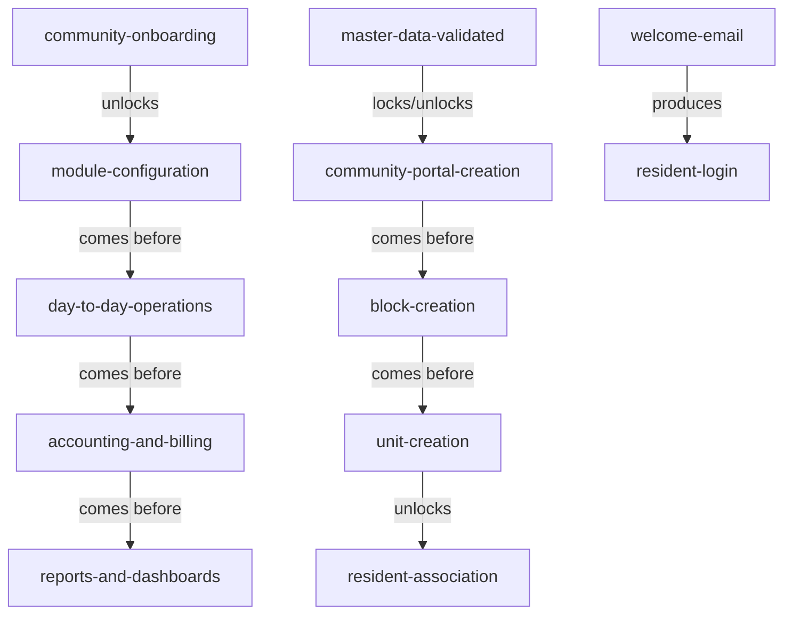
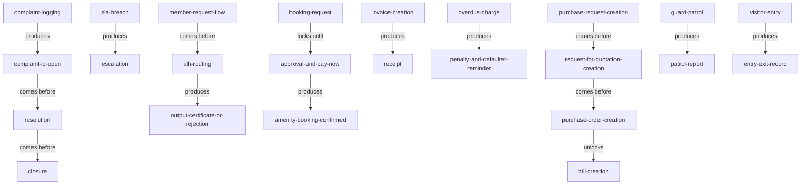

<!-- Assembled per glossary-assembly-principles.md - Part B: steps -->
# Steps

The named stages of the work in the ANACITY Community Management platform (DIEZ Dubai deployment), and the flow between them. Steps are listed by workstream for navigation, then the forward thread and the main operational lifecycles are each shown twice: a diagram and a verbatim link table.

## How to read this document

- `term` - the stage word, kebab-case and backticked.
- `what it is` - one plain sentence naming the stage; a shared stage carries an `Other deployment:` pointer to the Commercial word.
- `source` - the deployment that defines it; always `Res` here.
- `decision` - a link to the register when the stage was contested (a split), else `-`.
- `relationship` - how the stage connects to the next, using the words below.
- Relationship words: `comes before` (this stage runs, then the next), `produces` (this stage creates a thing as it runs), `locks / unlocks` (this stage controls whether the next can happen).

## Onboarding

| term | what it is | source | decision | relationship |
|---|---|---|---|---|
| `community-onboarding` | the end-to-end setup of a new community. Other deployment: `employee-onboarding` (different sense) | Res | [D-12](decisions.md#d-12) | comes before module configuration |
| `community-creation` | creating a new community portal | Res | - | comes before `block-creation` |
| `block-creation` | creating named structural blocks | Res | - | comes before `unit-creation` |
| `unit-creation` | creating units within a block | Res | - | unlocks resident association |
| `bulk-upload-units` | uploading many units via the Excel template | Res | - | produces `unit` records |
| `resident-database-updation` | adding or uploading resident records | Res | - | produces `resident-record` |
| `resident-login` | a resident signs in to their mapped community | Res | - | produced by `welcome-email` credentials |

## People, roles and directory

| term | what it is | source | decision | relationship |
|---|---|---|---|---|
| `staff-role-creation` | creating and managing named staff role categories | Res | - | comes before `staff-member-addition` |
| `staff-member-addition` | adding and maintaining staff member records | Res | - | produces `staff-member-record` |
| `staff-role-reassignment` | changing a staff member's role assignment | Res | - | produces updated `staff-profile` |
| `manage-committee-role` | creating or editing Owners Committee roles | Res | - | comes before `committee-member-assignment` |
| `committee-member-assignment` | assigning OC member status to a member or staff | Res | - | produces `oc-member-status` |
| `role-assignment` | assigning admin roles to members or staff | Res | - | produces updated portal access |
| `admin-role-revocation` | revoking administrator roles | Res | - | produces updated portal access |
| `emergency-contact-setup` | creating community emergency and service contacts | Res | - | produces `contact-record` |
| `contact-management` | editing, deleting or viewing contact records | Res | - | updates `contact-record` |

## Communication and engagement

| term | what it is | source | decision | relationship |
|---|---|---|---|---|
| `post-new-admin-notice` | publishing or scheduling a notice to an audience | Res | - | produces `notice` |
| `document-upload` | uploading a document with metadata | Res | - | produces `document` |
| `document-management` | editing, versioning, expiring, archiving a document | Res | - | produces `document-version` |
| `audit-and-logs` | reviewing and exporting document interaction logs | Res | - | produces `export-file` |
| `album-creation` | creating a media album | Res | - | comes before `media-upload` |
| `media-upload` | adding photos or videos to an album | Res | - | produces `media` |
| `product-listing-flow` | a resident submits a product listing | Res | - | comes before `admin-approval-workflow` |
| `admin-approval-workflow` | an admin approves or rejects a listing | Res | - | produces published `product-listing` |
| `event-setup` | entering event details, capacity and media | Res | - | comes before `event-booking` |
| `resident-booking-flow` | a resident selects, pays for and books an event or amenity | Res | [D-13](decisions.md#d-13) | produces `booking-confirmation` |

## Helpdesk, requests and incidents

| term | what it is | source | decision | relationship |
|---|---|---|---|---|
| `complaint-logging` | a resident or admin logs a complaint | Res | - | produces `complaint-id` |
| `escalation` | moving an unresolved item to the next level on SLA breach | Res | - | produced by SLA breach |
| `re-open` | reopening a closed complaint | Res | - | reopens `complaint` |
| `resolution` | addressing and marking an item resolved | Res | - | comes before `closure` |
| `closure` | the raiser confirms resolution to close the item | Res | - | closes `complaint` |
| `member-request-flow` | a member submits a request through the ALH to closure | Res | - | comes before ALH routing |
| `incident-raising` | a member, guard or admin raises an incident | Res | - | produces `incident-report` |
| `incident-resolution` | a category admin or field staff resolves the incident | Res | - | produces resolution timestamp |

## Access, visitors and security

| term | what it is | source | decision | relationship |
|---|---|---|---|---|
| `move-in` | moving a resident into a unit. Other deployment: none | Res | - | uses `move-in-form` |
| `move-out` | moving a resident out of a unit. Other deployment: none | Res | - | uses `move-out-form` |
| `guidelines-acknowledgement` | a resident acknowledges guidelines to unlock the form | Res | - | unlocks `move-in-form` |
| `visitor-entry` | logging a visitor's entry after resident approval | Res | - | produces `entry-exit-record` |
| `visitor-exit` | logging a visitor's exit with a timestamp | Res | - | produces `entry-exit-record` |
| `service-staff-entry` | logging staff entry via the 6-digit verification code | Res | - | produces `entry-exit-record` |
| `guard-patrol` | a guard's scheduled round of checkpoints. Other deployment: `guard-patrol` | Res | - | produces `patrol-report` |
| `checkpoint-verification` | verifying presence by QR scan or NFC tap | Res | - | produces verified `checkpoint` |

## Amenities, facilities and holiday homes

| term | what it is | source | decision | relationship |
|---|---|---|---|---|
| `amenity-configuration` | creating and configuring an amenity | Res | - | produces `slot` |
| `booking-rules-configuration` | setting quota, duration, window and capacity rules | Res | - | locks / unlocks a booking attempt |
| `approval-workflow` | approving or rejecting a pending booking | Res | - | produces `amenity-booking` and `invoice` |
| `make-booking` | an admin creates a booking for a resident | Res | - | produces `amenity-booking` |
| `cancel-booking` | cancelling a booking with a reason and releasing the slot | Res | - | releases `slot` |
| `holiday-home-operator-registration` | registering an HHO with regulatory documents | Res | - | produces `hho-record` |
| `unit-association` | associating residential units with an HHO | Res | - | unlocked by active `hho-record` |
| `move-in-short-stay-setup` | configuring the short-stay move-in form | Res | - | produces `move-in-short-stay-form` |
| `guest-check-in` | an operator registers a short-stay guest | Res | - | produces `holiday-home-stay` |

## Assets, inventory and maintenance

| term | what it is | source | decision | relationship |
|---|---|---|---|---|
| `asset-addition` | registering assets individually or in bulk | Res | - | produces `asset` and `qr-code` |
| `bulk-asset-upload` | Excel-template bulk import of assets | Res | - | produces `asset` records |
| `maintenance-scheduling` | adding preventive-maintenance action items per asset | Res | [D-14](decisions.md#d-14) | produces `action-item` |
| `qr-code-management` | generating, printing and scanning asset QR codes | Res | - | produces `qr-code-sheet` |
| `mobile-qr-scan` | scanning an asset QR code in the field | Res | - | reveals `maintenance-log` |
| `category-setup` | creating stock categories | Res | - | comes before `stock-addition` |
| `stock-addition` | registering stock items individually or in bulk | Res | - | produces `stock-item` |
| `stock-monitoring` | monitoring low-stock and generating reports | Res | - | produces `low-stock-alert` |
| `procurement` | arranging purchase and adding low stock | Res | - | updates `on-hand-quantity` |
| `amc-creation` | creating AMC records | Res | - | produces `amc` |
| `renewal-reminders` | configuring and dispatching renewal reminders | Res | - | produces `renewal-reminder-notification` |
| `amc-status-recomputation` | the daily recompute of all AMC statuses (a system job; `job` is not a glossary term) | Res | [D-24](decisions.md#d-24) | produces recomputed `amc` status |

## Accounting and finance

| term | what it is | source | decision | relationship |
|---|---|---|---|---|
| `accounting-module-setup` | onboarding and activating accounting before live transactions | Res | - | comes before any accounting transaction |
| `charge-category-creation` | creating income and expense categories and the COA | Res | - | comes before `invoice-creation` |
| `accounting-period-setup` | setting up the period before transactions | Res | - | locks / unlocks accounting transactions |
| `closing-balance-upload` | the one-time upload of unit balances | Res | - | loads `account-ledger` |
| `invoice-creation` | creating member or non-member invoices | Res | - | produces `invoice` |
| `invoice-distribution` | sharing an invoice via app and email | Res | - | produced by `invoice-creation` |
| `recurring-invoice-configuration` | configuring a recurring invoice | Res | - | produces `recurring-invoice` |
| `penalty-setup` | configuring the penalty scheme | Res | - | produces `penalty-scheme` |
| `non-member-invoice-creation` | creating a non-member invoice | Res | - | produces `non-member-invoice` |
| `debit-credit-note-creation` | creating a debit or credit note | Res | - | comes before approval |
| `journal-voucher-auto-posting` | auto-posting a JV on note approval | Res | [D-21](decisions.md#d-21) | produces `journal-voucher` |
| `credit-adjustment` | applying a credit note to open invoices | Res | - | reduces `outstanding-invoice` |
| `bill-creation` | submitting a vendor bill | Res | - | produces `bill` |
| `vendor-self-registration` | a vendor self-registers via the portal | Res | - | produces `public-vendor-list` entry |
| `expense-and-bills` | recording expense bills against a PO or PR | Res | - | produces `expense-bill` |
| `mollak-integration` | synchronising data with Mollak | Res | - | syncs `service-charge-invoice` |
| `approval-hierarchy-setup` | creating the ALH before PR or PO | Res | [D-7](decisions.md#d-7) | locks / unlocks PR or PO submission |
| `purchase-request-creation` | creating and submitting a PR | Res | - | comes before `request-for-quotation-creation` |
| `request-for-quotation-creation` | creating and sharing an RFQ | Res | - | produces `quotation` |
| `purchase-order-creation` | creating, approving and sharing a PO | Res | - | unlocks `bill-creation` against the PO |
| `create-accrual` | creating an accrual entry | Res | - | produces `accrual` |
| `accrual-knock-off` | knocking off an accrual when a bill is created against it | Res | - | produces `vendor-payable` |
| `record-bank-book-transactions` | recording receipts, payments, deposits and withdrawals | Res | - | comes before `bank-reconciliation` |
| `bank-reconciliation` | matching and reconciling bank entries | Res | - | produces `bank-reconciliation-statement` |
| `manual-reminder` | identifying defaulters and sending reminders now | Res | - | produces defaulter list |
| `auto-reminder` | scheduling automated defaulter reminders | Res | - | produces reminder notifications |

## Dashboards, reports and integrations

| term | what it is | source | decision | relationship |
|---|---|---|---|---|
| `builder-community-mapping` | mapping communities to a builder account | Res | - | comes before `mpd-admin-setup` |
| `mpd-admin-setup` | provisioning the MPD admin account | Res | - | unlocks `multi-property-dashboard` |
| `user-access-management` | creating staff users with community scope | Res | - | produces `mpd-user-account` |
| `mollak-owner-data-sync` | fetch, compare, verify and sync owner data | Res | - | produces `sync-completion-report` |
| `report-scheduling` | configuring a report's frequency and recipients | Res | - | produces scheduled `report` |
| `report-generation` | generating a report on demand or on schedule | Res | - | comes before `download` |
| `download` | downloading the generated report (the `download-manager` object is dropped) | Res | [D-24](decisions.md#d-24) | produced by `report-generation` |

## Forward thread (the platform's main flow)

| parent | relationship | child |
|---|---|---|
| `community-onboarding` | locks / unlocks | module configuration |
| module configuration | comes before | day-to-day operations |
| day-to-day operations | comes before | accounting and billing |
| accounting and billing | comes before | reports and dashboards |
| master data validated | locks / unlocks | community portal creation |
| community portal creation | comes before | `block-creation` |
| `block-creation` | comes before | `unit-creation` |
| `unit-creation` | unlocks | resident association |
| `welcome-email` | produces | `resident-login` |

## Operational lifecycles (the main gated sequences)

| parent | relationship | child |
|---|---|---|
| `complaint-logging` | produces | `complaint-id` (open) |
| `complaint-id` (open) | comes before | `resolution` |
| `resolution` | comes before | `closure` |
| SLA breach | produces | `escalation` |
| `member-request-flow` | comes before | ALH routing |
| ALH routing | produces | `output-certificate` or rejection |
| `booking-request` | locks until | approval and Pay Now |
| approval and Pay Now | produces | confirmed `amenity-booking` |
| `invoice-creation` | produces | `receipt` |
| `overdue-charge` | produces | penalty and `defaulter-reminder` |
| `purchase-request-creation` | comes before | `request-for-quotation-creation` |
| `request-for-quotation-creation` | comes before | `purchase-order-creation` |
| `purchase-order-creation` | unlocks | `bill-creation` |
| `guard-patrol` | produces | `patrol-report` |
| `visitor-entry` | produces | `entry-exit-record` |

## Related pages

| page | why it relates |
|---|---|
| [map.md](map.md) | the joined forward flow across all kinds |
| [objects.md](objects.md) | the things these stages create and change |
| [states.md](states.md) | the conditions the objects reach as these stages run |
| [decisions.md](decisions.md) | why split stages (onboarding, booking, maintenance) were separated |
