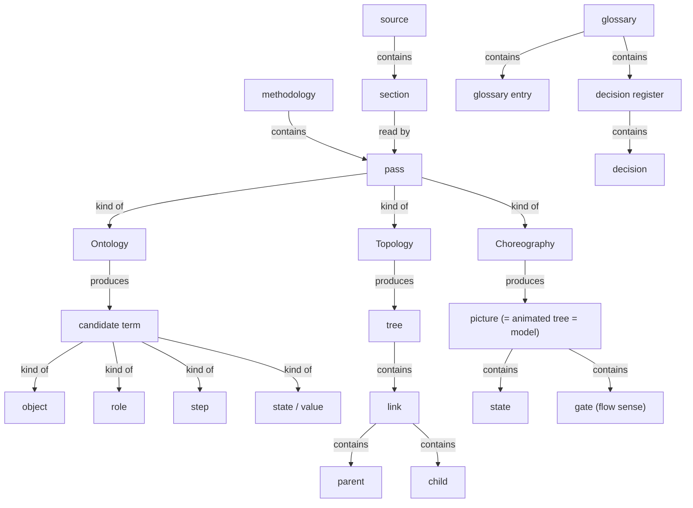
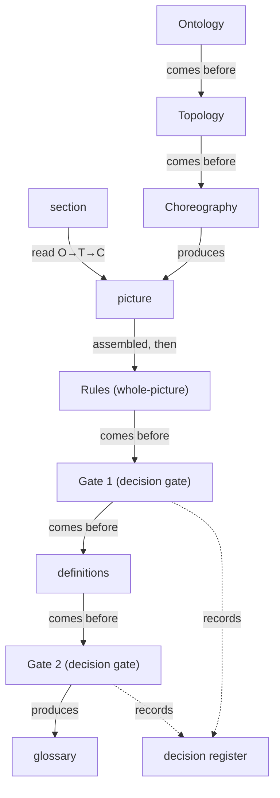

# Assembled draft — self-glossary (dogfood)

> Source: the six `.skills/_shared/glossary/` method docs. Mode: **new build**.
> Sections joined on shared terms (join points): pass · Ontology · Topology · Choreography · term · candidate term · picture · tree · glossary · gate · section · decision register · re-scan.

## Joined tree (structure)

## Joined flow (behaviour)

## Whole-picture rules applied

### The three tests → qualifying terms
Reach ≥ 2 sections carries most core terms (source, section, candidate term, term, picture, tree, glossary, gate, pass, O/T/C, re-scan, decision register, conflict, delta, kind, person). Borderline-reach (single-section) raised at Gate 1: node, join point, newcomer, index, bucket, decision, parent, child, law, model, thing.

### The five conflict kinds (detail feeds the Gate 1 review)
1. **several words, one thing** — picture=animated tree=model · thing=candidate term/term · rule=law=judgment · give-away phrase=flow phrase=structural phrase · cross-link=cross-section link · evidence=evidence quote=quote
2. **one word, two+ meanings** — **gate** (person-checkpoint vs flow-control) · **source** (document read / provenance field / example code) · read (whole vs deep read) · test (three tests / same-thing / weak-word) · kind (four kinds / conflict kinds / kind-of) · state (condition / Ontology kind) · delta (check / re-scan)
3. **part vs whole** — the read (whole) vs deep read (part) · tree (stage) vs picture (whole) · pass (one) vs read/run (all)
4. **collides with our own working words** — module (example) vs section (method) · state (product) vs state (Ontology kind) · source (example) vs source (method input)
5. **drift between documents/files** — disposition (Methodology l.6) vs change (Methodology l.92, "Where the methodology stops") · re-scan (shared) vs re-run (harvest SKILL) · picture vs model (within Methodology)

### Weak-word recommendations (committed)
- thing → **candidate term** before a gate, **term** after
- model → **picture**
- law / judgment → **rule**
- give-away / flow / structural phrase → **signal phrase**
- cross-link / cross-section link → **cross-section link**
- evidence / quote → **evidence quote**

*Scope note:* method vocabulary only; the running worked example (quick scan, deep read, domain, finding, journey, as-is…) is treated as illustration, not harvested.
