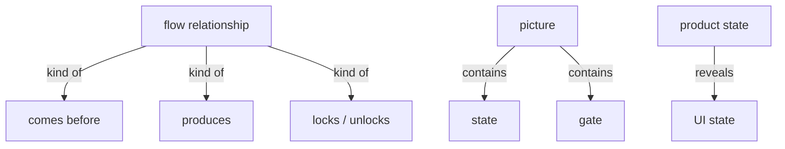
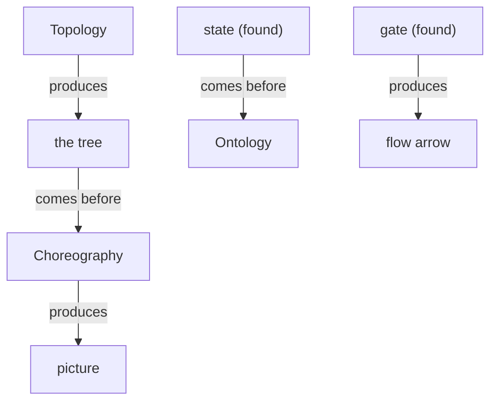

# Section draft — choreography

> Source: `.skills/_shared/glossary/Choreography.md`. Repeats marked `KNOWN`.
> Scope: worked slice (quick scan, deep read, result, source-as-code) = illustration, not harvested.

## Ontology — the things

### Objects
| # | Term | Meaning | Evidence | Re-scan |
|---|---|---|---|---|
| 1 | state | a condition a thing can be in | "the states a thing can be in" | NEW |
| 2 | gate | a flow control between two things | "the **gates** between things — … locks or unlocks" | KNOWN ⚠⚠ collides with the decision-gate sense |
| 3 | flow phrase | wording that signals a gate | "look for a flow give-away phrase" | NEW ⚠ vs "give-away phrase" |
| 4 | product state | the true condition of a thing (vs its UI echo) | "We capture the product state it echoes" | NEW |
| 5 | UI state / control | a button/field that echoes a product state | "buttons, fields, toggles, modals" | NEW (drop-class, named as a distinction) |
| 6 | animated tree | the tree with states + gates added | "that animated tree is the section's picture" | KNOWN ⚠ = picture |
| 7 | picture | the section's animated tree | "The animated tree **is** the section's picture" | KNOWN |
| 8 | thing | loose alias of a placed term | "for each thing, record the conditions" | KNOWN ⚠ alias |

### Roles
| # | Term | Meaning | Evidence | Re-scan |
|---|---|---|---|---|
| — | None. | — | — | — |

### Steps
| # | Term | Meaning | Evidence | Re-scan |
|---|---|---|---|---|
| 1 | Choreography | the pass that animates the tree | "Choreography — find how each thing moves" | KNOWN |

### States & values
| # | Term | Values | Evidence | Re-scan |
|---|---|---|---|---|
| 1 | flow relationship | comes before · produces · locks / unlocks | "Classify a gate as `comes before`, `produces`, or `locks / unlocks`" | NEW |

## Topology — the tree

**Verbatim**

| Parent (A) | relationship | Child (B) | Evidence |
|---|---|---|---|
| flow relationship | kind of | • comes before • produces • locks / unlocks | "The relationships this pass reads" |
| picture | contains | • state • gate | "the animated tree" (states + gates on the tree) |
| product state | reveals | UI state | "the **visible echo** of a product state" |

**Mermaid**

## Choreography — states & gates

**States**

| Thing | States | Evidence |
|---|---|---|
| candidate (that is a state) | • loops back to Ontology | "a **state it finds** … loops back to Ontology as a candidate term" |

**Gates (verbatim)**

| A | relationship | B | Evidence |
|---|---|---|---|
| Topology | produces | Choreography input (the tree) | "From Topology: the tree" |
| Choreography | produces | picture | "that animated tree is the section's picture" |
| state (found) | comes before | Ontology | "it loops back to Ontology as a candidate term" |
| gate (found) | produces | flow arrow | "a **gate it finds** becomes a flow arrow" |

**Mermaid**

## Conflict flags (for Gate 1)
- `gate` here means a **flow control** (locks/produces/comes-before); in Methodology/Rules `gate` means **a checkpoint where a person decides** (Gate 1 / Gate 2). One word, two unrelated things. **⚠ the sharpest conflict in the set.**
- `flow phrase` vs `give-away phrase` (Topology) — same idea.
- `animated tree` = `picture` = `model` — one thing, three labels.
