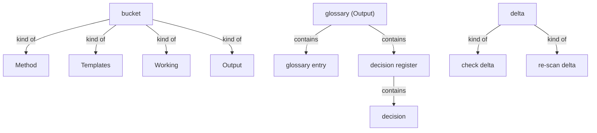
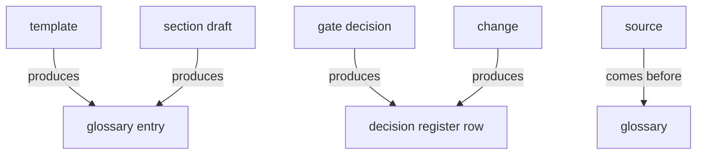

# Section draft — formats

> Source: `.skills/_shared/glossary/Formats.md`. Repeats marked `KNOWN`.
> Scope: the worked slice inside example tables (quick scan, deep read) = illustration, not harvested.

## Ontology — the things

### Objects
| # | Term | Meaning | Evidence | Re-scan |
|---|---|---|---|---|
| 1 | decision | one gate ruling, id `D-n` | "keyed by a global id `D-1`, `D-2`" | NEW |
| 2 | check delta | what `check` reports when measuring a document | "**Check delta** (measuring a document)" | NEW ⚠ two deltas |
| 3 | re-scan delta | the Add/Merge/Change/No-change output | "**Re-scan delta** (glossary already exists)" | NEW ⚠ two deltas |
| 4 | index | the glossary's contents map (README) | "the index, and how to read the glossary" | NEW |
| 5 | working file | per-section scratch draft | "The working files (operational)" | NEW |
| 6 | section draft | the `<section>-glossary.md` working file | "the section's draft — its terms, tree, and gates" | NEW |
| 7 | template | a blank copy of an output file | "**blank** copies of the output files" | NEW |
| 8 | Source (entry field) | where a term came from | "recorded once, in the term's glossary entry (its `Source`)" | NEW ⚠ third sense of *source* |
| 9 | bucket | one of the four homes for files | "four buckets, output isolated from working" | NEW |
| 10 | glossary entry | one term's row in its kind file | "One row per term, in its kind's file" | KNOWN |
| 11 | decision register | the append-only record keyed by id | "one row per gate decision, keyed by a global id" | KNOWN |
| 12 | delta | the difference output of a run | "The two deltas" | KNOWN |
| 13 | glossary | the finished deliverable | "the **finished** glossary" | KNOWN |
| 14 | picture | the section model built in working/ | "the picture being built" | KNOWN |

### Roles
| # | Term | Meaning | Evidence | Re-scan |
|---|---|---|---|---|
| — | None. | — | — | — |

### Steps
| # | Term | Meaning | Evidence | Re-scan |
|---|---|---|---|---|
| 1 | rename / redefine / split / retire | the four ways a term changes | "Rename … Redefine … Split … Retire" | NEW |

### States & values
| # | Term | Values | Evidence | Re-scan |
|---|---|---|---|---|
| 1 | bucket | Method · Templates · Working · Output | "four buckets, output isolated from working" | NEW |
| 2 | delta | check delta · re-scan delta | "The two deltas" | NEW |
| 3 | entry.Changed | date + previous wording, or — | "date + previous wording, if it has changed" | NEW |

## Topology — the tree

**Verbatim**

| Parent (A) | relationship | Child (B) | Evidence |
|---|---|---|---|
| bucket | kind of | • Method • Templates • Working • Output | "four buckets" |
| glossary (Output) | contains | • objects.md • roles.md • steps.md • states.md • decisions.md • README.md | the Output/glossary/ tree |
| glossary entry | contains | • Term • Definition • Part of • Decision • Changed | "One row per term … Columns" |
| decision register | contains | decision | "one row per gate decision" |
| working file | kind of | • section draft • section decisions | "Just two" (per-section files) |
| delta | kind of | • check delta • re-scan delta | "The two deltas" |

**Mermaid**

## Choreography — states & gates

**States**

| Thing | States | Evidence |
|---|---|---|
| glossary entry | • current • changed • retired | "the entry is marked retired (kept for history)" |
| working file | • scratch • approved → archived | "the working folders can then be archived" |

**Gates (verbatim)**

| A | relationship | B | Evidence |
|---|---|---|---|
| template | produces | glossary entry | "each file a filled copy of its `templates/` blank" |
| section draft | produces | glossary entry | "the terms become entries in the output glossary" |
| gate decision | produces | decision register row | "Every gate decision is one row" |
| change | produces | decision register row | "Every change also appends a timestamped row" |
| source | comes before | glossary | "the source flows **down** into the glossary" |

**Mermaid**

## Conflict flags (for Gate 1)
- `delta` — one word for two things (check delta vs re-scan delta): split or keep as a family?
- `Source` (entry field) is a **third** sense of `source` (method input; example code; provenance field).
- `working file` / `section draft` / `picture` all name the working artifact — align.
