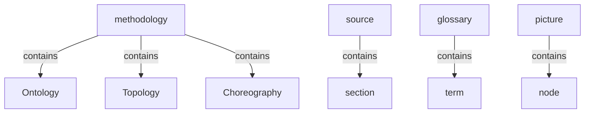
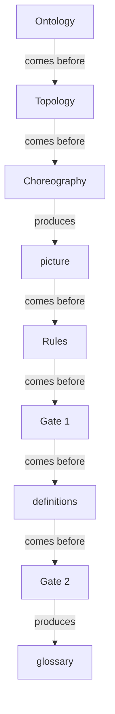

# Section draft — methodology

> Source: `.skills/_shared/glossary/Methodology.md`. New build → all rows `NEW` (first section).
> Scope: harvesting the method's **own** vocabulary. The running worked example (quick scan, deep read, domain, finding…) is illustration, not harvested.

## Ontology — the things

### Objects
| # | Term | Meaning (≤12 words) | Evidence (exact quote — where) | Re-scan |
|---|---|---|---|---|
| 1 | source | any document read for its meaning | "A way to read *any* document for meaning" | NEW |
| 2 | section | one coherent part of the source, read at a time | "one coherent part of the source, read at a time" | NEW |
| 3 | candidate term | a thing a pass found, not yet judged | "a thing a pass found, not yet judged" | NEW |
| 4 | term | a candidate that qualified and has an entry | "a candidate that qualified and has a glossary entry" | NEW |
| 5 | picture | the assembled model of one section | "the assembled model of one section" | NEW |
| 6 | tree | the things arranged into a hierarchy | "arranges it into a *tree*" | NEW |
| 7 | glossary | the one shared term set across sections | "The glossary is one shared set across every section" | NEW |
| 8 | decision register | the permanent record of what overrode what | "the permanent record of what overrode what" | NEW |
| 9 | gate | a checkpoint where a person decides | "a checkpoint where a person decides" | NEW |
| 10 | conflict | an unsettled same-thing disagreement, for the gate | "it becomes a conflict for the gate" | NEW |
| 11 | cross-section link | a link to a term owned by another section | "that **cross-section link** is recorded" | NEW |
| 12 | join point | a shared term stitching section trees together | "those shared terms are the **join points**" | NEW |
| 13 | node | a term as one box in the picture | "a term used in two sections is the **same node**" | NEW |
| 14 | delta | a run's difference against the current glossary | "every run is a delta against the current glossary" | NEW |
| 15 | thing | loose alias of candidate term / term | "finds *what* the things are" | NEW ⚠ alias |
| 16 | model | the assembled picture (informal) | "the assembled *model* of one section" | NEW ⚠ alias |

### Roles
| # | Term | Meaning | Evidence | Re-scan |
|---|---|---|---|---|
| 1 | person | the one who decides at a gate | "the **person**, at a gate" | NEW |

### Steps
| # | Term | Meaning | Evidence | Re-scan |
|---|---|---|---|---|
| 1 | pass | one of the three readings (O/T/C) | "one of the three readings: Ontology, Topology, Choreography" | NEW |
| 2 | Ontology | the pass that finds what the things are | "**Ontology** finds *what* the things are" | NEW |
| 3 | Topology | the pass that arranges things into a tree | "**Topology** takes that list and arranges it into a *tree*" | NEW |
| 4 | Choreography | the pass that animates the tree | "**Choreography** takes the tree and *animates* it" | NEW |
| 5 | same-thing test | the check for whether two words name one thing | "Deciding whether two words name one thing" | NEW |
| 6 | re-scan | a run against an existing glossary | "On a re-scan, Ontology marks each thing `NEW` or `KNOWN`" | NEW |
| 7 | assembly | joining section pictures into one whole | "one picture per section, then joined across sections" | NEW |
| 8 | harvest | the skill that builds/updates the glossary | "The harvest and check skills apply this methodology" | NEW |
| 9 | check | the skill that measures a document | "the harvest and check skills" | NEW |
| 10 | disposition | the skill that consumes the outputs | "the disposition skill consumes its outputs" | NEW ⚠ line 92 still says "change" |

### States & values
| # | Term | Values | Evidence | Re-scan |
|---|---|---|---|---|
| 1 | re-scan status | NEW · KNOWN · possible-merge | "marks each thing `NEW` or `KNOWN`" | NEW |
| 2 | re-scan outcome | Add · Merge · Change · No change | "classifies each as **Add · Merge · Change · No change**" | NEW |

## Topology — the tree

**Verbatim**

| Parent (A) | relationship | Child (B) | Evidence |
|---|---|---|---|
| methodology | contains | • Ontology • Topology • Choreography | "in three passes — **O**ntology, **T**opology, **C**horeography" |
| pass | kind of | • Ontology • Topology • Choreography | "one of the three readings" |
| source | contains | section | "Each pass reads one **section** at a time" |
| glossary | contains | term | "The glossary is one shared set across every section" |
| picture | contains | node | "a term used in two sections is the **same node**" |

**Mermaid**

## Choreography — states & gates

**States**

| Thing | States | Evidence |
|---|---|---|
| candidate term | • NEW • KNOWN • possible-merge | "marks each thing `NEW` or `KNOWN`" |
| re-scan outcome | • Add • Merge • Change • No change | "classifies each as **Add · Merge · Change · No change**" |

**Gates (verbatim)**

| A | relationship | B | Evidence |
|---|---|---|---|
| Ontology | comes before | Topology | "run in a fixed order, each building on the one before" |
| Topology | comes before | Choreography | "things → tree → animated tree" |
| Ontology | produces | list of things | "finds *what* the things are — a flat list" |
| Topology | produces | tree | "arranges it into a *tree*" |
| Choreography | produces | picture | "that animated tree is the picture" |
| read + assemble | comes before | Rules | "Everything from `Rules` downward is judgment" |
| Rules | comes before | Gate 1 | flowchart: `RULES --> G1` |
| Gate 1 | comes before | definitions | flowchart: `G1 --> DEF` |
| definitions | comes before | Gate 2 | flowchart: `DEF --> G2` |
| Gate 2 | produces | glossary | flowchart: `G2 --> GLOSS` |

**Mermaid**

## Conflict flags (for Gate 1)
- `thing` (row 15) is a loose alias of *candidate term* / *term*.
- `model` (row 16) is a second word for *picture*.
- `disposition` (step 10): this doc's line 6 says "disposition" but line 92 still says "change" — drift **within one file**.
