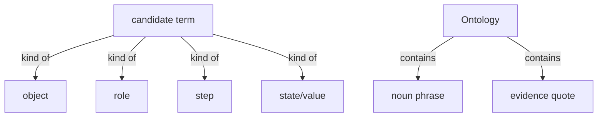
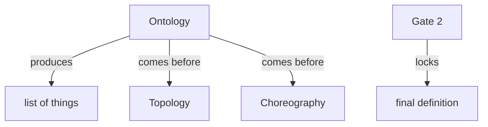

# Section draft — ontology

> Source: `.skills/_shared/glossary/Ontology.md`. Terms already owned by an earlier section marked `KNOWN`.
> Scope: the worked slice (source-as-code, result, as-is, domain, journey, module, finding, evidence, quick scan, deep read) is illustration — flagged, not harvested. These are exactly the words a literal "list every noun phrase" would pull in.

## Ontology — the things

### Objects
| # | Term | Meaning | Evidence | Re-scan |
|---|---|---|---|---|
| 1 | noun phrase | the raw unit listed before judging | "List every noun phrase in the section" | NEW |
| 2 | kind | one of the four buckets a candidate falls in | "one of the four KINDS below" | NEW ⚠ overloaded |
| 3 | evidence quote | the exact source quote proving a term | "a **mandatory evidence quote on every row**" | NEW ⚠ also *evidence*/*quote* |
| 4 | drop-list | the closed list of never-candidates | "a closed drop-list" | NEW |
| 5 | wide net | the wide-capture stance of this pass | "Ontology casts a **wide net**" | NEW |
| 6 | candidate term | a kept noun phrase, not yet judged | "keep the real terms" | KNOWN |
| 7 | term | a candidate with a glossary entry | "a candidate that qualified" | KNOWN |
| 8 | section | one coherent part of the source | "One section of the source" | KNOWN |
| 9 | glossary | the shared term set (checked on re-scan) | "The existing glossary" | KNOWN |
| 10 | thing | loose alias of candidate term / term | "the list of things" | KNOWN ⚠ alias |

### Roles
| # | Term | Meaning | Evidence | Re-scan |
|---|---|---|---|---|
| — | None. | this section names no roles | — | — |

### Steps
| # | Term | Meaning | Evidence | Re-scan |
|---|---|---|---|---|
| 1 | Ontology | the pass that finds the things | "Ontology — find the things and what they mean" | KNOWN |
| 2 | re-scan | a run against an existing glossary | "When the glossary already exists (a re-scan)" | KNOWN |
| 3 | same-thing test | decides whether two words name one thing | "That is the same-thing test in `Methodology.md`" | KNOWN |

### States & values
| # | Term | Values | Evidence | Re-scan |
|---|---|---|---|---|
| 1 | the four kinds | object · role · step · state/value | "a candidate is one of exactly four kinds" | NEW |
| 2 | re-scan status | NEW · KNOWN · possible-merge | "`Re-scan` ∈ { NEW, KNOWN, possible-merge }" | KNOWN |

## Topology — the tree

**Verbatim**

| Parent (A) | relationship | Child (B) | Evidence |
|---|---|---|---|
| candidate term | kind of | • object • role • step • state/value | "a candidate is one of exactly four kinds" |
| Ontology | contains | • noun phrase • evidence quote • re-scan status | output-table columns |

**Mermaid**

## Choreography — states & gates

**States**

| Thing | States | Evidence |
|---|---|---|
| candidate term | • NEW • KNOWN • possible-merge | "`Re-scan` ∈ { NEW, KNOWN, possible-merge }" |

**Gates (verbatim)**

| A | relationship | B | Evidence |
|---|---|---|---|
| Ontology | produces | list of things | "hand the list of things to Topology" |
| Ontology | comes before | Topology | "feeds `Topology.md`" |
| Ontology | comes before | Choreography | "feeds … `Choreography.md`" |
| Gate 2 | locks | final definition | "Definitions are finalised at Gate 2" |

**Mermaid**

## Conflict flags (for Gate 1)
- `evidence quote` / `evidence` / `quote` — three labels for one thing in this doc.
- `kind` — used for the four keep-kinds here; Rules uses "kind" for the five conflict kinds; Topology for "kind of". Overloaded.
- `thing` — alias again ("the list of things").
