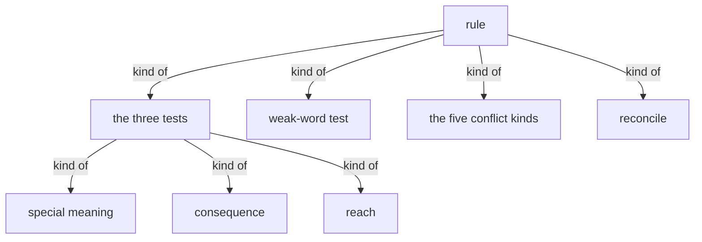
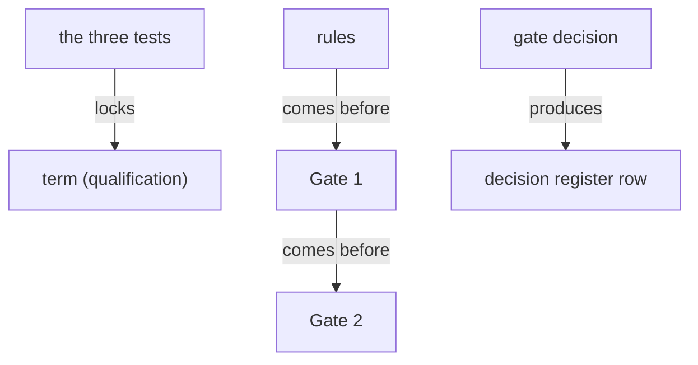

# Section draft — rules

> Source: `.skills/_shared/glossary/Rules.md`. Repeats marked `KNOWN`.
> Scope: the worked slice inside the test tables (quick scan, deep read, results, source-as-repository) = illustration. Note Rules itself uses "source" in the *repository* sense as its example of the one-word-two-meanings conflict.

## Ontology — the things

### Objects
| # | Term | Meaning | Evidence | Re-scan |
|---|---|---|---|---|
| 1 | rule | a whole-picture judgment on candidate terms | "the rules that need **every section in view**" | KNOWN |
| 2 | law | the rule-set (informal alias of *rule*) | "The **law** proposes; the person disposes" | NEW ⚠ alias of *rule* |
| 3 | judgment | a whole-picture decision | "the whole-picture judgments" | NEW ⚠ near-alias of *rule* |
| 4 | test | one qualifying check | "the three tests" | NEW ⚠ overloaded |
| 5 | recommendation | a proposed better word for the gate | "propose one or two better words … never a silent swap" | NEW |
| 6 | winning word | the word chosen to keep in a conflict | "It never picks a **winning word**" | NEW |
| 7 | conflict | a clash between candidate terms, for the gate | "Classify conflicts — the five kinds" | KNOWN |
| 8 | gate | a checkpoint where a person decides | "**GATE 1 — the person decides**" | KNOWN ⚠ decision-sense (clashes with Choreography's flow "gate") |
| 9 | decision register | the auditable record of gate decisions | "written to the decision register" | KNOWN |

### Roles
| # | Term | Meaning | Evidence | Re-scan |
|---|---|---|---|---|
| 1 | person | the one who decides at a gate | "the person **disposes**" | KNOWN |
| 2 | newcomer | a reader used to gauge special meaning | "would a **newcomer** take the everyday sense and be wrong?" | NEW (one use) |

### Steps
| # | Term | Meaning | Evidence | Re-scan |
|---|---|---|---|---|
| 1 | reconcile | classify each candidate against the glossary | "Reconciling a re-scan" | NEW |
| 2 | re-scan | a run against an existing glossary | "When the glossary already exists" | KNOWN |
| 3 | Gate 1 | the picture/recommendations/conflicts decision | "**Gate 1** — picture, recommendations, conflicts" | KNOWN |
| 4 | Gate 2 | the definitions decision | "**Gate 2** — definitions" | KNOWN |

### States & values
| # | Term | Values | Evidence | Re-scan |
|---|---|---|---|---|
| 1 | the three tests | special meaning · consequence · reach | "special meaning · consequence · reach" | NEW |
| 2 | the five conflict kinds | several words one thing · one word two meanings · part vs whole · collides with working words · drift between documents | "The five conflict kinds" | NEW |
| 3 | re-scan outcome | Add · Merge · Change · No change | "Add … Merge … Change … No change" | KNOWN |
| 4 | reach | borderline · single-sentence · multi-feature | "**Borderline reach** … is **raised at the gate**" | NEW |

## Topology — the tree

**Verbatim**

| Parent (A) | relationship | Child (B) | Evidence |
|---|---|---|---|
| rule | kind of | • the three tests • weak-word test • the five conflict kinds • reconcile | "The judgment at a glance" |
| the three tests | kind of | • special meaning • consequence • reach | "**all three** hold" |
| the five conflict kinds | kind of | (the five kinds) | "The five conflict kinds" |

**Mermaid**

## Choreography — states & gates

**States**

| Thing | States | Evidence |
|---|---|---|
| reach | • single-sentence • borderline • multi-feature | "**Borderline reach** … is **raised at the gate**" |

**Gates (verbatim)**

| A | relationship | B | Evidence |
|---|---|---|---|
| the three tests | locks | term (qualification) | "A candidate becomes a term only if **all three** hold" |
| rules | comes before | Gate 1 | "its verdicts go to Gate 1" |
| Gate 1 | comes before | Gate 2 | "and, after that, Gate 2 (definitions)" |
| gate decision | produces | decision register row | "written to the decision register" |

**Mermaid**

## Conflict flags (for Gate 1)
- `rule` = `law` = `judgment` — the file is `Rules` yet calls itself "the law" and "the judgments."
- `gate` (decision sense here) vs `gate` (flow sense in Choreography) — one word, two things.
- `test` — three qualifying tests vs same-thing test vs weak-word test. Overloaded.
- `source` — Rules uses it in the *repository/example* sense while Methodology uses it for *the document read*.
