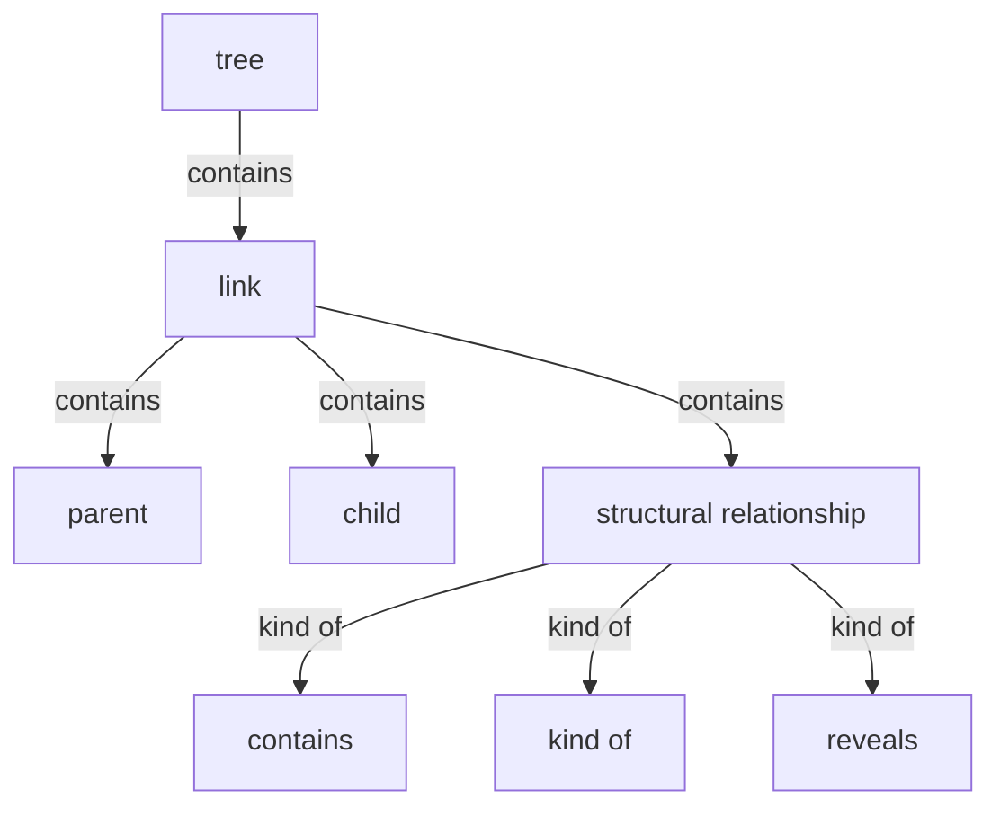
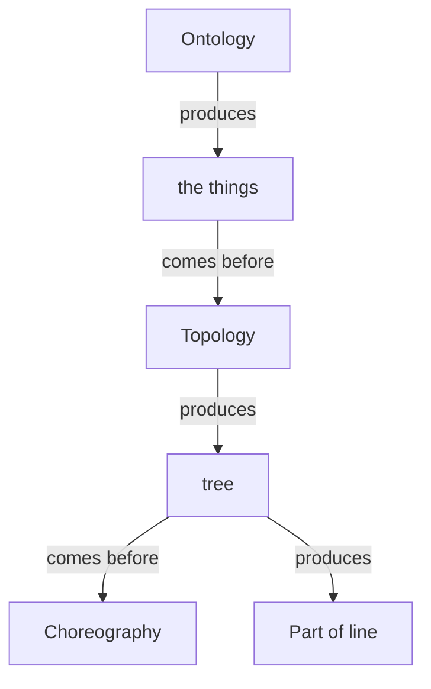

# Section draft — topology

> Source: `.skills/_shared/glossary/Topology.md`. Repeats marked `KNOWN`.
> Scope: worked slice (result, domain, journey, module, finding, evidence) = illustration, not harvested.

## Ontology — the things

### Objects
| # | Term | Meaning | Evidence | Re-scan |
|---|---|---|---|---|
| 1 | link | one parent→child relationship | "Each link is a parent–child step" | NEW |
| 2 | parent | the whole / category / opener in a link | "the **parent (A)** is the whole / category / opener" | NEW |
| 3 | child | the part / member / revealed thing | "the **child (B)** is the part / member / revealed thing" | NEW |
| 4 | give-away phrase | wording that signals a relationship | "a structural give-away phrase between them" | NEW ⚠ see flags |
| 5 | Part of | a term's parent, shown in its entry | "the **Part of** line in each glossary entry" | NEW |
| 6 | cross-link | a link reaching into another feature/module | "Topology never invents a cross-link" | NEW ⚠ vs "cross-section link" |
| 7 | tree | the section decomposed into a hierarchy | "**decomposes the section into a tree**" | KNOWN |
| 8 | glossary entry | one term's row in the glossary | "the 'Part of' line in each glossary entry" | KNOWN (defined in Formats) |
| 9 | thing | loose alias of the things Ontology found | "the things Ontology found" | KNOWN ⚠ alias |

### Roles
| # | Term | Meaning | Evidence | Re-scan |
|---|---|---|---|---|
| — | None. | — | — | — |

### Steps
| # | Term | Meaning | Evidence | Re-scan |
|---|---|---|---|---|
| 1 | Topology | the pass that places each thing | "Topology — find where each thing sits" | KNOWN |

### States & values
| # | Term | Values | Evidence | Re-scan |
|---|---|---|---|---|
| 1 | structural relationship | contains · kind of · reveals | "Classify it as `contains`, `kind of`, or `reveals`" | NEW |

## Topology — the tree

**Verbatim**

| Parent (A) | relationship | Child (B) | Evidence |
|---|---|---|---|
| tree | contains | link | "Read the whole set of links together and you have the section decomposed" |
| link | contains | • parent • child • structural relationship | "Record the link — `parent → child` — with the exact phrase" |
| structural relationship | kind of | • contains • kind of • reveals | "The three structural relationships" |

**Mermaid**

## Choreography — states & gates

**States**

| Thing | States | Evidence |
|---|---|---|
| — | None. | Topology adds structure, not movement (by its own boundary) |

**Gates (verbatim)**

| A | relationship | B | Evidence |
|---|---|---|---|
| Ontology | produces | Topology input (the things) | "From Ontology: the things" |
| Topology | produces | tree | "That tree is the entire output of this pass" |
| Topology | comes before | Choreography | "The tree is handed to **Choreography**" |
| tree | produces | Part of line | "each thing's parent becomes the **Part of** line" |

**Mermaid**

## Conflict flags (for Gate 1)
- `give-away phrase` here vs `flow phrase` (Choreography) vs `structural phrase` — one idea, three labels.
- `cross-link` here vs `cross-section link` (Methodology) — one idea, two labels.
- `tree` (this pass's output) vs `picture` (the animated whole) — part vs whole.
