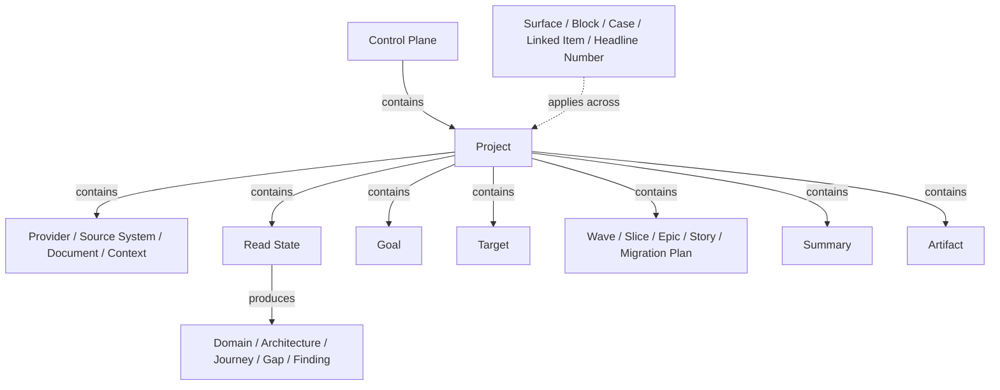

# Map - how the terms nest

This is where you see how the terms nest into one structure - the object hierarchy, what belongs to what. It is shown twice: as a diagram to scan and as a verbatim link table you can copy, search, and diff. When the diagram is too large or lays out badly, the verbatim is the source of truth. The forward thread - what happens in what order - lives in [steps.md](steps.md).

## How to read this document

- The **diagram** shows the top level; the **verbatim** table below is the complete set of links, one row per `parent | relationship | child`. The verbatim is the source of truth.
- **relationship** is one of: **contains** - the parent is the whole, the child a part of it; **reveals** - the parent opens on demand to show the child; **produces** - the parent creates the child as it runs.

## Object hierarchy

**Diagram (top level).** Family roots only; a node written with slashes collapses that family's subtree, which you will find in its kind doc. The complete structure is in the verbatim below.

**Verbatim (complete).** Every structural link, ordered by family.

| parent | relationship | child |
|---|---|---|
| Control Plane | contains | Record |
| Control Plane | contains | Project |
| Project | contains | Provider |
| Provider | contains | Provider Key |
| Project | contains | Source System |
| Project | contains | Document |
| Project | contains | Context |
| Project | contains | Read State |
| Read State | produces | Reading Order |
| Read State | produces | Domain |
| Read State | produces | Architecture |
| Read State | produces | Gap |
| Read State | produces | Finding |
| Domain | contains | Capability |
| Domain | reveals | Module |
| Domain | reveals | Journey |
| Capability | contains | Behaviour |
| Capability | contains | Rule |
| Capability | contains | Risk |
| Module | contains | Coupling |
| Architecture | contains | Architecture View |
| Project | contains | Goal |
| Goal | contains | Guardrail |
| Goal | contains | Non-Goal |
| Goal | contains | Success Criterion |
| Goal | contains | Scope Item |
| Project | contains | Target |
| Target | contains | Direction |
| Target | contains | Disposition |
| Target | contains | Migration Approach |
| Wave | contains | Slice |
| Wave | contains | Epic |
| Wave | contains | Story |
| Story | contains | User Story |
| Story | contains | Acceptance |
| Project | contains | Summary |
| Summary | contains | Summary Section |
| Summary Section | contains | Claim |
| Claim | reveals | Evidence |
| Claim | contains | Citation |
| Project | contains | Artifact |
| Artifact | contains | Note |
| Note | contains | Resolution |
| Artifact | contains | Synthesis |
| Synthesis | contains | Conflict |
| Artifact | contains | Brainstorm |
| Artifact | reveals | Artifact Version |
| Artifact | contains | History |

**Standalone (no parent):** Decision, Transition Approach, Migration Plan, Surface, Block, Case, Linked Item, Headline Number.

## Related pages

| page | why it relates |
|---|---|
| [objects.md](objects.md) | the full object subtrees this hierarchy summarizes |
| [steps.md](steps.md) | the forward thread - what happens in what order |
