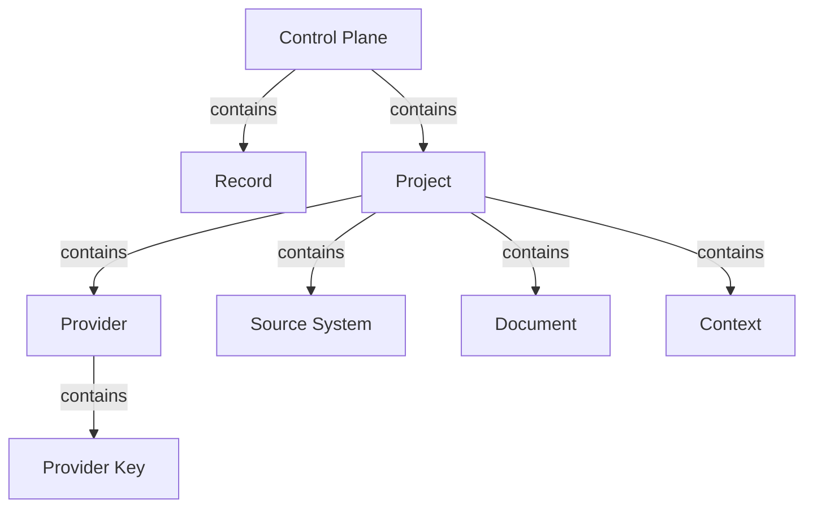
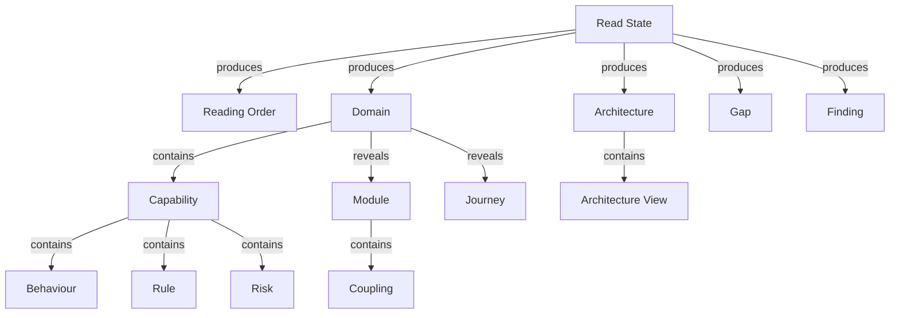
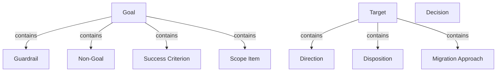
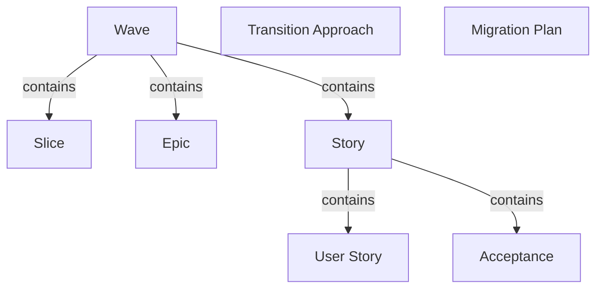
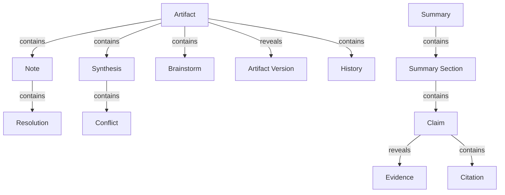

# Objects

Objects are the things the product stores, shows, or acts on - the nouns the platform is built around. This document lists all 58 of them, grouped into six families and, within each family, nested under the parent they belong to, so everything under (say) Goal sits together.

## How to read this document

- **term** - the one agreed word for the thing, in Title Case.
- **what it is** - a one-line plain-language definition.
- **relationship** - how this term sits under the parent it is listed under:
  - **contains** - the parent is the whole; this term is a part of it.
  - **reveals** - the parent opens on demand to show this term.
  - **produces** - the parent creates this term as it runs.
- **source** - the upstream document that defines it: **spec** (`mcp-spec-v4.md`), **req** (`mcp-requirements-v4.md`), or **both**.
- **decision** - if the term was contested during the harvest, a link to the register row that settled it; otherwise `-`.

The joined picture across all families is in [map.md](map.md).

## Families at a glance

| family | root terms | what it covers | source |
|---|---|---|---|
| Platform and Container | Control Plane, Project | the platform itself and the one effort everything lives in | both |
| Understanding | Read State, Domain, Architecture | what the read produces about the as-is system | both |
| Decisions and the To-Be | Goal, Target, Decision | why the modernization happens and where it is going | both |
| Plan | Wave, Migration Plan | the move sequenced into reversible units of work | both |
| Collaboration and Output | Artifact, Summary | how people shape the work and how it is delivered | both |
| Cross-Cutting | Surface, Block, Case, Linked Item | ideas that apply across every family | both |

---

## Platform and Container

The platform, and the single effort every other object lives inside.

### Control Plane
The thin platform that sits above the modernization work and owns the understanding, the decisions, and the record - not code editing or requirement authoring. *(source: spec)*

| term | what it is | relationship | source | decision |
|---|---|---|---|---|
| Record | the kept trace of the understanding and the decisions | contains | spec | - |
| Project | one modernization effort; the single container every other object lives in | contains | both | [D-19](decisions.md#d-19) |

### Project
One modernization effort; carries one provider and a name that locks after creation. *(source: both)*

| term | what it is | relationship | source | decision |
|---|---|---|---|---|
| Provider | the one AI provider that powers the read, set on the project one-to-one | contains | both | [D-4](decisions.md#d-4) |
| Source System | the legacy codebase under modernization, connected read-only and never edited | contains | both | [D-2](decisions.md#d-2) |
| Document | written material describing the system, marked as covering the whole system or one part | contains | both | [D-3](decisions.md#d-3) |
| Context | the engagement-wide home for documents and reference links that apply across the whole effort | contains | both | [D-3](decisions.md#d-3) |

### Provider
The one AI provider that powers the read. *(source: both)*

| term | what it is | relationship | source | decision |
|---|---|---|---|---|
| Provider Key | the provider's credential; optional at creation, and without it the project has no AI capability | contains | both | [D-4](decisions.md#d-4) |

---

## Understanding

What the read produces about the as-is system. Read State is the read itself; the rest is what it turns the source into.

### Read State
The read as an object: its progress, its held remainder, and its run state. *(source: spec)*

| term | what it is | relationship | source | decision |
|---|---|---|---|---|
| Reading Order | the defensible, dependency-aware order to read the sources in | produces | both | - |
| Domain | an area of the as-is system organised by business capability | produces | both | [D-11](decisions.md#d-11) |
| Architecture | the system's architecture read fact by fact across its views (as-is, and target at Target) | produces | both | [D-11](decisions.md#d-11) |
| Gap | an as-is shortfall, ranked by severity, tagged by category, traced to evidence | produces | both | - |
| Finding | a cited item of understanding - a domain fact, a coupling, or a gap - openable to its evidence | produces | both | - |

### Domain
An area of the as-is system organised by business capability; groups capabilities and reveals journeys and modules. *(source: both)*

| term | what it is | relationship | source | decision |
|---|---|---|---|---|
| Capability | what a domain groups; carries behaviours, rules, and risks | contains | both | - |
| Module | part of a domain, carrying its dependencies and coupling | reveals | req | - |
| Journey | an end-to-end path a person completes through the system (as-is, reimagined at Target) | reveals | both | [D-11](decisions.md#d-11) |

### Capability
What a domain groups. *(source: both)*

| term | what it is | relationship | source | decision |
|---|---|---|---|---|
| Behaviour | a capability's action, each traced to a place in the source | contains | both | - |
| Rule | a capability's rule, marked sound, defect, or gap | contains | both | - |
| Risk | a capability's identified risk | contains | spec | - |

### Module
Part of a domain, carrying its dependencies and coupling. *(source: req)*

| term | what it is | relationship | source | decision |
|---|---|---|---|---|
| Coupling | how tightly modules or domains are connected | contains | req | - |

### Architecture
The system's architecture read fact by fact across its views. *(source: both)*

| term | what it is | relationship | source | decision |
|---|---|---|---|---|
| Architecture View | one view of the architecture (functional, context, deployment, and the rest) | contains | both | - |

---

## Decisions and the To-Be

Why the modernization is happening, and where it is going.

### Goal
The recorded reasons for the modernization: drivers and outcomes, non-goals, and a named agreement, set before the read. *(source: both)*

| term | what it is | relationship | source | decision |
|---|---|---|---|---|
| Guardrail | a hard limit in the goal, carrying a standing of non-negotiable or must-have | contains | req | - |
| Non-Goal | an explicitly out-of-scope item recorded in the goal | contains | both | - |
| Success Criterion | a goal check carrying how it is measured and a named owner | contains | req | - |
| Scope Item | a goal item marked in or out with a reason | contains | req | - |

### Target
The recorded to-be: direction, target architecture, target domains, target journeys, and a recommended migration approach. *(source: both)*

| term | what it is | relationship | source | decision |
|---|---|---|---|---|
| Direction | the to-be direction that follows from, and cites, the goal | contains | both | - |
| Disposition | how a target domain is treated - a rewrite or lift-shift lean, provisional until decided in Plan | contains | both | - |
| Migration Approach | the recommended way to migrate, for consideration; the committed sequence is decided in Plan | contains | both | - |

### Decision *(no children)*
A recorded choice that shapes the architecture - the options weighed and the consequence to accept. *(source: both)*

---

## Plan

The move sequenced into reversible units of work.

### Wave
Slices sequenced in dependency order; the unit the move is committed as. *(source: both)*

| term | what it is | relationship | source | decision |
|---|---|---|---|---|
| Slice | the smallest piece of work that can be moved and turned back; carries a user story and acceptance | contains | spec | [D-7](decisions.md#d-7) |
| Epic | a wave's grouping of stories | contains | req | - |
| Story | a slice specified as a work item for the delivery team - its user story, acceptance, and detail | contains | both | [D-7](decisions.md#d-7) |

### Story
A slice specified as a work item for the delivery team. *(source: both)*

| term | what it is | relationship | source | decision |
|---|---|---|---|---|
| User Story | the "as a / I want / so that" statement a slice or story carries | contains | both | [D-7](decisions.md#d-7) |
| Acceptance | the "done when" conditions a story is complete against | contains | both | - |

### Other Plan terms *(no children)*

| term | what it is | relationship | source | decision |
|---|---|---|---|---|
| Transition Approach | the safe cutover - data migration, database strategy, rollout - for reference; the verdict lives in the waves | part of Plan | both | - |
| Migration Plan | the platform's terminal deliverable: an agreed, reversible sequence of work, handed off by one-way export | part of Plan | spec | - |

---

## Collaboration and Output

How people shape the work, and how it is delivered.

### Artifact
Any thing that carries the collaboration and evidence layers. *(source: both)*

| term | what it is | relationship | source | decision |
|---|---|---|---|---|
| Note | a reviewer's attributed, timestamped comment, anchored to a selection or the whole artifact | contains | both | [D-1](decisions.md#d-1) |
| Synthesis | a derived reading of an artifact's open notes - a summary, per-point recommendations, and any conflict | contains | spec | [D-8](decisions.md#d-8) |
| Brainstorm | a chat forked from a selection to think a point through; registers nothing until promoted to a note | contains | spec | - |
| Artifact Version | a retained, switchable regeneration of an artifact's findings | reveals | both | - |
| History | the append-only per-artifact record of every note, resolution, edit, synthesis, and Linked Item update | contains | both | [D-12](decisions.md#d-12) |

### Note
A reviewer's attributed, timestamped comment. *(source: both)*

| term | what it is | relationship | source | decision |
|---|---|---|---|---|
| Resolution | the recorded outcome of resolving one note, or a cumulative resolution over several | contains | both | - |

### Synthesis
A derived reading of an artifact's open notes. *(source: spec)*

| term | what it is | relationship | source | decision |
|---|---|---|---|---|
| Conflict | two notes proposing opposing actions on the same subject, surfaced for a human decision | contains | both | [D-9](decisions.md#d-9) |

### Summary
The single assembled, client-facing deliverable, built from settled work into typed sections, never authored fresh. *(source: both)*

| term | what it is | relationship | source | decision |
|---|---|---|---|---|
| Summary Section | a typed unit of the summary - a view onto a settled artifact, declaring its backing, type, currency, and evidence links | contains | spec | [D-16](decisions.md#d-16) |

### Summary Section
A typed unit of the summary. *(source: spec)*

| term | what it is | relationship | source | decision |
|---|---|---|---|---|
| Claim | an assertion on a surface that must trace to its evidence; a summary claim carries a kind | contains | both | - |

### Claim
An assertion that must trace to its evidence. *(source: both)*

| term | what it is | relationship | source | decision |
|---|---|---|---|---|
| Evidence | the verified detail a claim rests on, disclosed on demand from the claim, two-way with the summary | reveals | both | - |
| Citation | the cite chip shown beneath a claim at rest, opening to its evidence | contains | req | - |

---

## Cross-Cutting

Ideas that apply across every family and belong to no single parent.

| term | what it is | source | decision |
|---|---|---|---|
| Surface | a view onto the objects, defined by its purpose, inputs and outputs, and how people collaborate on it | spec | - |
| Block | a case-driven unit a step produces (a section, domain, view, wave, or story), shown only when it has real content | req | [D-16](decisions.md#d-16) |
| Case | the specific system being modernized and what the read and the team actually found for it | req | - |
| Linked Item | a platform object a change re-checks and updates (capability, journey, decision, slice) | both | [D-13](decisions.md#d-13) |
| Headline Number | a roll-up figure that must re-derive from the rows beneath it | both | - |

---

## Related pages

| page | why it relates |
|---|---|
| [map.md](map.md) | the whole hierarchy and flow in one picture |
| [states.md](states.md) | the conditions these objects can be in |
| [steps.md](steps.md) | the stages of work that produce them |
