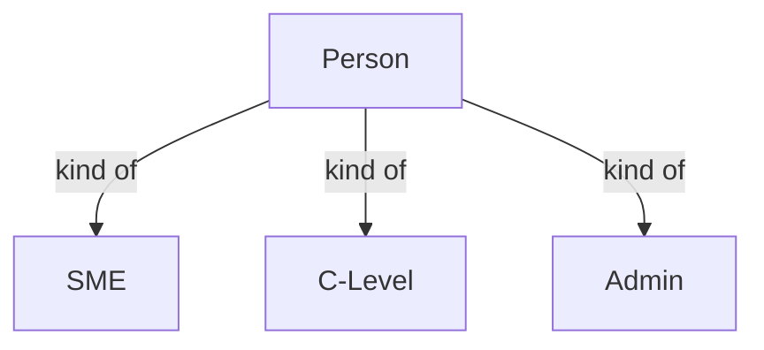

# Roles

A role is a kind of person the platform serves or records. There are six terms here. The key idea: everyone is a Person; a Persona is a lens that changes only where a person lands and what they emphasise - never what they can see (there is no access control in the MVP).

## How to read this document

- **term** - the kind of person, in Title Case.
- **what it is** - a one-line plain-language definition.
- **persona or role** - Persona = a lens on the same artifacts (SME, C-Level); Role = a setup/access label (Admin). SME and C-Level are both; Admin is a role only.
- **source** - the upstream document that defines it: **spec**, **req**, or **both**.
- **decision** - a link to the register row if the term was contested; otherwise `-`.
- In the diagram, **kind of** means the parent is the category and the child a member.

## Who is who

**Verbatim.**

| A | relationship | B |
|---|---|---|
| Person | kind of | SME |
| Person | kind of | C-Level |
| Person | kind of | Admin |

Where they land: SME starts at Goal (step 1); C-Level comes in at the Summary.

## The terms

| term | what it is | persona or role | source | decision |
|---|---|---|---|---|
| Person | the general, attributable actor; everything the platform records traces to a named person | - | both | [D-5](decisions.md#d-5) |
| SME | the practitioner - specifiers, builders, designers, architects who do the work, from Goal to Plan | persona (and role) | both | - |
| C-Level | the overseer - delivery and client leadership who oversee from above and come in at the Summary (also written C-Level (CX)) | persona (and role) | both | - |
| Admin | a setup and access role, not a persona; held alongside SME or C-Level by whoever sets the system up | role only | both | - |
| Delivery Team | those who execute the handed-off plan; outside the platform's boundary | - | both | - |
| Persona | a lens on the same artifacts (SME or C-Level) that changes landing and emphasis only, never what a person can see | - | both | - |

## Related pages

| page | why it relates |
|---|---|
| [steps.md](steps.md) | the stages each persona lands in and works through |
| [decisions.md](decisions.md) | why Person was chosen over user, reviewer, and member |
