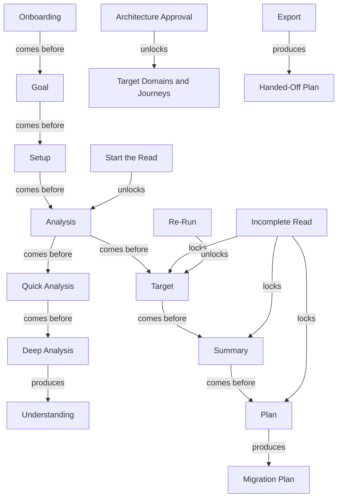
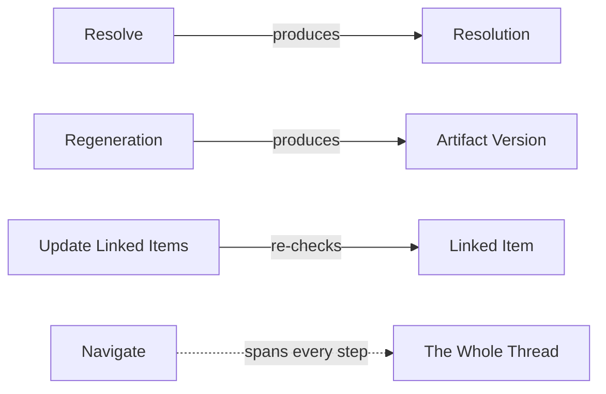

# Steps

Steps are the named stages of the work - the path an effort walks from start to hand-off. This document holds the whole flow: the forward thread and its gates, the supporting actions that happen along the way, and a definition for every step term. Steps are grouped by the thread, not by the six families, because the thread is their structure.

## How to read this document

- **term** - the one agreed word for the stage or action, in Title Case.
- Steps relate to each other by **flow**, not by nesting:
  - **comes before** - the first runs, then the second.
  - **produces** - the first creates the second.
  - **locks / unlocks** - the first controls whether the second can happen.
  - **re-checks** - the first re-examines and updates the second.
- **source** - the upstream document that defines it: **spec**, **req**, or **both**.
- **decision** - a link to the register row if the term was contested; otherwise `-`.

> Note: Goal, Target, and Summary appear here as **stages** and also in [objects.md](objects.md) as the **records** those stages produce - same word, split by where it lives (see [D-11](decisions.md#d-11)). The document you are in tells you which is meant.

## The forward thread

The full flow: the spine, the two analysis passes, and the gates that lock or unlock it.

**Verbatim.** Every flow link, including the gates.

| A | relationship | B |
|---|---|---|
| Onboarding | comes before | Goal |
| Goal | comes before | Setup |
| Setup | comes before | Analysis |
| Analysis | comes before | Quick Analysis |
| Quick Analysis | comes before | Deep Analysis |
| Deep Analysis | produces | Understanding (Domain, Architecture, Journey, Gap) |
| Analysis | comes before | Target |
| Target | comes before | Summary |
| Summary | comes before | Plan |
| Plan | produces | Migration Plan |
| Start the Read | unlocks | Analysis |
| Architecture Approval | unlocks | Target Domains and Journeys |
| Incomplete Read | locks | Target |
| Incomplete Read | locks | Summary |
| Incomplete Read | locks | Plan |
| Re-Run | unlocks | Target, Summary, Plan |
| Export | produces | Handed-Off Plan |

## Supporting actions

These happen on artifacts throughout the thread, not at one step, so they sit off the spine.

**Verbatim.**

| action | relationship | result |
|---|---|---|
| Resolve | produces | Resolution |
| Regeneration | produces | Artifact Version |
| Update Linked Items | re-checks | Linked Item |
| Navigate | spans | every step |

## The seven steps, in order

| term | what it is | hands off | source | decision |
|---|---|---|---|---|
| Onboarding | establish who is acting and set up the project, before the thread begins | an identified person and an open project | both | - |
| Goal | record why the modernization is happening, before the read | the agreed intent the later steps steer toward | both | [D-11](decisions.md#d-11) |
| Setup | bring the system in and set up the read on a complete, attributed footing | a connected, attributed source base | both | - |
| Analysis | understand the as-is in two passes - quick then deep | the verified as-is baseline | both | - |
| Target | decide and agree where the system is going, against the baseline | the agreed to-be the plan is held to | both | [D-11](decisions.md#d-11) |
| Summary | assemble the understanding and decisions into one client-facing deliverable | a single assembled account, kept current | both | [D-11](decisions.md#d-11) |
| Plan | turn the agreed target into a sequenced, reversible order of waves and slices | the terminal deliverable, ready to hand off | both | - |

## The two passes and the read controls

| term | what it is | relationship | source | decision |
|---|---|---|---|---|
| Quick Analysis | the first pass: a steerable scan that ends in a reading order and triggers the deep read | comes before Deep Analysis | both | [D-6](decisions.md#d-6) |
| Deep Analysis | the second pass: reads a source in depth and presents the verified understanding | produces the understanding | both | [D-6](decisions.md#d-6) |
| The Read | the AI reading the source (analysis); in scope, distinct from the deferred delivery/run | comes before Target | both | - |
| Start the Read | the single deliberate action that moves the effort to Analysis, once a source is attached | unlocks Analysis | both | - |
| Re-Run | resume or restart a stopped or partial read so the downstream can unlock | unlocks Target, Summary, Plan | both | - |

## Supporting actions and gates

| term | what it is | relationship | source | decision |
|---|---|---|---|---|
| Architecture Approval | approving the target architecture view by view; the one approval, and what agreeing the target means | unlocks Target Domains and Journeys | both | [D-18](decisions.md#d-18) |
| Resolve | close a note singly or several as one cumulative resolution; a resolved note can be reopened | produces a Resolution | both | - |
| Regeneration | rebuild an artifact's findings from resolved notes into a new, retained version | produces an Artifact Version | both | - |
| Update Linked Items | re-check a change's impact across the platform's own linked objects and update what it affects | re-checks Linked Item | both | [D-13](decisions.md#d-13) |
| Export | send a settled artifact out of the platform, one-way, with nothing pulled back | produces the Handed-Off Plan | both | - |
| Navigate | move among the steps and always know where you are within the effort | spans every step | both | - |

## Related pages

| page | why it relates |
|---|---|
| [map.md](map.md) | the object hierarchy the steps produce |
| [objects.md](objects.md) | the things each step produces, defined in full |
