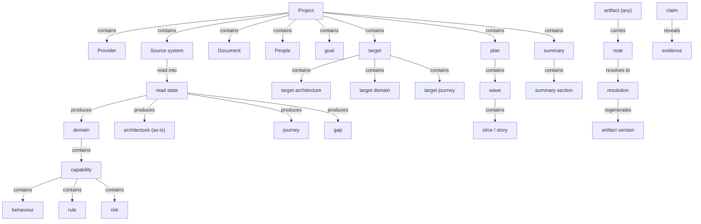
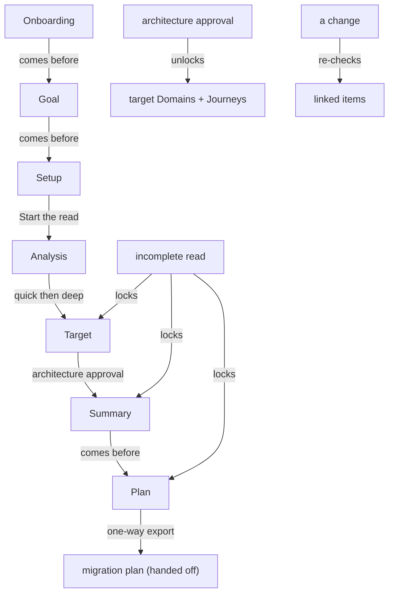

# Assembled draft - Modernization Control Plane glossary

> Source: `mcp-spec-v4.md` + `mcp-requirements-v4.md`. Mode: **new build**.
> Sections joined on shared terms: product-model, inputs, understanding, decisions-and-plan, collaboration-and-output, personas, surfaces-and-navigation, governance-gating.
> Join points (terms owned in one section, referenced across others): Project, Source system, domain, architecture, journey, Goal, Target, decision, slice, Summary, note, evidence, gate, person, block.

## Joined tree (the product's object model)

## Joined flow (the forward thread + gates)

## Whole-picture rule 1 - the three tests (qualifying)
Reach >= 2 sections carries the core product vocabulary. Proposed keep (kinds shown in the deliverable):
- **Objects:** Project, Provider, Source system, Document, Context, read state, reading order, domain, capability, behaviour, rule, risk, module, coupling, architecture, journey, gap, finding, goal, target, direction, decision, migration unit/slice, wave, epic, story, transition approach, note, synthesis, resolution, artifact version, history, summary, summary section, evidence, citation, claim, block, case, linked item, surface, control plane, migration plan
- **Roles:** SME, C-Level (CX), Admin, person, delivery team
- **Steps:** Onboarding, Goal, Setup, Analysis, quick analysis, deep analysis, the read, Target, Summary, Plan, export, regeneration, update linked items, architecture approval, navigate
- **States/values:** run state, baseline authority, fact status, rule quality, gap severity/category, disposition lean, journey change, guardrail standing, scope mark, story priority, note state, collaboration state, claim kind, health status, surface type, gate type, lock state, access model

**Borderline reach (raised at Gate 1):** entry point, station, hub, thread, emphasis, landing, account, engagement, headline number.

## Whole-picture rule 2 - the five conflict kinds (feeds Gate 1)

### (1) several words, one thing
- **note / comment** - spec object "Notes"; req section 9 "note"/"comment" interchangeably.
- **Source system / source / repository / Repo** - the codebase, four names.
- **Document / Context / reference material** - the written material, three names.
- **Provider / AI provider / provider key / the key / API** - provider config cluster.
- **People / team / team member / person / reviewer / user** - the actor cluster.
- **quick analysis / quick scan**; **deep analysis / deep read** - the two passes, two names each (spec vs req).
- **migration unit / slice / story / user story** - the unit of work.
- **history / record / append-only record**; **re-check / update linked items / impact propagation / ripple**.
- **thread / walk / forward thread**; **access control / RBAC**.

### (2) one word, two+ meanings
- **Goal / Target / Summary / Domains / Architecture / Analysis** - each is both a **step/surface** and an **object**.
- **synthesis** - note-synthesis vs **goal synthesis**.
- **conflict** - two opposing notes (product) vs a term-clash (method).
- **gate** - a person's decision checkpoint (method) vs a readiness lock (product gating).
- **source** - the codebase vs a claim's cited origin vs an entry's provenance.
- **section** - summary section / goal section vs a generic reading unit vs a doc section.
- **slice** - a migration slice vs the Goal's "first slice".
- **story** - a Plan work unit vs a "user story".
- **rule** - a capability's rule vs a business rule vs the method's own rule.
- **state / run state** - read run state vs note state vs surface run state vs health status.
- **role / persona** - SME & C-Level are both; Admin is a role, not a persona.

### (3) part vs whole
- **the read** (whole) vs **quick scan / deep read** (passes); **Analysis** (step) vs its two passes.
- **summary** (deliverable) vs **summary section**; **goal** vs **goal section**.
- **Plan** vs **wave / epic / story / slice**; **migration unit** vs **slice**.
- **domain** vs **capability / behaviour / rule / risk / module**.

### (4) collides with our own working words (method vs product)
- **section** - method's reading unit vs product's Goal/Summary "section".
- **module** - product "module" vs method's "section/module".
- **gate** - method's decision gate vs product's gating.
- **evidence** - product Evidence vs method's evidence quote.
- **conflict** - product conflict vs method conflict.

### (5) drift between the two documents
- **note (spec) vs comment (req)**; **Source system (spec) vs repository (req)**.
- **slice (spec) vs story (req)** as the atomic unit of work.
- **held as unknown (spec/Analysis) vs open question (Evidence section 10.3)** vs **open item (claim kind)**.
- run states: **complete (spec) vs resumed/restarted/incomplete (req)**.
- **Summary "typed sections" (spec) vs "blocks" (req section 11)**.

## Whole-picture rule 3 - weak-word recommendations (committed)
- comment -> **note**; repository / Repo / source -> **Source system**; reference material -> **Document** (with `Context` reserved for engagement-wide placement).
- team / member / user -> **person** (role stays `SME`/`C-Level`/`Admin`); reviewer -> **person**.
- quick scan -> **quick analysis**; deep read -> **deep analysis**.
- ripple / impact propagation -> **re-check** (verb: **update linked items**).
- record / append-only record -> **history**; RBAC -> **access control**.
- open question / open item -> **held as unknown** (one honest not-known label).
- story vs slice: keep **slice** as the movable/reversible unit; **story** = the user-story statement it carries.

*Scope note:* harvested the product's vocabulary from both docs; illustrative example values (Confluence, Figma, specific counts) treated as illustration per req section 11 / Notes.
