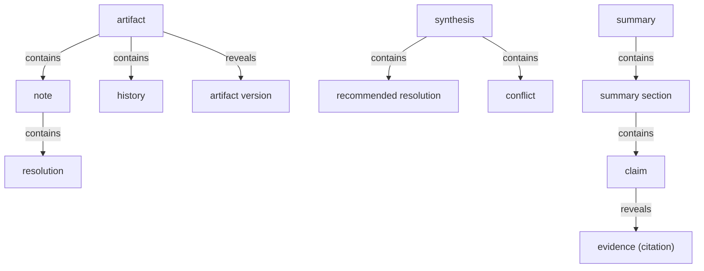
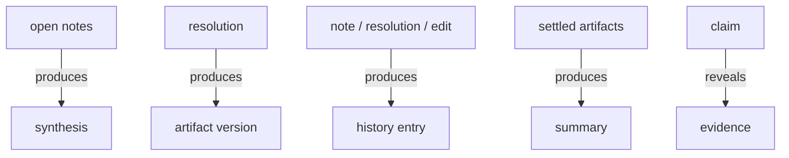

# Section draft - collaboration-and-output

> Source: `mcp-spec-v4.md` section 2.5; `mcp-requirements-v4.md` section 6 (Summary), section 9 (Collaboration), section 10 (Evidence). Repeats marked `KNOWN`.

## Ontology - the things

### Objects
| # | Term | Meaning | Evidence | Re-scan |
|---|---|---|---|---|
| 1 | note | a reviewer's anchored, attributed comment | "Comments a reviewer anchors to a specific line or element of any artifact" | NEW = comment |
| 2 | comment | an attributed, timestamped note | "an attributed, timestamped note that can mention a team member" | NEW = note |
| 3 | synthesis | a derived reading of all open notes | "A **derived** reading of all open notes on an artifact" | NEW vs goal synthesis / roll-up |
| 4 | recommended resolution | a per-point resolution the synthesis proposes | "a **recommended resolution per point**" | NEW |
| 5 | conflict | two notes proposing opposing actions | "any **conflict** - two notes proposing opposing actions on the same subject" | NEW collides with method "conflict" |
| 6 | brainstorm | a forked chat to think a point through | "A chat forked from a text selection ('Chat about this')" | NEW = chat / copilot |
| 7 | resolution | the recorded outcome of resolving note(s) | "The recorded outcome of resolving one note, or a single **cumulative resolution**" | NEW vs resolved state |
| 8 | artifact version | a retained, switchable regeneration of an artifact | "each regeneration produces a new **version** ... retained and switchable" | NEW |
| 9 | history | the append-only per-artifact record | "The **append-only** record, per artifact, of every note, resolution, edit..." | NEW = record |
| 10 | summary | the single assembled, client-facing deliverable | "The single client-facing deliverable, **assembled** ... into typed **sections**" | KNOWN = Summary step / proposal.html |
| 11 | evidence | the verified detail behind a claim, on demand | "The verified detail every claim rests on ... a **drawer opened from a claim**" | KNOWN layer vs citation |
| 12 | citation | a cite chip beneath a claim at rest | "inline citation at rest (a cite chip beneath a claim)" | NEW |
| 13 | claim | a summary section's assertion, carrying a kind | "Its claims carry a **kind**" | KNOWN |
| 14 | summary section | a typed view onto a settled artifact | "A typed unit of the Summary: a **view onto a settled artifact**" | KNOWN |
| 15 | artifact | any thing that carries Collaboration/Evidence | "on any artifact that carries the Collaboration layer" | KNOWN |

### Roles
| # | Term | Meaning | Evidence | Re-scan |
|---|---|---|---|---|
| 1 | reviewer | anyone who notes/resolves on an artifact | "**Created by:** any reviewer" | NEW = person / user / People |
| 2 | overseer | the C-Level who reviews the summary | "the overseer reviews the assembled summary" | KNOWN (persona) |

### Steps
| # | Term | Meaning | Evidence | Re-scan |
|---|---|---|---|---|
| 1 | Summary | assemble the deliverable from settled work | "assemble the understanding and decisions into one client-facing deliverable" | KNOWN |
| 2 | resolve | close a note singly or as a batch | "**resolution** of notes singly or as one cumulative batch" | NEW |
| 3 | regeneration | rebuild an artifact's findings from resolved notes | "**regeneration** of the artifact from resolved notes into a new ... version" | NEW |
| 4 | export | send the deliverable out, one-way | "exported one-way" | KNOWN |

### States & values
| # | Term | Values | Evidence | Re-scan |
|---|---|---|---|---|
| 1 | note state | open, resolved, reopened | "a **state** - open -> resolved -> reopened" | NEW |
| 2 | collaboration state | Locked, Empty, Comments, AI synthesis, History | "Locked ... Empty ... Comments ... AI synthesis ... and History" | NEW |
| 3 | claim kind | measured fact, diagnosis, decision, guarantee, estimate, open item | "measured fact, diagnosis, decision, guarantee, estimate, or open item" | NEW |
| 4 | section currency | up to date, out of date | "whether it is **up to date** with that artifact" | NEW |
| 5 | version retention | retained, switchable | "Prior versions are **retained and switchable**" | NEW |

**Dropped (why):** `proposal.html` (file name - mechanism); `drawer` / `rail` / `pane` / `cite chip` layout (UI mechanism, though "citation" kept as the concept); "Chat about this" (button label).

## Topology - the tree

**Verbatim**

| Parent (A) | relationship | Child (B) | Evidence |
|---|---|---|---|
| artifact | contains | - note - history | "any artifact that carries the Collaboration layer"; "History ... per artifact" |
| synthesis | contains | - recommended resolution - conflict | "a recommended resolution per point, and any conflict" |
| note | contains | resolution | "when resolved, a **resolution**" |
| summary | contains | summary section | "assembled ... into typed **sections**" |
| summary section | contains | - claim - evidence links | "Its claims carry a **kind** ... its **evidence links**" |
| claim | reveals | evidence (citation) | "disclosed as a **drawer opened from a claim**" |
| artifact | reveals | artifact version | "each regeneration produces a new **version**" |

**Mermaid**

## Choreography - states & gates

**States**

| Thing | States | Evidence |
|---|---|---|
| note | - open - resolved - reopened | "open -> resolved -> reopened" |
| collaboration pane | - Locked - Empty - Comments - AI synthesis - History | "Locked ... Empty ... Comments ... AI synthesis ... History" |
| summary section | - up to date - out of date | "whether it is **up to date** with that artifact" |

**Gates (verbatim)**

| A | relationship | B | Evidence |
|---|---|---|---|
| open notes | produces | synthesis | "Synthesis is recomputed from the open notes" |
| resolution | produces | artifact version (regeneration) | "Resolving notes can **regenerate** an artifact's findings; each regeneration produces a new version" |
| note/resolution/edit | produces | history entry | "written to **History**" |
| settled artifacts | produces | summary (assembled) | "**assembled** from the understanding and decisions" |
| claim | reveals | evidence (two-way) | "**Evidence and Summary are two-way**" |

**Mermaid**

## Conflict flags (for Gate 1)
- **note vs comment** (drift spec↔req): spec's object is `Note`; req section 9 uses `note` and `comment` interchangeably.
- **synthesis overloaded:** `synthesis` (derived reading of notes) vs `goal synthesis` (the goal record) - one word, two meanings.
- **conflict collides:** product `conflict` (two opposing notes) vs the method's own `conflict` (term clash).
- `resolution` (object/outcome) vs `resolved` (note state) vs `recommended resolution` - narrow.
- `history` vs `record` vs `append-only record` - one thing, three labels.
- `summary` (deliverable) vs `Summary` (step) vs `proposal.html`; `evidence` (layer) vs `citation` vs a finding's `evidence`.
- **actor cluster:** `reviewer` / `person` / `user` / `team member` / `People` - one actor word.
- "not settled" cluster: `open item` (claim kind) / `open question` (Evidence) / `held as unknown` (Analysis).
