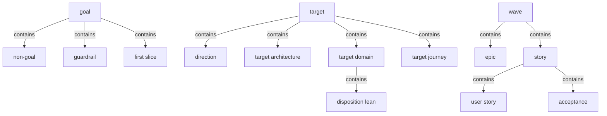
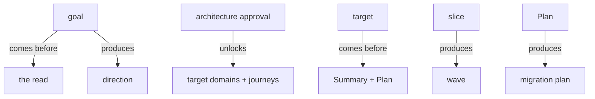

# Section draft - decisions-and-plan

> Source: `mcp-spec-v4.md` section 2.4; `mcp-requirements-v4.md` section 2 (Goal), section 5 (Target), section 7 (Plan). Repeats marked `KNOWN`.

## Ontology - the things

### Objects
| # | Term | Meaning | Evidence | Re-scan |
|---|---|---|---|---|
| 1 | goal | recorded reasons: drivers, outcomes, non-goals, agreement | "The recorded reasons for the modernization: the **drivers and outcomes**, the **non-goals**, and a **named agreement**" | NEW = Goal step / goal synthesis / intent |
| 2 | goal synthesis | the signed, sectioned goal record | "the **goal synthesis** (result) holds them as a signed, sectioned record" | NEW cluster |
| 3 | driver / outcome | why the modernization is happening | "the **drivers and outcomes**" | NEW |
| 4 | non-goal | what is explicitly out of scope | "the **non-goals**" | NEW |
| 5 | guardrail | a hard limit carrying a standing | "each guardrail carries a standing" | NEW |
| 6 | success criterion | a measured, owned goal check | "each criterion carries how it is measured and a named owner" | NEW |
| 7 | scope item | a goal item marked In or Out with a reason | "each item is marked In or Out with a reason" | NEW |
| 8 | first slice | the first capability worth proving | "the first capability worth proving" / "First slice" | NEW collides with migration slice |
| 9 | target | the recorded to-be | "The recorded to-be: the **direction** ... the **target architecture** ..." | NEW = Target step / to-be |
| 10 | direction | the to-be direction following from the goal | "the **direction** that follows from the Goal" | NEW |
| 11 | target architecture | the approved to-be architecture | "the **target architecture**" | NEW vs as-is architecture |
| 12 | target domain | a to-be domain with a disposition lean | "the **target domains** each with a **disposition lean**" | NEW vs as-is domain |
| 13 | target journey | a to-be journey measured against today | "the **target journeys** measured against today" | NEW vs as-is journey |
| 14 | disposition | how a domain is treated (rewrite / lift-shift) | "a **disposition lean** (rewrite or lift-shift)" | NEW |
| 15 | migration approach | the recommended way to migrate, for consideration | "the **recommended migration approach** put forward for consideration" | NEW |
| 16 | decision | a recorded choice: options weighed + consequence | "each recorded with the **options weighed** and the **consequence to accept**" | KNOWN |
| 17 | migration unit | the work carved into slices | "The work carved into **slices**" | NEW = slice |
| 18 | slice | smallest movable, reversible piece of work | "the smallest pieces that can be moved and ... **turned back**" | NEW = story / work unit |
| 19 | wave | slices sequenced in dependency order | "slices are sequenced into **waves** in dependency order" | NEW |
| 20 | epic | a wave's grouping of stories | "A wave breaks into epics and stories" | NEW |
| 21 | story | a unit of work carrying a user story + acceptance | "each story carrying a priority ... and a status" | NEW = slice / user story |
| 22 | user story | the story statement a slice/story carries | "Each slice carries a user story" | NEW cluster |
| 23 | acceptance | the "done when" for a story | "its 'done when' acceptance" | NEW |
| 24 | transition approach | data migration + database strategy + rollout | "The **transition approach** - data migration, database strategy, rollout" | NEW |
| 25 | summary section | a typed view onto a settled artifact | "A typed unit of the Summary: a **view onto a settled artifact**" | NEW owned with Summary (collab-output) |

### Roles
| # | Term | Meaning | Evidence | Re-scan |
|---|---|---|---|---|
| - | None. | roles are in personas | - | - |

### Steps
| # | Term | Meaning | Evidence | Re-scan |
|---|---|---|---|---|
| 1 | Goal | record why, before the read | "record why the modernization is happening, before the read" | KNOWN |
| 2 | Target | set + agree the to-be | "decides and agrees where the system is going" | KNOWN |
| 3 | Plan | sequence the move into waves and slices | "turns the agreed target into a sequenced, reversible order of delivery" | KNOWN |
| 4 | architecture approval | approving the target architecture = agreeing the target | "Approving the architecture is the target's agreement" | NEW agreement cluster |

### States & values
| # | Term | Values | Evidence | Re-scan |
|---|---|---|---|---|
| 1 | disposition lean | rewrite, lift-shift | "a disposition lean (rewrite or lift-shift)" | NEW |
| 2 | journey change | changed, new, unchanged | "marked changed, new, or unchanged" | NEW |
| 3 | guardrail standing | Non-negotiable, Must-have | "a standing of Non-negotiable or Must-have" | NEW |
| 4 | scope mark | In, Out | "marked In or Out with a reason" | NEW |
| 5 | story priority | Blocker, High, Medium, Low | "a priority (Blocker, High, Medium, Low)" | NEW vs requirement priority (Must/Should/Could) |
| 6 | migration approach option | big-bang, incremental, phased by domain | "big-bang, incremental, phased by domain" | NEW |

## Topology - the tree

**Verbatim**

| Parent (A) | relationship | Child (B) | Evidence |
|---|---|---|---|
| goal | contains | - driver/outcome - non-goal - guardrail - success criterion - scope item - first slice | "the drivers and outcomes, the non-goals, and a named agreement"; "Vision, Business outcomes... Guardrails... First slice" |
| target | contains | - direction - target architecture - target domain - target journey - migration approach | "the direction ... the target architecture, the target domains ..., the target journeys ..., and the recommended migration approach" |
| target domain | contains | disposition lean | "each with a **disposition lean**" |
| migration unit | contains | slice | "The work carved into **slices**" |
| wave | contains | - epic - story | "A wave breaks into epics and stories" |
| story | contains | - user story - acceptance | "each story carrying a user story and clear acceptance" |
| transition approach | contains | - data migration - database strategy - rollout | "data migration, database strategy, rollout" |

**Mermaid**

## Choreography - states & gates

**States**

| Thing | States | Evidence |
|---|---|---|
| target domain | - rewrite lean - lift-shift lean | "a rewrite or lift-shift lean ... marked provisional" |
| target journey | - changed - new - unchanged | "marked changed, new, or unchanged" |
| story | - priority: Blocker/High/Medium/Low - a status | "a priority (Blocker, High, Medium, Low) and a status" |

**Gates (verbatim)**

| A | relationship | B | Evidence |
|---|---|---|---|
| goal | comes before | the read | "set before the read so the target and plan can steer toward it" |
| goal | produces | direction | "the direction that follows from the Goal" |
| architecture approval | unlocks | target domains + target journeys | "it **unlocks the Domains and Journeys surfaces** (held until then)" |
| target | comes before | Summary + Plan | "It steers the Summary and the Plan" |
| slice | produces | wave (sequenced) | "slices are sequenced into **waves**" |
| moving a story | locks | breaking move (until confirmed) | "a breaking move is warned ... before it is confirmed" |
| Plan | produces | migration plan (terminal) | "The terminal deliverable of the platform" |

**Mermaid**

## Conflict flags (for Gate 1)
- **unit-of-work cluster (drift spec↔req):** `migration unit` / `slice` (spec) vs `story` / `user story` (req) vs `epic` - what is the atomic movable unit called?
- `goal` (record) vs `Goal` (step) vs `goal synthesis` vs `intent` / `intake`; same shape for `target` / `Target` / `to-be`.
- `first slice` (a Goal capability) vs `slice` (a Plan migration unit) - one word, two things.
- `disposition` / `disposition lean` / `disposition verdict` (provisional at Target, decided at Plan) - narrow.
- **two priority scales:** story priority `Blocker/High/Medium/Low` vs requirement priority `Must/Should/Could`.
- `summary section` vs `block` vs `section` - the unit-of-assembly cluster (see collaboration-and-output).
- agreement cluster: `agreement` / `architecture approval` / `agree` / `sign-off` (absent on deliverable).
